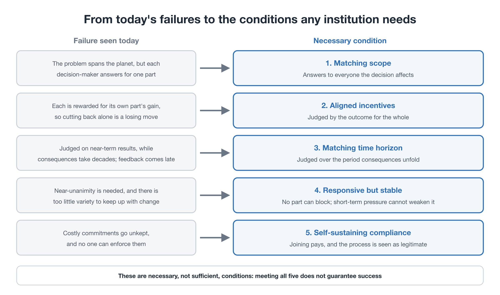
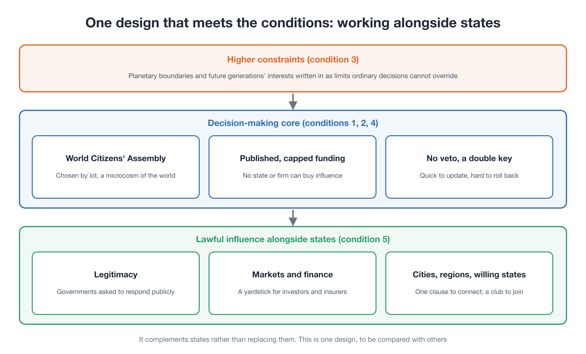

# Building Another World Politics
### Why is there no institution that makes policy for the world as a whole?

**Background essay** — Second edition (working draft, October 2026)

---

Advanced AI, climate change, pandemics, nuclear weapons, food, and energy. Many of the most important problems we face can no longer be contained within one country. Yet the basic unit of our politics is still the nation-state.

International cooperation exists, of course. Governments negotiate, sign treaties, and work through the UN and many other bodies. But a simple question remains:

**For problems that concern the whole world, who develops policy options from the standpoint of the world as a whole?**

This essay explores that question. It is not a call to abolish the UN or to reject the state. It asks whether we could build, beside inter-state politics, **another political circuit**: one through which world citizens think about policy, develop options, test them, and judge them.

---

## 1. Not only a shortage of cooperation

When a country negotiates internationally, its government acts for its own security, economy, jobs, and voters. That is its job. The difficulty is that even when no one acts in bad faith, decisions that are reasonable for each country can add up to an outcome that is bad for everyone. Wherever moving first means falling behind, everyone waits.

Imagine a country with no national parliament, where defence and the national budget were decided only by a meeting of its regional governors. Each would put their own region first: more subsidies for us, the costs for our neighbours. No one would answer for the country as a whole. The world today works in much the same way: the climate, AI, and global capital behave as one connected planet, yet decisions about them are made by negotiation among about 200 states.

The logic can be stated precisely. If other countries cut back, a country that does not enjoys the benefit without paying; if others do not, a country that cuts back alone pays the cost and still cannot prevent the damage. Whatever the others do, holding back pays more, and when every country reasons this way, all end up worse off. Game theorists call this a prisoner's dilemma. It is the simplest form of the problem, and changing the payoffs, through clubs and rewards for cutting back, can change the outcome. But without such changes, the logic holds.

More cooperation would help. But the problem is not only the *amount* of cooperation. It is also that **no one is responsible for thinking, from the standpoint of the world as a whole**, about what to aim for, what the options are, and what each would bring.

Universities, think tanks, and international bodies do excellent work on global problems. But each works within its own mandate: a government institute answers to a state, a company to its business, a university to its funding and disciplines. What is missing is not goodwill, but **an institution whose role is to design policy for the world as a whole from the standpoint of world citizens**.

## 2. The politics of making options

We usually think of democracy as deciding: electing representatives, debating bills, voting. But before any decision, someone decides **which options are on the table**.

If citizens choose between policies A, B, and C, the choice looks democratic. But who drew up those three, why those three, and what was left out? **Making options is also part of democracy**, and on global questions it is the part that hardly exists.

## 3. A strange circle

Global policies seem politically impossible, so they are not designed in detail. Because no detailed designs exist, they look unrealistic. Because they look unrealistic, no one designs them.

> "Too difficult to research" → "no concrete designs" → "no realistic proposals" → "too difficult"

To break this circle, we first need to **design what such institutions could look like**, before handing the question of whether they are possible to inter-state negotiation.

## 4. Another circuit, beside states

The idea is not a world government. It is to keep states as they are, and to add a circuit beside them:

1. world citizens raise a problem
2. citizens selected to reflect society deliberate, with information from experts
3. an independent policy institute designs several options and compares their costs, effects, risks, regional impacts, and impacts on future generations
4. where possible, options are tried in small pilots
5. citizens review the results and revise the proposals
6. when it is time to turn them into treaties and institutions, states and international bodies take over

Inter-state negotiation does not disappear. **World policy-making simply stops depending on it alone.**

## 5. What any such institution needs

Before describing any particular design, it helps to ask what *any* institution would need in order not to fail in the same ways. Each failure, turned around, gives a necessary condition.

| Failure seen today | Necessary condition |
|---|---|
| The problem spans the planet, but each decision-maker answers for one part of it | **1. Matching scope:** decision-makers answer to everyone the decision affects |
| Each is rewarded for its own part's gain, so cutting back alone is a losing move | **2. Aligned incentives:** they are judged by the outcome for the whole |
| Leaders are judged on near-term results, while consequences unfold over decades | **3. Matching time horizon:** decisions are judged over the period their consequences unfold |
| Agreements need near-unanimity, so the whole moves at the pace of its most reluctant member | **4. Responsive but stable:** no single part can block, rules can be updated as evidence changes, yet short-term pressure cannot weaken them |
| Commitments that are costly to keep go unkept, and no one can enforce them | **5. Self-sustaining compliance:** joining and complying pays more than staying out, and the process is widely seen as legitimate |

<figure markdown="span">
  
  <figcaption>From today's failures to the conditions any institution needs</figcaption>
</figure>

Two ideas from systems theory support conditions 3 and 4. The cybernetician W. Ross Ashby showed that a regulator can keep a system under control only if it has at least as much variety, as many ways of responding, as the disturbances it must counter (the law of requisite variety). A system that can respond only in ways about 200 governments all accept has far too little. And control theory adds that if one full round of the feedback loop, noticing the state, deciding, acting, and the action taking effect, takes longer than the changes it is meant to correct, feedback cannot correct them. In politics today, problems are often noticed only once damage is visible, agreement takes years, and implementation takes more. On top of that, emissions cut today take decades to show up in the climate. If this total delay is longer than the time left before a tipping point is crossed, the response comes too late. And because a tipping point cannot be undone once crossed, the usual way feedback corrects an overshoot, going too far and then coming back, is not available. Condition 1, for its part, is a basic principle of democracy, the all-affected principle: those significantly affected by a decision should have a say in it.

These conditions are necessary, not sufficient. Meeting all five does not guarantee success, but an institution that misses one will tend to fail in the corresponding way. Today's system of agreements among states is weak on all five at once, which is why better negotiators alone cannot fix it.

The institutions described next are one design intended to meet these conditions. Other designs are possible, and they should be compared.

<figure markdown="span">
  
  <figcaption>One design that meets the conditions: working alongside states</figcaption>
</figure>

## 6. Three institutions, kept separate

| Institution | Role |
|---|---|
| **World Citizens' Assembly** | Citizens from different regions, cultures, incomes, and generations deliberate and make value judgments. Experts inform; citizens decide what to prioritize and which risks to accept |
| **World Policy Institute** | Designs several workable options for each problem, never a single right answer, and makes their consequences comparable |
| **World Policy Laboratory** | Tests options in practice, compares them across regions, and publishes failures as well as successes |

Beyond them stand states and international bodies, which turn the results into international institutions.

The greatest danger in such a system is that one body comes to define "the world's interest" on its own. So the roles are kept separate: **citizens judge values, experts set out facts and possibilities, researchers design options, testing checks them against reality, and states implement them.** This is neither rule by experts nor rule by AI. It is a way of building expert knowledge into democracy.

## 7. AI that extends democracy

For citizens to deliberate on global policy, they must handle a great deal of information across many languages. AI can help: translating, summarizing, simulating, mapping arguments, and comparing positions. It can serve as **cognitive infrastructure for world citizens**.

The point is not to hand decisions to AI. It is the opposite: to let more people make, with understanding, the value judgments that experts and AI cannot make for them. **AI should extend people's capacity to take part in democracy, not replace it.**

## 8. A clearer role for the UN

What happens to the UN? It does not disappear. Its role becomes clearer.

Until now, states negotiate first and look for what is possible. In this circuit, the order changes: world citizens deliberate, the institute designs options, the laboratory tests them, and **then** states and international bodies institutionalize them. The UN becomes not the *starting point* of world politics, but an essential **place of implementation and coordination** for policies that world citizens have formed.

## 9. Not waiting for the great powers

The great powers shape the world's institutions. That is a reality, and their cooperation matters. But if nothing can begin until they agree, no one begins designing what the world needs.

Small states, cities, researchers, and civil society can design institutions first, test them, and show that they work. Others can join later. What is needed is not **a politics that waits for the great powers**, but **something that moves ahead, somewhere in the world**.

## 10. Start small, and improve the system itself

Such a system cannot be completed on a global scale at once. It should start with a single concrete agenda, run the whole cycle once, and learn from it.

Within the package *Steering Within Limits*, the first agenda is **climate**: an international citizens' assembly compares Planetary OS with alternative designs. The next candidate is **AI governance**, an area where the need for shared rules across borders is equally clear.

AI also shows something larger: technologies and risks that cross borders will keep appearing, so we need not only rules for each problem, but **a lasting institution for thinking about global policy**.

What matters is not building a perfect system from the start, but **experimenting with the system itself and improving it**.

## 11. Hard questions

**"Who will comply with an institution that has no army?"** Hobbes wrote that covenants without the sword are but words. But armies cannot stop a climate tipping point or a runaway algorithm, and this institution does not try to compel. Much of today's world already runs on standards no army enforces, such as the technical standards of the internet, followed because using them is worth more than ignoring them.

**"Why should an unelected body be legitimate?"** By the all-affected principle, a system in which each country's policies are decided only by its own voters leaves most of the people affected by planetary decisions without a say. The circuit described here does not replace elected parliaments; it adds what elections alone cannot provide, and earns legitimacy through open procedures, independent audit, and published minority views.

**"If authoritarian governments bar their citizens, won't it become a club of the West?"** This is a real risk. At first, the assembly will not reach everyone. Standards that spread through trade and investment, participation by people living abroad, secure channels for anonymous participation, and an agenda kept to a minimal common ground can partly fill the gap. How to represent people whose governments forbid them to take part remains an open question, and one the assembly itself should take up.

## Closing: extending democracy to the planet

Democracy grew up inside nations. If our problems now cross borders, democracy may need, step by step, to cross them too.

That does not mean making everyone think alike. Cultures, histories, and living conditions differ. It means deliberating while keeping our differences, and making shared rules for the problems we must face together. **Building world citizens into an institution that forms global policy**, before inter-state negotiation begins, is the core of this idea.

The *Global Democratic Governance Charter* [→](charter.md) turns it into a concrete institutional design. Both are working hypotheses, published to be criticized, tested, and rewritten.

---

**Read more**

- Global Democratic Governance Charter [→](charter.md)
- Proposal A: Youth GCC [→](../proposals/a-youth-gcc.md)
- Essay: *Why Now?* [→](../why-now.md)

---

This document is also published on: [note (Japanese)](https://note.com/ttmori/n/ndd3b106dbf1c)
