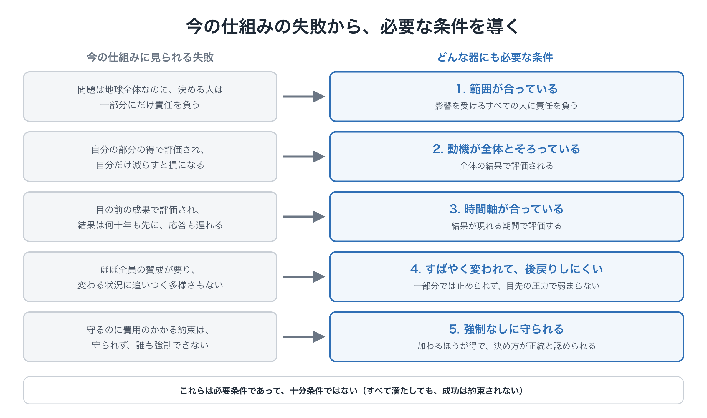
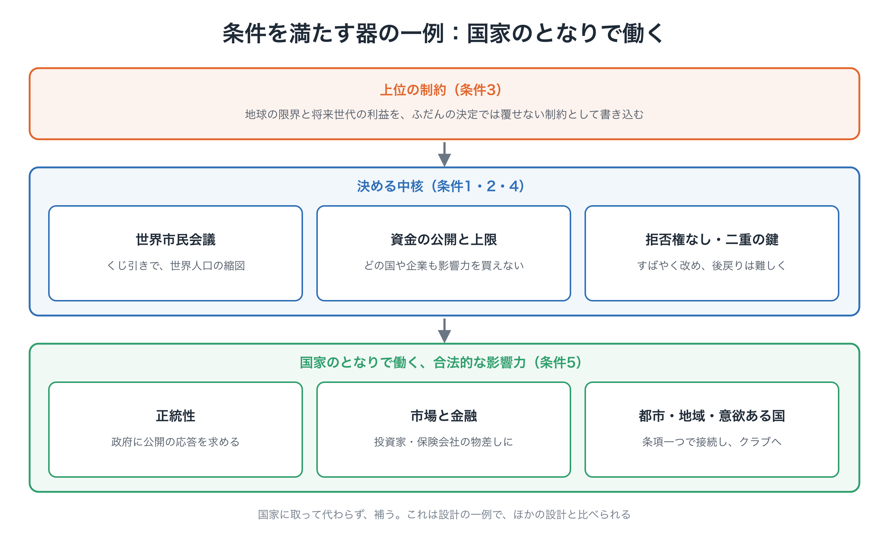

# もう一つの世界政治をつくる
### なぜ、世界全体のための政策をつくる制度がないのか

**背景論考**　第2版（草案、2026年10月）

---

高度なAI、気候変動、感染症、核兵器、食料、エネルギー。私たちが向き合う重要な問題の多くは、もはや一つの国の中には収まりません。それなのに、政治の基本の単位は、今も国民国家です。

もちろん、国際協力はあります。各国の政府は交渉し、条約を結び、国連やさまざまな国際機関を通じて動いています。それでも、素朴な問いが残ります。

**世界全体にかかわる問題について、世界全体の立場から政策の選択肢をつくるのは、誰なのでしょうか。**

この論考は、この問いを考えます。国連をなくそう、国家を否定しよう、という話ではありません。国家どうしの政治のとなりに、世界市民が政策を考え、選択肢をつくり、試し、判断できる、**もう一つの政治の回路**をつくれないか、という提案です。

---

## 1. 協力が足りない、だけではない

国際交渉の場で、各国の政府は、自国の安全、経済、雇用、そして有権者のために動きます。それが政府の仕事です。難しいのは、誰も悪意を持っていなくても、それぞれの国にとって合理的な判断が積み重なると、全員にとって悪い結果になりうることです。先に動くと損をする場面では、誰もが様子を見ます。

国会のない国を想像してみてください。安全保障も国の予算も、各地方の知事が集まって話し合うだけで決めるとします。どの知事も、まず自分の地方を優先するでしょう。補助金はうちに、負担は隣に。国全体に責任を持つ人は、誰もいません。今の世界は、これとよく似た形で動いています。気候も、AIも、世界を動くお金も、一つにつながった地球として動いているのに、それについての決定は、約200の国の交渉で下されています。

この筋道は、はっきりと示すことができます。他の国が減らすなら、自国は減らさずにその恩恵だけを受けられます。他の国が減らさないなら、自国だけが減らしても、負担を払ったうえに被害も防げません。他の国がどう動いても、減らさないほうが得になり、すべての国がそう考えると、全員が悪い結果にたどり着きます。ゲーム理論で「囚人のジレンマ」と呼ばれる形です。これは問題の最も単純な形で、クラブや、減らすことへの報酬によって損得の形を変えれば、結果も変えられます。けれども、そうした変化がなければ、この筋道は成り立ち続けます。

協力が増えれば、助けにはなります。けれども問題は、協力の*量*だけではありません。何を目指すのか、どんな選択肢があるのか、それぞれが何をもたらすのかを、**世界全体の立場から考える役割を、誰も担っていない**ことにもあります。

大学やシンクタンク、国際機関は、地球規模の問題について優れた仕事をしています。けれども、それぞれが自分の役割の範囲で動いています。政府の研究機関は国家に、企業は事業に、大学は資金と専門分野に応えます。欠けているのは善意ではありません。**世界市民の立場から、世界全体のための政策を設計することを役割とする制度**です。

## 2. 選択肢をつくる政治

民主主義というと、ふつうは「決めること」を思い浮かべます。代表を選び、法案を議論し、投票する。けれども、何かを決める前に、誰かが**どの選択肢を示すか**を決めています。

市民がA案・B案・C案から選ぶなら、それは民主的に見えます。けれども、その3つを誰がつくったのか。なぜその3つなのか。何が外されたのか。**選択肢をつくることも、民主主義の一部です。** そして地球規模の問題では、その部分がほとんど存在していません。

## 3. 奇妙な循環

地球規模の政策は、政治的に無理に見えるので、具体的に設計されません。具体的な設計がないので、非現実的に見えます。非現実的に見えるので、誰も設計しません。

> 「研究が難しい」→「具体的な設計がない」→「現実的な提案がない」→「難しい」

この循環を断つには、実現できるかどうかを国家どうしの交渉に委ねる前に、まず**そうした制度がどんな形になりうるかを設計してみる**ことが必要です。

## 4. 国家のとなりに、もう一つの回路を

ここでの考えは、世界政府ではありません。国家は今のままにして、そのとなりに回路を一つ加えます。

1. 世界市民が問題を提起する
2. 社会の縮図となるよう選ばれた市民が、専門家から情報を得て熟議する
3. 独立した政策機関が複数の選択肢を設計し、費用、効果、リスク、地域への影響、将来世代への影響を比べる
4. できるところでは、小規模な試行で選択肢を試す
5. 市民が結果を見直し、提案を改める
6. 条約や制度にする段階で、国家と国際機関が引き継ぐ

国家どうしの交渉は、なくなりません。**世界の政策づくりが、それだけに頼らなくなる**だけです。

## 5. どんな器にも必要な、5つの条件

具体的な設計を述べる前に、まず問うべきことがあります。同じ失敗をくり返さないために、**どんな器であっても**満たさなければならない条件は何か、です。それぞれの失敗を裏返すと、一つずつ必要な条件が出てきます。

| 今の仕組みに見られる失敗 | 必要な条件 |
|---|---|
| 問題は地球全体に広がっているのに、決める人はそれぞれ一部分にだけ責任を負っている | **1. 範囲が合っている**：決める人が、決定の影響を受けるすべての人に責任を負う |
| それぞれ自分の部分の得で評価されるので、自分だけ減らすのは損な手になる | **2. 動機が全体とそろっている**：全体の結果で評価される |
| 指導者は目の前の成果で評価されるのに、結果は何十年もかけて現れる | **3. 時間軸が合っている**：結果が現れる期間で、決定を評価する |
| 合意にはほぼ全員の賛成が要るので、最も消極的な国の速さでしか動けない | **4. すばやく変われて、後戻りしにくい**：一部分だけでは止められず、根拠に合わせて改められるが、目先の圧力では弱まらない |
| 守るのに費用のかかる約束は守られず、誰も強制できない | **5. 強制なしに守られる**：加わって守るほうが、加わらないより得になり、決め方が広く正統と認められる |

<figure markdown="span">
  
  <figcaption>今の仕組みの失敗から、必要な条件を導く</figcaption>
</figure>

条件3と4は、システム論の2つの考え方に支えられています。サイバネティクスの研究者 W・ロス・アシュビーは、制御する側が、打ち消すべき乱れと少なくとも同じだけの多様さ、つまり対応のしかたの数を持っていなければ、しくみを制御し続けられないことを示しました（必要多様性の法則）。約200の政府がそろって受け入れられることにしか対応できない仕組みでは、多様さが足りません。また、制御理論は、対策の一巡り（状態に気づき、決め、実施し、それが効いてくるまで）にかかる時間が、対象の変化より遅ければ、フィードバックでは正せないことを教えます。今の政治では、被害が目に見えてから気づき、合意に何年もかかり、実施にも時間がかかります。そのうえ、排出を減らしても、気候に効いてくるまでには数十年かかります。この遅れの合計が、臨界点を越えるまでの時間より長ければ、間に合いません。そして臨界点は、一度越えると元に戻せないので、行き過ぎてから直すこともできません。条件1は、民主主義の基本的な原理でもあります。「ある決定によって大きな影響を受ける人は、その決定に加わる権利を持つ」という、影響を受ける者すべての原理です。

これらは必要条件であって、十分条件ではありません。5つすべてを満たしても、成功は約束されません。けれども、どれか一つでも欠けた器は、それに対応する形で失敗しやすくなります。今の国家どうしの合意の仕組みは、5つすべてで同時に弱い。交渉のうまい人を集めるだけでは直せないのは、そのためです。

次に述べる機関は、これらの条件を満たすことを目指した設計の一例です。ほかの設計もありえて、比べられるべきものです。

<figure markdown="span">
  
  <figcaption>条件を満たす器の一例：国家のとなりで働く</figcaption>
</figure>

## 6. 3つの機関を、分けておく

| 機関 | 役割 |
|---|---|
| **世界市民会議** | 地域、文化、所得、世代の異なる市民が熟議し、価値の判断をする。専門家は情報を示し、何を優先し、どのリスクを受け入れるかは市民が決める |
| **世界政策機構** | 問題ごとに、実行可能な複数の選択肢を設計する。単一の正解は示さず、それぞれの結果を比べられるようにする |
| **世界政策実証局** | 選択肢を実際に試し、地域ごとに比べ、成功だけでなく失敗も公開する |

その先には、結果を国際的な制度にする国家と国際機関があります。

こうした仕組みで最も危ういのは、一つの機関が「世界の利益」をひとりで定義するようになることです。そこで役割を分けておきます。**価値を判断するのは市民、事実と可能性を示すのは専門家、選択肢を設計するのは研究者、現実と照らし合わせるのは実証、実施するのは国家です。** これは専門家による支配でも、AIによる支配でもありません。専門知を、民主主義の中に組み込むやり方です。

## 7. 民主主義を広げるAI

市民が地球規模の政策を熟議するには、たくさんの言語にまたがる、膨大な情報を扱う必要があります。AIは、そこで助けになります。翻訳、要約、シミュレーション、論点の整理、立場の比較。AIは、**世界市民のための「考えるための基盤」**になりえます。

大事なのは、決定をAIに任せることではありません。むしろ逆です。専門家にもAIにも代わりにできない価値の判断を、より多くの人が、理解したうえで行えるようにすることです。**AIは、人々が民主主義に参加する力を広げるものであって、それに取って代わるものではありません。**

## 8. 国連の役割は、より明確になる

国連はどうなるのでしょうか。なくなりません。役割が、より明確になります。

これまでは、まず国家どうしが交渉し、可能なことを探してきました。この回路では、順番が変わります。世界市民が熟議し、政策機構が選択肢を設計し、実証局が試し、**そのうえで**国家と国際機関が制度にします。国連は、世界政治の*出発点*ではなく、世界市民がつくった政策を実施し、調整するための、欠かせない**場**になります。

## 9. 大国を待たない

大国は、世界の制度を形づくっています。それは現実であり、大国の協力は大切です。けれども、大国が合意するまで何も始められないなら、世界に必要なものを設計し始める人は、誰もいなくなります。

小さな国、都市、研究者、市民社会が、先に制度を設計し、試し、うまくいくことを示すことができます。ほかの国は、あとから加わればよいのです。必要なのは、**大国を待つ政治**ではなく、**世界のどこかで、先に動き出すもの**です。

## 10. 小さく始め、仕組みそのものを改めていく

こうした仕組みを、一度に世界規模で完成させることはできません。一つの具体的な課題から始め、サイクルを一通り回し、そこから学ぶべきです。

パッケージ提案「限界の内側で、舵を取る」では、最初の課題は**気候**です。国際的な市民会議が、Planetary OS とほかの設計を比べます。次の候補は**AIの統治**です。国境を越えた共通のルールが必要なことが、同じくらいはっきりしている分野です。

AIは、もっと大きなことも示しています。国境を越える技術とリスクは、これからも次々に現れます。だから、問題ごとのルールだけでなく、**地球規模の政策を考えるための、長く続く制度**が必要なのです。

大切なのは、最初から完璧な仕組みをつくることではありません。**仕組みそのものを試し、改めていく**ことです。

## 11. 難しい問いに答える

**「軍隊のない機関に、誰が従うのか」**　ホッブズは、剣のない契約は言葉にすぎないと書きました。けれども、軍隊は、気候の臨界点や暴走するアルゴリズムを止められません。そして、この回路は、従わせようとはしません。今の世界の多くは、どの軍隊も強制していない標準で動いています。たとえば、インターネットの技術的な標準は、従わないより使うほうが得だから、世界中で使われています。

**「選挙で選ばれていない機関が、なぜ正統なのか」**　影響を受ける者すべての原理から見れば、各国の政策をその国の有権者だけが決める仕組みでは、地球規模の決定で影響を受ける人の大部分が、発言権を持てません。ここで述べた回路は、選挙で選ばれた議会に取って代わるものではありません。選挙だけでは届かないものを補い、開かれた手続き、独立した監査、少数意見の公開を通じて、正統性を積み重ねます。

**「権威主義の国が市民の参加を禁じたら、欧米だけのクラブになるのではないか」**　これは本当の危険です。最初は、世界市民会議がすべての人に届くことはありません。貿易と投資を通じて広がる標準、海外に住む人々の参加、匿名で安全に参加できる経路、そして扱う課題を最小限の共通の土台に絞ることが、欠けた部分を一部補えます。政府が参加を禁じている人々をどう代表するかは、まだ解決していない問題で、世界市民会議そのものが取り組むべき問いです。

## おわりに：民主主義を、地球の規模へ

民主主義は、国の中で育ってきました。問題が国境を越えるようになった今、民主主義もまた、一歩ずつ国境を越えていく必要があるのかもしれません。

それは、みんなに同じ考えを持たせることではありません。文化も、歴史も、暮らしの条件も違います。違いを保ったまま熟議し、一緒に向き合うべき問題について、共通のルールをつくることです。国家どうしの交渉が始まる前に、**世界市民を、地球規模の政策をつくる制度の中に組み込むこと**。それが、この考えの中心です。

「世界市民ガバナンス憲章」[→](charter.md)は、この考えを具体的な制度の設計にしたものです。どちらも作業のための仮説であり、批判され、試され、書き直されるために公開しています。

---

**あわせて読みたい**

- 世界市民ガバナンス憲章[→](charter.md)
- 提案A：Youth GCC[→](../proposals/a-youth-gcc.md)
- 「なぜ今か」[→](../why-now.md)

---

この文書は、次の場所でも公開しています： [note（日本語）](https://note.com/ttmori/n/ndd3b106dbf1c)
