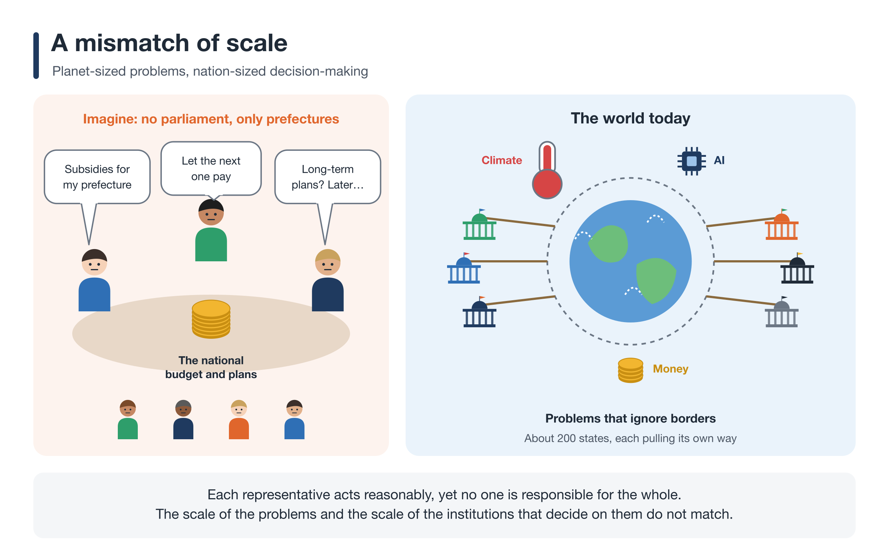
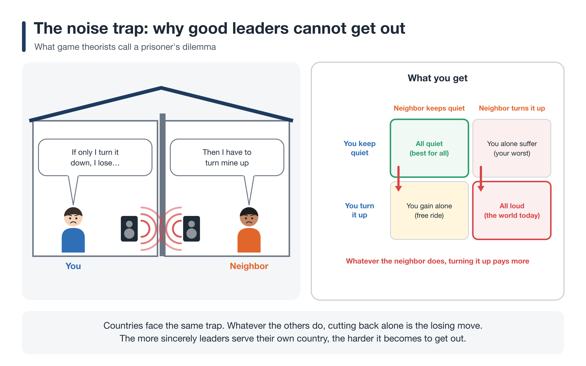
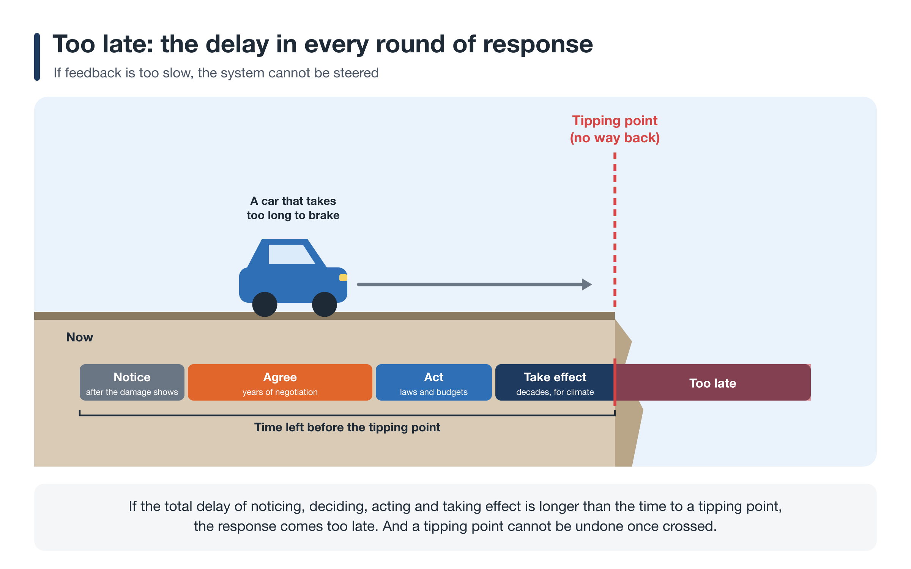
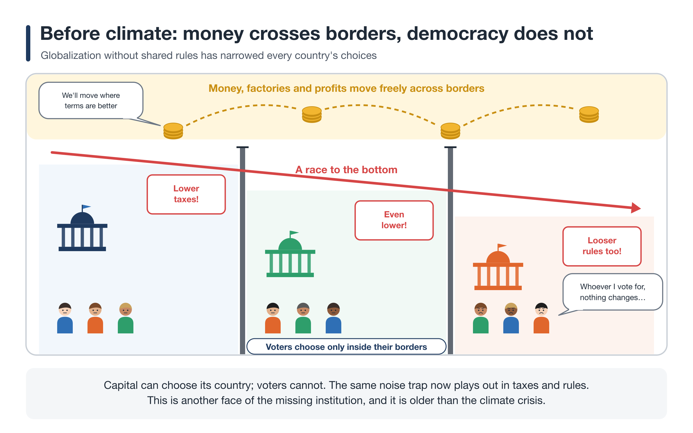
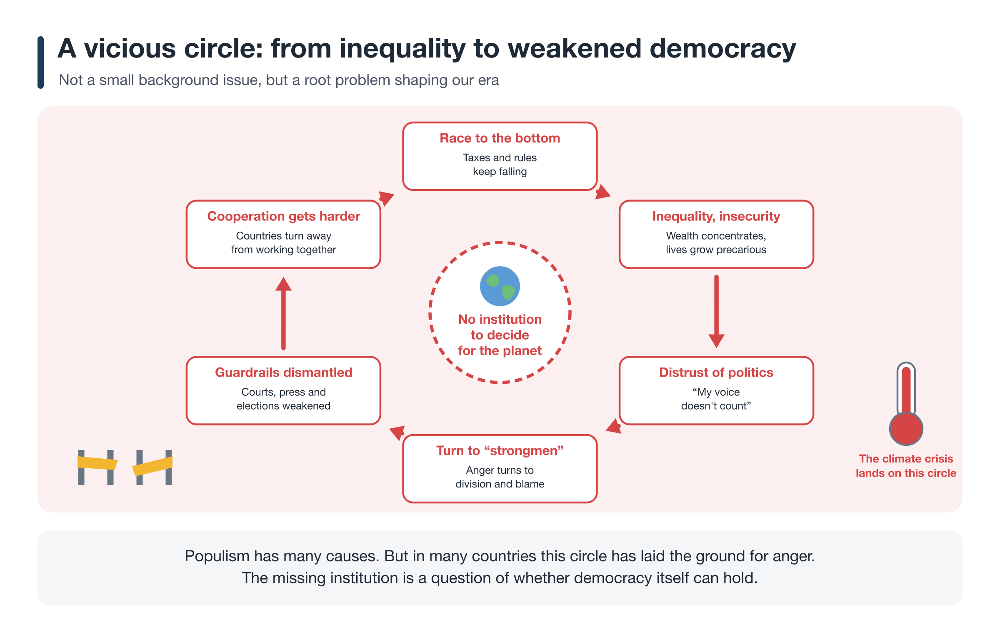
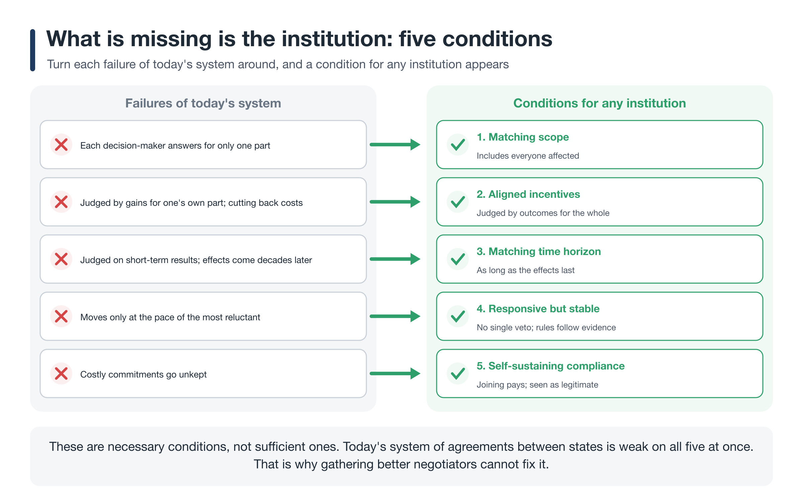
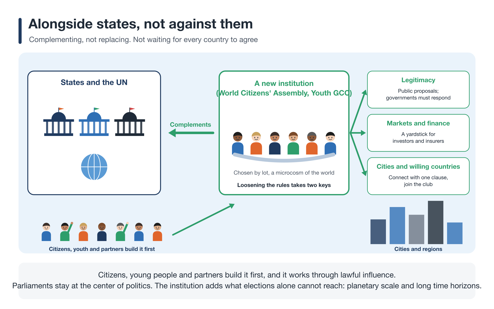
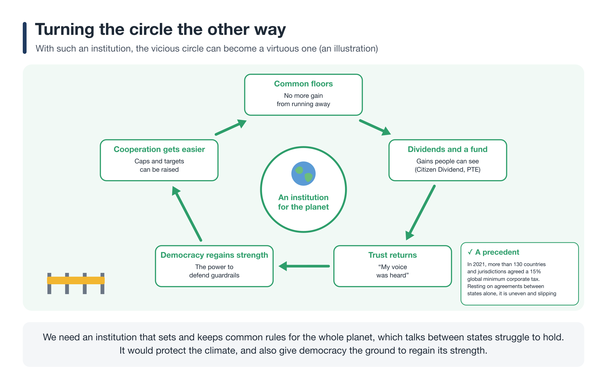

# Why Can't Humanity Stop the Slide Toward Catastrophe?
### What is missing is not effort, but an institution that can decide for the planet

**Essay** — Second edition (working draft)

**A note from the author.** I am not a specialist in international relations, game theory, or systems engineering. This essay starts from a question I could not set aside, and was developed with generative AI as a sparring partner for structuring the ideas and connecting them to existing research. The judgments, and the responsibility for them, are mine. Critical comments are very welcome.

---

Climate change, the risks of advanced AI, and widening inequality all threaten humanity's future. Every year we hold international conferences and reach agreements. Scientists warn, people march, and large sums are spent. Yet the overall curves keep heading the wrong way.

It is tempting to blame someone: politicians lack the will, corporations are greedy, citizens do not care enough. But that diagnosis keeps us going around in circles.

This essay argues something different. The failure is not mainly a failure of morals or effort. **As long as planetary problems are decided only through a system built for nation-states, failure is built into the structure.** What is missing is an institution able to decide for the planet as a whole.

And this gap is not new. Long before the climate crisis, it was shaping the world economy, and through it, the health of democracy itself. That is why it is not a background issue but one of the root problems of our time.

---

## 1. A national budget set by a council of prefectures

Imagine that Japan had no national parliament. Defence, the national budget, and long-term planning would be decided only by a meeting of the governors and assembly members of its 47 prefectures.

The result is easy to predict. Each representative would put their own prefecture first: more subsidies for us, and let the neighboring prefecture bear the cost. No one would be responsible for the country as a whole, and long-term decisions would never be reached.

The world today works in much the same way. The climate system, the space in which AI operates, and global capital do not stop at borders. They behave as one connected planet. Yet we try to govern them through negotiations among about 200 states, a system whose roots go back to the 17th century. **The scale of the problems and the scale of the institutions that decide on them do not match.** And because that system works by agreement, a major agreement usually needs almost every country on board, so it moves at the pace of the most reluctant; even once agreed, there is little that can make a country keep a commitment that has become costly.

<figure markdown="span">
  
  <figcaption>A mismatch of scale</figcaption>
</figure>

---

## 2. Why even good leaders cannot get out

"If only politicians would talk to each other more sincerely," one might say. But the problem runs deeper than sincerity.

### The noise trap

Imagine a neighbor who plays loud music late at night. You would both prefer a quiet evening. But if you turn your television off and your neighbor keeps the music on, you simply suffer. So, reluctantly, you turn your own volume up. Your neighbor does the same. No one wants a deafening room, yet that is where you both end up.

Game theorists call this structure a prisoner's dilemma, and its logic can be stated precisely. Each country can either cooperate, cutting back at its own cost, or defect, putting itself first. If the others cooperate, a country that defects enjoys the benefit of their efforts without paying: its best outcome. If the others defect, a country that cooperates alone pays the cost and still cannot prevent the damage: its worst outcome. So whatever the others do, defecting pays more. When every country reasons this way, all defect, and all end up worse off than if all had cooperated. No one can escape this outcome alone.

This is the simplest form of the problem. In reality countries deal with each other again and again, which is why changing the payoffs, through clubs and through rewards for cutting back, can change the outcome. That is the aim of Planetary OS. But without such changes, the logic holds.

National leaders are in this dilemma every day. Their role is to serve their own country's voters, and they are judged on the near-term results they deliver. That is not a flaw of character; it is what the role asks of them. So the more faithfully a leader serves their own country, the harder it is to escape the trap.

<figure markdown="span">
  
  <figcaption>The noise trap: why good leaders cannot get out</figcaption>
</figure>

### When the parts compete for the blood of the whole

Think of the human body. Blood circulates through every organ and keeps the whole body alive. If each organ tried to draw as much blood as it could for itself, each might do well for a while, but the body as a whole would fail.

The planet is one connected system in the same way. Today's institutions add up the separate interests of about 200 countries, and nothing in them is designed to look after the whole. **When each part optimizes for itself, the whole suffers**, even if every part is acting reasonably.

### What systems theory adds

Systems theory, the study of how complex systems are kept under control, adds two more points.

- **Requisite variety.** The cybernetician W. Ross Ashby showed that a regulator can keep a system under control only if it has at least as much variety, as many distinct ways of responding, as the disturbances it must counter. The climate, AI, and global finance change in many ways at once. A system that can respond only in the ways all of about 200 governments agree on has far too little variety to keep up.
- **Delay in the feedback loop.** Control theory adds that if one full round of the feedback loop, noticing the state, deciding, acting, and the action taking effect, takes longer than the changes it is meant to correct, feedback cannot correct them. In politics today, problems are often noticed only once damage is visible, agreement takes years, and implementation takes more. On top of that, emissions cut today take decades to show up in the climate. If this total delay is longer than the time left before a tipping point is crossed, the response comes too late. And because a tipping point cannot be undone once crossed, the usual way feedback corrects an overshoot, going too far and then coming back, is not available.

<figure markdown="span">
  
  <figcaption>Too late: the delay in every round of response</figcaption>
</figure>

---

## 3. Older than the climate crisis: money crosses borders, democracy does not

So far we have followed the climate crisis. But the lack of an institution that can decide for the planet is much older. It has been shaping the world since at least the 1980s and 1990s.

In those decades, money, factories, and profits became free to move across borders. Trade and investment grew, and many people, especially in parts of Asia, escaped poverty. But the rules for this new global economy did not grow at the same pace. Taxes, labour protections, financial rules, and environmental standards stayed national. **Money could choose its country; voters could not.**

This created a new version of the noise trap. Every country wants investment and jobs. If one country alone raises taxes on companies or large fortunes, or tightens its rules, capital can move to where the terms are better. So countries competed with lower taxes, looser rules, and more favorable deals. Corporate tax rates fell across the world for decades. Profits could be booked where taxes were lowest, and large fortunes held where they were hardest to see. This is often called a race to the bottom. No one needed to plan it. Each government was acting reasonably for its own country, just like the neighbors with their volume.

The economist Dani Rodrik has described this as a trilemma: we cannot fully have deep global economic integration, national sovereignty, and democracy all at once. With no shared rules above the national level, it was often democracy that gave way. Governments of different parties found that they could promise only a narrow range of economic policies, and many voters came to feel that **whoever they voted for, nothing changed.**

The financial crisis of 2008 showed the same gap from another side. Large banks were global while they made profits, but national when they failed: it was each country's taxpayers who paid to rescue them. In a phrase often attributed to Mervyn King, a former Governor of the Bank of England, global banks are global in life but national in death. Profits stayed private, while losses were shared by the public; some call this, with irony, "socialism for corporations." It is less a failure of markets as such than a distortion born of having no rules at the scale at which those markets work.

This is not just a story about villains. Of course, many people and companies act in ways that deserve criticism. But they are taking advantage of flaws in rules that no longer fit the world. If we look only at the people in front of us, we lose sight of what stands behind them: an outdated structure. The deeper problem is a structural gap, and it is the same gap as in the climate crisis: problems and markets at the scale of the planet, and decisions only at the scale of nations.

<figure markdown="span">
  
  <figcaption>Before climate: money crosses borders, democracy does not</figcaption>
</figure>

---

## 4. A vicious circle: from inequality to weakened democracy

The gap does not stay in economics. It feeds a circle that reaches into politics itself.

1. **A race to the bottom.** With no institution to set common rules, taxes and rules on mobile capital keep falling.
2. **Inequality and insecurity.** Wealth concentrates at the top, while many people face unstable jobs, stagnant wages, and weakened public services. Concentrated wealth also brings more influence over politics, through lobbying and funding.
3. **Distrust of politics.** When people feel that elections do not change their lives, they lose trust that democracy works for them: "my voice doesn't count."
4. **A turn to "strongmen."** The anger is real and often justified. But it is easily directed at neighbors, migrants, or minorities rather than at the structure, and leaders who promise to cut through the rules gain support.
5. **Guardrails dismantled.** Once in power, some of these leaders weaken the guardrails that keep power in check: independent courts, a free press, fair elections, and the unwritten norms of restraint. Political scientists such as Steven Levitsky and Daniel Ziblatt have described how democracies can erode this way, step by step, at the hands of elected leaders.
6. **Cooperation gets harder.** Countries that have turned inward and distrustful find it even harder to work together, and the lack of an institution for the planet grows deeper. The circle returns to where it started.

<figure markdown="span">
  
  <figcaption>A vicious circle: from inequality to weakened democracy</figcaption>
</figure>

Populism has many causes, including culture, migration, and new media, and no single cause explains it. But research supports parts of this circle. In the United States, for example, studies have linked the regions hit hardest by import competition to sharper political polarization. And organizations that track democracy worldwide, such as the V-Dem Institute, report that in recent years more of the world's people have lived in countries where democracy is declining than in countries where it is advancing.

The climate crisis lands on top of this circle. A carbon price that raises costs for households without giving anything back feeds the anger; the fuel-tax protests in France in 2018 are one example. Climate policy that ignores fairness can speed the circle up.

So the missing institution is **not a small background issue.** It is one of the roots of the turmoil of our time. It decides not only whether we can protect the climate, but whether democracy itself can hold.

---

## 5. The missing piece is the institution itself

Most debate in politics, the environmental movement, and the media is about how to do better within the existing framework: how to get countries to agree on emission targets, how to reform the United Nations. These efforts matter, and they have achieved real things. But they all take the existing framework as given.

As Part 1 of the series *Rewriting the Planet's OS* puts it, pouring water faster into a leaky bucket does not fill it. The more basic question is rarely asked: **what kind of institution could decide on planetary problems at the scale they occur?**

There is a historical precedent for asking it. At the start of the modern era, thinkers such as Hobbes and Locke imagined a new kind of political body, grounded in a social contract, and the modern state and its constitutions grew from that idea. The state was itself once a new institution. Our problems now call for another one at the scale of the planet, not to replace the state, but to do what the state was never designed to do.

---

## 6. What any institution would need: five necessary conditions

Before describing any particular design, it helps to ask what *any* institution would need in order not to fail in the ways described above. Each failure, turned around, gives a necessary condition. These conditions say nothing yet about how to meet them.

| Failure seen today | Necessary condition |
|---|---|
| The problem spans the planet, but each decision-maker answers for one part of it (Section 1) | **1. Matching scope:** the range of people whose interests the decision-makers answer for must cover everyone the decision affects |
| Each decision-maker is rewarded for its own part's gain, so cutting back alone is a losing move (Section 2) | **2. Aligned incentives:** what the decision-makers are rewarded or held to account for must depend on the outcome for the whole, not for any one part |
| Leaders are judged on near-term results, while the consequences unfold over decades, and the feedback comes too late (Section 2) | **3. Matching time horizon:** the period over which decisions are judged must be as long as the period over which their consequences unfold |
| Agreements need near-unanimity, so the whole moves at the pace of its most reluctant member and has too little variety to keep up with changing conditions (Sections 1 and 2) | **4. Responsive but stable:** no single part can block a decision, and rules can be updated as evidence changes, yet they cannot easily be weakened under short-term pressure |
| Commitments that are costly to keep are often not kept, and no one can force them (Section 1) | **5. Self-sustaining compliance:** without relying on force, adopting and keeping the decisions must be better, for each party, than staying out, and the way decisions are made must be widely seen as legitimate |

<figure markdown="span">
  
  <figcaption>What is missing is the institution: five conditions</figcaption>
</figure>

Condition 1 is also a basic principle of democracy, often called the all-affected principle: those significantly affected by a decision should have a say in it.

Two points about these conditions. First, they are **necessary, not sufficient**: an institution that misses any one of them will tend to fail in the corresponding way, but meeting all five does not guarantee success. Second, the present system of agreements among states is weak on all five at once. That is why better negotiators alone cannot fix it.

These conditions are not only about climate. The race to the bottom in taxes and rules (Section 3) is the same failure: no one answers for the whole, and each country is judged by its own gains.

### One design that meets them

The package proposal sets out one design intended to meet these conditions. Other designs are possible, and in keeping with the Charter's principle of comparing options, they should be compared.

| Condition | One way to meet it |
|---|---|
| 1. Matching scope | A World Citizens' Assembly chosen by lot as a statistical microcosm of the world's population, from all generations and without national quotas |
| 2. Aligned incentives | Members chosen by lot have no constituency or seat to protect; funding sources are published and capped, so no state or firm can buy influence |
| 3. Matching time horizon | Planetary boundaries and the interests of future generations written in as constraints that ordinary decisions cannot override, with a body that represents future generations |
| 4. Responsive but stable | No veto for any member; rules linked to scientific data and updated as it changes; changes that would loosen the rules require a double key: scientific justification plus approval by citizens' representatives |
| 5. Self-sustaining compliance | States, cities, and firms adopt the decisions by choice, through a single clause in their existing law; members of a club gain benefits that outsiders do not, so joining pays; legitimacy is earned through open procedures, independent audit, and published minority views |

This design is developed in detail in the Global Democratic Governance Charter [→](../charter/charter.md) and in Proposal A, the Youth GCC [→](../proposals/a-youth-gcc.md); the essay *Building Another World Politics* [→](../charter/another-world-politics.md) explains the thinking behind it. How it connects to states is described in Proposal C, Planetary OS [→](../proposals/c-summary.md).

---

## 7. A realistic path: alongside states, not against them

Proposals for a world parliament, from the world federalist movement to the campaign for a United Nations Parliamentary Assembly, have often stalled because they asked governments to hand over their powers. Few governments will.

So the path proposed here is different. **The new institution starts alongside existing states, not in place of them.** It does not wait for every country, or for the great powers, to agree. Citizens, young people, and willing partners build it first, and it complements states and the United Nations rather than competing with them.

In the transition, it works through three kinds of lawful influence.

- **Legitimacy.** Recommendations made by a cross-section of humanity, informed by the best available science and published with minority views and uncertainties, carry weight. Governments and international bodies are asked to respond in public, and to explain when they decline. Voters can then see where their own government stands.
- **Markets and finance.** Its standards can serve as yardsticks for investors, insurers, and consumers who want to manage climate and other long-term risks. Firms that meet them can show it; ignoring them carries a growing cost.
- **Cities, regions, and willing countries.** Cities and regions facing real crises can adopt its standards directly. Willing countries can connect through a single clause in their existing law and join a club of members that move together.

<figure markdown="span">
  
  <figcaption>Alongside states, not against them</figcaption>
</figure>

---

## 8. Turning the circle the other way

If the missing institution is one of the roots of the vicious circle in Section 4, building it can help turn the circle the other way. One illustration:

1. **Common floors.** Shared minimum rules for taxes and standards mean no one gains by running to the bottom.
2. **Dividends and a fund.** In the package's climate design, Planetary OS, most of the revenue from the carbon cap goes straight back to citizens as a Citizen Dividend, and a thin, broad levy on large fortunes and profits (BEI) funds a lasting endowment (PTE). People can see that the rules work for them.
3. **Trust returns.** When ordinary citizens chosen by lot deliberate, and their proposals receive real answers, people can feel that their voice was heard.
4. **Democracy regains strength.** With more fairness and trust, there is more support for defending the guardrails that keep power in check.
5. **Cooperation gets easier.** Countries that trust the system and see its benefits can raise their caps and targets together, and the institution grows stronger.

<figure markdown="span">
  
  <figcaption>Turning the circle the other way</figcaption>
</figure>

There is already a precedent for the first step. In 2021, more than 130 countries and jurisdictions agreed on a global minimum corporate tax rate of 15%. It showed that common floors are possible. It also showed the limits of agreements between states alone: implementation has been uneven, the rate was set low, and in 2025 the largest economy stepped back from the agreement. An exemption for its companies was then agreed, first by the G7 in 2025 and then by the wider group of countries in January 2026. A floor that rests only on negotiations between governments can slip with each change of government. That is why an institution that decides for the whole, and keeps its rules over time, is needed.

---

## 9. Answers to the hardest objections

**"Isn't the real problem capitalism itself? Shouldn't we change the whole system?"**
The anger behind this question is understandable. But the diagnosis matters, because the wrong diagnosis leads to the wrong cure. The core of the problem described in this essay is not markets as such. It is that the guardrails which keep power in check, such as common rules, independent courts, a free press, and fair elections, are missing at the scale of the planet and have been weakened within many countries. Under any economic system, power without guardrails tends to run away. A system that places economic and political power in the same hands makes guardrails even more important, and harder to build. So replacing one system with another, without first learning from the failure of governance, could concentrate power further rather than restrain it. Whatever one's view of the economy, what is needed first is an institution, and guardrails, at the scale at which power now operates.

**"An institution without an army or police cannot make anyone comply."**
Thomas Hobbes wrote that covenants without the sword are but words, and this is the strongest objection. But two things have changed. Armies can stop invasions, but not a climate tipping point or a runaway algorithm; force is not the tool these problems need. And the institution does not try to compel. Much of today's world already runs on standards that no army enforces: the technical standards of the internet, for example, are followed worldwide because using them is worth more than ignoring them. An institution whose standards are useful and legitimate can have real influence without force.

**"Why should an unelected body be considered legitimate?"**
By the all-affected principle, a system in which each country's policies are decided only by that country's voters leaves most of the people affected by planetary decisions without any say. The new institution does not replace elected parliaments, which remain at the center of politics. Its role is to add what elections alone cannot provide: a planetary scale, a long time horizon, and independence from vested interests. Its legitimacy is earned through open procedures, published selection methods, independent audit, and recorded disagreement, not declared.

**"Won't the new body simply reproduce the same conflicts?"**
Disagreement is normal and healthy; the aim is to change the incentives. Members chosen by lot are not elected by any constituency and have no seat to protect. Experience with citizens' assemblies, for example in Ireland and in France's Citizens' Convention for Climate, shows that ordinary citizens, given time and good information, can reach considered recommendations on divisive questions. There is a further difference. Planetary boundaries are fixed in advance as constraints, so the question is never whether the planet's life-support systems may be sacrificed. What remains to decide is how to share costs and benefits fairly within those limits. A zero-sum struggle becomes a question of fair allocation. And the institution is designed to be checked: independent audit, published minority views, and rules that only a double key can change.

**"If authoritarian governments bar their citizens from taking part, won't it become a club of the West?"**
This is a real risk, and it should be said plainly. At first, the assembly will not reach everyone; the citizens of some countries may be barred from taking part. Three things help, though none solves the problem completely. The club works through trade and investment, so its standards can matter even to countries that do not join, much as other markets' product standards already do. People from those countries who live abroad, and secure channels for anonymous participation, can partly fill the gap. And the agenda is kept to a minimal common ground, physical limits and humanity's survival, rather than any one political model. How to represent people whose governments forbid them to take part remains an open question, and one that the assembly itself should take up.

---

## Closing

The heart of the crisis is not only carbon dioxide or the technology of AI. It is that **no institution yet exists that can decide on these problems at the scale they occur.** That gap is older than the climate crisis. Through a race to the bottom, inequality, distrust, and weakened guardrails, it has been feeding the turmoil of our time.

Hitting a broken calculator harder will not produce the right answer. Beside the policy proposals we already need, we also need a shared understanding: the nation-state system alone was never designed for problems of this kind, and an institution that can decide for the planet has to be built, alongside it. Such an institution would protect the climate, and also give democracy the ground to regain its strength.

The Youth GCC is a first attempt, starting small and starting now. When such an institution exists, humanity's knowledge and effort can begin to move toward the goal they were always meant to serve.

---

**Read more**

- Global Democratic Governance Charter [→](../charter/charter.md)
- Building Another World Politics [→](../charter/another-world-politics.md)
- Essay: *"Realistically Impossible" — For Whom?* [→](impossible-for-whom.md) (why citizens have to draft the rules)
- Proposal A: Youth GCC [→](../proposals/a-youth-gcc.md)
- Series Part 4: Giving future generations a voice [→](../series/part-4.md)
- Package proposal: *Steering Within Limits* [→](../package.md)

**Contact:** Tatsuya Mori · [Substack](https://ttmori.substack.com) · [note](https://note.com/ttmori) · [X](https://x.com/ttmori) · [Contact form](https://docs.google.com/forms/d/e/1FAIpQLSexBpD4BcRWIV--FuhMC9BxbP4I9fXl6pi9nxQPmX2bjivjqw/viewform)
