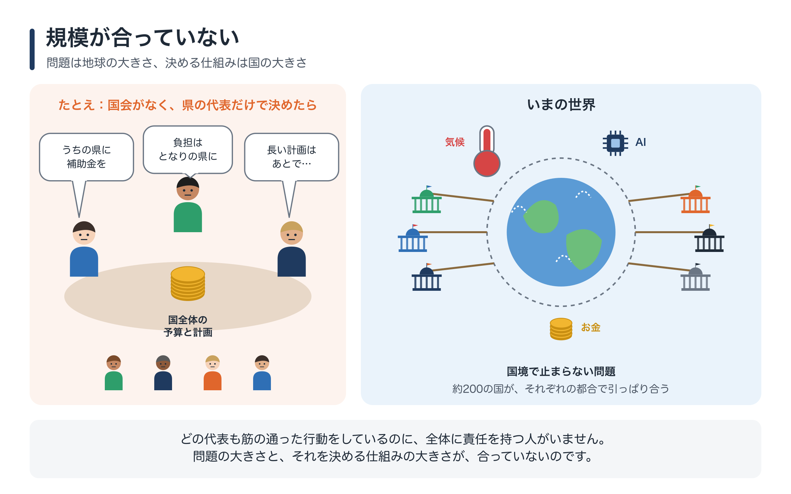
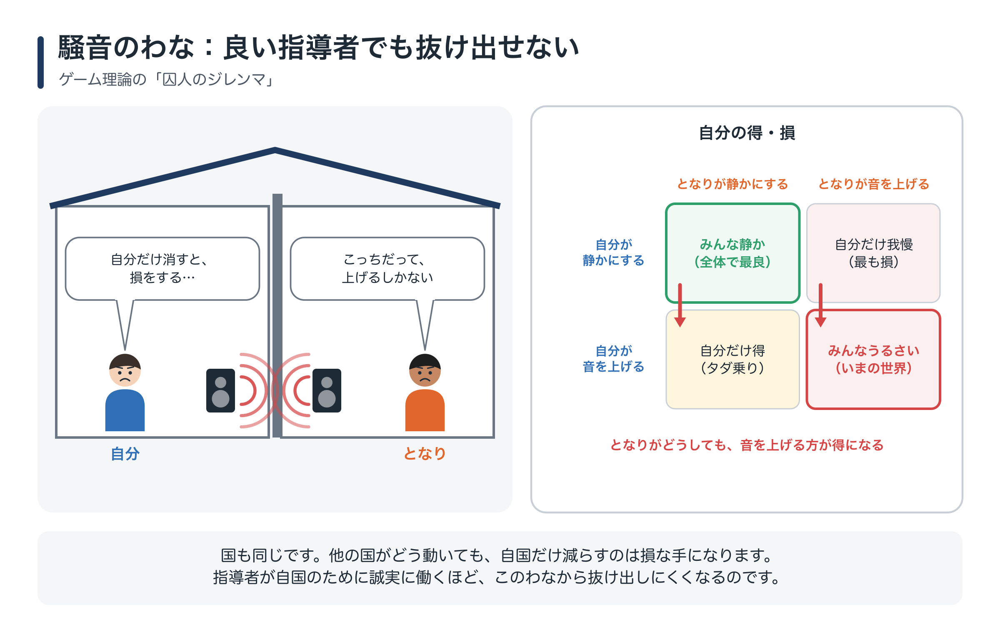
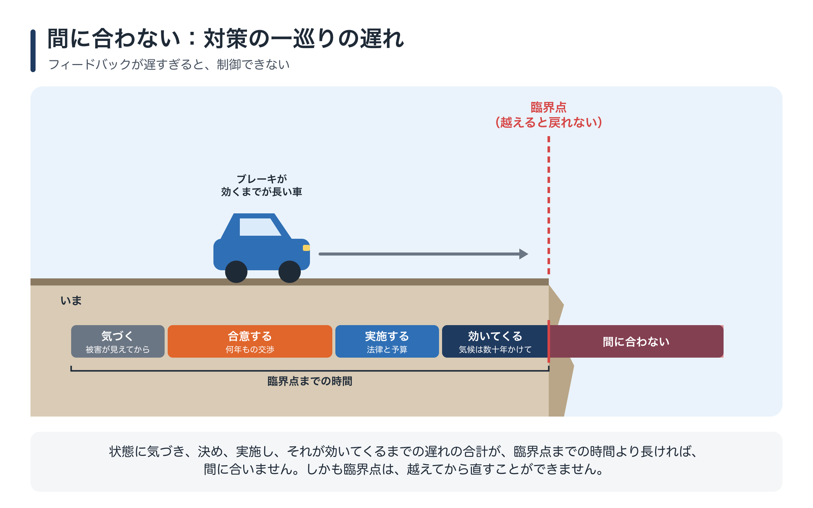
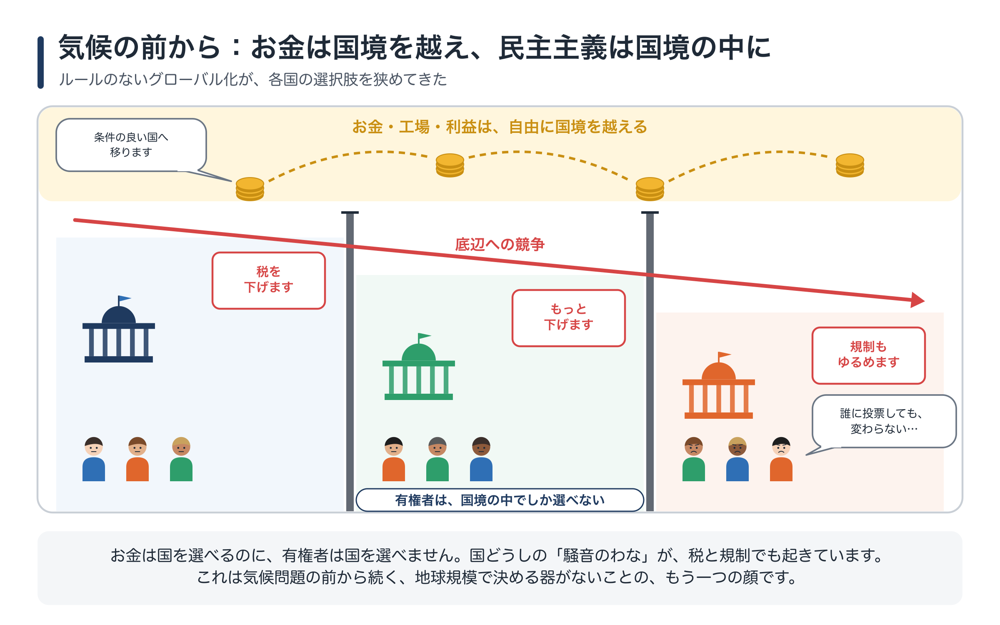
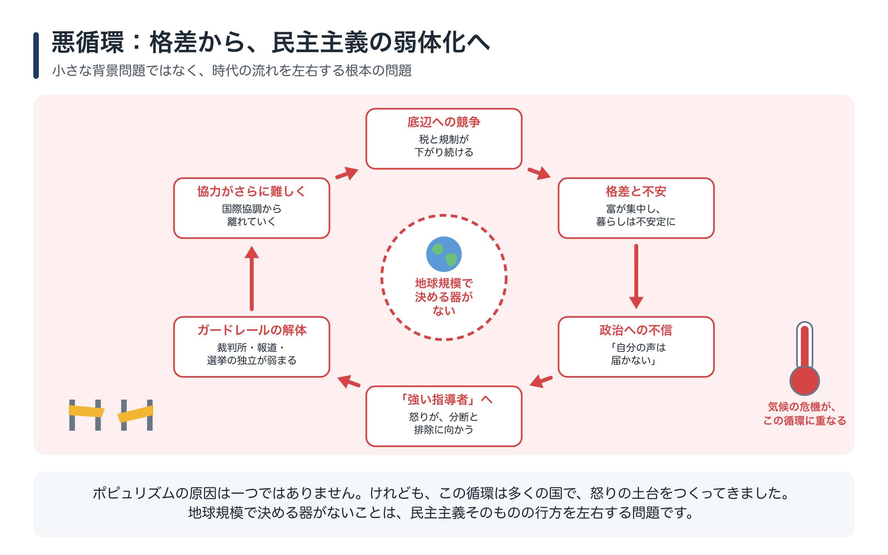
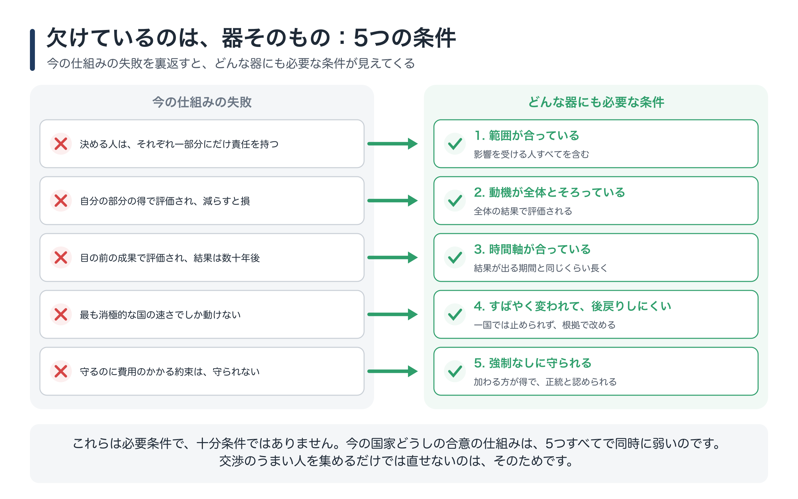
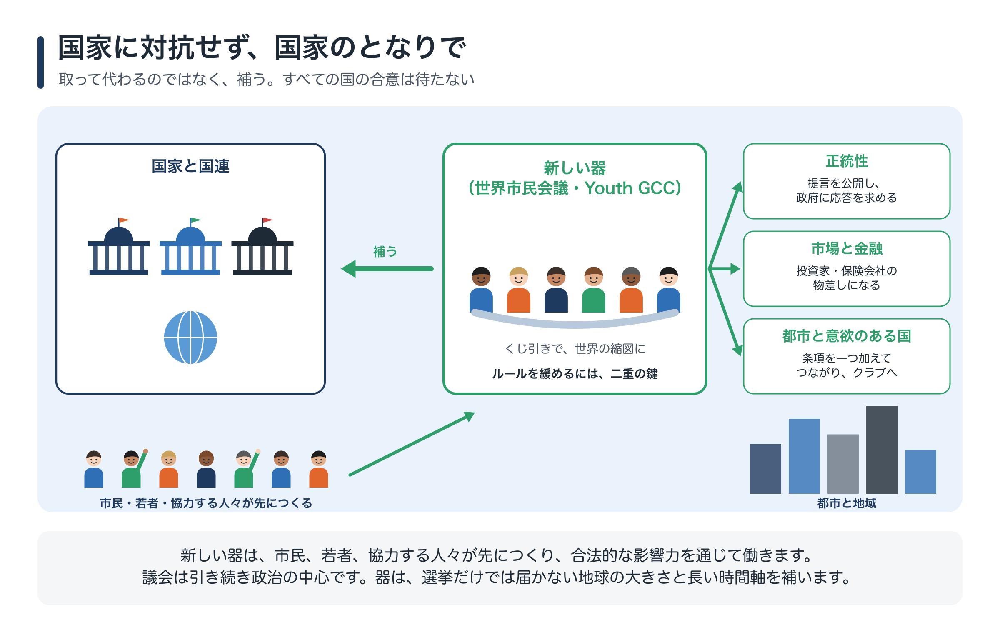
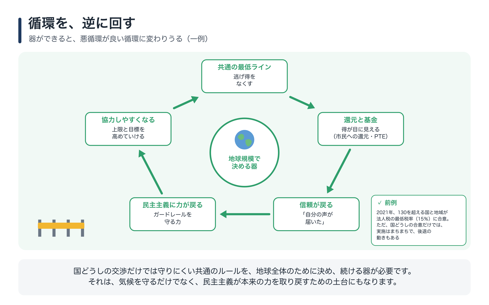

# なぜ人類は、破局を止められないのか
### 足りないのは努力ではなく、地球のために決める「器」

**論考**　第2版（草案）

**著者から**：私は、国際政治学やゲーム理論、システム工学の専門の研究者ではありません。この論考は、どうしても手放せなかった一つの問いから出発し、生成AIを考えを組み立てる壁打ちの相手として使いながら、既存の研究とつなげてまとめたものです。何を書き、何を採用するかの判断と、その責任は、私にあります。批判的なご意見を、ぜひお寄せください。

---

気候変動、高度なAIのリスク、広がり続ける格差。どれも人類の未来を脅かしています。私たちは毎年のように国際会議を開き、合意を交わしています。科学者は警鐘を鳴らし、世界中で人々が声を上げ、多くのお金が投じられています。それでも、全体の流れは、悪い方向へ進み続けています。

誰かのせいにしたくなります。政治家にやる気がない、大企業が強欲だ、市民の意識が低い。けれども、そう考えている限り、私たちは同じ場所を回り続けることになります。

この論考の考えは違います。失敗の主な原因は、道徳や努力が足りないことではありません。**地球規模の問題を、国民国家のために作られた仕組みだけで決めようとする限り、失敗は構造の中に組み込まれています。** 足りないのは、地球全体のために決めることのできる「器」です。

しかも、このすき間は新しいものではありません。気候危機よりずっと前から、世界の経済の形を左右し、それを通じて、民主主義そのものの健康にまで影響を与えてきました。だからこれは、背景の小さな問題ではなく、今の時代の根本にかかわる問題の一つなのです。

---

## 1. 都道府県の集まりで、国の予算を決めたら

もし日本に国会がなかったら、と想像してみてください。安全保障も、国の予算も、長い目で見た計画も、47都道府県の知事や議員が集まって話し合うだけで決めることになります。

結果は目に見えています。どの代表も、まず自分の県の利益を優先するでしょう。補助金はうちの県に、負担は隣の県に。国全体に責任を持つ人がいないので、長い目で見た決定は、いつまでたっても下せません。

今の世界は、これとよく似た形で動いています。気候のしくみ、AIが動く空間、世界を動くお金は、国境で止まりません。一つにつながった地球として動いています。それなのに私たちは、それを約200の国の交渉で動かそうとしています。17世紀にさかのぼる仕組みです。**問題の大きさと、それについて決める仕組みの大きさが、合っていないのです。** しかも、この仕組みは国どうしの合意で動くので、大きな合意にはほぼすべての国の賛成が要り、最も消極的な国の速さでしか進みません。合意できたとしても、守るのに費用がかかるようになった約束を、守らせる手立てはほとんどありません。

<figure markdown="span">
  
  <figcaption>規模が合っていない</figcaption>
</figure>

---

## 2. なぜ、良い指導者でも抜け出せないのか

「政治家がもっと誠実に話し合えば」と思うかもしれません。けれども、問題は誠実さよりも深いところにあります。

### 騒音のわな

夜遅くまで大きな音で音楽をかける隣人を思い浮かべてください。本当は、お互いに静かな夜を過ごしたいはずです。けれども、自分だけテレビを消して、隣人が音楽をかけ続けたら、自分だけが我慢することになります。だから、しかたなく自分もテレビの音を上げます。隣人も同じことをします。誰も大きな音を望んでいないのに、二人とも、耳をふさぎたくなる部屋にたどり着きます。

これは、ゲーム理論で「囚人のジレンマ」と呼ばれる形で、その筋道は、はっきりと示すことができます。各国は、自分の負担で減らす（協力する）か、自国を優先する（裏切る）かを選べます。他の国が協力するなら、自国は裏切れば、負担を払わずに他の国の努力の恩恵だけを受けられます。これが自国にとって最も得な結果です。他の国が裏切るなら、自国だけが協力しても、負担を払ったうえに被害も防げません。これが最も損な結果です。つまり、他の国がどう動いても、裏切るほうが得になります。すべての国がそう考えると、全員が裏切り、全員が協力した場合より悪い結果にたどり着きます。この結果から、一国だけで抜け出すことはできません。

これは、問題の最も単純な形です。現実には、国どうしは何度もくり返し関わり合います。だからこそ、クラブや、減らすことへの報酬によって損得の形を変えれば、結果も変えられます。それが Planetary OS の狙いです。けれども、そうした変化がなければ、この筋道は成り立ち続けます。

各国の指導者は、毎日このジレンマの中にいます。指導者の役割は、自国の有権者に応えることで、目の前の成果で評価されます。それは性格の欠点ではなく、その役割が求めていることです。だから、指導者が自国のために誠実に働こうとするほど、このわなから抜け出しにくくなるのです。

<figure markdown="span">
  
  <figcaption>騒音のわな：良い指導者でも抜け出せない</figcaption>
</figure>

### 部分が、全体の血液を奪い合うと

人の体を思い浮かべてください。血液は全身をめぐり、体全体を支えています。もし、それぞれの臓器が、自分のためにできるだけ多くの血液を取ろうとしたらどうなるでしょうか。しばらくはうまくいく臓器もあるかもしれませんが、やがて体全体が弱ってしまいます。

地球も、同じように一つにつながったしくみです。今の仕組みは、約200の国のそれぞれの利益を足し合わせるだけで、全体の面倒を見るようにはできていません。**部分がそれぞれ自分の最善を追うと、全体が損なわれます。** たとえ、どの部分も筋の通った行動をしていてもです。

### システム論から見えること

複雑なしくみをどう制御するかを扱うシステム論からは、さらに2つのことが見えてきます。

- **必要多様性の法則**：サイバネティクスの研究者 W・ロス・アシュビーは、制御する側が、打ち消すべき乱れと少なくとも同じだけの多様さ、つまり対応のしかたの数を持っていなければ、しくみを制御し続けられないことを示しました（アシュビーの法則）。気候、AI、世界の金融は、多くの面で同時に変わり続けます。約200の政府が合意できることにしか対応できない仕組みでは、多様さが足りず、追いつけません。
- **フィードバックの遅れ**：制御理論は、対策の一巡り（状態に気づき、決め、実施し、それが効いてくるまで）にかかる時間が、対象の変化より遅ければ、フィードバックでは正せないことを教えます。今の政治では、被害が目に見えてから気づき、合意に何年もかかり、実施にも時間がかかります。そのうえ、排出を減らしても、気候に効いてくるまでには数十年かかります。この遅れの合計が、臨界点を越えるまでの時間より長ければ、間に合いません。そして臨界点は、一度越えると元に戻せないので、行き過ぎてから直すこともできません。

<figure markdown="span">
  
  <figcaption>間に合わない：対策の一巡りの遅れ</figcaption>
</figure>

---

## 3. 気候の前から：お金は国境を越え、民主主義は国境の中に

ここまでは、気候危機を例に見てきました。けれども、地球全体のために決める器がないという問題は、気候危機よりずっと古いものです。少なくとも1980年代から90年代には、すでに世界の形を左右していました。

その頃から、お金、工場、利益が、国境を自由に越えられるようになりました。貿易と投資が増え、アジアをはじめ多くの人々が貧困から抜け出しました。けれども、この新しい世界経済のためのルールは、同じ速さでは育ちませんでした。税、働く人の保護、金融のルール、環境の基準は、国ごとのままでした。**お金は国を選べるのに、有権者は国を選べなかったのです。**

ここで、新しい形の「騒音のわな」が生まれました。どの国も、投資と仕事がほしいと考えます。自国だけが企業や大きな資産への税を上げたり、規制を厳しくしたりすれば、お金は条件の良い国へ移ってしまうかもしれません。そこで国々は、税を下げ、規制をゆるめ、より有利な条件を示して競い合いました。法人税の税率は、世界中で何十年も下がり続けました。利益は税の最も低い場所で計上でき、大きな資産は最も見えにくい場所に置けるようになりました。これは「底辺への競争」と呼ばれます。誰かが計画したわけではありません。どの政府も、自国のために筋の通った行動をしていただけです。音を上げ合う隣人と同じです。

経済学者のダニ・ロドリックは、これを「トリレンマ（三つのうち二つしか選べない問題）」として説明しました。世界経済の深い統合、国の主権、民主主義の三つを、同時に十分には手にできない、というものです。国より上に共通のルールがない中で、しばしば後退したのは民主主義でした。どの政党の政府も、約束できる経済政策の幅が狭くなり、多くの有権者が、**「誰に投票しても、変わらない」**と感じるようになりました。

2008年の金融危機は、同じすき間を別の面から見せました。大きな銀行は、利益を上げている間は世界規模で動き、破綻すると国の問題になりました。救済のお金を払ったのは、それぞれの国の納税者です。イングランド銀行の総裁だったマーヴィン・キング氏の言葉として、よく「世界的な銀行は、生きている間はグローバルだが、死ぬときは国のもの」と引かれます。利益は自分のものに、損失はみんなの負担に。これを皮肉をこめて「企業のための社会主義」と呼ぶ人もいます。これは市場そのものの失敗というより、市場が動く大きさでのルールがないことから生まれたゆがみです。

これは、悪者だけの物語ではありません。もちろん、批判されて当然の行動をとる人や企業は、たくさんいます。けれども、その人たちは、今の世界に合わなくなったルールの欠陥を使っているのです。手前にいる人だけを見ていると、その背後にある本当の問題、つまり時代遅れになった構造が見えなくなります。根にあるのは、構造のすき間です。そして、それは気候危機と同じすき間です。問題と市場は地球の大きさなのに、決める仕組みは国の大きさしかありません。

<figure markdown="span">
  
  <figcaption>気候の前から：お金は国境を越え、民主主義は国境の中に</figcaption>
</figure>

---

## 4. 悪循環：格差から、民主主義の弱体化へ

このすき間は、経済の中だけにとどまりません。政治そのものにまで届く循環を生み出します。

1. **底辺への競争**：共通のルールを決める器がないので、国境を越えて動けるお金にかかる税と規制が、下がり続けます。
2. **格差と不安**：富は上の方に集まり、多くの人は不安定な仕事、伸びない賃金、細っていく公共サービスに直面します。集まった富は、ロビー活動や献金を通じて、政治への影響力も強めます。
3. **政治への不信**：選挙で暮らしが変わらないと感じると、人々は、民主主義が自分のために働いているとは信じられなくなります。「自分の声は届かない」。
4. **「強い指導者」へ**：その怒りは本物で、多くの場合、もっともなものです。けれども、怒りは、構造ではなく、近所の人、移民、少数派に向けられやすく、ルールを打ち破ると約束する指導者が、支持を集めます。
5. **ガードレールの解体**：そうした指導者の中には、権力についたあと、権力の暴走を防ぐガードレールを弱める人もいます。独立した裁判所、自由な報道、公正な選挙、そして自制という書かれていない決まりごとです。政治学者のスティーブン・レビツキー氏とダニエル・ジブラット氏は、民主主義が、選挙で選ばれた指導者によって、一歩ずつこのように崩れうることを描きました。
6. **協力がさらに難しく**：内向きになり、互いを信じられなくなった国々は、さらに協力しにくくなります。地球全体のために決める器がない状態は、ますます深まり、循環は最初に戻ります。

<figure markdown="span">
  
  <figcaption>悪循環：格差から、民主主義の弱体化へ</figcaption>
</figure>

ポピュリズムの原因は、一つではありません。文化、移民、新しいメディアなど、多くのものが関わっていて、一つの原因ですべてを説明することはできません。けれども、この循環の一部は、研究でも裏付けられています。たとえば米国では、輸入品との競争の影響を最も強く受けた地域ほど、政治の分断が強まったという研究があります。また、世界の民主主義を調べている機関（スウェーデンの V-Dem 研究所など）は、近年、民主主義が前進している国より、後退している国に住む人の方が多いと報告しています。

気候危機は、この循環の上に重なります。家計の負担を増やすだけで何も返さない炭素の価格は、怒りに油を注ぎます。2018年にフランスで起きた燃料税への抗議は、その一例です。公正さを置き去りにした気候政策は、この循環を速めてしまうことがあります。

だからこそ、地球規模で決める器がないことは、**小さな背景の問題ではありません。** 今の時代の混乱の根の一つです。気候を守れるかどうかだけでなく、民主主義そのものが持ちこたえられるかどうかを、左右しているのです。

---

## 5. 欠けているのは、器そのもの

政治、環境運動、報道での議論の多くは、今の枠組みの中でどうすればよくなるか、についてのものです。どうすれば各国が削減目標に合意するか。どうすれば国連を改革できるか。こうした努力は大切で、実際に成果も上げてきました。けれども、どれも今の枠組みを前提にしています。

連載「地球のOSを書き換える」の第1回で書いたように、底の抜けたバケツに水を勢いよく注いでも、バケツは満たされません。もっと根本的な問いは、ほとんど問われていません。**地球規模の問題を、その問題と同じ大きさで決めることのできる器とは、どのようなものか。** という問いです。

この問いには、歴史の前例があります。近代の初め、ホッブズやロックといった思想家は、社会契約にもとづく新しい政治の形を構想しました。そこから、近代の国家と憲法が育っていきました。国家もまた、かつては新しい器だったのです。今の問題は、地球の大きさで、もう一つの新しい器を求めています。国家に取って代わるためではなく、国家がもともと担うようには作られていなかった役割を担うためです。

---

## 6. どんな器にも必要な、5つの条件

具体的な設計を述べる前に、まず問うべきことがあります。ここまで見てきた失敗をくり返さないために、**どんな器であっても**満たさなければならない条件は何か、です。それぞれの失敗を裏返すと、一つずつ必要な条件が出てきます。この段階では、まだ、どう満たすかには触れません。

| 今の仕組みに見られる失敗 | 必要な条件 |
|---|---|
| 問題は地球全体に広がっているのに、決める人はそれぞれ一部分にだけ責任を負っている（1節） | **1. 範囲が合っている**：決める人が責任を負う人々の範囲が、その決定の影響を受けるすべての人を含んでいる |
| 決める人は、それぞれ自分の部分の得で評価されるので、自分だけ減らすのは損な手になる（2節） | **2. 動機が全体とそろっている**：決める人が評価され、責任を問われる基準が、どれか一部分ではなく、全体の結果で決まる |
| 指導者は目の前の成果で評価されるのに、結果は何十年もかけて現れ、応答も遅れる（2節） | **3. 時間軸が合っている**：決定を評価する期間が、その結果が現れる期間と同じくらい長い |
| 合意にはほぼ全員の賛成が要るので、全体は最も消極的な国の速さでしか動けず、変わり続ける状況に追いつくだけの多様さもない（1・2節） | **4. すばやく変われて、しかも後戻りしにくい**：どの部分も一つだけで決定を止められず、根拠が変われば規則を改められる。それでいて、目先の圧力で規則を弱めることは難しい |
| 守るのに費用のかかる約束は、守られないことが多く、誰も強制できない（1節） | **5. 強制なしに守られる**：力に頼らずに、決定を採り入れて守ることが、どの参加者にとっても、加わらないことより得になる。そして、決め方が広く正統だと認められている |

<figure markdown="span">
  
  <figcaption>欠けているのは、器そのもの：5つの条件</figcaption>
</figure>

条件1は、民主主義の基本的な原理でもあります。「ある決定によって大きな影響を受ける人は、その決定に加わる権利を持つ」という、**影響を受ける者すべての原理**です。

この条件について、2つのことを付け加えます。一つは、これらが**必要条件であって、十分条件ではない**ことです。どれか一つでも欠けた器は、それに対応する形で失敗しやすくなります。けれども、5つすべてを満たしても、成功が約束されるわけではありません。もう一つは、今の国家どうしの合意の仕組みが、**5つすべてで同時に弱い**ことです。交渉のうまい人を集めるだけでは直せないのは、そのためです。

これらの条件は、気候だけに当てはまるものではありません。税と規制の「底辺への競争」（3節）も、同じ失敗です。誰も全体に責任を負わず、どの国も自国の得で評価されているからです。

### 条件を満たす設計の一例

パッケージ提案は、これらの条件を満たすことを目指した設計を、一つの例として示しています。ほかの設計もありえます。複数の選択肢を比べるという憲章の原則に沿って、比べられるべきものです。

| 条件 | 満たし方の一例 |
|---|---|
| 1. 範囲が合っている | すべての世代から、国ごとの割り当てなしに、世界人口の統計的な縮図となるようにくじ引きで選ぶ「世界市民会議」 |
| 2. 動機が全体とそろっている | くじ引きで選ばれたメンバーには、守るべき選挙区も議席もない。資金の出どころを公開し、上限を設けるので、どの国や企業も影響力を買えない |
| 3. 時間軸が合っている | 地球の限界と将来世代の利益を、ふだんの決定では覆せない制約として書き込む。将来世代を代表する機関を置く |
| 4. すばやく変われて、後戻りしにくい | どのメンバーにも拒否権はない。規則は科学のデータに連動して改められる。規則を緩める変更には、科学的な裏付けと市民の代表の承認という「二重の鍵」が要る |
| 5. 強制なしに守られる | 国、都市、企業は、既存の法律に条項を一つ加えて、自分の意思で採り入れる。クラブに加わると、外にいては得られない利点があるので、加わるほうが得になる。正統性は、開かれた手続き、独立した監査、少数意見の公開を通じて積み重ねる |

この設計は、世界市民ガバナンス憲章[→](../charter/charter.md)と、提案A：Youth GCC[→](../proposals/a-youth-gcc.md)で詳しく述べています。その背景にある考え方は、論考「もう一つの世界政治をつくる」[→](../charter/another-world-politics.md)で説明しています。国家とどうつながるかは、提案C：Planetary OS[→](../proposals/c-summary.md)で述べています。

---

## 7. 現実的な道筋：国家に対抗せず、国家のとなりで

世界連邦運動から、国連議員総会（UNPA）を求める運動まで、世界議会の構想は、これまで何度も行き詰まってきました。各国の政府に、権限を手放すよう求めたからです。権限を手放したい政府は、ほとんどありません。

そこで、ここで提案する道筋は違います。**新しい器は、国家に取って代わるのではなく、国家のとなりで始めます。** すべての国や大国の合意は待ちません。市民、若者、協力する人々が先につくり、国家や国連と競うのではなく、それを補います。

移行の時期には、次の3つの、合法的な影響力を通じて働きます。

- **正統性**：人類の縮図となる市民が、最良の科学をもとにまとめ、少数意見や不確実性もあわせて公開する提言には、重みがあります。各国政府や国際機関には、公開で応答し、採り入れない場合はその理由を示すよう求めます。そうすれば、有権者は、自分の国の政府がどこに立っているのかを見ることができます。
- **市場と金融**：その標準は、気候をはじめとする長期のリスクを管理したい投資家、保険会社、消費者にとっての物差しになります。標準を満たす企業は、それを示すことができます。無視すれば、その分、損が大きくなっていきます。
- **都市、地域、意欲のある国**：現実の危機に直面している都市や地域は、その標準を直接採り入れられます。意欲のある国は、既存の法律に条項を一つ加えることで接続し、共に動く国々のクラブに加わることができます。

<figure markdown="span">
  
  <figcaption>国家に対抗せず、国家のとなりで</figcaption>
</figure>

---

## 8. 循環を、逆に回す

地球全体のために決める器がないことが、4節で見た悪循環の根の一つなら、その器をつくることは、循環を逆に回す助けになりえます。たとえば、次のような流れです（一例）。

1. **共通の最低ライン**：税や基準に共通の最低ラインを決めれば、底辺へ逃げても得をしなくなります。
2. **還元と基金**：パッケージの気候の設計（Planetary OS）では、炭素の上限から生まれる収入の大部分を、「市民への還元」として市民に直接返します。大きな資産と企業の利益に薄く広く負担してもらう仕組み（BEI）で、長く続く基金（PTE）もつくります。人々は、ルールが自分のために働いていることを、目で見て確かめられます。
3. **信頼が戻る**：くじ引きで選ばれたふつうの市民が話し合い、その提言に本当の応答が返ってくると、人々は「自分の声が届いた」と感じられます。
4. **民主主義に力が戻る**：公正さと信頼が増すと、権力の暴走を防ぐガードレールを守ろうとする支えも強くなります。
5. **協力しやすくなる**：仕組みを信頼し、その恩恵を実感している国々は、上限や目標をいっしょに高めていけます。そして、器はさらに強くなります。

<figure markdown="span">
  
  <figcaption>循環を、逆に回す</figcaption>
</figure>

最初の一歩には、すでに前例があります。2021年、130を超える国と地域が、法人税の最低税率を15％とすることに合意しました。共通の最低ラインは、つくれるということです。けれども、この例は、国どうしの合意だけに頼ることの限界も示しています。実施は国によってまちまちで、税率も低めに決められました。2025年には、最大の経済大国がこの合意から距離を置きました。その国の企業を対象から外す例外も、2025年に G7 で、2026年1月にはより多くの国のあいだで認められました。政府どうしの交渉だけに支えられた最低ラインは、政権が変わるたびに揺らぎます。だからこそ、全体のために決め、そのルールを長く保てる器が必要なのです。

---

## 9. 最も厳しい反論に答える

**「本当の問題は、資本主義そのものではないのか。体制を変えるべきではないか」**
この問いの背後にある怒りは、よく分かります。けれども、診断を間違えると、処方も間違えます。この論考で見てきた問題の芯は、市場そのものではありません。権力の暴走を止めるガードレール、つまり共通のルール、独立した裁判所、自由な報道、公正な選挙が、地球の大きさでは欠けていて、多くの国の中でも弱まっていることです。どんな経済の仕組みでも、ガードレールのない権力は暴走しがちです。経済の力と政治の力を同じ手に集める仕組みでは、ガードレールはもっと大事になり、もっと作りにくくなります。ですから、ガバナンスの失敗から学ばないまま体制だけを取り替えれば、権力を抑えるどころか、さらに集めてしまうおそれがあります。経済についてどんな考えを持つにしても、まず必要なのは、いま権力が動いている大きさで働く器と、ガードレールです。

**「軍隊も警察もない機関に、誰が従うのか」**
ホッブズは『リヴァイアサン』で、剣のない契約は言葉にすぎないと書きました。これは、最も強い反論です。けれども、2つのことが変わっています。軍隊は侵略を防げても、気候の臨界点や暴走するアルゴリズムは止められません。これらの問題に必要なのは、力ではないのです。そして、この器は、従わせようとはしません。今の世界の多くの部分は、どの軍隊も強制していない標準で動いています。たとえば、インターネットの技術的な標準は、世界中で使われています。従わないより、使うほうが得だからです。役に立ち、正統性のある標準を示す器は、力に頼らなくても、現実の影響力を持てます。

**「選挙で選ばれていない機関が、なぜ正統だと言えるのか」**
影響を受ける者すべての原理から見れば、各国の政策をその国の有権者だけが決める仕組みでは、地球規模の決定で影響を受ける人の大部分が、何の発言権も持てません。それでも、この器は、選挙で選ばれた議会に取って代わるものではありません。議会は、引き続き政治の中心にあります。この器の役割は、選挙だけでは届かないもの、つまり地球の大きさ、長い時間軸、既得権益からの独立を補うことです。その正統性は、宣言するものではありません。開かれた手続き、公開された選び方、独立した監査、記録された反対意見を通じて、積み重ねていくものです。

**「新しい組織をつくっても、また同じ対立が起きるだけではないか」**
意見の違いは、あって当然で、健全なことです。目指しているのは、対立をなくすことではなく、動機の仕組みを変えることです。くじ引きで選ばれたメンバーは、どの選挙区からも選ばれておらず、守るべき議席もありません。アイルランドの市民会議や、フランスの気候市民会議の経験は、ふつうの市民が、時間と十分な情報を得れば、意見の分かれる問題でも、よく考えた提言にたどり着けることを示しています。もう一つの違いがあります。地球の限界は、前もって制約として決めてあります。そのため、地球の生命を支えるしくみを犠牲にしてよいかどうかは、議論の対象になりません。決めるのは、その限界の内側で、負担と恩恵をどう公正に分けるかです。奪い合いの争いが、公正な分け方の問題に変わります。さらに、この器は、確かめられるように設計されています。独立した監査、少数意見の公開、そして「二重の鍵」でしか変えられないルールです。

**「権威主義の国が市民の参加を禁じたら、欧米だけのクラブになるのではないか」**
これは本当の危険で、はっきり認めるべきです。最初は、世界市民会議がすべての人に届くことはなく、参加を禁じられる国の市民も出るでしょう。完全な解決にはなりませんが、3つのことが助けになります。クラブは貿易と投資を通じて働くので、その標準は、加わっていない国にとっても意味を持ちえます。ほかの市場の製品の基準が、すでにそうであるように、です。その国の出身で海外に住む人々や、匿名で安全に参加できる経路が、欠けた部分を一部補えます。そして、扱う課題を、特定の政治の形ではなく、物理的な限界と人類の生存という最小限の共通の土台に絞ります。政府が参加を禁じている人々をどう代表するかは、まだ解決していない問題で、世界市民会議そのものが取り組むべき問いです。

---

## おわりに

危機の核心は、二酸化炭素やAIの技術だけにあるのではありません。**こうした問題を、その大きさで決めることのできる器が、まだ地球上に存在しない**ことにあります。そのすき間は、気候危機よりも古いものです。底辺への競争、格差、不信、そしてガードレールの弱まりを通じて、今の時代の混乱を育ててきました。

壊れた計算機をどれほど強く叩いても、正しい答えは出てきません。すでに必要とされている政策の提案と並んで、もう一つ、共通の理解が必要です。国民国家の仕組みだけでは、もともとこの種の問題を扱うようにはできていないこと。そして、地球のために決める器を、そのとなりにつくらなければならないこと、です。その器は、気候を守るだけでなく、民主主義が本来の力を取り戻すための土台にもなるはずです。

Youth GCC は、その最初の試みです。小さく始め、今始めます。そうした器ができたとき、人類の知恵と努力は、本来目指すべき目的に向かって動き始めるはずです。

---

**あわせて読みたい**

- 世界市民ガバナンス憲章[→](../charter/charter.md)
- もう一つの世界政治をつくる[→](../charter/another-world-politics.md)
- 論考「「現実には無理」は、誰にとっての現実か」[→](impossible-for-whom.md)（なぜ市民がルールを起草するのか）
- 提案A：Youth GCC[→](../proposals/a-youth-gcc.md)
- 連載 第4回「将来世代の声を意思決定に組み込む」[→](../series/part-4.md)
- パッケージ提案書「限界の内側で、舵を取る」[→](../package.md)

**連絡先**：森　達哉 · [Substack](https://ttmori.substack.com) · [note](https://note.com/ttmori) · [X](https://x.com/ttmori) · [お問い合わせフォーム](https://docs.google.com/forms/d/e/1FAIpQLSexBpD4BcRWIV--FuhMC9BxbP4I9fXl6pi9nxQPmX2bjivjqw/viewform)

---

この文書は、次の場所でも公開しています： [note（日本語）](https://note.com/ttmori/n/n2dd8b9dc3fbc)
