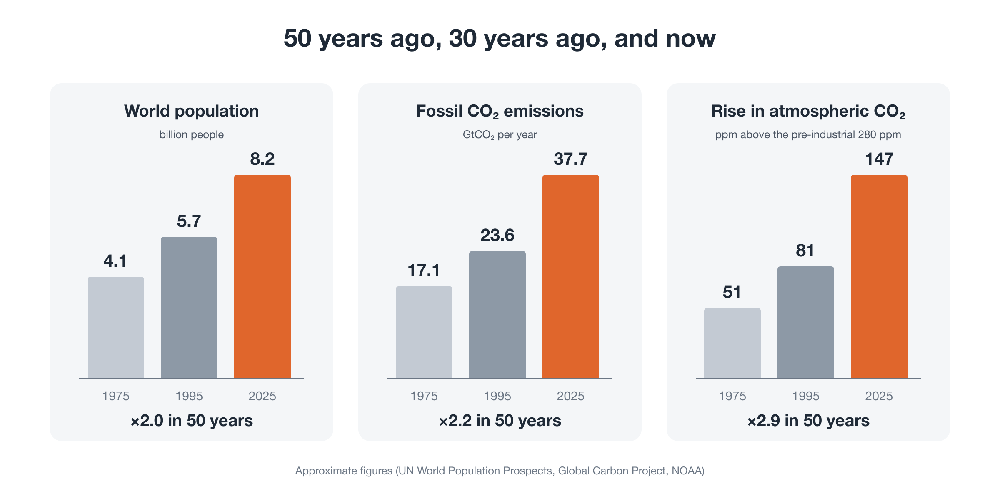
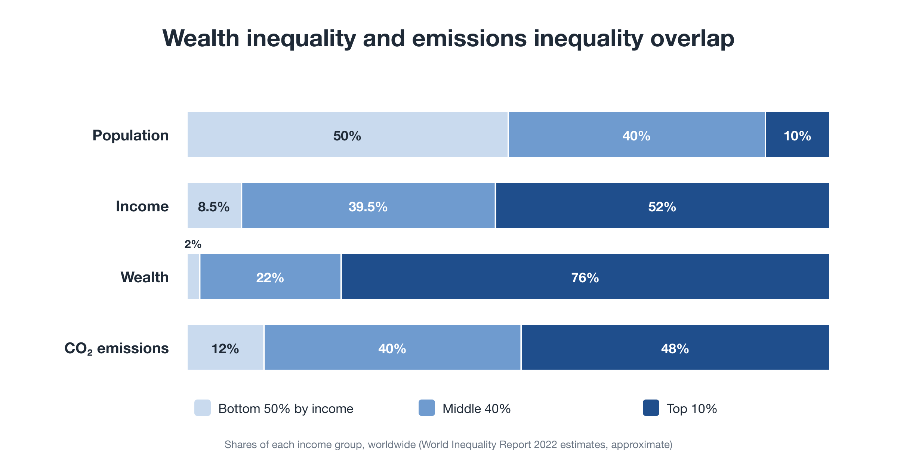

---
hide:
  - navigation
  - toc
---

Package proposal · working draft

# Steering Within Limits

Three proposals for a civilizational transition: <strong>Youth GCC</strong>, the <strong>Global Citizen Will Platform</strong>, and <strong>Planetary OS</strong>.

[See it in six pictures (about 6 minutes)](pictures.md){ .md-button .md-button--primary }
[Read the whole idea in one go](start.md){ .md-button }
[Try the dividend simulator](tools/simulator.md){ .md-button }

## Where to start

| If you have… | Read |
|---|---|
| 6 minutes, in pictures | [The proposal in pictures](pictures.md): the core of the idea in six illustrations |
| 3 minutes | [One-page overview](overview.md): the problem, the three proposals, and how they fit |
| 10 minutes | [Why now?](why-now.md): why civilization must now learn to steer |
| 15 minutes | [Start here](start.md): the whole idea in one read, with the reasoning behind it |
| An interest in taking part, funding, or research | [Package proposal](package.md): roles, roadmap, risks, and what we are asking for |
| A specific question | [Proposals A, B, C](proposals/a-youth-gcc.md), [the series](series/part-0.md), and the [Planetary OS FAQ](proposals/c-faq.md) |

## Why now

In fifty years, the world's population has doubled, annual fossil CO₂ emissions have more than doubled, and about 70% of all fossil CO₂ ever emitted has been released. Most of it came after the world had been warned.

The problem is not a lack of effort, goodwill, or technology. Our civilization's operating system, an economy built to expand and a politics built around nation-states, has reached limits it was never designed for. **A civilization that grew without steering must learn to steer within limits.** [Read *Why Now?*](why-now.md)

## Not a shortage, but a blockage

Humanity as a whole already has enough. What is missing is circulation: wealth and emissions are concentrated in the same hands.

## Three gaps, three proposals

A · Who

### Youth GCC
A youth-led global citizens' congress for future generations, with a World Citizens' Assembly selected by lot, a World Policy Institute, and a World Policy Laboratory.

[Proposal A →](proposals/a-youth-gcc.md)

B · How

### Global Citizen Will Platform
A federation of existing movements that makes support visible and connects it to governments, courts, elections, and markets.

[Proposal B →](proposals/b-platform.md)

C · What

### Planetary OS
Operating rules under which reducing pays: a one-way cap on fossil fuels, 90% of revenue returned to citizens, a share of historical liability, and a club worth joining.

[Proposal C →](proposals/c-summary.md)

## How Planetary OS works

Because energy use rises steeply with income, returning the revenue in equal shares means **about 70% of people come out ahead** under standard assumptions, and a majority-benefit rule tops up households just short of break-even so that **at least 70%** do. [Check your own household in the simulator.](tools/simulator.md)

## One question for politics

Not "please act," but **"Here is a working design. Will you connect to it?"**

[Join as a Co-Initiator](join.md){ .md-button .md-button--primary }
[Read the package proposal](package.md){ .md-button }
[Read the series](series/part-0.md){ .md-button }

All names, ratios, and figures are illustrative. This is a working draft, published to be criticized, tested, and rewritten.

