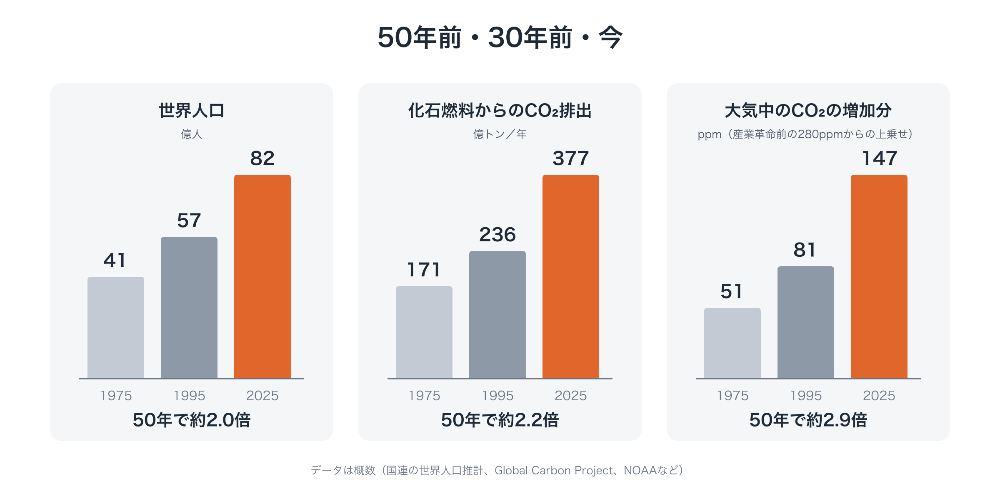
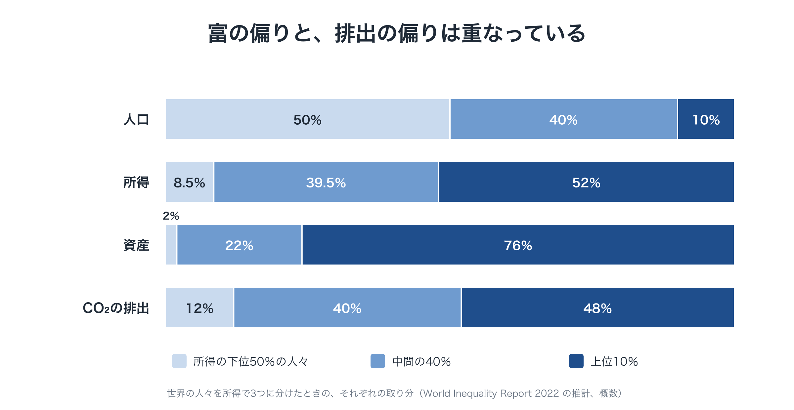

---
hide:
  - navigation
  - toc
---

パッケージ提案 · 草案

# 限界の内側で、舵を取る

文明の転換に向けた3つの提案：<strong>Youth GCC</strong>、<strong>Global Citizen Will Platform</strong>、<strong>Planetary OS</strong>

[はじめての方へ：全体をひと続きで読む](start.md){ .md-button .md-button--primary }
[1ページ概要を読む](overview.md){ .md-button }
[還元シミュレーターを試す](tools/simulator.md){ .md-button }
[スライドを見る](tools/slides.md){ .md-button }

## どこから読むか

| 時間や関心 | 読むもの |
|---|---|
| 7分ほど | [1ページ概要](overview.md)：問題、3つの提案、その組み合わせ方 |
| 20分ほど | [なぜ今か](why-now.md)：文明がいま「舵を取る」段階にある理由 |
| 45分ほど | [はじめての方へ](start.md)：提案の全体を、理由とともにひと続きで |
| 参加・資金提供・研究を検討している | [パッケージ提案書](package.md)：役割分担、進め方、リスク、求めていること |
| 特定の点を詳しく知りたい | [提案A・B・C](proposals/a-youth-gcc.md)、[連載](series/part-0.md)、[Planetary OS のよくある質問](proposals/c-faq.md) |

## なぜ今なのか

この50年で、世界の人口は約2倍に、化石燃料からの年間のCO₂排出量は2倍以上になりました。産業革命以来の累積排出の約7割が、この50年間に出されています。その大半は、世界が警告を受けたあとのことです。

問題は、努力や善意や技術の不足ではありません。拡大し続けるように作られた経済と、国家を単位とする政治という文明のOSが、もともと想定していなかった限界に達しているのです。**舵を取らずに成長してきた文明は、限界の内側で舵を取ることを学ばなければなりません。** [記事「なぜ今なのか」を読む](why-now.md)

## 足りないのではなく、めぐっていない

人類全体では、すでに足りています。欠けているのは、めぐりです。富と排出は、同じところに集中しています。

## 3つの空白と、3つの提案

A · 誰が

### Youth GCC
将来世代のための、若者主導の地球市民会議。くじ引きで選ぶ世界市民会議、世界政策機構、世界政策実証局を備えます。

[提案A →](proposals/a-youth-gcc.md)

B · どのように

### Global Citizen Will Platform
既存の運動の連合。支持を目に見える形にし、政府・裁判所・選挙・市場につなぎます。

[提案B →](proposals/b-platform.md)

C · 何を

### Planetary OS
減らすほど得をする動作ルール。化石燃料への一方向の上限、収入の9割を市民に還元、過去の負債の分かち合い、参加すると得をするクラブ。

[提案C →](proposals/c-summary.md)

## Planetary OS のしくみ

エネルギーの使用量は所得とともに急に増えるため、収入を一人あたり同じ額で還すと、標準的な前提で**約7割の人の手取りがプラス**になります。さらに、損益の境目にいる世帯に上乗せする多数派保証ルールで、**少なくとも7割**がプラスになるようにします。[自分の世帯をシミュレーターで確かめる](tools/simulator.md)

## 政治への、一つの問い

「動いてください」ではなく、**「動く設計図がここにあります。この仕組みにつなぎますか」**

[共同発起人として参加する](join.md){ .md-button .md-button--primary }
[パッケージ提案書を読む](package.md){ .md-button }
[連載を読む](series/part-0.md){ .md-button }

制度の名前・比率・数値は、すべて一例です。批判され、試され、書き直されるために公開している草案です。

