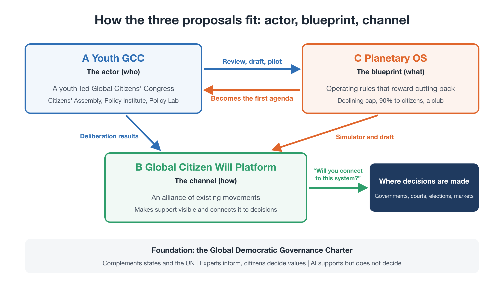
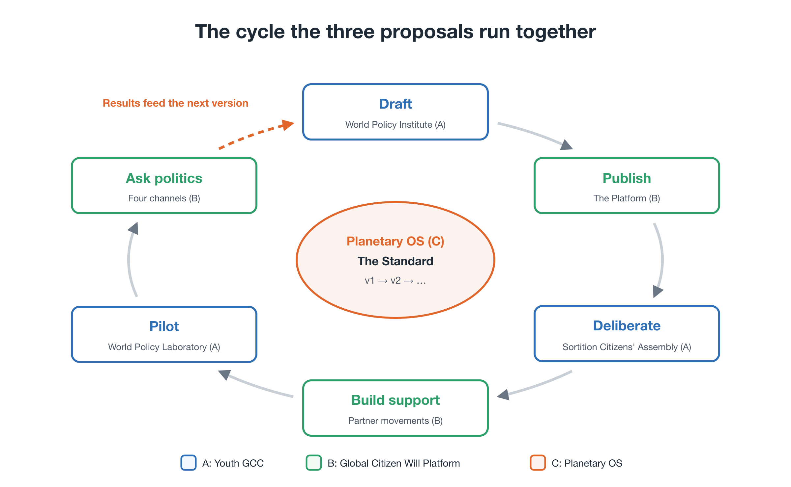

# Steering Within Limits
## Three proposals for a civilizational transition: Youth GCC, the Global Citizen Will Platform, and Planetary OS

**Package Proposal** — First edition (working draft)

!!! info "About this page"
    For prospective partners, funders, and researchers: how the three proposals divide the work, how they will proceed, the risks, and what we are asking for (about 20 minutes). If you are new to the proposal, start with Start here [→](start.md) (about 15 minutes).

---

### About this document

- This document presents three proposals as **one package**:
  - **Proposal A — Youth GCC:** who acts
  - **Proposal B — Global Citizen Will Platform:** how civic will is gathered and connected to decisions
  - **Proposal C — Planetary OS:** what the system runs on
- It also explains **why now**: why this is a turning point for civilization, and not only a climate emergency.
- Each proposal has its own detailed documents. This package shows how they fit together, and links to them (Section 12).
- All names, ratios, figures, and organizational forms are **illustrative**. They show a direction, not a final design. The details are meant to be rewritten through expert review, civic deliberation, and pilots.
- This document was written by one individual with extensive use of AI. On how AI was used and the author's responsibility, see About [→](about.md).

---

## Contents

0. Summary
1. Why now: a turning point for civilization
2. Three gaps, three proposals
3. Proposal A — Youth GCC: who acts
4. Proposal B — Global Citizen Will Platform: how civic will is connected
5. Proposal C — Planetary OS: what the system runs on
6. How the three fit together
7. Beyond the first agenda: the deeper layers of the OS
8. An integrated roadmap
9. Shared principles
10. Risks and how we address them
11. What we are asking for
12. Documents in this package

---

## 0. Summary

For decades, enormous effort has gone into the climate crisis and other global risks, and still the curves have not bent. This package argues that the reason is not a lack of effort, goodwill, or technology. The reason is that **the operating system of our civilization, an economy built to expand and a politics built around nation-states, has reached the limits it was never designed to handle.**

We are at the point where a civilization that grew **without steering** must learn to **steer within limits**. That does not mean central planning, and it does not mean leaving everything to markets. It means defining the planet's physical boundaries as non-negotiable guardrails, and keeping society inside them by continual, data-driven correction, with democratic goals and humility about what we cannot predict.

Three things are missing for that transition, and each proposal fills one gap:

| Missing | Proposal | What it provides |
|---|---|---|
| An actor that speaks for the future across borders | **A — Youth GCC** | A youth-led global citizens' congress, with a citizens' assembly, a World Policy Institute, and a World Policy Laboratory |
| A channel from scattered civic will to real decisions | **B — Global Citizen Will Platform** | A federated platform that gathers proposals and consensus from existing movements and connects them to governments, courts, elections, and markets |
| A concrete blueprint for the system to move to | **C — Planetary OS** | Operating rules under which reducing pays: a one-way cap, a Citizen Dividend, a share of historical liability, and a club worth joining |

The three are designed to work as one. Youth GCC launches with Planetary OS as its first agenda. The platform carries one question to politics: not "please act," but **"will you connect to this?"** Each depends on the others: a blueprint without carriers stays on paper, carriers without a blueprint lose direction, and both need a channel to reach decisions.

---

## 1. Why now: a turning point for civilization

*The full argument, with data and figures, is in the companion essay "Why Now?" [→](why-now.md). This chapter gives the essentials.*

**The diagnosis.** In fifty years, the world's population has doubled, annual fossil CO₂ emissions have more than doubled, and about 70% of all fossil CO₂ ever emitted has been released. Meanwhile, productivity gains are absorbed by overcompetition, and benefits flow into asset prices while daily life gets harder. Wealth and emissions are concentrated in the same hands: the top 10% by income hold about 76% of the world's wealth and produce about 48% of its emissions. The problem is not a shortage of resources or effort. It is a set of rules under which **everyone acting rationally produces a collective failure**.

**Why existing tools fall short.** Treaties that need near-unanimous consent and policies that can be reversed at the next election were built for one-off agreements. The planetary crisis demands **continuous, system-wide management** within physical limits. Applying the old tools to it is a category error.

**The transition.** Neither central planning nor market fundamentalism is the answer. What is needed is a shift from a **naturally arising civilization** to a **consciously steered civilization**:

- planetary limits defined strictly, as non-negotiable guardrails
- freedom for life and business within them
- continual correction by data and pre-agreed rules
- goals set democratically, including for future generations

Economic rules are human agreements, and they can be rewritten.

**Why now is possible.** The tools exist: planetary data, digital payments, AI translation, and tested citizens' assemblies. Belief that more growth will make life better is fading, especially among the young. And crises will come; the speed of the response will depend on whether a working alternative is already designed and tested.

This is not a call to become poorer or to overthrow anyone. It is a **graduation**: moving on from a system that has served its purpose, toward more time, more security, and a livable planet.

---

## 2. Three gaps, three proposals

If the diagnosis is right, what has been missing? Three things.

**Gap 1: no actor speaks for the future across borders.** Governments answer to today's voters within national borders. International bodies depend on the consent of their member states. The people with the greatest stake in the future, the young and those not yet born, have almost no voice in the decisions that will shape their lives.

**Gap 2: no channel connects scattered civic will to decisions.** Millions of people have marched, signed, and organized. But their efforts remain trapped within national agendas, and there is no shared infrastructure to turn them into visible, global support for specific policy choices.

**Gap 3: no one has drawn a blueprint for what comes next.** Most resources have gone into raising the alarm and asking governments to act. Very little has gone into designing, concretely and across disciplines, the system we should move to.

| Gap | Proposal | Role in the package |
|---|---|---|
| 1. No actor for the future | A — Youth GCC | **Who**: the actor and its institutions |
| 2. No channel for civic will | B — Global Citizen Will Platform | **How**: the channel from will to decisions |
| 3. No blueprint | C — Planetary OS | **What**: the operating rules |

---

## 3. Proposal A — Youth GCC: who acts

### 3.1 What it is

The **Youth-Led Global Citizens' Congress for Future Generations (Youth GCC)** is a youth-led, independent body that designs and advocates for global policy from the standpoint of future generations. It does not replace states or the United Nations. It builds **a second political circuit** alongside inter-state politics: one that identifies global problems, develops policy options from the standpoint of world citizens, debates them in the open, and presents the results to existing decision-makers.

### 3.2 Why youth

- **They have the largest stake.** Today's young people will live longest with the consequences of today's decisions.
- **They are less bound by existing interests.** With fewer obligations to particular industries or institutions, they can consider new designs openly.
- **They can spread ideas across borders.** They are fluent in digital tools and connected across countries.

Youth leadership is not a rejection of other generations. Experienced people play an essential role as advisors and partners.

### 3.3 How it is organized (illustrative)

**Four layers.**

- **A Youth Council** (roughly ages 15–35, representing regions of the world) that sets the agenda, runs the organization, and responds publicly to the citizens' assembly.
- **A World Citizens' Assembly** of citizens selected by lot from **all generations**, stratified so that youth and future-generation perspectives are deliberately strengthened.
- **An advisory layer** of scientists, legal scholars, experienced former policymakers, Indigenous leaders, faith leaders, and others, who advise but do not decide.
- **An open participation layer**, where anyone can take part through the Global Citizen Will Platform (Proposal B).

**Three functions, plus audit.** Following the Global Democratic Governance Charter (世界市民ガバナンス憲章), Youth GCC builds three functions that work together and check one another, with a Global Citizens' Policy Council connecting the assembly and the Institute:

| Function | Role |
|---|---|
| **World Citizens' Assembly** | Citizens chosen by lot from all generations and diverse regions and backgrounds deliberate with good information, and judge values, priorities, and acceptable risks |
| **World Policy Institute** | Experts organize the science, uncertainties, and evidence, and set out several policy options with their effects, costs, risks, and trade-offs |
| **Global Citizens' Policy Council** (connects the two) | A standing body where citizen representatives and experts meet between assembly sessions. The assembly is large and meets periodically, and the Institute is a body of experts, so a place is needed where the two work together continuously: it frames the questions, checks that the options are fair and understandable, and keeps continuity. Final authority rests with the citizen representatives |
| **World Policy Laboratory** | Options are tested through simulation, comparative study, and small pilots, and adopted policies are tracked and re-evaluated |
| **Independent audit** | Procedures, finances, conflicts of interest, and fairness of participation are reviewed and published |

**A policy cycle.** These functions connect into a continuous cycle: identify an issue, organize the evidence, develop options, deliberate, publish proposals (including dissenting views), seek responses from institutions, then implement, verify, and revise.

**Division of roles.** Experts clarify facts, options, and uncertainties. Citizens judge values and priorities. AI helps with translation, summarizing, and mapping arguments, but **never replaces human judgment**. How AI is used is published, and people can challenge it.

### 3.4 Relation to the UN and states

Youth GCC starts **outside** the formal UN system, so that its agenda is not limited by the consent of member states. But being outside the UN is not the same as being isolated from it. From the start, it seeks cooperation with UN bodies, governments, regional organizations, universities, and civil society.

**A duty to respond, not a power to compel.** At first, Youth GCC has no power to compel states. Instead, it asks states and international bodies to respond publicly to the assembly's recommendations, and to publish their reasons when they reject them.

**Legitimacy is earned, not declared.** No body becomes the voice of world citizens by announcing it. Youth GCC builds trust step by step through open participation, transparent procedures, expert review, and independent evaluation. Where existing institutions can provide a function, it works with them rather than duplicating them.

### 3.5 One agenda first

Youth GCC could address many issues: climate, the safety of advanced AI, an economy that does not depend on growth, and global citizenship education. At launch, however, it **concentrates on one agenda: Planetary OS**. A concrete first agenda gives a new organization a purpose, early results, and momentum. The first full run of the policy cycle is **an international citizens' assembly on climate policy**. In keeping with the Charter's principle of presenting several options, it compares the Planetary OS Standard, a detailed version of the Charter's "global carbon dividend" option, with alternative designs. Other issues follow once the cycle has been tested. The Global AI Citizens' Assembly proposed in the Charter is the next candidate, and could run in parallel. (Proposal A sets out the details.)

### 3.6 Funding (illustrative)

- Initial support from foundations and individual donors, with all funders disclosed.
- Crowdfunding with a cap per contributor, so that no single funder gains outsized influence.
- "Generational responsibility" giving: regular donations from older generations to future generations.
- Funding never buys influence over policy content.

---

## 4. Proposal B — Global Citizen Will Platform: how civic will is connected

### 4.1 What it is

The **Global Citizen Will Platform** is shared, open infrastructure that gathers proposals and expressions of support from existing movements around the world, makes global civic will visible, and connects it to real decision-making. It is the channel between Youth GCC and the world.

### 4.2 Federation, not competition

The platform does not compete with existing organizations or replace them. Youth movements, climate groups, and regional NGOs **keep their own names, autonomy, and campaigns**. They connect to a shared standard for proposals and support, and join as **Co-Initiators** with real ownership of the platform, not as subordinate members.

### 4.3 Core functions

- **Proposal and deliberation engine:** open-source participatory tools (for example, Decidim-based) to collect, compare, and deliberate on policy proposals.
- **Shared dashboard:** support, votes, and actions gathered locally are combined on one verifiable dashboard, shown alongside planetary indicators such as the remaining carbon budget.
- **Tools that let people see what a policy means for them,** such as the Citizen Dividend Simulator from Proposal C.
- **Privacy by design:** the minimum personal data needed, published methods, and verification against double counting.

### 4.4 Four channels to decisions

Visible civic will matters only if it reaches decisions. The platform connects it through four channels:

1. **Multilateral:** working with willing governments, such as climate-vulnerable states, to bring proposals to international forums.
2. **Legal:** offering verified data and deliberation records that can inform climate litigation, including claims about intergenerational harm.
3. **Electoral:** turning Youth GCC's policy proposals into questions that voters can put to candidates and parties.
4. **Markets:** helping consumers and investors align their choices with the Standard, so that non-compliance carries a growing cost.

The platform's power comes from **legitimacy and numbers, not from coercion**. It persuades, informs, and builds pressure through lawful channels. Whether to accept a proposal remains the decision of the institutions concerned.

### 4.5 Phases (illustrative)

| Phase | Content |
|---|---|
| 1. Federation | Connect existing youth groups through open standards; recruit Co-Initiators |
| 2. Visibility | Make support for specific proposals visible against planetary indicators |
| 3. Institutionalization | Convene Youth GCC with its advisory layer; begin the policy cycle |
| 4. Connection | Use the four channels to bring proposals into decision-making |

---

## 5. Proposal C — Planetary OS: what the system runs on

Planetary OS is a set of operating rules for a world where **reducing pays**. It is described in full in the Proposal C documents and the 8-part series. In brief:

**The diagnosis: two barriers.**

- **The burden falls only on the present.** Higher prices hit today's households, and support collapses.
- **Reducing alone means losing.** For individuals, firms, and nations alike, cutting back unilaterally is a loss.

**Four modules** build in the conditions to overcome both barriers:

| Module | Content (illustrative) |
|---|---|
| 1. BEI and the PTE | **BEI** (Benefit Equity Internalization): a thin, broad levy on those who benefited most from the fossil economy. **PTE** (Planetary Transition Endowment): a lasting endowment that holds it, for investment, guarantees, and support |
| 2. SAS | A one-way cap on fossil fuels at the upstream point, with allowances sold at auction; the cap tightens faster when it can, and never loosens |
| 3. Settlement and return | 90% of auction revenue returned directly to citizens, partly weighted toward those who use less; a majority-benefit rule tops up households just short of break-even so that at least 70% of people come out ahead |
| 4. Tamper-resistance | A double key, scientific justification plus approval by citizens' representatives, protects the rules from backsliding |

<figure markdown="span">
  
  <figcaption>The four modules of Planetary OS and the two money flows</figcaption>
</figure>

**Scaling.** Planetary OS spreads through **a club that is worth joining and costly to stay out of**, with reduction rates that rise as the club grows, border carbon adjustment, and rules fixed at launch. The target is **staying well below 2°C**.

**Stage 1 outputs:** the first edition of the Planetary OS Standard, a public Citizen Dividend Simulator, and the launch of Youth GCC with partner organizations.

---

## 6. How the three fit together

<figure markdown="span">
  
  <figcaption>How the three proposals fit: actor, blueprint, channel</figcaption>
</figure>

### 6.1 Interfaces

The three proposals connect at specific points:

- **A:** Youth GCC (who acts)
- **B:** Global Citizen Will Platform (how civic will reaches decisions)
- **C:** Planetary OS (what the system runs on)

| Interface | How it works |
|---|---|
| A ↔ C | Youth GCC launches with Planetary OS as its first agenda. Its World Citizens' Assembly is the natural base for the **citizens' layer of the PPA** (the body that writes the Standard), and its citizens' representatives hold one half of the **double key** |
| A ↔ C | The World Policy Institute hosts the working groups that draft the Standard (economics, science, law). The World Policy Laboratory runs the simulator and pilots |
| B ↔ C | The platform carries the Citizen Dividend Simulator and the question "**will you connect to this?**" to voters, candidates, and governments |
| A ↔ B | The platform federates existing movements as Co-Initiators of Youth GCC, and makes support for its proposals visible |
| C → A, B | Planetary OS gives the movement something concrete to ask for, and a reason for citizens to support it: a dividend they can see |

### 6.2 One cycle, from idea to implementation

1. **Draft (A, C):** the World Policy Institute's working groups publish a first edition of the Standard.
2. **Show (B, C):** the platform publishes the Standard and the simulator; people check what it would mean for their household.
3. **Deliberate (A):** the World Citizens' Assembly reviews the Standard and records agreements and disagreements.
4. **Gather support (B):** partner movements gather support for the revised Standard in many countries.
5. **Test (A, C):** the World Policy Laboratory runs pilots with willing municipalities or small island states.
6. **Ask (B):** the four channels put one question to politics: "Will you connect?"
7. **Learn and revise (A, C):** results feed into the next edition of the Standard.

<figure markdown="span">
  
  <figcaption>The cycle the three proposals run together</figcaption>
</figure>

### 6.3 Why the package, not the parts

Each proposal alone has a known failure mode:

- A **blueprint without carriers** stays on paper.
- **Carriers without a blueprint** lose direction and end in general demands.
- **Both without a channel** remain small and easy to ignore.

Together, they form a complete loop: a concrete design, people who carry it, and a path into decisions.

---

## 7. Beyond the first agenda: the deeper layers of the OS

Planetary OS addresses the most urgent layer: keeping the economy within the carbon budget while making reduction pay. But the deeper problem is the rule that the economy must keep expanding. Once the policy cycle is working, Youth GCC can take up further layers. These are directions for later deliberation, not part of the first agenda (Background essay 2 develops them further):

- **Returning productivity as time.** Turning gains from AI and automation into shorter standard working hours, rather than into ever more output and overcompetition.
- **Accounting for ecological liability.** Recognizing cumulative environmental damage as a liability in the accounts of firms and financial assets. BEI and the PTE are a first, practical step in this direction.
- **A financial safety net for slowing growth.** Using the PTE, or a similar buffer, to absorb shocks so that slowing growth does not trigger a financial crisis.
- **Designing the economy.** Treating the economy's parameters as democratic choices, including a Designed Model Economy, a Global Shrinkage Evaluation System, and a Dual Value Economy that measures contributions to the planet alongside money.
- **Governing advanced AI** within planetary and social limits, through the same cycle of deliberation, options, and testing.

---

## 8. An integrated roadmap

The length of each stage is not fixed in advance. Each stage proceeds when the previous one meets published criteria.

| Phase | Proposal A (who) | Proposal B (how) | Proposal C (what) |
|---|---|---|---|
| **0. Foundations** (now) | Proposals published; first young partners gathered | Co-initiator page and outreach | Series, proposal documents, FAQ, simulator prototype |
| **1. Launch** | Youth GCC founded with co-founders; advisory layer formed; working groups organized | Federation of first partner movements; platform prototype | First edition of the Standard drafted; simulator published |
| **2. Verification** | First World Citizens' Assembly reviews the Standard; independent evaluation | Support made visible for the revised Standard | Standard revised; talks with pilot hosts |
| **3. Pilots** | World Policy Laboratory runs pilots and evaluations | Results shared widely | Small-scale pilots of the dividend and related rules |
| **4. Connection** | Proposals presented to governments and international forums | The four channels put "Will you connect?" to politics | Club formation with first-mover countries and cities |

Stage 1 of Proposal C (the Standard, the simulator, and the launch of Youth GCC, over roughly eighteen months) corresponds to Phases 1 and 2.

---

## 9. Shared principles

All three proposals follow the same principles:

1. **Strict limits, freedom within.** Only the planet's outer boundaries are strictly enforced. No individual surveillance.
2. **Complement, do not replace.** Work with states, the UN, and existing movements, and avoid duplicating what they already do well.
3. **Legitimacy is earned.** Trust comes from open participation, transparency, expert review, and independent evaluation, not from claims.
4. **Experts inform, citizens decide values.** Facts and options come from science; priorities and acceptable risks come from deliberation.
5. **Protect against backsliding.** Rules that protect the future are hard to loosen, but always open to learning.
6. **Humility.** Every design here is a working draft. It is published to be criticized, tested, and rewritten.
7. **Illustrative numbers.** All figures show a direction. Real values come from scientific review and democratic choice.

---

## 10. Risks and how we address them

| Risk | Description | Response |
|---|---|---|
| Legitimacy | "Who gave you the right to speak for world citizens?" | Selection by lot; open procedures; published minority views; legitimacy built through a track record |
| Capture | Funders, states, or firms gain undue influence | Separation of functions; funding caps; disclosure; independent audit |
| Overreach | Trying to do everything at once | One agenda first; staged growth with published criteria |
| Confrontation | Being seen as hostile to governments or existing movements | Complementary stance; partners as Co-Initiators; lawful channels only |
| Fragmentation | Partner movements pull in different directions | A shared Standard and a shared question; autonomy for each partner |
| A single-author design | Blind spots and bias | Published as a draft; rewritten through expert and civic review |
| Misuse of AI | Errors, bias, or hidden steering of deliberation | AI supports, never decides; methods published; open to challenge |

---

## 11. What we are asking for

| Who | Ask |
|---|---|
| Young people and youth organizations | Join as co-founders and Co-Initiators of Youth GCC |
| Climate and civic movements | Federate through the platform; use the simulator in your campaigns |
| Researchers and experts | Join a working group; review and co-author the Standard |
| Civic tech developers | Help build the platform and the simulator |
| Experienced leaders, Indigenous and faith leaders | Serve on the advisory layer |
| Foundations and funders | Support the foundations and launch phases |
| Municipalities and small island states | Host pilots |
| Established NGOs and universities | Act as a fiscal host |

---

## 12. Documents in this package

| Proposal | Documents |
|---|---|
| Package | This document; Japanese translation |
| A — Youth GCC | **Proposal A (summary)** [→](proposals/a-youth-gcc.md); Global Democratic Governance Charter [→](charter/charter.md); essay *Building Another World Politics* [→](charter/another-world-politics.md); earlier documents: Global Citizens' Congress proposal [↗](https://ttmori.substack.com/p/proposal-global-citizens-congress), Global Citizens' Assembly series [↗](https://ttmori.substack.com/p/a-proposal-for-a-global-citizens?r=5dzcae), Youth GCC petition [↗](https://c.org/4jScSgpYhq) |
| B — Global Citizen Will Platform | Proposal B (summary) [→](proposals/b-platform.md); Co-Initiator page [→](join.md) |
| C — Planetary OS | Executive Summary [→](proposals/c-summary.md); Full Proposal [→](proposals/c-full.md); FAQ [→](proposals/c-faq.md); series *Rewriting the Planet's OS* (8 parts) [→](series/part-0.md); Citizen Dividend Simulator [→](tools/simulator.md) |
| Background | Essay: *Why Now?* [→](why-now.md); Background essay 1: *Why Doesn't Technology Make Life Easier?* [→](essays/why-technology.md); Background essay 2: *The Next Layers of Planetary OS* [→](essays/next-layers.md); BEI policy white paper [↗](https://ttmori.substack.com/p/policy-white-paper-proposal-a-new?r=5dzcae) |

**Contact:** Tatsuya Mori · [Substack](https://ttmori.substack.com) · [note](https://note.com/ttmori) · [X](https://x.com/ttmori) · [Contact form](https://docs.google.com/forms/d/e/1FAIpQLSexBpD4BcRWIV--FuhMC9BxbP4I9fXl6pi9nxQPmX2bjivjqw/viewform)
