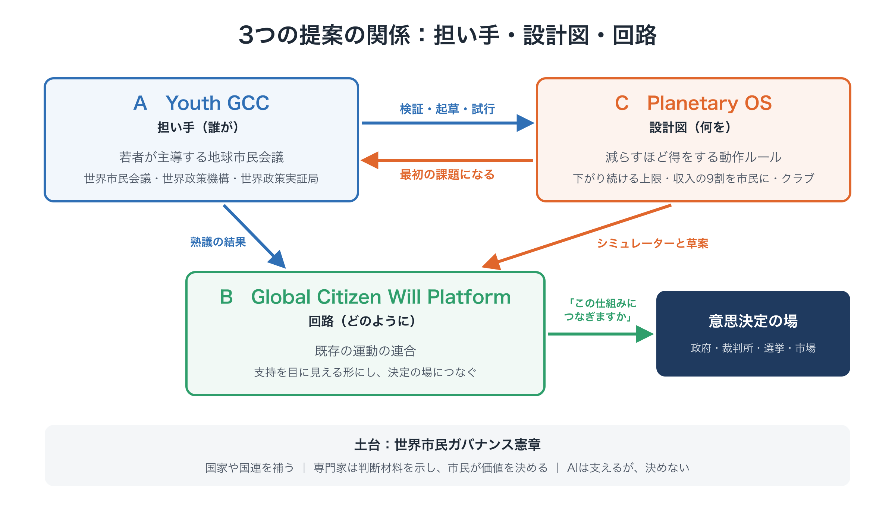
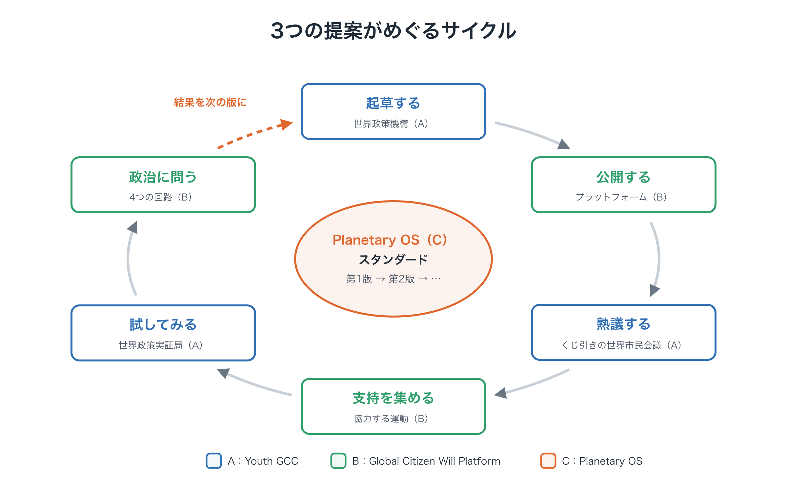

# 限界の内側で、舵を取る
## 文明の転換に向けた3つの提案：Youth GCC、Global Citizen Will Platform、Planetary OS

**パッケージ提案書**　第1版（草案）

!!! info "このページについて"
    協力者・資金提供者・研究者に向けて、3つの提案の役割分担、進め方、リスク、求めていることを示す文書です（約20分）。はじめて読む方は、先に「はじめての方へ」[→](start.md)（約15分）をお読みください。

---

### 本書について

- 本書は、3つの提案を**一つのパッケージ**として示すものです。
  - **提案A：Youth GCC** ―― 誰が担うか
  - **提案B：Global Citizen Will Platform** ―― 市民の意思をどう集め、意思決定につなげるか
  - **提案C：Planetary OS** ―― 社会を何のルールで動かすか
- あわせて、**なぜ今なのか**を説明します。今は気候の非常事態であるだけでなく、文明の転換点でもあるということです。
- それぞれの提案には、詳しい文書があります。本書は、3つがどう組み合わさるのかを示し、各文書へ案内します（12章）。
- 本書で示す名前・比率・数値・組織の形は、すべて**一例**です。方向性を示すもので、最終的な設計ではありません。細部は、専門家の検証、市民の熟議、試行を通じて書き直していくことを前提としています。
- 本書は、一人の個人がAIを大きく活用して作成しました。AIの使い方と、筆者の責任については、「このサイトについて」[→](about.md)をご覧ください。

---

## 目次

0. 要約
1. なぜ今なのか：文明の転換点
2. 3つの空白と、3つの提案
3. 提案A：Youth GCC ―― 誰が担うか
4. 提案B：Global Citizen Will Platform ―― 市民の意思をどうつなぐか
5. 提案C：Planetary OS ―― 社会を何のルールで動かすか
6. 3つはどう組み合わさるのか
7. 最初の課題の先へ：OSのより深い層
8. 統合したロードマップ
9. 共通の原則
10. リスクと対応
11. お願いしたいこと
12. パッケージの文書

---

## 0. 要約

何十年ものあいだ、気候危機をはじめとする地球規模のリスクに、莫大な努力が注がれてきました。それでも、曲線は曲がっていません。本書は、その理由が努力や善意や技術の不足ではないと考えます。**私たちの文明のOS、つまり拡大し続けるように作られた経済と、国家を単位とする政治が、もともと想定していなかった限界に達している**からです。

私たちは今、**舵を取らずに**成長してきた文明が、**限界の内側で舵を取る**ことを学ばなければならない地点に立っています。それは中央計画ではありません。すべてを市場に任せることでもありません。地球の物理的な境界を交渉の余地のないガードレールとして定め、データに基づく絶え間ない修正で、社会をその内側に保ち続けることです。目標は民主的に決め、予測できないことへの謙虚さを持ち続けます。

この転換には、3つのものが欠けています。それぞれの提案が、一つずつ空白を埋めます。

| 欠けているもの | 提案 | 提供するもの |
|---|---|---|
| 国境を越えて、未来のために語る担い手 | **A：Youth GCC** | 若者が主導する世界市民会議。市民会議、世界政策機構、世界政策実証局を備える |
| 散らばった市民の意思を、現実の意思決定につなぐ回路 | **B：Global Citizen Will Platform** | 既存の運動から提案と支持を集め、政府・裁判所・選挙・市場につなぐ連合型のプラットフォーム |
| 移行先の具体的な設計図 | **C：Planetary OS** | 減らすほど得をする動作ルール。一方向の上限、市民への還元、過去の負債の分かち合い、参加すると得をするクラブ |

3つは、一体として働くように設計しています。Youth GCC は、Planetary OS を最初の課題として立ち上がります。プラットフォームは、政治に一つの問いを届けます。「動いてください」ではなく、**「この仕組みにつなぎますか」**という問いです。どれか一つが欠けても成り立ちません。担い手のない設計図は紙の上にとどまり、設計図のない担い手は方向を見失い、両方とも、意思決定に届く回路を必要とします。

---

## 1. なぜ今なのか：文明の転換点

*データと図を含めた詳しい議論は、記事「なぜ今なのか」[→](why-now.md)にまとめています。この章では、その要点を示します。*

**診断**：この50年で、世界の人口は約2倍に、化石燃料からの年間のCO₂排出量は2倍以上になりました。産業革命以来のCO₂の累積排出の約7割が、この50年間に出されています。その一方で、生産性の向上は過剰な競争に飲み込まれ、恩恵は資産の価格に流れ込み、日々の暮らしは楽になっていません。富と排出は同じところに集中しています。所得の上位10％の人々が、世界の資産の約76％を持ち、排出の約48％を出しています。問題は、資源や努力の不足ではありません。**一人ひとりが合理的に行動するほど、全体として共倒れになる**ルールにあります。

**今の道具が届かない理由**：ほぼ全員の同意を必要とする条約や、次の選挙で覆されうる政策は、一度きりの合意のために作られた道具です。地球の危機が求めているのは、物理的な限界の内側での、**社会全体の継続的な管理**です。古い道具でそれに臨むことは、問題の種類の取り違えです。

**転換**：答えは、中央計画でも市場原理主義でもありません。必要なのは、**自然発生の文明**から、**意識して舵を取る文明**への転換です。

- 地球の限界は、交渉の余地のないガードレールとして厳格に定める
- その内側の暮らしと事業は自由にする
- データと、あらかじめ合意したルールで、絶えず修正する
- 目標は、将来世代の声も含めて民主的に決める

経済のルールは人間の合意であり、書き換えることができます。

**なぜ今、可能なのか**：道具がそろいました。地球のデータ、デジタルの決済、AIによる翻訳、試されてきた市民会議です。もっと成長すれば暮らしが良くなるという考えは、特に若い世代で力を失いつつあります。そして危機は来ます。そのときの対応の速さは、動く代わりの仕組みが、すでに設計され試されているかどうかで決まります。

これは、貧しくなることでも、誰かを打倒することでもありません。役目を終えた仕組みから**卒業**し、より多くの時間、より大きな安心、住み続けられる地球へと進むことです。

---

## 2. 3つの空白と、3つの提案

この診断が正しいなら、何が欠けていたのでしょうか。3つあります。

**空白①：国境を越えて、未来のために語る担い手がいない。** 政府は、国境の内側の今の有権者に責任を負います。国際機関は、加盟国の同意に依存します。未来に最も大きな利害を持つ人々、つまり若者とまだ生まれていない世代は、自分たちの暮らしを左右する決定に、ほとんど声を持っていません。

**空白②：散らばった市民の意思を、意思決定につなぐ回路がない。** 何百万もの人が、行進し、署名し、組織してきました。けれども、その努力は各国の政治の枠の中にとどまり、特定の政策の選択肢への支持を、世界規模で目に見える形にする共通の基盤がありません。

**空白③：移行先の設計図を、誰も描いていない。** 資源の多くは、危機を訴え、政府に行動を求めることに注がれてきました。移っていく先の仕組みを、分野を越えて具体的に設計することには、ほとんど注がれてきませんでした。

| 空白 | 提案 | パッケージでの役割 |
|---|---|---|
| ① 未来のための担い手がいない | A：Youth GCC | **誰が**：担い手と、その制度 |
| ② 市民の意思をつなぐ回路がない | B：Global Citizen Will Platform | **どのように**：意思から意思決定への回路 |
| ③ 設計図がない | C：Planetary OS | **何を**：動作ルール |

---

## 3. 提案A：Youth GCC ―― 誰が担うか

### 3.1 どんなものか

**将来世代のための地球市民会議（Youth-Led Global Citizens' Congress for Future Generations：Youth GCC）**は、若者が主導する独立した組織です。将来世代の立場から、地球規模の政策を設計し、提案します。国家や国連に取って代わるものではありません。国家間の政治と並んで、**もう一つの政治の回路**をつくります。地球規模の課題を見つけ、世界市民の立場から政策の選択肢をつくり、開かれた場で議論し、その成果を既存の意思決定機関に示す回路です。

### 3.2 なぜ若者なのか

- **最も大きな利害を持つ当事者だから。** 今の決定の結果と最も長く付き合うのは、今の若者です。
- **既存の利害にとらわれにくいから。** 特定の業界や組織への義理が少なく、新しい設計を素直に検討できます。
- **国境を越えて広げる力があるから。** デジタルの道具を使いこなし、国を越えてつながっています。

若者が主導することは、他の世代を退けることではありません。経験のある人々は、助言者やパートナーとして欠かせない役割を担います。

### 3.3 組織のあり方（一例）

**4つの層**

- **若者評議会**（15〜35歳程度、世界の各地域を代表）：議題を決め、組織を運営し、市民会議に公開で応答します。
- **世界市民会議**：**すべての世代**から、くじ引きで選ばれた市民。若者と将来世代の視点が意識して厚くなるよう、層別に選びます。
- **助言の層**：科学者、法律家、経験のある元政策担当者、先住民族のリーダー、宗教指導者などが、助言を担います。決定はしません。
- **開かれた参加の層**：Global Citizen Will Platform（提案B）を通じて、誰でも参加できます。

**3つの機能と、監査**
世界市民ガバナンス憲章に基づき、Youth GCC は、互いに連携し、互いを確かめ合う3つの機能を備えます。世界市民会議と世界政策機構は、世界市民政策評議会がつなぎます。

| 機能 | 役割 |
|---|---|
| **世界市民会議** | すべての世代と、さまざまな地域・背景から、くじ引きで選ばれた市民が、十分な情報のもとで熟議し、価値、優先順位、受け入れられるリスクを判断する |
| **世界政策機構** | 専門家が、科学的な知見、不確実性、根拠を整理し、効果・費用・リスク・トレードオフを示した複数の政策の選択肢をつくる |
| **世界市民政策評議会**（両者をつなぐ） | 市民の代表と専門家が、会議と会議のあいだも顔を合わせる常設の機関。世界市民会議は大きく、定期的に開かれ、世界政策機構は専門家の機関なので、両者が継続して一緒に働く場が要る。問いを立て、選択肢が公平で分かりやすいかを確かめ、継続性を保つ。最終的な権限は、市民の代表にある |
| **世界政策実証局** | シミュレーション、比較研究、小規模な試行で選択肢を確かめ、採用された政策を追跡し、評価し直す |
| **独立した監査** | 手続き、財務、利益相反、参加の公平さを確認し、公開する |

**政策形成のサイクル**
これらの機能は、途切れないサイクルとしてつながります。課題を見つけ、根拠を整理し、選択肢をつくり、熟議し、提案を公表し（少数意見も含めて）、各機関に応答を求め、実施し、検証し、修正します。

**役割の分担**
専門家は、事実、選択肢、不確実性を明らかにします。市民は、価値と優先順位を判断します。AIは、翻訳、要約、論点の整理を助けますが、**人の判断に取って代わることはありません**。AIの使い方は公開し、誰でも異議を申し立てられるようにします。

### 3.4 国連や国家との関係

Youth GCC は、国連の正式な枠組みの**外**から始めます。議題が加盟国の同意に縛られないようにするためです。ただし、国連の外にあることと、国連から孤立することは違います。最初から、国連の機関、各国政府、地域機構、大学、市民社会との協力を求めます。

**強制する力ではなく、応答してもらうしくみ。** 最初、Youth GCC は国家を強制する力を持ちません。その代わりに、国家と国際機関に、世界市民会議の提言へ公開で応答し、拒否する場合はその理由を公開してもらうことを求めます。

**正統性は、宣言するものではなく、積み重ねるものです。** 名乗るだけで、世界市民の声になれる組織はありません。Youth GCC は、開かれた参加、透明な手続き、専門家の検証、独立した評価を通じて、一歩ずつ信頼を築きます。既存の機関が担える機能は、重ねてつくるのではなく、その機関と協力します。

### 3.5 まず一つの課題から

Youth GCC が扱いうる課題は数多くあります。気候、高度なAIの安全、成長に頼らない経済、地球市民としての教育などです。けれども立ち上げの段階では、**Planetary OS という一つの課題に集中します**。具体的な最初の課題があることで、新しい組織は目的と、早い成果と、勢いを得られます。政策のサイクルを最初に一通り動かすのは、**気候政策についての国際的な市民会議**です。複数の選択肢を示すという憲章の原則に沿って、憲章の「世界炭素配当型」を具体化した Planetary OS の Standard を、別の制度案と並べて比べます。その他の課題は、サイクルが試されたあとに扱います。次の候補は、憲章が提案する Global AI Citizens' Assembly（世界AI市民会議）で、並行して進めることもできます（詳しくは提案A）。

### 3.6 資金（一例）

- 財団や個人の寄付者からの初期の支援。資金の出し手はすべて公開する。
- 一人あたりの上限を設けたクラウドファンディング。特定の出し手に影響力が偏らないようにする。
- 「世代の責任としての寄付」：上の世代から将来世代への、継続的な寄付。
- 資金を出したことで、政策の中身に影響を与えることはできない。

---

## 4. 提案B：Global Citizen Will Platform ―― 市民の意思をどうつなぐか

### 4.1 どんなものか

**Global Citizen Will Platform（地球市民の意思のプラットフォーム）**は、世界の既存の運動から提案と支持を集め、地球規模の市民の意思を目に見える形にし、現実の意思決定につなげる、共有された開かれた基盤です。Youth GCC と世界をつなぐ回路の役割を担います。

### 4.2 競争ではなく、連合

プラットフォームは、既存の組織と競ったり、取って代わったりしません。若者の運動、気候の団体、地域のNGOは、**それぞれの名前、自律性、活動をそのまま保ちます**。そのうえで、提案と支持のための共通の規格につながり、従属するメンバーとしてではなく、プラットフォームに本当の当事者として関わる**共同発起人（Co-Initiator）**として参加します。

### 4.3 中心となる機能

- **提案と熟議の仕組み**：オープンソースの参加型ツール（Decidim を土台にしたものなど）で、政策の提案を集め、比べ、熟議する。
- **共有のダッシュボード**：各地で集まった支持、投票、行動を、一つの検証できるダッシュボードにまとめ、残された炭素予算などの地球の指標と並べて示す。
- **政策が自分にとって何を意味するかが分かる道具**：提案Cの還元シミュレーターなど。
- **はじめからプライバシーを守る設計**：個人のデータは必要最小限にとどめ、方法を公開し、重複して数えないように確かめる。

### 4.4 意思決定につなぐ4つの経路

目に見える市民の意思は、意思決定に届いてはじめて意味を持ちます。プラットフォームは、次の4つの経路でつなぎます。

1. **多国間の経路**：気候被害を受けやすい国など、意欲のある政府と協力し、提案を国際的な場に届ける。
2. **司法の経路**：検証されたデータと熟議の記録を提供し、世代間の不利益をめぐる主張を含む、気候訴訟の判断材料にしてもらう。
3. **選挙の経路**：Youth GCC の政策提案を、有権者が候補者や政党に投げかけられる問いに変える。
4. **市場の経路**：消費者と投資家が、自分の選択を Standard に合わせられるよう支え、守らないことのコストを高めていく。

プラットフォームの力は、**強制からではなく、正統性と数から生まれます**。説得し、情報を示し、合法的な経路を通じて圧力と影響力を積み上げます。提案を受け入れるかどうかは、最終的にはそれぞれの機関が決めることです。

### 4.5 段階（一例）

| 段階 | 内容 |
|---|---|
| 1. 連合 | 開かれた規格で既存の若者の団体をつなぐ。共同発起人を募る |
| 2. 可視化 | 特定の提案への支持を、地球の指標と並べて目に見える形にする |
| 3. 制度化 | 助言の層とともに Youth GCC を招集し、政策のサイクルを始める |
| 4. 接続 | 4つの経路で、提案を意思決定の場に届ける |

---

## 5. 提案C：Planetary OS ―― 社会を何のルールで動かすか

Planetary OS は、**減らすほど得をする社会**のための動作ルールです。詳しくは、提案Cの文書と全8回の連載で説明しています。要点は次のとおりです。

**診断：2つの壁**

- **今の人だけが負担する**：値上がりが今の家計を直撃し、支持が崩れる。
- **自分だけ減らすと損をする**：個人・企業・国のどれにとっても、一人だけ減らすのは損になる。

**4つのモジュール**が、2つの壁を越える条件を組み込みます。

| モジュール | 内容（一例） |
|---|---|
| 1. BEIとPTE | **BEI（恩恵の内部化）**：化石燃料の経済から最も恩恵を受けた側が、薄く広く負担する。**PTE（Planetary Transition Endowment）**：そのお金を、投資、保証、支援のための長く残る基金として運用する |
| 2. SAS | 化石燃料の上流に、一方向にしか動かない上限をかけ、排出枠を競売で売る。上限は、できるときには速く下げ、決して緩めない |
| 3. 清算と還元 | 競売収入の90％を市民に直接還す。その一部は少なく使う人ほど多く受け取る形にする。多数派保証ルールで、少なくとも7割の人の手取りがプラスになるようにする |
| 4. 改ざん防止 | 科学的な裏付けと市民の代表の承認という「二重の鍵」で、ルールの後退を防ぐ |

<figure markdown="span">
  
  <figcaption>Planetary OS の4つのモジュールと、2つのお金の流れ</figcaption>
</figure>

**広がり方**：Planetary OS は、**参加すると得をし、参加しないと損をするクラブ**として広がります。クラブが大きくなるほど上がる削減率、国境での炭素コストの調整、発足時に固めるルールを組み合わせます。目標は、**2℃を確実に下回ること**です。

**第1段階の成果物**：Planetary OS の Standard の第1版、公開の還元シミュレーター、協力団体とともに立ち上げる Youth GCC です。

---

## 6. 3つはどう組み合わさるのか

<figure markdown="span">
  
  <figcaption>3つの提案の関係：担い手・設計図・回路</figcaption>
</figure>

### 6.1 つながる点

3つの提案は、具体的な点でつながっています。

- **A**：Youth GCC（誰が担うか）
- **B**：Global Citizen Will Platform（市民の意思をどうつなぐか）
- **C**：Planetary OS（社会を何のルールで動かすか）

| つながり | 内容 |
|---|---|
| A ↔ C | Youth GCC は、Planetary OS を最初の課題として立ち上がる。世界市民会議は、Standard を書く場（PPA）の**市民の層**の自然な土台になり、その市民の代表が**二重の鍵**の片方を担う |
| A ↔ C | 世界政策機構が、Standard を起草する作業部会（経済、科学、法務）を受け持つ。世界政策実証局が、シミュレーターと試行を担う |
| B ↔ C | プラットフォームが、還元シミュレーターと「**この仕組みにつなぎますか**」という問いを、有権者、候補者、政府に届ける |
| A ↔ B | プラットフォームが、既存の運動を Youth GCC の共同発起人としてつなぎ、その提案への支持を目に見える形にする |
| C → A、B | Planetary OS が、運動に具体的な求めるものを与え、市民には支持する理由（目に見える還元）を与える |

### 6.2 構想から実装までの、一つのサイクル

1. **起草する（A、C）**：世界政策機構の作業部会が、Standard の第1版を公開する。
2. **見せる（B、C）**：プラットフォームが Standard とシミュレーターを公開し、人々が自分の家計にとっての意味を確かめる。
3. **熟議する（A）**：世界市民会議が Standard を検証し、合意した点と意見が分かれた点を記録する。
4. **支持を集める（B）**：協力する運動が、多くの国で、改訂した Standard への支持を集める。
5. **試す（A、C）**：世界政策実証局が、意欲のある自治体や小島嶼国で試行する。
6. **問う（B）**：4つの経路で、政治に一つの問いを投げかける。「この仕組みにつなぎますか」。
7. **学び、直す（A、C）**：結果を、次の版の Standard に反映する。

<figure markdown="span">
  
  <figcaption>3つの提案がめぐるサイクル</figcaption>
</figure>

### 6.3 なぜ、ばらばらではなくパッケージなのか

それぞれの提案は、単独では、よく知られた失敗の形を持っています。

- **担い手のない設計図**は、紙の上にとどまる。
- **設計図のない担い手**は、方向を見失い、漠然とした要求で終わる。
- **回路のない両者**は、小さなままで、たやすく無視される。

3つがそろうと、一つの輪が閉じます。具体的な設計、それを担う人々、そして意思決定へ届く道です。

---

## 7. 最初の課題の先へ：OSのより深い層

Planetary OS が扱うのは、最も急を要する層です。炭素予算の内側に経済を収めながら、減らすことを得にすることです。けれども、より深い問題は、経済が拡大し続けなければならないというルールそのものにあります。政策のサイクルが動き出したあと、Youth GCC は、さらに深い層に取り組むことができます。以下は、のちの熟議のための方向性であり、最初の課題には含めません（背景論考2で詳しく述べています）。

- **生産性の向上を、時間として還す**：AIや自動化による成果を、より多くの生産と過剰な競争にではなく、標準の労働時間の短縮に向ける。
- **生態系への負債を、会計に載せる**：累積した環境への損害を、企業や金融資産の会計上の負債として認める。BEIとPTEは、その方向への最初の、実際的な一歩です。
- **成長がゆるやかになるときの、金融の安全網**：PTE などの緩衝の仕組みで衝撃を吸収し、成長の減速が金融危機を引き起こさないようにする。
- **経済を設計する**：経済のパラメーターを民主的な選択として扱う。設計型モデル経済、地球規模の縮小評価の仕組み、お金と並んで地球への貢献も測る二重価値経済などの構想です。
- **高度なAIを統治する**：熟議、選択肢、検証という同じサイクルで、地球と社会の限界の内側に収める。

---

## 8. 統合したロードマップ

各段階の長さは決めていません。前の段階が公開した基準を満たしてから進みます。

| 段階 | 提案A（誰が） | 提案B（どのように） | 提案C（何を） |
|---|---|---|---|
| **0. 土台**（現在） | 提案を公開し、最初の若い仲間を集める | 共同発起人の募集ページと呼びかけ | 連載、提案書、FAQ、シミュレーターの試作版 |
| **1. 立ち上げ** | 共同設立者とともに Youth GCC を設立。助言の層と作業部会をつくる | 最初の協力団体の連合。プラットフォームの試作版 | Standard の第1版を起草。シミュレーターを公開 |
| **2. 検証** | 最初の世界市民会議が Standard を検証。独立した評価 | 改訂した Standard への支持を可視化 | Standard を改訂。試行の受け入れ先との協議 |
| **3. 試行** | 世界政策実証局が試行と評価を行う | 結果を広く共有 | 還元と関連するルールの小規模な試行 |
| **4. 接続** | 政府や国際的な場に提案を示す | 4つの経路で「この仕組みにつなぎますか」を問う | 先に動く国や都市とのクラブの形成 |

提案Cの第1段階（Standard、シミュレーター、Youth GCC の立ち上げ。約18か月）は、この表の段階1と2にあたります。

---

## 9. 共通の原則

3つの提案は、同じ原則に従います。

1. **外側の限界は厳しく、内側は自由に。** 厳しく守るのは地球の外側の境界だけ。個人は監視しない。
2. **取って代わるのではなく、補う。** 国家、国連、既存の運動と協力し、それらがすでに担っていることを重ねてつくらない。
3. **正統性は積み重ねるもの。** 信頼は、主張からではなく、開かれた参加、透明性、専門家の検証、独立した評価から生まれる。
4. **専門家は判断材料を示し、市民は価値を決める。** 事実と選択肢は科学から、優先順位と受け入れるリスクは熟議から。
5. **後退を防ぐ。** 未来を守るルールは緩めにくく、しかし学ぶことには常に開いておく。
6. **謙虚さ。** ここにある設計はすべて草案です。批判され、試され、書き直されるために公開しています。
7. **数値は一例。** すべての数値は方向を示すもの。実際の値は、科学的な検討と民主的な選択から決める。

---

## 10. リスクと対応

| リスク | 内容 | 対応 |
|---|---|---|
| 正統性 | 「誰があなたたちに世界市民を代表する権利を与えたのか」 | くじ引きによる選出。開かれた手続き。少数意見の公開。実績による正統性の積み重ね |
| 乗っ取り | 資金の出し手、国家、企業による不当な影響 | 機能の分離。資金の上限。公開。独立した監査 |
| 手の広げすぎ | すべてを一度にやろうとする | まず一つの課題から。公開した基準に基づく段階的な拡大 |
| 対立 | 政府や既存の運動に敵対的だと受け止められる | 補完する姿勢。協力団体は共同発起人として参加。合法的な経路のみ |
| 分裂 | 協力する運動が、ばらばらの方向に向かう | 共通の Standard と共通の問い。各団体の自律性は保つ |
| 一人で描いた設計 | 見落としと偏り | 草案として公開し、専門家と市民の検証で書き直す |
| AIの誤用 | 誤り、偏り、熟議の見えない誘導 | AIは支えるだけで、決めない。方法を公開し、異議を受け付ける |

---

## 11. お願いしたいこと

| 対象 | お願い |
|---|---|
| 若者と若者の団体 | Youth GCC の共同設立者・共同発起人として加わる |
| 気候と市民の運動 | プラットフォームを通じて連合に加わる。シミュレーターを活動に使う |
| 研究者と専門家 | 作業部会に加わる。Standard を検証し、共同で執筆する |
| シビックテックの開発者 | プラットフォームとシミュレーターの開発を手伝う |
| 経験のある指導者、先住民族と宗教の指導者 | 助言の層を担う |
| 財団と資金提供者 | 土台と立ち上げの段階を支援する |
| 自治体と小島嶼国 | 試行を受け入れる |
| 実績のあるNGOと大学 | 財政面の受け皿となる |

---

## 12. パッケージの文書

| 提案 | 文書 |
|---|---|
| パッケージ | 本書（英語版・日本語版） |
| A：Youth GCC | **提案A（要約）**[→](proposals/a-youth-gcc.md)、世界市民ガバナンス憲章[→](charter/charter.md)、記事「もう一つの世界政治をつくる」[→](charter/another-world-politics.md)。以前の資料：Global Citizens' Congress の提案[↗](https://ttmori.substack.com/p/proposal-global-citizens-congress)、Global Citizens' Assembly のシリーズ[↗](https://ttmori.substack.com/p/a-proposal-for-a-global-citizens?r=5dzcae)、Youth GCC の請願文[↗](https://c.org/4jScSgpYhq) |
| B：Global Citizen Will Platform | 提案B（要約）[→](proposals/b-platform.md)、共同発起人の募集ページ[→](join.md) |
| C：Planetary OS | 要約版[→](proposals/c-summary.md)、本編[→](proposals/c-full.md)、FAQ[→](proposals/c-faq.md)、連載「地球のOSを書き換える」（全8回）[→](series/part-0.md)、還元シミュレーター[→](tools/simulator.md) |
| 背景 | 記事「なぜ今なのか」[→](why-now.md)、背景論考1「なぜ技術が進んでも、暮らしは楽にならないのか」[→](essays/why-technology.md)、背景論考2「Planetary OS の次の層」[→](essays/next-layers.md)、BEIの政策白書[↗](https://ttmori.substack.com/p/policy-white-paper-proposal-a-new?r=5dzcae) |

**連絡先**：森　達哉 · [Substack](https://ttmori.substack.com) · [note](https://note.com/ttmori) · [X](https://x.com/ttmori) · [お問い合わせフォーム](https://docs.google.com/forms/d/e/1FAIpQLSexBpD4BcRWIV--FuhMC9BxbP4I9fXl6pi9nxQPmX2bjivjqw/viewform)
