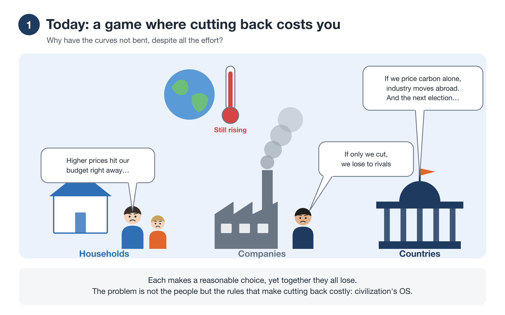
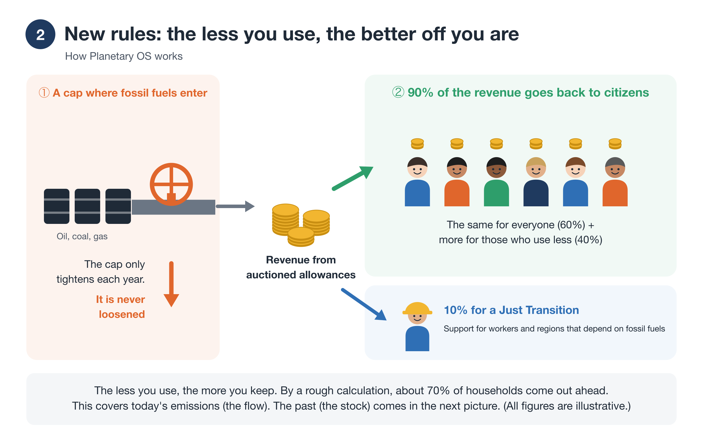
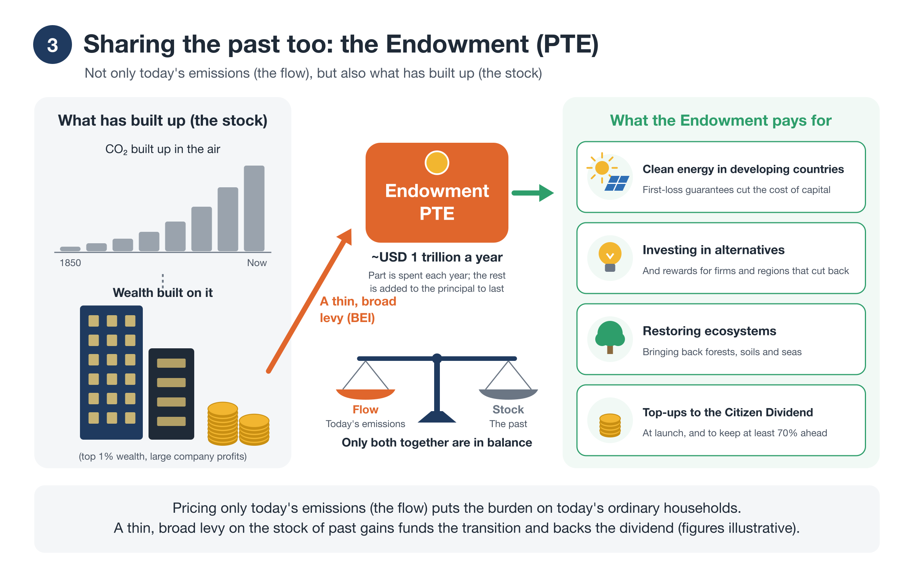
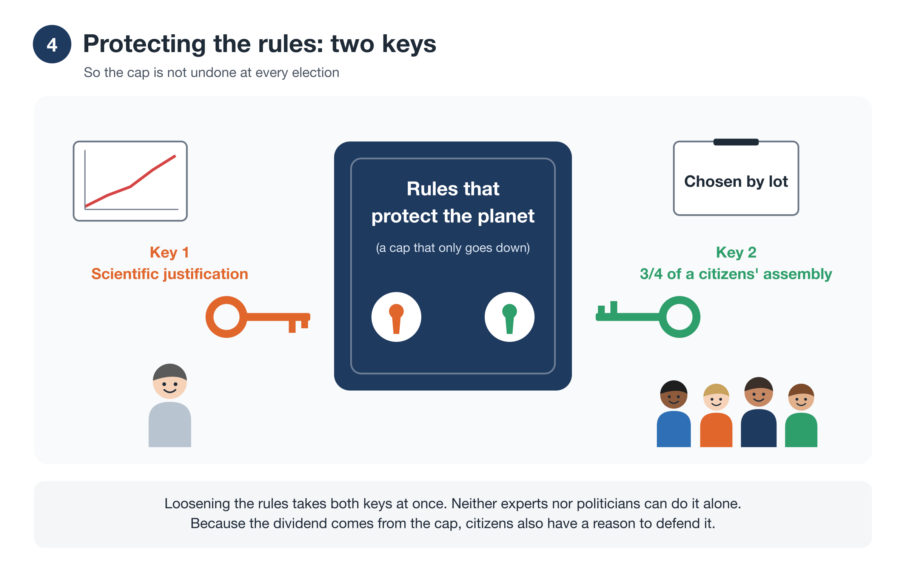
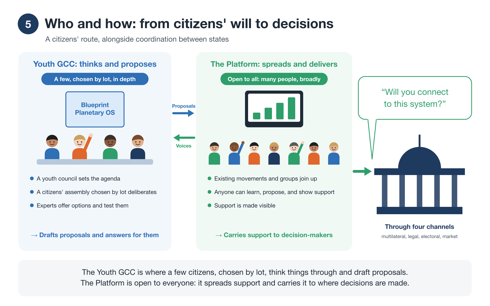
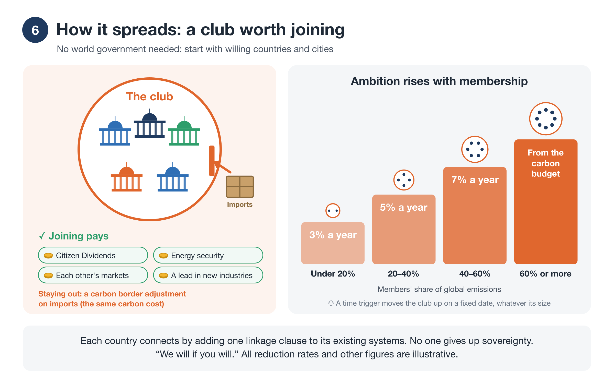

# The Proposal in Pictures
### Steering Within Limits, in six pictures

!!! info "About this page"
    The core of the proposal in six pictures, for anyone new to it (about 6 minutes). For the reasoning behind each picture, read Start Here [→](start.md) (about 45 minutes). For the essentials in text, read the one-page overview [→](overview.md).

All names, ratios, and figures are illustrative.

## 1. Today: a game where cutting back costs you

<figure markdown="span">
  
  <figcaption>Today: a game where cutting back costs you</figcaption>
</figure>

Households, companies, and countries each have good reasons not to cut back on their own. So decades of effort have gone into a game that cannot be won. The problem is not the people. It is the rules.

## 2. New rules: the less you use, the better off you are

<figure markdown="span">
  
  <figcaption>New rules: the less you use, the better off you are</figcaption>
</figure>

Planetary OS caps fossil fuels where they enter the economy, and the cap only tightens. The revenue from auctioning the allowances goes back to people: 90% to citizens as a Citizen Dividend, and 10% to a Just Transition for workers and regions. The less you use, the more you keep.

## 3. Sharing the past too: the Endowment (PTE)

<figure markdown="span">
  
  <figcaption>Sharing the past too: the Endowment (PTE)</figcaption>
</figure>

Pricing only today's emissions (the flow) puts the whole burden on today's households and workers, while those who built wealth on past emissions (the stock) pay almost nothing. So Planetary OS adds a thin, broad levy on the largest fortunes and corporate profits (BEI). It goes into a lasting fund, the Planetary Transition Endowment (PTE): on the order of USD 1 trillion a year in one estimate. The fund cuts the cost of clean energy in developing countries, invests in alternatives, restores ecosystems, and tops up the Citizen Dividend. Only when the stock shares the load with the flow is the burden in balance.

## 4. Protecting the rules: two keys

<figure markdown="span">
  
  <figcaption>Protecting the rules: two keys</figcaption>
</figure>

Loosening the rules takes two keys at once: scientific justification, and the approval of three-quarters of a citizens' assembly chosen by lot. Because the dividend comes from the cap, citizens also have a reason to defend it.

## 5. Who and how: from citizens' will to decisions

<figure markdown="span">
  
  <figcaption>Who and how: from citizens' will to decisions</figcaption>
</figure>

Problems like climate cross every border. Yet no one speaks for the whole planet and for future generations. Governments answer to today's voters within their borders. The UN and other international bodies depend on coordination and agreement among their member states. The young and the unborn, who have the most at stake, have almost no voice.

So the package builds a second route alongside coordination between states: one that gathers the will of the world's citizens, brings it together, and expresses it from the citizens' standpoint. It complements states and the UN rather than replacing them. It has no power to compel; it asks for answers in public.

This route has two parts, with different jobs.

- **The Youth GCC is the place to think.** A small group of citizens, chosen by lot from all generations, deliberates in depth with experts' options in front of them and drafts proposals. Young people set the agenda, and the body answers for what it proposes.
- **The Global Citizen Will Platform is the channel to deliver.** Anyone can take part, and existing movements join up while keeping their own names. It turns many people's support into something visible and carries it to governments, courts, elections, and markets with one question: "Will you connect to this system?"

The two feed each other: the Youth GCC's proposals become the questions the platform gathers support on, and the voices and ideas gathered on the platform flow back into the Youth GCC's deliberation.

## 6. How it spreads: a club worth joining

<figure markdown="span">
  
  <figcaption>How it spreads: a club worth joining</figcaption>
</figure>

It starts with a club of willing countries and cities, with no world government. Joining pays. Staying out means a carbon border adjustment on imports. The target rises as the club grows.

## What you can do

- Read the whole idea, with the reasoning [→](start.md)
- Check your own household in the simulator [→](tools/simulator.md)
- Take part as a Co-Initiator [→](join.md)

**Contact:** Tatsuya Mori · [Substack](https://ttmori.substack.com) · [note](https://note.com/ttmori) · [X](https://x.com/ttmori) · [Contact form](https://docs.google.com/forms/d/e/1FAIpQLSexBpD4BcRWIV--FuhMC9BxbP4I9fXl6pi9nxQPmX2bjivjqw/viewform)
