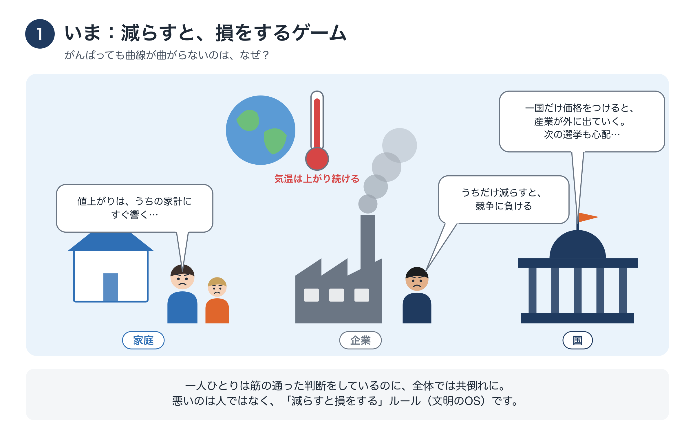
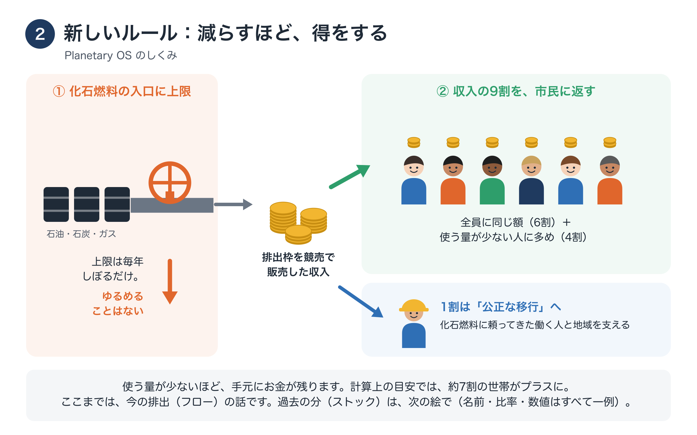
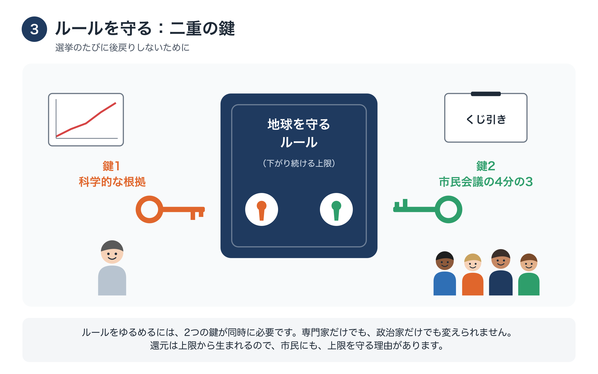
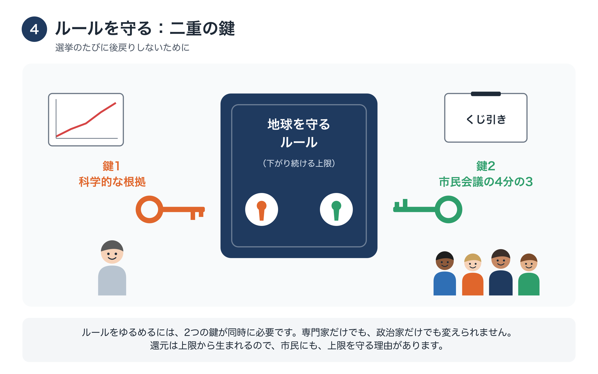
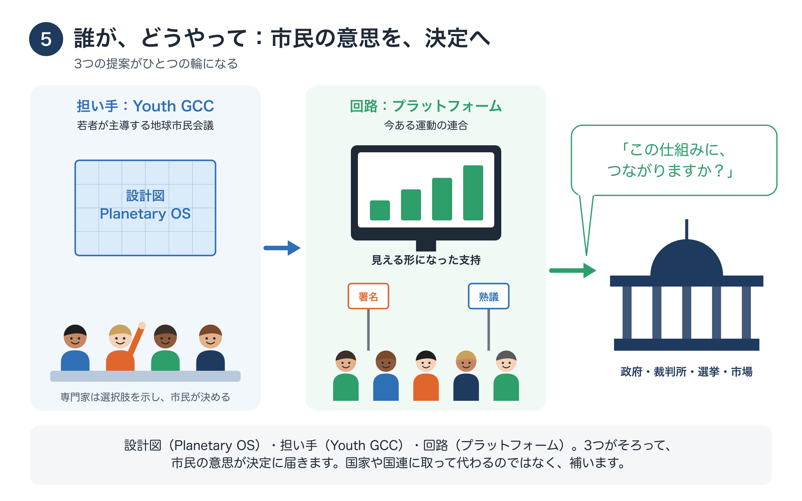
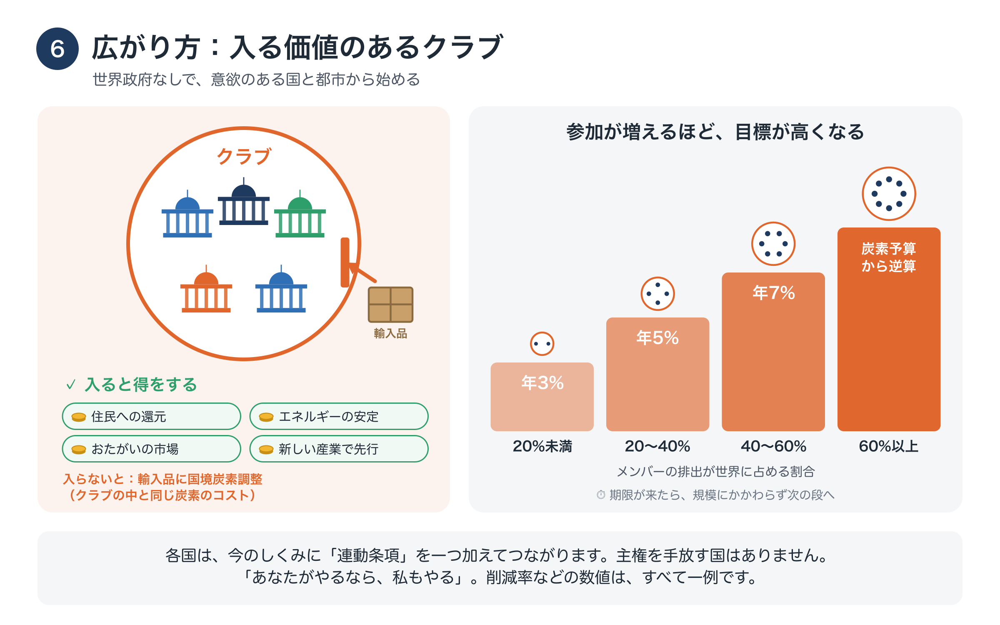

# 絵で見る提案
### 6枚の絵で見る「限界の内側で、舵を取る」

!!! info "このページについて"
    はじめての方に向けて、提案の中心を6枚の絵で説明します（約6分）。それぞれの絵の理由を知りたい方は「はじめての方へ」[→](start.md)（約15分）を、要点を文章で読みたい方は1ページ概要[→](overview.md)をご覧ください。

名前・比率・数値は、すべて一例です。

## 1. いま：減らすと、損をするゲーム

<figure markdown="span">
  
  <figcaption>いま：減らすと、損をするゲーム</figcaption>
</figure>

家庭は値上がりを、企業は競争を、国は産業の流出と次の選挙を心配します。どれも筋の通った理由で、自分だけ減らすと損をします。だから何十年もの努力が、勝てないゲームに注ぎ込まれてきました。問題は人ではなく、ルールにあります。

## 2. 新しいルール：減らすほど、得をする

<figure markdown="span">
  
  <figcaption>新しいルール：減らすほど、得をする</figcaption>
</figure>

Planetary OS は、化石燃料が経済に入る入口に上限をかけ、毎年しぼっていきます。排出枠を競売で売った収入のうち、9割は「市民への還元」として市民に、1割は働く人と地域のための「公正な移行」に使います。使う量が少ないほど、手元にお金が残ります。

## 3. 過去の分も、分かち合う：基金（PTE）

<figure markdown="span">
  
  <figcaption>過去の分も、分かち合う：基金（PTE）</figcaption>
</figure>

今の排出（フロー）だけに価格をつけると、負担は今の家庭だけにかかります。そこで、過去の排出の上に築かれた大きな資産と企業の利益（ストック）にも、薄く広く負担してもらいます（BEI）。そのお金は長く続く基金 PTE に入ります（一例の試算で年約1兆ドル規模）。基金は、途上国のクリーンエネルギー、生態系の回復、還元への上乗せなどに使います。

## 4. ルールを守る：二重の鍵

<figure markdown="span">
  
  <figcaption>ルールを守る：二重の鍵</figcaption>
</figure>

ルールをゆるめるには、2つの鍵が同時に必要です。科学的な根拠と、くじ引きで選んだ市民会議の4分の3の承認です。専門家だけでも、政治家だけでも変えられません。還元は上限から生まれるので、市民にも上限を守る理由があります。

## 5. 誰が、どうやって：市民の意思を、決定へ

<figure markdown="span">
  
  <figcaption>誰が、どうやって：市民の意思を、決定へ</figcaption>
</figure>

問題は国境を越えるのに、地球全体と将来世代のために語る担い手がいません。そこで、国家どうしの調整のとなりに、国家や国連を補う市民のルートをつくります。Youth GCC は、くじ引きで選んだ市民が深く話し合い、提言をつくる「考える場」です。プラットフォームは、だれでも参加して支持を広げ、「この仕組みに、つながりますか？」と決定の場に届ける「届ける回路」です。

## 6. 広がり方：入る価値のあるクラブ

<figure markdown="span">
  
  <figcaption>広がり方：入る価値のあるクラブ</figcaption>
</figure>

世界政府はつくりません。意欲のある国と都市のクラブから始めます。入ると、住民への還元やエネルギーの安定などの得があります。入らないと、輸入品に国境炭素調整がかかります。クラブが大きくなるほど、目標が高くなります。

## 今からできること

- 理由とともに、全体を読む[→](start.md)
- 自分の家計への影響を、シミュレーターで確かめる[→](tools/simulator.md)
- 共同発起人として参加する[→](join.md)

**連絡先**：森　達哉 · [Substack](https://ttmori.substack.com) · [note](https://note.com/ttmori) · [X](https://x.com/ttmori) · [お問い合わせフォーム](https://docs.google.com/forms/d/e/1FAIpQLSexBpD4BcRWIV--FuhMC9BxbP4I9fXl6pi9nxQPmX2bjivjqw/viewform)
