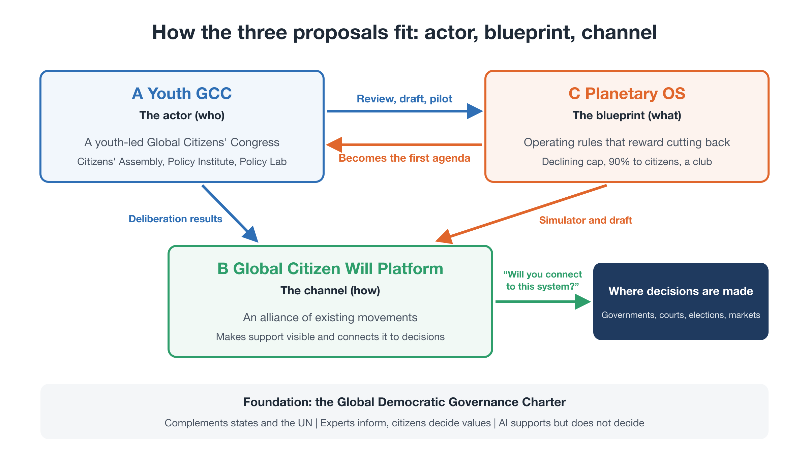
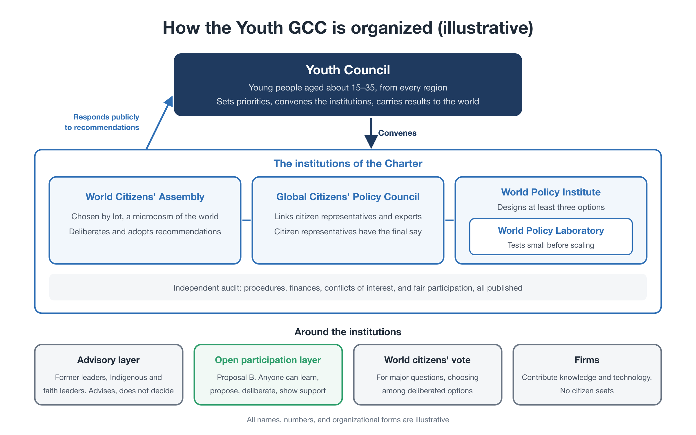
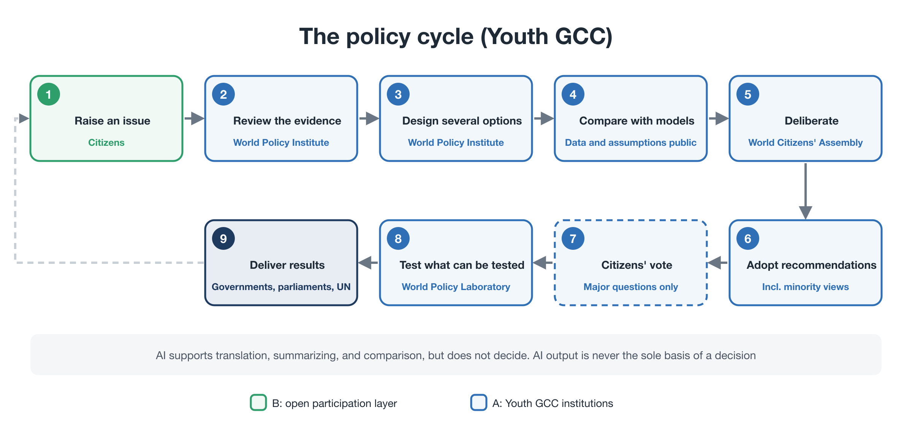

# Proposal A: Youth GCC — A Youth-Led Global Citizens' Congress for Future Generations

**Proposal summary** — First edition (working draft), revised October 2026

---

## Where this proposal fits

This is one of three proposals in the package *Steering Within Limits*:

- **Proposal A — Youth GCC (this document):** who acts. The actor, and the institutions it builds.
- **Proposal B — Global Citizen Will Platform:** how civic will is gathered, made visible, and connected to decisions. It is the Youth GCC's open participation layer.
- **Proposal C — Planetary OS:** what the system runs on. A concrete policy blueprint under which reducing pays, and the Youth GCC's first agenda.

All names, figures, and organizational forms in this document are **illustrative**.

<figure markdown="span">
  
  <figcaption>How the three proposals fit: actor, blueprint, channel</figcaption>
</figure>

---

## 1. The problem: no one makes policy for the world as a whole

**The unit of decision does not match the unit of the problem.** Democracy works within national borders. The economy, emissions, and new technologies work across them. Each government, acting reasonably for its own people, can still add up to an outcome that is bad for humanity as a whole. Where moving first puts a country at a disadvantage, everyone waits. This is not anyone's bad faith. It is a structural problem.

**The missing piece is not only cooperation, but the making of options.** Democracy is usually discussed in terms of who decides. But before any decision, someone decides **which options are on the table**. Today, policy for global problems is drafted by governments, international bodies, firms, and research institutions, each within its own mandate and constraints. No independent body designs policy options **from the standpoint of world citizens**, compares their effects, tests them, and lets citizens choose.

**A strange circle.** Global policies seem politically impossible, so they are not designed in detail. Because no detailed designs exist, they look unrealistic. Because they look unrealistic, no one designs them. Breaking this circle starts with designing what such institutions could look like, before handing the question to inter-state negotiation.

**Those most affected have the least voice.** The generation that benefited from emissions has lived most of its life. Today's young people and those not yet born will bear the consequences, yet have the least say. For problems that are **irreversible, fast, and driven by competition between countries**, such as the climate crisis and advanced AI, institutions must be designed **first**, while the situation is still controllable.

---

## 2. What the Youth GCC is

The **Youth-Led Global Citizens' Congress for Future Generations (Youth GCC)** is an independent, youth-led body that founds and carries a **second political circuit** alongside inter-state politics: a circuit in which world citizens raise problems, deliberate on them, develop and test policy options, and bring the results to states and international bodies.

Its institutional design follows the **Global Democratic Governance Charter**. Three principles from the Charter are central:

1. **World citizens are a political subject.** Every person has political interests as a world citizen, independent of nationality. Bodies that represent states and bodies that represent world citizens are kept separate. They are not meant to oppose each other, but to check and cooperate with each other.
2. **Making options is separated from deciding.** Choosing which options to present is itself political power. The whole sequence, from finding and defining a problem, through designing and testing options, to deliberation, choice, evaluation, and revision, is placed inside democratic institutions.
3. **It begins as a policy-making body, not a government.** At first it has no power to compel states. Instead, it seeks to establish that **states and international bodies respond publicly to policies that world citizens have formed democratically**, and explain why they adopt, modify, or reject them.

The Youth GCC is not a protest movement or an awareness campaign. It is **an institution for designing and proposing**, and it is youth-led because those who will live longest with the results should carry its founding.

---

## 3. Why youth

- **They have the largest stake.** Today's young people will live longest with the consequences of today's decisions.
- **They see the world globally from the start.** Many are fluent in digital tools and connected across borders.
- **They are less bound by existing interests.** They have fewer obligations to particular industries or institutions, and can consider new designs openly.

Youth leadership is about **institutional design, not symbolism**. Young people found and run the institution, with responsibility, expert support, and continuity. It is not a rejection of other generations: the citizens' assembly is drawn from all generations, and experienced people serve as advisors.

---

## 4. How it is organized (illustrative)

### The Youth Council

Young people, roughly aged 15–35 and representing regions of the world, form the **Youth Council**. It founds and runs the Youth GCC: it sets priorities for which issues to take up, convenes the institutions below, carries their results to the world, and responds publicly to the citizens' assembly. It does not replace the assembly's judgment.

### The institutions of the Charter

| Institution | Role |
|---|---|
| **World Citizens' Assembly** | Citizens selected by lot as a **statistical microcosm of the world's population**, from all generations. Selection reflects region, age, gender, income, education, and urban or rural life, not national quotas. A permanent core of roughly 500–2,000 members, partly rotated each year to prevent entrenchment. Members are paid and supported with translation, equipment, education, care support, and disability support, so that income and location do not decide who can take part. The assembly deliberates and adopts recommendations that include a preferred option, alternatives, minority views, and uncertainties |
| **World Policy Institute** | Independent of any state, government, party, firm, or international body. No single state or firm may provide more than a set share of its funding, and all funding sources are published. For each issue it designs **at least three workable options** and publishes their costs, effects, distributional and regional impacts, feasibility, risks, side effects, and long-term consequences |
| **World Policy Laboratory** | An independent testing unit within the Institute. Policies are **tested before they are scaled**: simulation, small pilots, comparison across regions, independent evaluation, and review by the assembly. Failures are published as well as successes, as public knowledge for humanity |
| **Global Citizens' Policy Council** | A standing body that connects the assembly and the Institute, made up of citizen representatives, scientists, engineers, economists, legal scholars, ethicists, civil society, affected people, and practitioners. It is needed because the assembly is large and meets periodically, while the Institute is a body of experts: the Council is where the two work together continuously, framing the questions, checking that the options are fair and understandable, and keeping continuity between assembly sessions. **Final democratic authority rests with the citizen representatives.** Experts show what is possible, what may happen, and what side effects may follow; they do not decide what is desirable |
| **Independent audit** | Reviews procedures, finances, conflicts of interest, and fairness of participation, and publishes the results |

### Around the institutions

- **Advisory layer:** experienced former leaders, Indigenous and faith leaders, and others who advise the Youth Council but do not decide.
- **Open participation layer:** anyone can learn, propose, deliberate, and show support through the Global Citizen Will Platform (Proposal B).
- **World citizens' vote:** for major questions, an online vote of world citizens can supplement the assembly, but only on options that have already been deliberated, not as a simple majority vote.
- **Firms:** take part as stakeholders that contribute knowledge, technology, and implementation capacity, but **receive no citizen seats**. Funding, data, and research they provide are published and may not be used to steer agendas, findings, or votes.

<figure markdown="span">
  
  <figcaption>How the Youth GCC is organized (illustrative)</figcaption>
</figure>

### The policy cycle

1. citizens raise an issue; issues with enough support are formally taken up
2. the Institute reviews the science, existing policies, models, and ethical questions
3. it designs several options, never a single "right answer"
4. options are compared with models and simulations; all data and assumptions are made public, and AI output is never the basis of a decision on its own
5. the assembly hears experts, asks questions, and deliberates
6. the assembly adopts recommendations, with alternatives, minority views, and uncertainties
7. for major questions, a world citizens' vote can supplement the assembly
8. the Laboratory tests what can be tested
9. results go to governments, parliaments, regional bodies, the UN, and other international organizations

<figure markdown="span">
  
  <figcaption>The policy cycle of the Youth GCC</figcaption>
</figure>

### The role of AI

AI helps with translation, summarizing, simulation, comparing options, and mapping arguments, making deliberation across languages practical. It is used to **extend people's capacity to take part in democracy**, never to replace human judgment. How AI is used is published, and anyone can challenge it.

### Safeguards for democratic legitimacy

The Charter recognizes that a body like this could itself become a new elite. It therefore builds in:

- term limits
- selection by lot
- full transparency of materials, methods, funding, and votes
- a record of minority views
- external audit
- separation of research, deliberation, testing, audit, and international negotiation
- the possibility for citizens to propose reforms of the institution itself

Above all, **no one may claim to own the definition of humanity's interest.** It is treated as a hypothesis, formed and revised through continuing democratic deliberation.

---

## 5. Which issues, and in what order

### Priority principles

The Youth GCC cannot address everything. It gives priority to issues that are:

1. **irreversible** once a threshold is crossed
2. **time-constrained**, where delay closes options
3. **cross-border** in their causes and effects
4. **beyond what existing institutions can handle**

### One agenda first: climate

At launch, the Youth GCC concentrates on one agenda: **the climate crisis**, with **Planetary OS** (Proposal C) as its leading policy design. A concrete first agenda gives a new institution a purpose, early results, and momentum.

Planetary OS is a detailed version of what the Charter calls a **"global carbon dividend" option**. In keeping with the Charter's principle of presenting several options, the World Policy Institute sets it beside other designs, such as a carbon-price-centered approach, public investment and allocation, and a market–regulation mix, so that citizens can compare them.

The four types, as examples:

- **Carbon-price-centered:** a carbon tax or emissions trading sets a price on carbon; each country decides how to use the revenue.
- **Global carbon dividend:** the revenue is returned directly to citizens.
- **Public investment and allocation:** public spending builds low-carbon infrastructure, and scarce resources are allocated where needed.
- **Market–regulation mix:** standards and regulations, such as efficiency standards and phase-out dates, combined with market mechanisms.

### The first pilot

The first full run of the policy cycle is **an international citizens' assembly on climate policy**:

- the Youth Council chooses climate as the first agenda, convenes the assembly, and responds publicly to its recommendations
- the Institute's working groups draft the Planetary OS Standard and the alternative options
- the assembly deliberates on them and adopts recommendations
- the Laboratory runs the Citizen Dividend Simulator and prepares small pilots of the dividend
- an independent evaluation reviews representativeness, transparency, quality, fairness of participation, and cost

### Next: a Global AI Citizens' Assembly

The Charter proposes a **Global AI Citizens' Assembly** as an early experiment: several hundred to about 1,000 citizens selected by lot, deliberating for six to twelve months on how the world should govern advanced AI. Its outputs include principles, an international regulatory proposal, an international system to monitor AI incidents and dangerous capabilities, rules on computing resources, public investment in AI safety research, and a division of roles between states, firms, and international bodies. Within this package, it is the **next agenda**, and it could run in parallel if partners and resources allow.

### Later agendas

Other issues that meet the priority principles can follow, such as climate liability, an economy that does not depend on growth (see Background essay 2), pandemics, and global citizenship education.

---

## 6. Relation to the UN and states

**The order changes, not the actors.** Until now, states negotiate first and look for what is possible. In this circuit, world citizens raise and deliberate problems, the Institute designs options, the Laboratory tests them, and **then** states and international bodies implement them as international institutions.

**The UN as the place of implementation and coordination.** The UN does not decide the will of world citizens on their behalf; it carries out coordination between states and international implementation. When the assembly adopts a policy that meets agreed standards, the UN General Assembly and relevant bodies are asked to consider it formally. If the UN or member states reject it, **they publish their reasons**. In this way, world citizens can have the capacity to form policy and political legitimacy, even without any veto.

**States may take part, but not control.** States are not barred from participating, but may not control the institutions.

**Outside, but not isolated.** The Youth GCC starts outside the formal UN system, so that its agenda is not limited by the consent of member states. From the start, it seeks cooperation with UN bodies, governments, regional organizations, universities, and civil society. Small states, cities, researchers, and NGOs can move first, design and test institutions, and invite larger states to join once they work.

**Legitimacy is earned, not declared.** No body becomes the voice of world citizens by announcing it. The Youth GCC builds trust through open participation, selection by lot, transparent procedures, expert review, and independent evaluation, and it states the limits of its legitimacy openly.

---

## 7. A possible long-term path

The Charter describes a path that could open only after a substantial track record:

1. a policy advisory body
2. an international policy-making body
3. a body that takes part formally in forming international treaties
4. a world citizens' parliament

In the long run, this could lead to a **two-chamber world politics**: a chamber of states, made up of governments, and a chamber of world citizens, made up mainly of representatives selected by lot to reflect the world's population, deliberating together on global public goods. This is a direction for the long term, not a goal of the launch phase.

---

## 8. Funding and independence (illustrative)

- Initial support from foundations and individual donors, with all funders disclosed
- A cap on the share any single state or firm may provide
- Crowdfunding with a cap per contributor, so that no single funder gains outsized influence
- "Generational responsibility" giving: regular donations from older generations to future generations
- Funding never buys influence over agendas, findings, or votes; conflicts of interest are managed and published
- A physical base, if any, is chosen together with partners, with attention to the Global South and climate-vulnerable regions; most work is online and regional

---

## 9. Roadmap (illustrative)

Each stage proceeds when the previous one meets published criteria.

| Stage | Content | Corresponds to the package roadmap |
|---|---|---|
| 1. Design and verification | Recruit co-founders; form the Youth Council and advisory layer; design selection, deliberation, and audit methods based on the Charter | Foundations |
| 2. First pilot | The Institute's working groups draft the Planetary OS Standard and alternative climate options; the first international citizens' assembly deliberates; independent evaluation | Launch and verification |
| 3. Institution or network | Establish a lasting legal and organizational base, diverse funding, and partnerships; prepare the Global AI Citizens' Assembly | Pilots |
| 4. International cooperation | Present recommendations to governments and international forums and seek public responses; connect regional and global deliberation | Connection |
| 5. Long-term development | Based on results and support, reconsider the long-term path described in section 7 | — |

---

## 10. Risks and how we address them

| Risk | Response |
|---|---|
| "Who gave you the right to speak for world citizens?" | Selection by lot as a statistical microcosm; open procedures; published minority views; legitimacy built through a track record and stated limits |
| A new elite | Term limits, rotation, separation of functions, external audit, citizens' right to propose reforms |
| Tokenism toward youth | Real responsibility for the Youth Council, with expert support and continuity |
| Exclusion of other generations | An all-generation assembly; advisors from every generation |
| Capture by funders, states, or firms | Funding caps and disclosure; no citizen seats for firms; independent audit |
| Overreach | One agenda first; staged growth with published criteria |
| Unequal participation | Payment, translation, equipment, care and disability support; monitoring who takes part |
| Misuse of AI | AI supports, never decides; models, data, and assumptions published; open to challenge |

---

## 11. What we are asking for

| Who | Ask |
|---|---|
| Young people and youth organizations | Join as co-founders of the Youth Council and as Co-Initiators |
| Experienced leaders, Indigenous and faith leaders | Serve on the advisory layer |
| Researchers and experts | Join the World Policy Institute's working groups; help design the assembly and its evaluation |
| Universities and deliberation practitioners | Help run and evaluate the first international citizens' assembly |
| Foundations and funders | Support the design and first-pilot stages, within the funding caps |
| Governments, cities, and international bodies | Engage with the assembly's recommendations and respond publicly |

---

## Related materials

- Package Proposal: *Steering Within Limits* [→](../package.md)
- Proposal B: Global Citizen Will Platform [→](b-platform.md)
- Proposal C: Planetary OS (Executive Summary, Full Proposal, FAQ) [→](c-summary.md)
- Global Democratic Governance Charter [→](../charter/charter.md)
- *Building Another World Politics* [→](../charter/another-world-politics.md)
- Earlier proposals: *Global Citizens' Congress* proposal [↗](https://ttmori.substack.com/p/proposal-global-citizens-congress); *Global Citizens' Assembly* series [↗](https://ttmori.substack.com/p/a-proposal-for-a-global-citizens?r=5dzcae)

**Contact:** Tatsuya Mori · [Substack](https://ttmori.substack.com) · [note](https://note.com/ttmori) · [X](https://x.com/ttmori) · [Contact form](https://docs.google.com/forms/d/e/1FAIpQLSexBpD4BcRWIV--FuhMC9BxbP4I9fXl6pi9nxQPmX2bjivjqw/viewform)

---

This document is also published on: [note (Japanese)](https://note.com/ttmori/n/nd868e82b4336)
