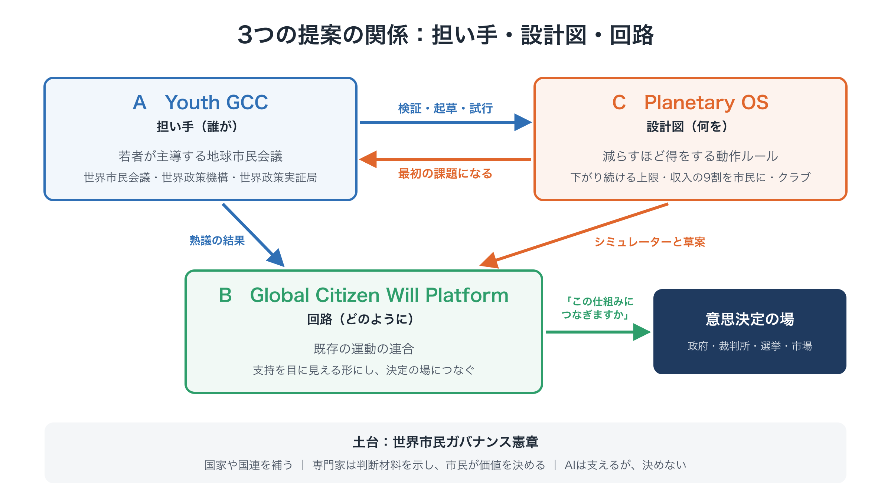
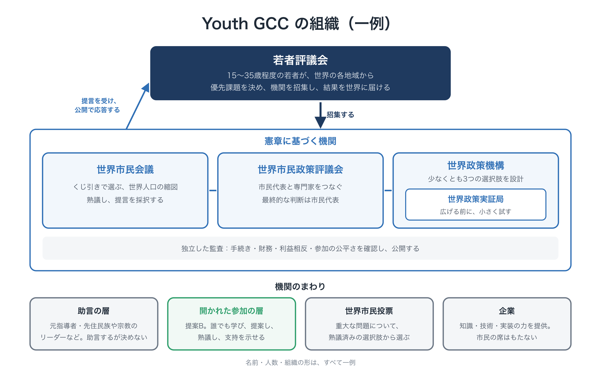
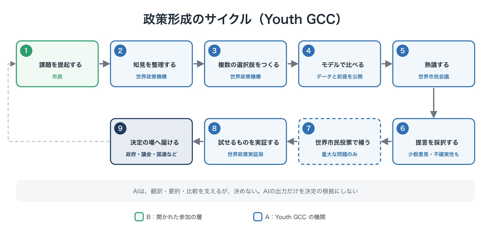

# 提案A：Youth GCC ―― 将来世代のための、若者主導の地球市民会議

**提案の要約**　第1版（草案）、2026年10月改訂

---

## この提案の位置づけ

本書は、パッケージ提案「限界の内側で、舵を取る」を構成する3つの提案の一つです。

- **提案A：Youth GCC（本書）** ―― 誰が担うか。担い手と、それがつくる制度。
- **提案B：Global Citizen Will Platform** ―― 市民の意思をどう集め、目に見える形にし、意思決定につなぐか。Youth GCC の開かれた参加の層です。
- **提案C：Planetary OS** ―― 社会を何のルールで動かすか。減らすほど得をする、具体的な政策の設計図であり、Youth GCC の最初の課題です。

本書で示す名前・数値・組織の形は、すべて**一例**です。

<figure markdown="span">
  
  <figcaption>3つの提案の関係：担い手・設計図・回路</figcaption>
</figure>

---

## 1. 問題：世界全体のための政策を、誰もつくっていない

**意思決定の単位と、問題の単位が合っていない。** 民主主義は、国境の内側で働きます。経済、排出、新しい技術は、国境を越えて働きます。それぞれの政府が自国民のために合理的に行動しても、その積み重ねが人類全体にとって望ましくない結果になりえます。先に動いた国が不利になるなら、誰もが様子を見ます。これは誰かの悪意ではなく、構造の問題です。

**欠けているのは協力の量だけでなく、「選択肢をつくる政治」です。** 民主主義は、ふつう「誰が決めるか」で語られます。けれども、決める前に、**何を選択肢として示すか**を誰かが決めています。今、地球規模の問題についての政策は、政府、国際機関、企業、研究機関が、それぞれの役割と制約の中でつくっています。**世界市民の立場から**政策の選択肢を設計し、その影響を比べ、試し、市民が選べるようにする独立した主体はありません。

**奇妙な循環。** 地球規模の政策は政治的に難しいと思われているので、詳しく設計されません。詳しい設計がないので、非現実的に見えます。非現実的に見えるので、誰も設計しません。この循環を断ち切るには、国家間の交渉に委ねる前に、どんな制度がありうるのかを設計してみることから始める必要があります。

**最も影響を受ける人ほど、声が小さい。** 排出の恩恵を受けた世代は、すでに人生の大半を生きています。その結果を背負う今の若者と、まだ生まれていない世代は、最も口を出せません。気候危機や高度なAIのように、**取り返しがつかず、速く、国どうしの競争に駆り立てられる**問題では、まだ制御できるうちに、**先に**制度を設計しなければなりません。

---

## 2. Youth GCC とは何か

**将来世代のための、若者主導の地球市民会議（Youth-Led Global Citizens' Congress for Future Generations：Youth GCC）**は、国家間の政治と並ぶ**もう一つの政治の回路**を立ち上げ、担う、独立した若者主導の組織です。この回路では、世界市民が問題を提起し、熟議し、政策の選択肢をつくって試し、その成果を国家や国際機関に届けます。

制度の設計は、**世界市民ガバナンス憲章**に沿います。憲章の次の3つの原則が中心です。

1. **世界市民は政治主体である。** すべての人は、国籍とは別に、世界市民としての政治的な利益を持っています。国家を代表する機関と、世界市民を代表する機関は分けます。両者は対立するためではなく、互いに牽制し、協力するためにあります。
2. **「意思決定」と「選択肢の生成」を分ける。** 何を選択肢として示すかは、それ自体が政治的な権力です。問題の発見と定義から、選択肢の設計と検証、熟議、選択、評価、改良までの一連の過程を、民主的な制度の内側に置きます。
3. **「政府」ではなく「政策形成機構」として始める。** 最初は、国家に対する強制力を持ちません。その代わりに、**世界市民が民主的に形成した政策案に、国家と国際機関が公式に応答し、採用・修正・拒否の理由を公開する**しくみをつくることを目指します。

Youth GCC は、抗議の運動でも、啓発のキャンペーンでもありません。**設計し、提案するための制度**です。そして、その結果と最も長く付き合う世代が立ち上げを担うべきだという考えから、若者が主導します。

---

## 3. なぜ若者なのか

- **最も大きな利害を持つ当事者だから。** 今の決定の結果と最も長く付き合うのは、今の若者です。
- **最初から、世界を地球規模で見ているから。** 多くの若者はデジタルの道具を使いこなし、国境を越えてつながっています。
- **既存の利害にとらわれにくいから。** 特定の業界や組織への義理が少なく、新しい設計を素直に検討できます。

若者が主導することは、**象徴ではなく、制度の設計**の問題です。若者が、責任、専門家の支え、継続性を備えた制度を立ち上げ、運営します。他の世代を退けることでもありません。世界市民会議はすべての世代から選ばれ、経験のある人々は助言者を務めます。

---

## 4. 組織のあり方（一例）

### 若者評議会

世界の各地域を代表する、15〜35歳程度の若者が**若者評議会**をつくります。若者評議会は Youth GCC を立ち上げ、運営します。どの課題を取り上げるかの優先順位を決め、下の機関を招集し、その成果を世界に届け、世界市民会議に公開で応答します。世界市民会議の判断に取って代わることはしません。

### 憲章に基づく機関

| 機関 | 役割 |
|---|---|
| **世界市民会議** | くじ引きで選ばれた、**世界人口の統計的な縮図**となる市民。すべての世代から選ぶ。地域、年齢、性別、所得、教育、都市と農村などを考慮し、国籍ごとの割り当てはしない。常設の中核は500〜2,000人程度で、権力が固定しないよう毎年一部を入れ替える。報酬、翻訳、通信設備、学習支援、保育・介護の支援、障害のある人への支援を保障し、所得や住む場所で参加が左右されないようにする。熟議を経て、推奨案、代替案、少数意見、不確実性を含む提言を採択する |
| **世界政策機構** | どの国家、政府、政党、企業、国際機関の支配も受けない。単一の国家や企業からの資金は一定の割合までとし、すべての資金源を公開する。課題ごとに、**少なくとも3つの実行可能な制度案**をつくり、費用、効果、分配と地域への影響、実施の可能性、リスク、副作用、長期的な影響を公開する |
| **世界政策実証局** | 世界政策機構の中に置く、独立した実証部門。政策は**できる限り実証してから広げる**。シミュレーション、小規模な実験、複数の地域での比較、独立した評価、世界市民会議による再評価を行う。成功だけでなく失敗も、人類全体の政策知識として公開する |
| **世界市民政策評議会** | 世界市民会議と世界政策機構をつなぐ常設の機関。市民代表、科学者、技術者、経済学者、法学者、倫理学者、市民社会、当事者、実務家で構成する。世界市民会議は大きく、定期的に開かれ、世界政策機構は専門家の機関なので、両者が継続して一緒に働く場が必要になる。評議会は、問いを立て、選択肢が公平で分かりやすいかを確かめ、会議と会議のあいだの継続性を保つ。**最終的な民主的権限は市民代表にある。** 専門家は、何が可能か、何が起きうるか、どんな副作用がありうるかを示し、何が望ましいかは決めない |
| **独立した監査** | 手続き、財務、利益相反、参加の公平さを確認し、結果を公開する |

### 機関のまわり

- **助言の層**：経験のある元指導者、先住民族のリーダー、宗教指導者などが、若者評議会に助言します。決定はしません。
- **開かれた参加の層**：Global Citizen Will Platform（提案B）を通じて、誰でも学び、提案し、熟議し、支持を示せます。
- **世界市民投票**：重大な問題については、世界市民によるオンライン投票で世界市民会議を補うことができます。ただし単純な多数決ではなく、熟議を経た案についての投票です。
- **企業**：知識、技術、実装の力を提供するステークホルダーとして参加できますが、**市民代表の枠は持ちません**。企業から提供された資金、データ、研究結果は公開し、議題、研究結果、投票を左右するために使ってはなりません。

<figure markdown="span">
  
  <figcaption>Youth GCC の組織（一例）</figcaption>
</figure>

### 政策形成のサイクル

1. 市民が課題を提起する。一定の支持を得た課題は、正式に検討の対象にする
2. 世界政策機構が、科学的な知見、既存の政策、モデル、倫理的な論点を整理する
3. 複数の選択肢をつくる。単一の「正解」は示さない
4. モデルやシミュレーションで選択肢を比べる。データと前提はすべて公開し、AIの出力だけを決定の根拠にはしない
5. 世界市民会議が専門家の説明を受け、質問し、熟議する
6. 世界市民会議が、代替案、少数意見、不確実性を含む提言を採択する
7. 重大な問題については、世界市民投票で補う
8. 世界政策実証局が、試せるものを実証する
9. 結果を、各国政府、議会、地域機構、国連などの国際機関に提出する

<figure markdown="span">
  
  <figcaption>Youth GCC の政策形成のサイクル</figcaption>
</figure>

### AIの役割

AIは、翻訳、要約、シミュレーション、選択肢の比較、論点の整理を助け、言語を越えた熟議を現実的なものにします。AIは、**民主主義に参加できる人間の力を広げるため**に使い、人の判断に取って代わることはありません。AIの使い方は公開し、誰でも異議を申し立てられるようにします。

### 民主的な正統性を守るしくみ

憲章は、このような機関そのものが新しいエリート支配になる危険を認めています。そのため、次のしくみを組み込みます。

- 任期制
- くじ引きによる選出
- 資料、方法、資金源、投票結果の完全な公開
- 少数意見の記録
- 外部の監査
- 研究、熟議、実証、監査、国際交渉の分離
- 制度そのものの改革を市民が提案できること

そして何より、**人類の利益を、誰かが独占して定義してはなりません。** 人類全体の利益は、続いていく民主的な熟議の中で形づくられ、見直されていく仮説として扱います。

---

## 5. どの課題を、どの順番で

### 優先の原則

Youth GCC は、すべてを扱うことはできません。次の条件を満たす課題を優先します。

1. 一定の線を越えると**取り返しがつかない**
2. 先送りすると選択肢が失われる、**時間の制約がある**
3. 原因と影響が**国境を越える**
4. **既存の制度では対応しきれない**

### まず一つの課題から：気候

立ち上げの段階では、Youth GCC は一つの課題に集中します。**気候危機**です。その中心となる政策の設計が、**Planetary OS**（提案C）です。具体的な最初の課題があることで、新しい制度は目的と、早い成果と、勢いを得られます。

Planetary OS は、憲章が気候の制度案の例として挙げる**「世界炭素配当型」**を、具体的に設計したものです。複数の選択肢を示すという憲章の原則に沿って、世界政策機構はこれを、炭素価格中心型、公共投資・配給型、市場・規制混合型などの別の案と並べ、市民が比べられるようにします。

4つの型は、たとえば次のようなものです。

- **炭素価格中心型**：炭素税や排出量取引で炭素に価格をつけ、収入の使い道は各国に任せる
- **世界炭素配当型**：収入を、市民に直接還す
- **公共投資・配給型**：公共の投資で低炭素のインフラを整え、限られた資源は必要に応じて割り当てる
- **市場・規制混合型**：効率の基準や廃止の期限などの規制と、市場の仕組みを組み合わせる

### 最初の実証

政策のサイクルを最初に一通り動かすのは、**気候政策についての国際的な市民会議**です。

- 若者評議会が、最初の課題として気候を選び、会議を招集し、提言に公開で応答する
- 世界政策機構の作業部会が、Planetary OS の Standard と、別の選択肢を起草する
- 世界市民会議がそれらを熟議し、提言を採択する
- 世界政策実証局が還元シミュレーターを運用し、還元の小規模な試行を準備する
- 独立した評価が、代表性、透明性、質、参加の公平さ、費用を確かめる

### 次に：Global AI Citizens' Assembly

憲章は、早い段階の実験として **Global AI Citizens' Assembly（世界AI市民会議）** を提案しています。世界各地から無作為に選ばれた数百〜1,000人程度の市民が、6〜12か月かけて、世界が高度なAIをどう統治すべきかを熟議します。成果として、世界AI原則、AIの国際規制案、AIの事故や危険な能力の国際的な監視の制度、計算資源やデータセンターに関する国際ルール案、AIの安全研究への国際的な公共投資案、国家・企業・国際機関の権限の分担案をまとめます。このパッケージでは、これを**次の課題**と位置づけます。協力者と資源がそろえば、並行して進めることもできます。

### その後の課題

優先の原則を満たすその他の課題に広げていきます。たとえば、気候の責任、成長に頼らない経済（背景論考2を参照）、感染症、地球市民としての教育などです。

---

## 6. 国連や国家との関係

**変えるのは、担い手ではなく順番です。** これまでは、まず国家が交渉し、その中でできることを探してきました。この回路では、世界市民が問題を提起して熟議し、世界政策機構が選択肢をつくり、世界政策実証局が試し、**そのうえで**国家と国際機関が国際的な制度として実装します。

**国連は、実装と調整の場として。** 国連は、世界市民に代わって世界市民の意思を決めることはしません。国家間の調整と、国際的な実装を担います。世界市民会議が一定の基準を満たす政策を採択した場合、国連総会と関連機関には、それを正式に審議してもらいます。国連や加盟国がそれを拒否する場合は、**拒否の理由を公開してもらいます**。こうすることで、世界市民の側は、拒否権を持たなくても、政策を形成する力と政治的な正統性を持つことができます。

**国家は参加できるが、支配はできない。** 国家が参加することは妨げません。ただし、国家が機関を支配してはなりません。

**外にあっても、孤立しない。** 議題が加盟国の同意に縛られないよう、国連の正式な枠組みの外から始めます。そのうえで最初から、国連の機関、各国政府、地域機構、大学、市民社会との協力を求めます。小さな国、都市、研究者、NGO が先に制度を設計して試し、それが機能すると分かったところで、大きな国に加わってもらう道もあります。

**正統性は、宣言するものではなく、積み重ねるもの。** 名乗るだけで、世界市民の声になれる組織はありません。Youth GCC は、開かれた参加、くじ引きによる選出、透明な手続き、専門家の検証、独立した評価を通じて信頼を築き、自らの正統性の限界もはっきり示します。

---

## 7. 長期的に考えうる道筋

憲章は、十分な実績を積んだあとに開かれうる道筋を示しています。

1. 政策提言機関
2. 国際的な政策形成機関
3. 国際条約の形成に正式に参加する機関
4. 世界市民議会

長い目で見れば、これは**二院型の世界政治**につながりうるものです。各国政府で構成する国家代表院と、世界人口の構成を反映するくじ引きの代表を中心とする世界市民院が、地球規模の公共財について協議します。これは長期的な方向性であり、立ち上げの段階の目標ではありません。

---

## 8. 資金と独立性（一例）

- 財団や個人の寄付者からの初期の支援。資金の出し手はすべて公開する
- 単一の国家や企業からの資金は、一定の割合までとする
- 一人あたりの上限を設けたクラウドファンディング。特定の出し手に影響力が偏らないようにする
- 「世代の責任としての寄付」：上の世代から将来世代への、継続的な寄付
- 資金を出したことで、議題、研究結果、投票に影響を与えることはできない。利益相反は管理し、公開する
- 拠点を置く場合は、協力団体とともに選び、南の国々や気候被害を受けやすい地域に配慮する。活動の大半は、オンラインと地域ごとに行う

---

## 9. ロードマップ（一例）

各段階は、前の段階が公開した基準を満たしてから進みます。

| 段階 | 内容 | パッケージのロードマップとの対応 |
|---|---|---|
| 1. 設計と検証 | 共同設立者を募る。若者評議会と助言の層をつくる。憲章に基づいて、選出、熟議、監査の方法を設計する | 土台 |
| 2. 最初の実証 | 世界政策機構の作業部会が、Planetary OS の Standard と別の気候の選択肢を起草し、最初の国際的な市民会議が熟議する。独立した評価 | 立ち上げ・検証 |
| 3. 組織またはネットワーク | 長く続く法的・組織的な基盤、多様な資金、協力関係を整える。Global AI Citizens' Assembly を準備する | 試行 |
| 4. 国際的な協力 | 提言を政府や国際的な場に示し、公開の応答を求める。地域の熟議と地球規模の熟議をつなぐ | 接続 |
| 5. 長期的な発展 | 実績と支持に基づき、7章の長期的な道筋を検討する | ― |

---

## 10. リスクと対応

| リスク | 対応 |
|---|---|
| 「誰があなたたちに世界市民を代表する権利を与えたのか」 | 統計的な縮図としてのくじ引きによる選出。開かれた手続き。少数意見の公開。実績と、正統性の限界の明示による積み重ね |
| 新しいエリート支配 | 任期制、入れ替え、機能の分離、外部の監査、制度の改革を市民が提案できること |
| 若者のお飾り化 | 若者評議会に本当の責任を持たせ、専門家の支えと継続性を備える |
| 他の世代の排除 | すべての世代から選ぶ世界市民会議。あらゆる世代からの助言者 |
| 資金の出し手、国家、企業による乗っ取り | 資金の上限と公開。企業には市民代表の枠を与えない。独立した監査 |
| 手の広げすぎ | まず一つの課題から。公開した基準に基づく段階的な拡大 |
| 参加の偏り | 報酬、翻訳、通信設備、保育・介護と障害への支援。誰が参加しているかの確認 |
| AIの誤用 | AIは支えるだけで、決めない。モデル、データ、前提を公開し、異議を受け付ける |

---

## 11. お願いしたいこと

| 対象 | お願い |
|---|---|
| 若者と若者の団体 | 若者評議会の共同設立者、共同発起人として加わる |
| 経験のある指導者、先住民族と宗教の指導者 | 助言の層を担う |
| 研究者と専門家 | 世界政策機構の作業部会に加わる。世界市民会議とその評価の設計を手伝う |
| 大学と熟議の実践者 | 最初の国際的な市民会議の運営と評価を手伝う |
| 財団と資金提供者 | 資金の上限の範囲で、設計と最初の実証の段階を支援する |
| 政府、都市、国際機関 | 世界市民会議の提言に応じ、公開で応答する |

---

## 関連資料

- パッケージ提案書「限界の内側で、舵を取る」[→](../package.md)
- 提案B：Global Citizen Will Platform[→](b-platform.md)
- 提案C：Planetary OS（要約版、本編、FAQ）[→](c-summary.md)
- 世界市民ガバナンス憲章[→](../charter/charter.md)
- もう一つの世界政治をつくる[→](../charter/another-world-politics.md)
- 以前の提案：「Global Citizens' Congress」の提案[↗](https://ttmori.substack.com/p/proposal-global-citizens-congress)、「Global Citizens' Assembly」のシリーズ[↗](https://ttmori.substack.com/p/a-proposal-for-a-global-citizens?r=5dzcae)

**連絡先**：森　達哉 · [Substack](https://ttmori.substack.com) · [note](https://note.com/ttmori) · [X](https://x.com/ttmori) · [お問い合わせフォーム](https://docs.google.com/forms/d/e/1FAIpQLSexBpD4BcRWIV--FuhMC9BxbP4I9fXl6pi9nxQPmX2bjivjqw/viewform)

---

この文書は、次の場所でも公開しています： [note（日本語）](https://note.com/ttmori/n/nd868e82b4336)
