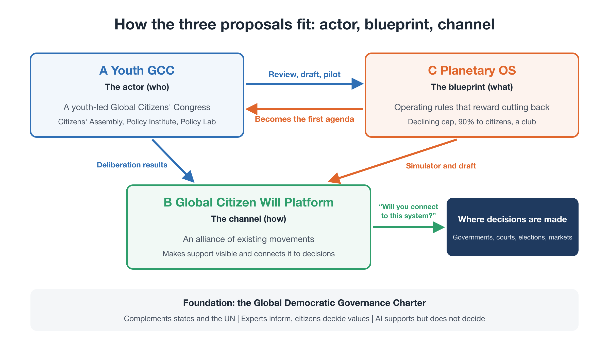
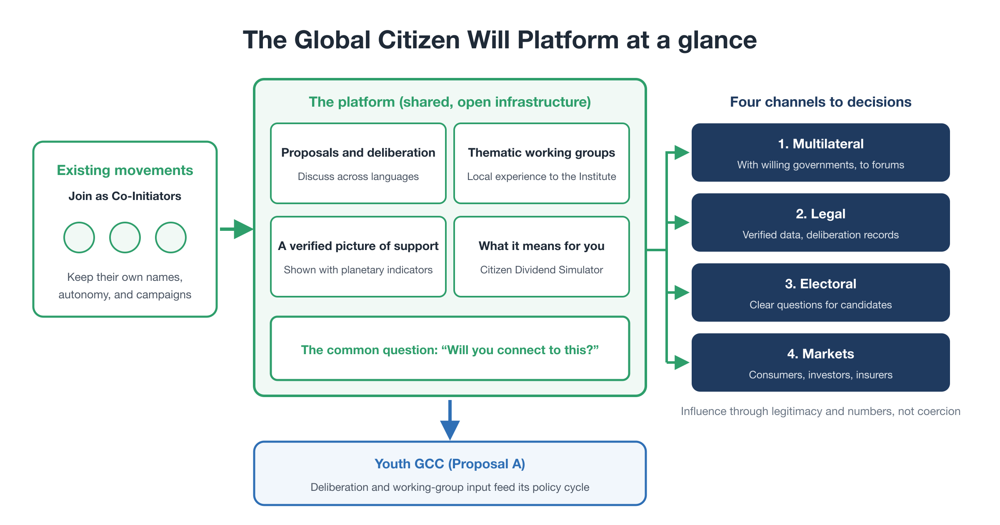

# Proposal B: Global Citizen Will Platform — Connecting Civic Will to Decisions

**Proposal summary** — First edition (working draft)

---

## Where this proposal fits

This is one of three proposals in the package *Steering Within Limits*:

- **Proposal A — Youth GCC:** who acts. A youth-led global citizens' congress with a World Citizens' Assembly, a World Policy Institute, and a World Policy Laboratory.
- **Proposal B — Global Citizen Will Platform (this document):** how civic will is gathered, made visible, and connected to decisions.
- **Proposal C — Planetary OS:** what the system runs on. A concrete policy blueprint under which reducing pays.

Proposal A provides the actor and Proposal C the blueprint. Proposal B is **the channel between them and the world**. Its first task is to carry Planetary OS, the Youth GCC's first agenda, to citizens and decision-makers.

All names, figures, and organizational forms in this document are **illustrative**.

<figure markdown="span">
  
  <figcaption>How the three proposals fit: actor, blueprint, channel</figcaption>
</figure>

---

## 1. The problem: a missing channel

Millions of people have marched, signed petitions, and organized for the climate and for future generations. Yet much of that energy has had less effect than it deserves, for two reasons.

**No path from global proposals to visible support.** There is no established way to put a concrete global policy option in front of people across many countries and show how much support it has. Without that, proposals that do not fit any one country's agenda are easily set aside in diplomacy.

**The local trap.** Movements work within national agendas, separated by borders, languages, and organizations. Each campaign is small enough to be absorbed, delayed, or ignored. No shared infrastructure turns them into one visible voice on a specific question.

The result is a familiar pattern: a great deal of effort, scattered across many places, that rarely reaches the point where decisions are made.

---

## 2. What the platform is

The Global Citizen Will Platform is **shared, open infrastructure** that:

1. gathers concrete policy proposals and the support behind them from existing movements around the world,
2. makes that support visible alongside planetary indicators, and
3. connects it, through lawful channels, to the people and institutions who make decisions.

It is the **open participation layer** of the Youth GCC. The Youth GCC's core bodies make decisions and develop proposals. The platform is where anyone can learn, deliberate, propose, and show support. Participation is easy to join; responsibility for decisions stays with accountable bodies.

---

## 3. Design principles

| Principle | What it means |
|---|---|
| **Federation, not competition** | Existing organizations keep their own names, autonomy, and campaigns. They connect to a shared standard and join as **Co-Initiators**, with real ownership of the platform |
| **Concrete questions** | Support is gathered for specific, published proposals, starting with Planetary OS, not for general demands |
| **Legitimacy is earned** | Numbers matter, but so do open procedures, recorded disagreement, and independent evaluation. The platform does not claim to speak for all world citizens |
| **Lawful influence, not coercion** | It informs, persuades, and builds pressure through lawful channels. Whether to adopt a proposal remains the decision of the institutions concerned |
| **Privacy by design** | The minimum personal data needed, verification without central profiles, published methods, and protection against double counting |
| **Open source** | Code, data standards, and counting methods are public and can be checked by anyone |

---

## 4. Core functions

**Proposal and deliberation.** Open-source participatory tools (for example, Decidim-based) let people read proposals, compare options, comment, and deliberate online across languages. AI-assisted translation and summarizing lower the barriers, but never decide.

**Thematic working groups.** Open groups, organized by topic, feed questions, evidence, and local experience to the Youth GCC's Policy Institute.

**A shared, verifiable picture of support.** Support, votes, and actions gathered by partner organizations are combined on one dashboard, shown alongside planetary indicators such as the remaining carbon budget. Counts are verified and deduplicated, and the methods are published.

**Tools that show what a policy means for you.** The first is the **Citizen Dividend Simulator** from Proposal C, which shows each household roughly how much it would come out ahead under Planetary OS.

**A common question.** All of this converges on one question for politics: not "please act," but **"Here is a working design. Will you connect to it?"**

---

## 5. Four channels to decisions

Visible support matters only if it reaches decisions. The platform connects it through four channels:

| Channel | How it works |
|---|---|
| **1. Multilateral** | Working with willing governments, such as climate-vulnerable states, to bring proposals, resolutions, and treaty ideas to international forums |
| **2. Legal** | Offering verified data and deliberation records that can inform courts and legal advocates, including on questions of intergenerational harm |
| **3. Electoral** | Turning published proposals into clear questions that voters can put to candidates and parties: "Will you connect to Planetary OS?" |
| **4. Markets** | Helping consumers, investors, and insurers align their choices with the Standard, so that ignoring it carries a growing cost |

In every channel, the platform's influence comes from **legitimacy and numbers, not from coercion**.

<figure markdown="span">
  
  <figcaption>The Global Citizen Will Platform at a glance</figcaption>
</figure>

---

## 6. Phases (illustrative)

| Phase | Content | Corresponds to the package roadmap |
|---|---|---|
| 1. Federation | Connect existing youth and climate organizations through an open standard; recruit Co-Initiators | Foundations and launch |
| 2. Visibility | Publish Planetary OS and the simulator; make support for the Standard visible against planetary indicators | Launch and verification |
| 3. Deliberation | Feed working-group input and online deliberation into the Youth GCC's citizens' assembly and policy cycle | Verification and pilots |
| 4. Connection | Use the four channels to bring proposals into decision-making, alongside club formation | Connection |

Each phase proceeds when the previous one meets published criteria, such as the quality of verification and the diversity of participation.

---

## 7. How it connects to Proposals A and C

- **A:** Youth GCC (who acts)
- **B:** Global Citizen Will Platform (this proposal)
- **C:** Planetary OS (what the system runs on)

| Connection | How it works |
|---|---|
| **B → A** | The platform federates movements as Co-Initiators of the Youth GCC, and channels online deliberation and working-group input into its policy cycle |
| **A → B** | The Youth GCC's published proposals, including dissenting views, become the questions on which support is gathered |
| **B ↔ C** | The platform carries the Planetary OS Standard and the Citizen Dividend Simulator to the public, and collects feedback for the next edition |
| **C → B** | Planetary OS gives the platform something concrete to ask for, and gives citizens a visible reason to support it: a dividend they can check |

---

## 8. Risks and how we address them

| Risk | Response |
|---|---|
| Inflated or fake support | Verification and deduplication; published counting methods; independent audit |
| Privacy and surveillance concerns | Minimal data; no central profiles; open methods; opt-in participation |
| Capture by a large partner or funder | Federation with shared ownership; funding caps and disclosure |
| Being seen as confrontational | Complementary stance; lawful channels only; partners keep their own identity |
| Low or unequal participation | Multilingual tools; offline and partner-led participation; monitoring who takes part |
| A platform without results | One concrete agenda first; staged growth with published criteria |

---

## 9. What we are asking for

| Who | Ask |
|---|---|
| Youth-led organizations and climate movements | Join as Co-Initiators; connect your campaigns to the shared standard |
| Civic tech developers and platforms | Help build the deliberation tools, the dashboard, and the simulator |
| Researchers and legal experts | Help design verification, privacy protection, and the legal channel |
| Foundations and funders | Support the federation and visibility phases |
| Willing governments and cities | Engage with the proposals that come through the platform |

---

## Related materials

- Package Proposal: *Steering Within Limits* [→](../package.md)
- Proposal A: Youth GCC [→](a-youth-gcc.md)
- Proposal C: Planetary OS (Executive Summary, Full Proposal, FAQ) [→](c-summary.md)
- Citizen Dividend Simulator [→](../tools/simulator.md)

**Contact:** Tatsuya Mori · [Substack](https://ttmori.substack.com) · [note](https://note.com/ttmori) · [X](https://x.com/ttmori) · [Contact form](https://docs.google.com/forms/d/e/1FAIpQLSexBpD4BcRWIV--FuhMC9BxbP4I9fXl6pi9nxQPmX2bjivjqw/viewform)
