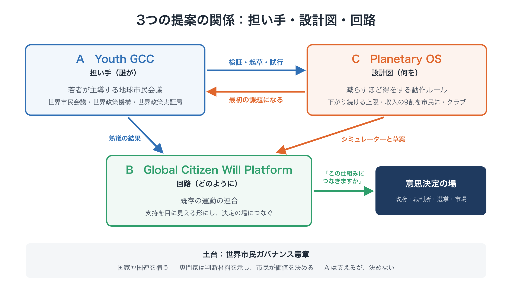
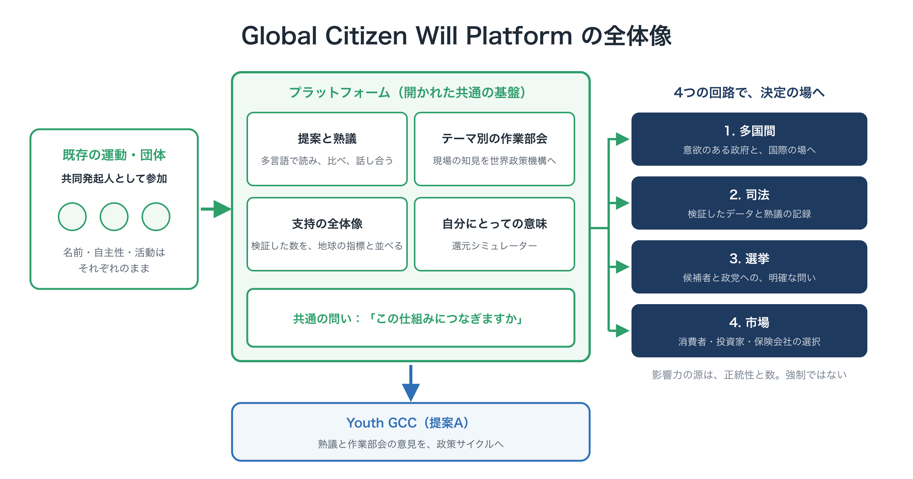

# 提案B：Global Citizen Will Platform ―― 市民の意思を、意思決定につなぐ

**提案の要約**　第1版（草案）

---

## この提案の位置づけ

本書は、パッケージ提案「限界の内側で、舵を取る」を構成する3つの提案の一つです。

- **提案A：Youth GCC** ―― 誰が担うか。世界市民会議、世界政策機構、世界政策実証局を備えた、若者主導の地球市民会議。
- **提案B：Global Citizen Will Platform（本書）** ―― 市民の意思をどう集め、目に見える形にし、意思決定につなぐか。
- **提案C：Planetary OS** ―― 社会を何のルールで動かすか。減らすほど得をする、具体的な政策の設計図。

提案Aが担い手を、提案Cが設計図を示します。提案Bは、**その両者と世界をつなぐ回路**です。最初の役目は、Youth GCC の最初の課題である Planetary OS を、市民と意思決定者に届けることです。

本書で示す名前・数値・組織の形は、すべて**一例**です。

<figure markdown="span">
  
  <figcaption>3つの提案の関係：担い手・設計図・回路</figcaption>
</figure>

---

## 1. 問題：欠けている回路

何百万もの人が、気候と将来世代のために、行進し、署名し、組織してきました。けれども、その力の多くは、本来の重みに見合う効果を上げられていません。理由は2つあります。

**地球規模の提案と、目に見える支持をつなぐ道がない。** 具体的な地球規模の政策の選択肢を、多くの国の人々の前に示し、どれだけの支持があるかを見せる、確立した方法がありません。そのため、どの国の議題にも当てはまらない提案は、外交の過程で簡単に脇に置かれてしまいます。

**「ローカルの罠」。** 運動は、国境、言語、組織によって分かれ、それぞれの国の議題の中で活動しています。一つひとつの活動は、吸収され、先送りされ、無視される程度の大きさにとどまります。特定の問いについて、それらを一つの目に見える声にする共通の基盤がありません。

その結果、多くの場所に散らばった大きな努力が、意思決定の場までなかなか届かない、というおなじみの形が繰り返されています。

---

## 2. プラットフォームとは何か

Global Citizen Will Platform は、次の3つを担う、**共有された、開かれた基盤**です。

1. 世界の既存の運動から、具体的な政策の提案と、その背後にある支持を集める
2. その支持を、地球の指標と並べて、目に見える形にする
3. 合法的な経路を通じて、意思決定を担う人々と機関につなぐ

これは、Youth GCC の**開かれた参加の層**です。Youth GCC の中核の組織は、意思決定を行い、提案をつくります。プラットフォームは、誰もが学び、熟議し、提案し、支持を示せる場です。参加の敷居は低くし、決定への責任は、説明責任を負う組織が持ちます。

---

## 3. 設計の原則

| 原則 | 内容 |
|---|---|
| **競争ではなく、連合** | 既存の組織は、それぞれの名前、自律性、活動を保ちます。共通の規格につながり、プラットフォームに本当の当事者として関わる**共同発起人**として参加します |
| **具体的な問い** | 支持を集めるのは、漠然とした要求ではなく、公開された具体的な提案に対してです。最初は Planetary OS です |
| **正統性は積み重ねるもの** | 数は大切ですが、開かれた手続き、意見の相違の記録、独立した評価も同じように大切です。世界市民全体を代表するとは主張しません |
| **強制ではなく、合法的な影響力** | 情報を示し、説得し、合法的な経路で圧力を積み上げます。提案を受け入れるかどうかは、それぞれの機関が決めることです |
| **はじめからプライバシーを守る** | 個人のデータは必要最小限にし、中央に個人の記録を集めずに確かめ、方法を公開し、重複して数えないようにします |
| **オープンソース** | コード、データの規格、数え方を公開し、誰でも確かめられるようにします |

---

## 4. 中心となる機能

**提案と熟議**：オープンソースの参加型ツール（Decidim を土台にしたものなど）を使い、提案を読み、選択肢を比べ、意見を書き、言語を越えてオンラインで熟議できるようにします。AIによる翻訳や要約で参加の壁を低くしますが、AIが決めることはありません。

**テーマ別の作業部会**：テーマごとの開かれた作業部会が、問い、根拠、地域の経験を、Youth GCC の世界政策機構に届けます。

**共有され、確かめられる支持の全体像**：協力団体が集めた支持、投票、行動を一つのダッシュボードにまとめ、残された炭素予算などの地球の指標と並べて示します。数は確かめられ、重複は除かれ、方法は公開されます。

**政策が自分にとって何を意味するかが分かる道具**：最初の道具は、提案Cの**還元シミュレーター**です。Planetary OS のもとで、自分の世帯がどのくらいプラスになるかの目安が分かります。

**共通の問い**：これらはすべて、政治への一つの問いに集まります。「動いてください」ではなく、**「動く設計図がここにあります。この仕組みにつなぎますか」**という問いです。

---

## 5. 意思決定につなぐ4つの経路

目に見える支持は、意思決定に届いてはじめて意味を持ちます。プラットフォームは、次の4つの経路でつなぎます。

| 経路 | 内容 |
|---|---|
| **1. 多国間** | 気候被害を受けやすい国など、意欲のある政府と協力し、提案、決議、条約の案を国際的な場に届ける |
| **2. 司法** | 検証されたデータと熟議の記録を提供し、世代間の不利益をめぐる問いを含め、裁判所や法律家の判断材料にしてもらう |
| **3. 選挙** | 公開した提案を、有権者が候補者や政党に投げかけられる、分かりやすい問いにする。「Planetary OS につなぎますか」 |
| **4. 市場** | 消費者、投資家、保険会社が、自分の選択を Standard に合わせられるよう支え、Standard を無視することのコストを高めていく |

どの経路でも、プラットフォームの影響力は、**強制からではなく、正統性と数から生まれます**。

<figure markdown="span">
  
  <figcaption>Global Citizen Will Platform の全体像</figcaption>
</figure>

---

## 6. 段階（一例）

| 段階 | 内容 | パッケージのロードマップとの対応 |
|---|---|---|
| 1. 連合 | 開かれた規格で、既存の若者と気候の団体をつなぐ。共同発起人を募る | 土台・立ち上げ |
| 2. 可視化 | Planetary OS とシミュレーターを公開し、Standard への支持を地球の指標と並べて示す | 立ち上げ・検証 |
| 3. 熟議 | 作業部会の意見とオンラインの熟議を、Youth GCC の市民会議と政策のサイクルにつなぐ | 検証・試行 |
| 4. 接続 | 4つの経路で、提案を意思決定の場に届ける。クラブの形成と並行して進める | 接続 |

各段階は、前の段階が公開した基準（検証の質、参加の多様さなど）を満たしてから進みます。

---

## 7. 提案A・Cとのつながり

- **A**：Youth GCC（誰が担うか）
- **B**：Global Citizen Will Platform（この提案）
- **C**：Planetary OS（社会を何のルールで動かすか）

| つながり | 内容 |
|---|---|
| **B → A** | プラットフォームが、各地の運動を Youth GCC の共同発起人としてつなぎ、オンラインの熟議と作業部会の意見を、その政策のサイクルに届ける |
| **A → B** | Youth GCC が公開した提案（少数意見を含む）が、支持を集める問いになる |
| **B ↔ C** | プラットフォームが、Planetary OS の Standard と還元シミュレーターを社会に届け、次の版に向けた意見を集める |
| **C → B** | Planetary OS が、プラットフォームに具体的な求めるものを与え、市民には支持する目に見える理由（確かめられる還元）を与える |

---

## 8. リスクと対応

| リスク | 対応 |
|---|---|
| 水増しされた、あるいは偽の支持 | 検証と重複の除去。数え方の公開。独立した監査 |
| プライバシーと監視への懸念 | データは最小限。中央に個人の記録を集めない。方法を公開。参加は任意 |
| 大きな協力団体や資金提供者による乗っ取り | 共有の当事者性を持つ連合。資金の上限と公開 |
| 対立的だと受け止められる | 補完する姿勢。合法的な経路のみ。協力団体はそれぞれの独自性を保つ |
| 参加が少ない、または偏る | 多言語のツール。オフラインや協力団体を通じた参加。誰が参加しているかの確認 |
| 成果の出ないプラットフォーム | まず一つの具体的な課題から。公開した基準に基づく段階的な拡大 |

---

## 9. お願いしたいこと

| 対象 | お願い |
|---|---|
| 若者主導の団体と気候の運動 | 共同発起人として加わり、自分たちの活動を共通の規格につなぐ |
| シビックテックの開発者とプラットフォーム | 熟議のツール、ダッシュボード、シミュレーターの開発を手伝う |
| 研究者と法律の専門家 | 検証の方法、プライバシーの保護、司法の経路の設計を手伝う |
| 財団と資金提供者 | 連合と可視化の段階を支援する |
| 意欲のある政府と都市 | プラットフォームを通じて届く提案に応じる |

---

## 関連資料

- パッケージ提案書「限界の内側で、舵を取る」[→](../package.md)
- 提案A：Youth GCC[→](a-youth-gcc.md)
- 提案C：Planetary OS（要約版、本編、FAQ）[→](c-summary.md)
- 還元シミュレーター[→](../tools/simulator.md)

**連絡先**：森　達哉 · [Substack](https://ttmori.substack.com) · [note](https://note.com/ttmori) · [X](https://x.com/ttmori) · [お問い合わせフォーム](https://docs.google.com/forms/d/e/1FAIpQLSexBpD4BcRWIV--FuhMC9BxbP4I9fXl6pi9nxQPmX2bjivjqw/viewform)
