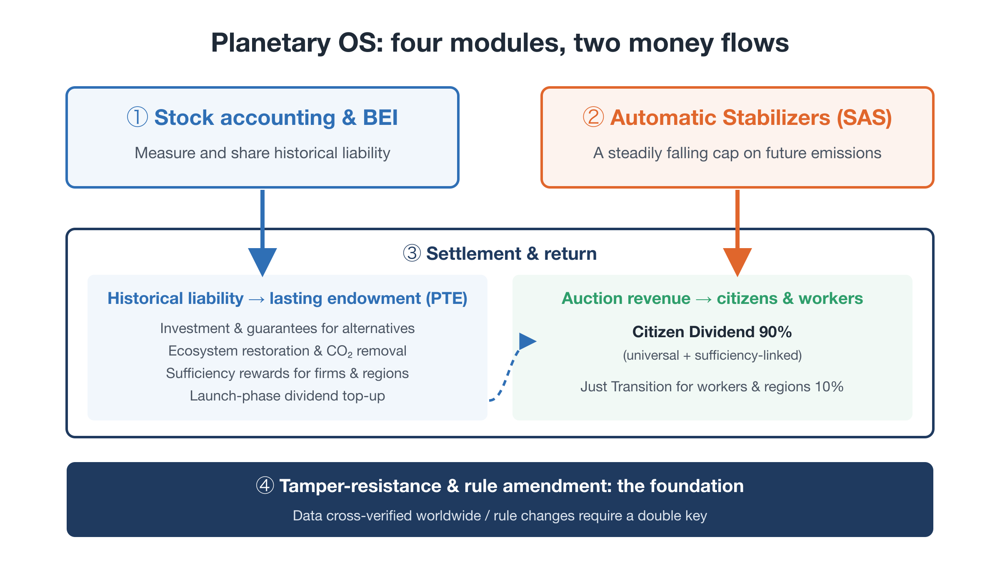
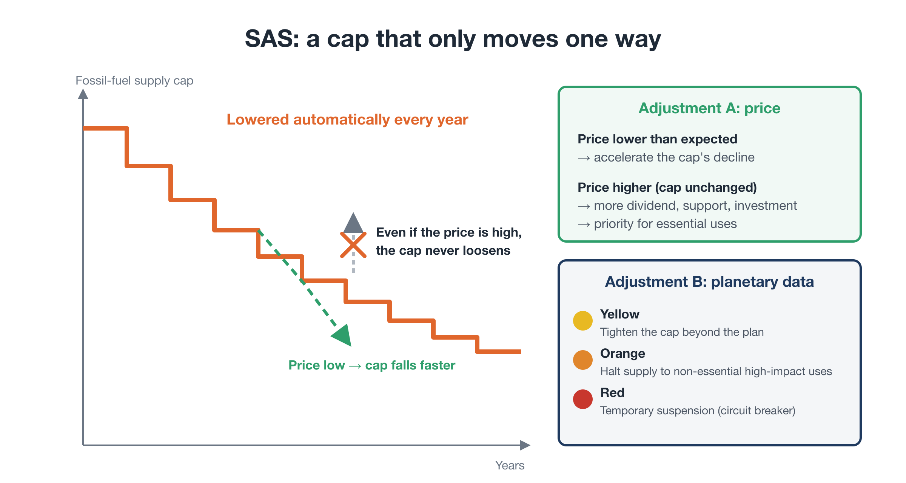
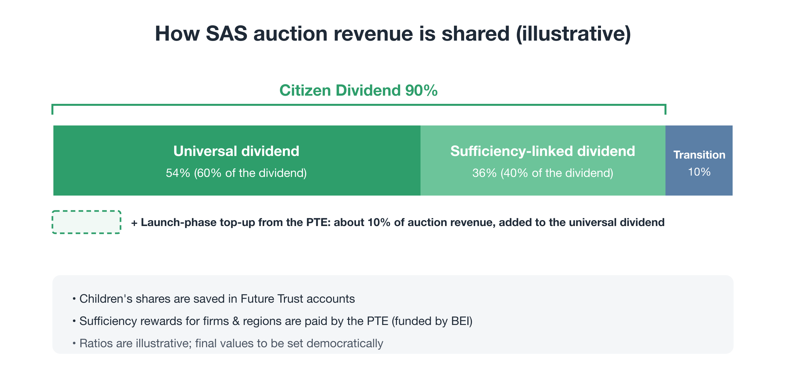
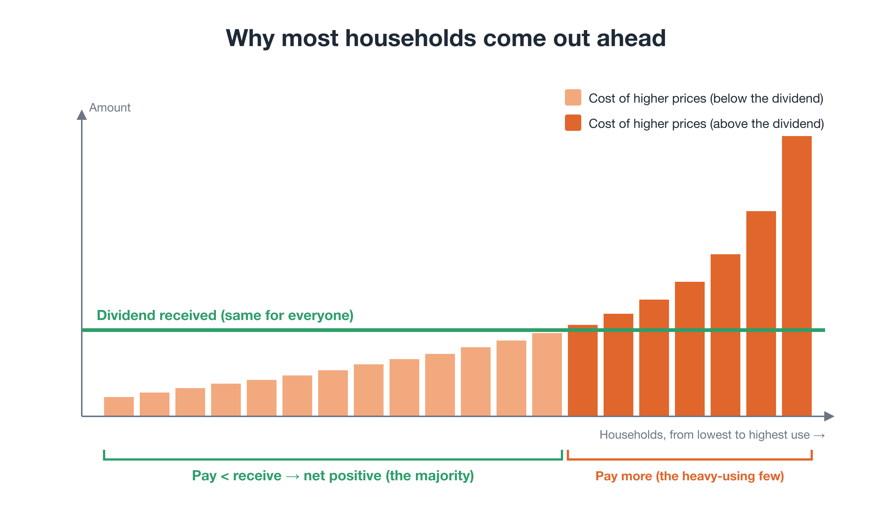
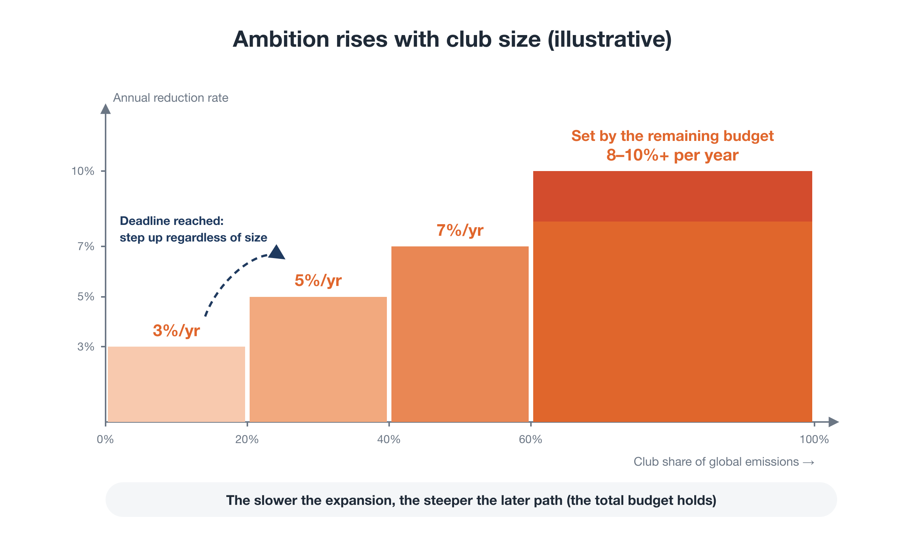
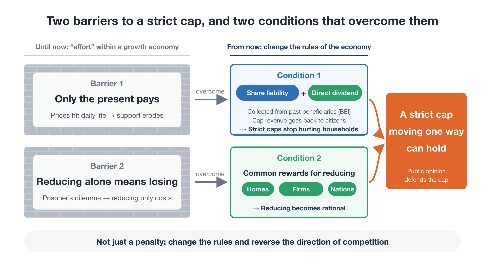
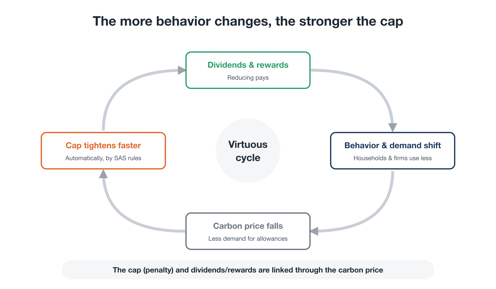

# Proposal C: Planetary OS
## An Operating System for a World Where Reducing Pays

**Full Proposal** — First edition (working draft)

---

### About this document

- This is the full text of **Proposal C: Planetary OS**, one of three proposals behind the Youth-Led Global Citizens' Congress for Future Generations (Youth GCC):
  - Proposal A — Youth GCC: who acts (the governance framework)
  - Proposal B — Global Citizen Will Platform: how civic will is gathered and connected to decisions
  - **Proposal C — Planetary OS: what the Youth GCC launches with — a concrete policy blueprint**
- For a short overview, see the Executive Summary (2–3 pages). The full reasoning is developed in the companion series *Rewriting the Planet's OS* (8 parts).
- All names, ratios, and figures in this document are **illustrative**. They show a direction, not a final design. The specifics will be set during the launch phase through scientific review and democratic deliberation.

---

## Contents

1. Summary
2. Background and problem
3. The proposal at a glance
4. Design of the four modules
5. Scaling internationally
6. Theory of change
7. Implementation plan (Stage 1)
8. Measuring progress
9. Risks and mitigation
10. Budget approach
11. Organization
12. What we are asking for
13. Relation to existing work
14. Appendices

---

## 1. Summary

Vast resources and energy have gone into the climate crisis. Yet emissions remain high, and carbon pricing has repeatedly stalled or been reversed. The root cause is that we have tried to cut emissions through **"effort" while leaving untouched the core rule of the economy: the more you expand, the more you gain.**

That design produces two barriers:

- **The burden falls only on the present.** Price increases hit today's households directly, and public support erodes.
- **Reducing alone means losing.** For individuals, firms, and nations alike, cutting back unilaterally is a loss. This is the prisoner's dilemma.

Planetary OS is a set of operating rules for society that builds in, from the start, the conditions needed to overcome both barriers. It has four modules:

1. **BEI** — a thin, broad levy on those who benefited most from the fossil economy, managed as the **Planetary Transition Endowment (PTE)**
2. **SAS** — a **one-way cap** on fossil fuels at the upstream point, with allowances sold at auction
3. **Settlement and return** — 90% of auction revenue returned directly to citizens, partly weighted toward those who use less, so that **reducing pays**. A majority-benefit rule tops up households just short of break-even so that at least 70% of people come out ahead
4. **Tamper-resistance and rule amendment** — distributed verification and a **double key** that prevents backsliding

It scales not through universal consensus but through **a club that is worth joining and costly to stay out of**. The target is **staying well below 2°C**.

Stage 1 aims to deliver:

- the **Planetary OS Standard** (first edition)
- a public **Citizen Dividend Simulator**
- the launch of the **Youth GCC**, together with a coalition of partner organizations and experts

---

## 2. Background and problem

### 2.1 Why previous efforts have not prevailed

Pricing carbon and returning the revenue to citizens is not a new idea. Yet real-world attempts have repeatedly been rolled back:

- Australia introduced a carbon price in 2012 and repealed it in 2014.
- Washington State voters rejected carbon-pricing ballot initiatives in both 2016 and 2018.
- France abandoned a planned fuel-tax increase after mass protests.
- Canada scrapped its consumer carbon charge, which came with household rebates, in 2025.
- Even the EU Emissions Trading System spent years unable to set a strict cap and continued to hand out free allowances.

These experiences share six weaknesses:

| Weakness | What happened |
|---|---|
| 1. Only the present paid | Only current emissions were priced; past beneficiaries kept their gains |
| 2. Diluted in negotiation | Rates and caps were bargained down under industry pressure |
| 3. Reversed after elections | Successor governments could simply repeal them |
| 4. "Effort" inside a growth economy | Reducing was a loss for everyone |
| 5. Unilateral adoption | Free-riding: "if others don't, we lose competitiveness" |
| 6. Proposed in "normal times" | The visible pain of higher prices outweighed distant risks |

### 2.2 The diagnosis: two barriers

All six weaknesses share one root: **trying to reduce through effort inside an economy built to expand.** Two barriers follow.

**Barrier 1: the burden falls only on the present.**
When only annual emissions (the flow) are regulated, every tightening of the cap damages livelihoods, jobs, and economic stability. Public support erodes, and politicians loosen the cap.

**Barrier 2: reducing alone means losing.**
Everyone would be better off if all reduced, yet each actor loses by reducing alone. As long as this dilemma persists, calls for "sufficiency" or "degrowth" offer only downside.

**Behind both barriers: a blockage, not a shortage.** Humanity as a whole already produces enough. Food supply is about 3,000 kcal per person per day, world GDP about USD 14,000 per person a year, and household wealth about USD 470 trillion, more than four times annual world GDP. What is missing is circulation. Wealth and emissions are concentrated in the same hands:

| Share of the world total | Bottom 50% by income | Middle 40% | Top 10% |
|---|---|---|---|
| Income | ~8% | ~40% | ~52% |
| Wealth | ~2% | ~22% | ~76% |
| CO₂ emissions | ~12% | ~40% | ~48% |

When wealth piles up at the top, three blockages follow together: most people's purchasing power shrinks, concentrated spending and investment push emissions past planetary limits, and the cost of climate policy lands on the majority, who then reject it. Planetary OS is designed to restore circulation, so that markets keep working and livelihoods stay secure within planetary limits. Because the carbon budget is finite, fossil-fuel use will fall either way: by plan and fairly, or through breakdown, starting with the most vulnerable.

### 2.3 What was missing: a blueprint for what comes next

There is a further gap. **No one has drawn a concrete blueprint for the system we should move to.** Most climate resources have gone into raising the alarm and petitioning governments for better laws. Because expertise is siloed, no integrated design has emerged that combines science, finance, law, incentive design, and movement strategy.

This proposal offers such a blueprint.

---

## 3. The proposal at a glance

### 3.1 Target

**Staying well below 2°C.**

Holding warming to 1.5°C without overshoot is now very likely out of reach. Even so, staying well below 2°C requires cutting emissions by roughly **8% a year globally**, and faster in high-income countries. This guide figure draws on estimates by Kevin Anderson and colleagues.

### 3.2 Design principles

1. **Strict outer limits, freedom within.** Only the planetary outer boundary is strictly enforced. Life and business within it remain free. No individual monitoring.
2. **One-way movement.** The cap may tighten faster, but it never loosens.
3. **Direct return, bypassing the treasury.** Revenue goes back to society by rule, not into general budgets.
4. **Combine penalty and reward.** The cap draws the line; rewards point competition in the right direction.
5. **Democratic goals, automatic execution.** Targets and rules are set democratically. Day-to-day adjustment is insulated from political bargaining.
6. **Humility about complexity.** The system keeps correcting course based on observed data.

### 3.3 Four modules

| Module | Role | Time horizon |
|---|---|---|
| 1. Stock accounting and BEI | Measure and share historical liability | Past |
| 2. SAS | Impose a declining cap on future emissions | Future |
| 3. Settlement and return | Return revenue so that reducing pays | Present |
| 4. Tamper-resistance and rule amendment | Protect the whole and prevent backsliding | Whole system |

Money flows in two streams, depending on its source:

- **SAS auction revenue** (the burden of future emissions) goes back to the households and workers who bear it: the Citizen Dividend and a Just Transition.
- **BEI revenue** (historical liability) goes to a lasting endowment, the PTE: investment in alternatives, guarantees, sufficiency rewards for firms and regions, ecosystem restoration, and, in the launch phase, a top-up to the Citizen Dividend.

<figure markdown="span">
  
  <figcaption>The four modules of Planetary OS and the two money flows</figcaption>
</figure>

---

## 4. Design of the four modules

### 4.1 BEI and the Planetary Transition Endowment (PTE)

**Principle.** Cumulative historical emissions are a liability owed by those who built wealth and profit on them. BEI extends responsibility beyond emitters to **beneficiaries of the fossil economy**: large concentrations of wealth, corporate profits, and fossil-dependent state assets.

**Scale (illustrative)**

| Base | Approximate size | Rate | Annual yield |
|---|---|---|---|
| Wealth of the top 1% | ~USD 200 trillion | 0.3–0.5% | ~USD 0.6–1.0 trillion |
| Profits of large companies (the world's 2,000 largest listed companies) | ~USD 5 trillion | ~5% | ~USD 0.25 trillion |
| Total | — | — | **on the order of USD 1 trillion (0.8–1.3 trillion)** |

The wealth figure is personal net wealth, which includes shares, so it already covers corporate assets indirectly; the corporate row is kept light for that reason. Sources: UBS Global Wealth Report (wealth) and the Forbes Global 2000, 2025 edition (profits). These figures assume global adoption. At the club stage, member countries' share would amount to several hundred billion dollars a year.

**Phased approach.** Identifying firm-by-firm liability and recovering it through litigation from day one would mean years of conflict. BEI therefore **starts thin and broad**. As data and institutions mature, it adds liability attribution and legal recovery on top.

**Use of the PTE**

| Phase | Spent each year | Added to principal |
|---|---|---|
| Launch | ~60%: investment and guarantees for members, support for climate-vulnerable countries, independent science, sufficiency rewards for firms and regions, and a top-up to the Citizen Dividend | ~40% |
| Mature | ~30% | ~70% |

**Guarantee rather than grant.** One of the largest obstacles to decarbonization in developing countries is the high cost of capital. The PTE prioritizes **first-loss guarantees** and **currency-risk cover** over grants. Existing guarantee instruments have stayed small because they depend on aid budgets and on the conservative balance-sheet constraints of development banks. The PTE aims to break through with an independent, large, and stable funding base and a mandate that **explicitly includes taking losses**.

**Safeguards against moral hazard**

- Cover only a first-loss tranche; investors and developers bear the rest.
- Cover only risks developers cannot control (currency shocks, abrupt policy change, offtaker default). Do not cover construction or management failure.
- Charge risk- and track-record-based guarantee fees.
- Underwrite portfolios rather than single deals, with rule-based eligibility checks instead of bespoke screening.
- If a host government breaches its commitments, the PTE pays out, seeks recovery from that government, and reduces its club benefits.
- Set an annual loss budget, and publish all loss records.

**Capital flight.** Like the global minimum corporate tax, members agree on a **minimum BEI rate**.

**Governance.** The PTE is separated from the body that sets club rules and is managed by independent experts. This prevents investment from favoring particular countries or firms and keeps the fund transparent.

### 4.2 SAS (Scientific Automatic Stabilizers)

**Where the cap applies**

- A supply cap applies at the **upstream** point: fossil-fuel extraction and import, and large point sources. Controlling a few thousand nodes worldwide reaches the whole economy, with no need to monitor individuals.
- Allowances equal to the cap are issued and **all sold at auction**. Firms bid for scarce allowances, and that competition sets the carbon price. The underlying mechanism is the familiar cap-and-trade design used in the EU and elsewhere.
- **Offsetting is not permitted.** Emissions above the cap cannot be cancelled with reductions bought elsewhere.

**How the cap declines**

- The binding commitment is the **remaining carbon budget** consistent with staying well below 2°C.
- The cap falls automatically each year on a path derived from that budget: about 8% a year globally on average, faster for high-income countries, and more gradual for developing ones.
- The path may start more gently and steepen later as new technologies scale up, but the total budget does not change.
- The cap starts from **current** emissions. Past overshoot is addressed through BEI and investment in carbon removal.
- At the club stage, the reduction rate rises with the club's size (Section 5).

**Automatic adjustment A: price**

- If the price is **lower** than expected, reductions are coming easily, so the decline of the cap accelerates.
- If the price is **higher** than expected, **the cap does not loosen**. Instead, the dividend and transition support increase, investment in alternatives is brought forward, and scarce supply is prioritized for essential uses.

**Automatic adjustment B: planetary indicators**
The system combines three kinds of indicators: cumulative levels, rates of change, and system health. Intervention escalates in three stages:

| Alert | Condition | Intervention |
|---|---|---|
| Yellow | Early signs of deterioration | Tighten the cap beyond the planned path |
| Orange | Approaching tipping points | Halt supply to non-essential high-impact uses; tighten lending conditions |
| Red | Irreversible collapse imminent | Temporarily suspend specific activities or facilities (circuit breaker) |

<figure markdown="span">
  
  <figcaption>SAS: a cap at the source that falls every year</figcaption>
</figure>

### 4.3 Settlement and return: making reduction pay

**Allocation of auction revenue (illustrative)**

| Use | Share |
|---|---|
| Citizen Dividend | 90% |
| — universal dividend | (60% of the dividend = 54% of revenue) |
| — sufficiency-linked dividend | (40% of the dividend = 36% of revenue) |
| Just Transition for workers and regions | 10% |

Households bear the higher prices, so the revenue goes back to them. Sufficiency rewards for firms and regions are funded by the PTE instead (4.1).

**Launch-phase top-up from the PTE.** In the launch phase, the PTE adds a top-up to the universal dividend, for example an amount equal to about 10% of auction revenue. BEI is paid by large concentrations of wealth and corporate profits, so for most households this top-up is a direct gain. It turns the principle of "those who benefited from the past give part of it back" into something people can see in their accounts.

**Why most households come out net positive.** Energy and material use rise steeply with income. If revenue is returned in equal per-capita amounts, the majority, who use less than the average, receive more than they pay in higher prices. Not all of the carbon cost lands on households: part of it is embodied in government spending, investment, and exports. Studies of carbon footprints suggest household consumption accounts for more than 60% of the total, so this proposal uses a standard assumption that **about 80% of the carbon cost reaches households**, which is still cautious.

Under these standard assumptions, as a rough calculation, **about 70% of people come out net positive**. Depending on the assumptions, such as how much of the cost reaches households and how unequal energy use is, the share ranges from about 60% to the low 70s with the launch-phase top-up, and lower without it. These are model estimates: the Citizen Dividend Simulator, which lets anyone test them, counts only direct costs, and indirect effects through wages, pensions, and the wider economy can only be estimated.

**Majority-benefit rule (standard design).** Because the share depends on the assumptions, the design does not rely on the estimate. Each year, households just short of break-even receive a top-up from the PTE equal to their shortfall, starting with the smallest shortfalls, until **at least 70% of households come out net positive**. The amount is fixed by each household's use when it joined, not by its current use, so cutting back afterwards still pays. Targeting keeps the cost low: in the simulator, about 1–2.5% of auction revenue even under the most cautious assumptions, compared with 20–30% if the universal dividend were raised for everyone. The PTE's total top-up has a ceiling, so the guarantee holds only within what the PTE can spend. The level of 70% is a value judgment and can be revisited democratically, including through citizens' assemblies.

**Design of the sufficiency-linked dividend**

- **Basis.** It rewards mainly **low levels of use**, and secondarily **reductions**. Rewarding reductions alone would penalize people who have always lived frugally.
- **Adjustments.** It corrects for use that people cannot easily change: cold climates, areas with little public transport, and medical or disability needs. Comparisons are made per person.
- **Measurement.** It uses only coarse, existing annual data, such as electricity and gas totals, vehicle type, and building energy ratings. Material consumption is phased in using category-level average coefficients, not individual purchase tracking.
- **Opt-in.** Participation is voluntary. Non-participants are assigned a standard value and still receive the universal dividend.

**A possible future extension: sufficiency action points (illustrative).** Annual data alone cannot reward everyday choices. Once the base layer is working, a second layer could be added after pilots: an independent body, under the scientific layer of the PPA, rates verified sufficiency actions, and citizens collect points for them in an app. Often the lowest-impact choice is not to buy, travel, or produce at all, so the points reward **choosing the lower-impact alternative**, not buying "green" products. Five principles guide it:

1. **Actions over products.** Large points for alternative actions (repair, second-hand, renting and sharing, cycling to work, working from home, community activities); medium points for alternative products (plant-based protein, products with verified deforestation-free ingredients, refills); small or no points for ordinary "eco" products.
2. **Points in proportion to avoided impact,** compared with the usual alternative.
3. **Priority to impacts the cap does not reach,** such as methane from livestock, deforestation, and biodiversity loss. SAS caps fossil carbon upstream; points can complement it where it cannot see.
4. **Reward only, never penalize** individual choices, especially in areas such as diet that are tied to culture and personal circumstances.
5. **Verify with existing records, cap points per person per year, and keep purchase records on the user's own device.** Only an annual total is reported.

Points do not carry a fixed cash value. They divide the existing sufficiency-linked pool (36% of revenue), so the total cost does not grow. The base layer of coarse annual data stays in place, so people who do not use the app are not disadvantaged. Rating products more broadly is better handled through public procurement and sufficiency rewards for firms.

**Sufficiency rewards (funded by the PTE).** Firms that cut output or material throughput, businesses that shift to repair, sharing, and durable products, and municipalities that build local circular economies are rewarded **in money, never in allowances**, so the cap never loosens. Public procurement also scores low environmental impact.

**Future Trust.** Half of each child's dividend is paid to the parents now, to cover the higher prices the household pays for the child. The other half accumulates in the child's personal Future Trust account and is released in stages, for example at 18 and 25. (The split is illustrative.)

**Does the dividend increase emissions?** No. Under a cap, total emissions cannot rise. If dividend spending raises energy demand, the only effect is a higher allowance price, which further rewards those who use less.

**Visibility.** In Canada, most households were estimated to receive more in rebates than they paid, yet few felt it, and the policy was repealed. Planetary OS therefore builds in three features:

- a clearly named payment, deposited directly on a fixed date
- a public simulator showing each household's net position
- small-scale pilots that let people experience the dividend first

**Order of magnitude (illustrative).** Consider a high-income country with per-capita emissions of around 10 tCO₂. At USD 100 per tonne, auction revenue is about USD 1,000 per person per year. Returning 90%, plus a PTE top-up of about USD 100, gives an average Citizen Dividend of about USD 1,000 per person, or about USD 4,000 for a family of four. For the median household, which uses less than the average, the dividend exceeds the higher prices by about USD 400 per person, or roughly USD 1,600 a year for a family of four. Revenue falls over the long term as the cap declines. The PTE provides the lasting financial base.

<figure markdown="span">
  
  <figcaption>How auction revenue is allocated</figcaption>
</figure>

<figure markdown="span">
  
  <figcaption>Why most households come out ahead</figcaption>
</figure>

### 4.4 Governance and protection against backsliding

**PPA (Planetary Protocol Assembly).** The PPA is an open body, independent of any state, that writes the Planetary OS Standard. It has three layers, and trust depends on all three together:

| Layer | Composition | Guarantees |
|---|---|---|
| Science and systems design | Earth-system scientists, ecological economists, systems engineers | Scientific integrity |
| Citizens and future generations | Citizens selected by lot; youth | Democratic legitimacy |
| Open-source engineering | Public code, distributed records | Implementation and tamper-resistance |

**Double key.** Changing the rules requires both scientific justification and approval by at least three-quarters of the citizens' representatives. Changes to club rules additionally require an overwhelming majority of member states. Changes that loosen the rules face even stricter conditions.

**Voice for future generations**

- **Future Generations Council:** may refer back policies that would breach planetary boundaries.
- **Virtual future citizens:** the perspective of future generations is a mandatory input to policy appraisal.
- **Sortition-based global citizens' assembly:** may refer questions to referendum and propose legislation.

**Data verification.** Satellite, ocean-sensor, and trade-settlement data are recorded and cross-verified across universities, research institutes, and civic nodes worldwide.

**Division of roles**

- **Politics decides:** goals; rules, including the pace of the cap, country differentiation, the price corridor, alert thresholds, and dividend ratios; oversight of the measuring bodies; and compensation.
- **The system executes:** day-to-day implementation according to pre-approved rules.

---

## 5. Scaling internationally: a club worth joining

### 5.1 Approach

Planetary OS does not wait for consensus among 190 countries. It starts with a **club** of willing countries and spreads as a **standard**. Like internet protocols, it grows by making non-adoption increasingly costly as adoption spreads. This builds on the author's separate *Green Gain Economy (GGE)* proposal.

| Body | Role |
|---|---|
| PPA | Writes the Standard (science data and design) |
| GGC (the Club) | Adopts the Standard and sets club rules |
| PTE | Invests and guarantees (separated from rule-setting) |

### 5.2 Joining pays

| Benefit | Content | Most valuable to |
|---|---|---|
| Energy security | Lower fossil-fuel import bills | Importers |
| Market access | Preferential tariffs among members; certification that eases trade | Exporting economies |
| Lower cost of capital | Investment backed by PTE guarantees | Developing countries |
| Citizen Dividend | A visible foundation of public support | All members |
| First-mover advantage | Early compliance with the standards of new industries | Technology leaders |

Benefits are **allocated according to reduction performance**, so that "reducing pays" holds at the level of nations too.

**What high-income countries gain.** In pure cash terms, high-income countries are net contributors. Their gains are indirect but substantial:

- their firms become the main investors, builders, and insurers
- a larger club means larger markets and less carbon leakage
- resource and supply-chain security improves
- climate damage that would spill back home is reduced
- they gain leadership in setting the standards

BEI falls on large wealth and corporate profits, **not on ordinary taxpayers**.

### 5.3 Staying out costs

- **Carbon border adjustment.** Imports from outside the club face the same carbon cost. A non-member faces a simple choice: collect that revenue at home and return it to its own citizens, or pay it at someone else's border.
- **Finance and insurance.** The Standard becomes a yardstick for climate-risk assessment.
- **Liability.** Historical-liability data can underpin legal claims.

### 5.4 Competitiveness

- **Imports:** Border adjustment prevents unfair competition from goods that bear no carbon cost.
- **Exports:** The main answer is to grow the club quickly and make it the primary market. Export rebates require careful review under trade rules.
- **Domestic:** Government procurement favors low-carbon materials, creating first buyers for new products.
- **Residual burden:** It is absorbed by sufficiency rewards and the Just Transition.

Under these rules, industry splits into losers (legacy fossil-dependent firms) and winners (new low-impact sectors). The winners, together with citizens, become the constituency that defends the system.

### 5.5 Ambition that rises with club size

Instead of demanding 8% a year from everyone at the outset, the club adopts a conditional commitment: **"we will if you will."**

| Club share of global emissions | Club-wide annual reduction (illustrative) |
|---|---|
| Under 20% | 3% |
| 20–40% | 5% |
| 40–60% | 7% |
| Over 60% | Set by the remaining budget (8–10%+) |

- **Recalibration rule.** At each step, the required rate is recalculated from the remaining budget and the years left. The slower the expansion, the steeper the later path.
- **Deadlines.** A step is triggered by club size or by a deadline, whichever comes first. This closes the loophole of keeping the club small to keep targets low.
- **If time runs out.** Overshoot beyond 2°C is partly addressed through investment in carbon removal. Planetary-indicator alerts operate regardless of club size.

<figure markdown="span">
  
  <figcaption>Club size and the reduction rate</figcaption>
</figure>

### 5.6 Early movers gain, and the rules are fixed at launch

- **Founding members** join while rates are low, lead standard-setting, and receive priority investment and guarantees.
- **Late entrants** adopt the prevailing, stricter rate at once and pay part of the BEI they missed.
- **Non-members** face a border carbon cost that rises as the club grows.

All of these rules are **set and published at launch**: thresholds, rates, deadlines, recalibration timing and method, entry-timing benefits and costs, and late-entry terms. Changing them is deliberately hard. Predictable rules make "join now" the rational choice and unlock long-term investment.

### 5.7 Connecting to existing systems

No country needs to build a new tax system from scratch. Each connects through a **linkage clause**:

- **Tax and cap:** levels update automatically in line with the Standard.
- **Dividend:** the revenue goes back to households through existing identification and payment systems (see below).
- **Customs:** the border carbon cost is collected through existing tariff infrastructure.

**What is shared, and what each country decides.** The club agrees on outcomes, not on every detail of delivery, in the same way that the global minimum corporate tax sets a floor and leaves the design of the tax system to each country.

| | Content |
|---|---|
| Common rules (conditions of membership) | ① Most of the revenue (for example, 90%) goes back to households. ② At least 70% of households come out net positive (the majority-benefit rule). ③ The amounts and methods of return are published |
| Chosen by each country | How the money is returned (direct dividends, tax credits, top-ups to existing benefits, and so on), and the balance between the universal and sufficiency-linked parts |
| Standard design | The direct dividend described in 4.3 (60% universal, 40% sufficiency-linked), offered as a ready-to-use model |

Why make the return a common rule at all, rather than sharing only the cap? Because the return is what keeps the cap politically in place: when most households come out ahead, public opinion defends the cap. And because members cut emissions on the understanding that others will too, one country's backlash and loosened cap would weaken every member's commitment. The common rule lets members assure one another that each cap will hold (FAQ E7).

Joining is each country's own decision, made through its own legislature, so membership is an exercise of sovereignty, not a loss of it. Countries whose constitutions or budget rules limit the earmarking of revenue can meet the common rules through the delivery method that fits them.

### 5.8 First movers

The natural first movers are fossil-fuel importers, climate-vulnerable nations, insurers and long-term investors, and ambitious cities and states. The design assumes that fossil-fuel exporters will not join at first. How large a market the founding club can bring in is therefore decisive.

---

## 6. Theory of change

### 6.1 Two conditions to overcome two barriers

| Barrier | Condition | Result |
|---|---|---|
| 1. Only the present pays | Shared historical liability (BEI) and a direct Citizen Dividend | A strict cap no longer breaks livelihoods |
| 2. Reducing alone means losing | A common sufficiency incentive for households, firms, regions, and nations | Reducing becomes the rational choice |

With both in place, public opinion shifts **from pushing the cap down to defending it**.

<figure markdown="span">
  
  <figcaption>Two barriers, and the two conditions that overcome them</figcaption>
</figure>

### 6.2 Feedback loops

> Dividends and rewards → behavior and demand shift → the carbon price falls → the cap's decline accelerates → dividends and rewards continue

The same structure operates among nations:

> Early members bear little cost and gain much → the club grows → non-members' disadvantage rises → they hurry to join → the club grows further

<figure markdown="span">
  
  <figcaption>The more behavior changes, the faster the cap can tighten</figcaption>
</figure>

### 6.3 From petition to implementation

Instead of **petitioning** governments for better laws, the movement **builds a working system first** and asks one question: *"Will you connect to it?"* Compared with drafting and negotiating legislation from scratch, this leaves far less room for dilution.

### 6.4 Readiness for crisis

In the end, climate shocks may be what pushes many countries to act. How fast the transition happens will depend on whether a **working alternative is already designed, tested, and running, even at small scale**.

---

## 7. Implementation plan (Stage 1)

### 7.1 Four stages overall

| Stage | Content |
|---|---|
| 1. Draft the Standard | Form the nucleus of the PPA and publish the first *Planetary OS Standard* |
| 2. Civic verification | A sortition-based citizens' assembly reviews it, and the simulator goes public |
| 3. Pilot | Small-scale pilots in municipalities, small island states, and similar settings |
| 4. Put the question to politics | Elections and summits face the question: "Will you connect?" |

This proposal seeks support mainly for **Stages 1 and 2, plus preparation for Stage 3**, over roughly eighteen months.

### 7.2 Indicative sequence

The length of each stage will adapt to how partners come together (about a year and a half in total, as a guide).

| Stage | Main activities | Outputs |
|---|---|---|
| Preparation | Dialogue with partners (youth organizations, experts); outline of the Standard based on the series | Outline of the Standard |
| Drafting | Working groups formed; Standard drafted; simulator prototyped | First edition of the Standard; simulator prototype |
| Launch | Youth GCC launched; Standard and simulator published | Launch declaration |
| Verification | Citizens' assembly review; outreach; talks with pilot hosts | Verification report; revised Standard |

### 7.3 Working groups

| Working group | Scope |
|---|---|
| Economics and dividends | Dividend design, BEI calculation, simulator |
| Science and the cap | Cap trajectory, planetary indicators, alert thresholds |
| Law | Linkage clauses, border adjustment and trade law, historical liability |

Outputs are published as a **shared standard**, not under any single organization's name. Each contributor can show what it contributed.

---

## 8. Measuring progress

### 8.1 Stage 1 indicators

- The first edition of the Standard has been published and revised after review.
- Experts from several disciplines have reviewed or co-authored it.
- Youth organizations and individuals have joined as Co-Initiators.
- The simulator is public and in use.
- A citizens' assembly review has taken place and its report has been published.
- Talks have begun with municipalities or small island states willing to host pilots.

Specific targets will be set together with partners.

### 8.2 Long-term indicators

- The club's share of global emissions
- The actual cap trajectory compared with the remaining budget
- The share of households that come out net positive
- Private investment mobilized by PTE guarantees
- Changes in the cost of capital in developing countries

---

## 9. Risks and mitigation

| Risk | Description | Mitigation |
|---|---|---|
| Trade-law compatibility | Border adjustment or export treatment may conflict with trade rules | Early review by the legal working group; learn from EU CBAM implementation |
| Political backlash | Opposition to higher prices; "elite imposition" narratives | Direct, visible dividend; public simulator; early small-scale pilots |
| Capital flight | Wealth relocating to avoid BEI | Minimum BEI rate across members |
| Surveillance concerns | Fear that measuring use enables monitoring | Coarse annual data only; opt-in; data minimization |
| Moral hazard | Guarantees encourage carelessness | First-loss tranche only; limited risk types; fees |
| Data uncertainty | False alarms or missed signals | Three indicator types; distributed verification |
| Slow club expansion | Missing the 2°C budget | Deadline-based steps; recalibration rule; carbon-removal investment |
| Governance capture | Undue influence by states or firms | Separation of rules and money; double key; full transparency |
| A single-author design | Blind spots and bias | Published as a working draft, to be rewritten through expert and civic review |

---

## 10. Budget approach

The scale and breakdown of the budget will be developed together with partners once the coalition takes shape. The main cost categories are:

- drafting the Standard: working groups, expert participation, legal analysis
- developing and running the simulator, including multilingual versions
- launch and coalition-building: launch event, citizens' assembly, talks with pilot hosts
- operations and audit: secretariat, accounting, independent evaluation

---

## 11. Organization

| Actor | Role |
|---|---|
| Initiator (individual) | Draws the initial blueprint (draft Standard, operating guide, simulator prototype) and supports its quality and logic |
| Youth GCC | The public face and executing body: runs assemblies, builds coalitions, hosts the launch, communicates |
| PPA working groups | Scientists, legal scholars, economists, and engineers drafting and reviewing the Standard |
| Advisors | Scientists, experienced former policymakers, Indigenous leaders, and others |
| Fiscal host | Receives and administers grants. **Not yet identified**: we are seeking an established partner organization to take this role |

**Conflicts of interest and transparency.** Funders, participating organizations, decision records, and accounts are published. Funding does not influence the content of the Standard.

---

## 12. What we are asking for

| Who | Ask |
|---|---|
| Youth organizations and individuals | Join the Youth GCC as Co-Initiators |
| Researchers and experts | Join a working group; review and co-author the Standard |
| Climate organizations | Join the coalition; use the simulator in campaigns |
| Foundations and funders | Support Stage 1 |
| Municipalities and small island states | Host small-scale pilots |
| Established NGOs and universities | Act as a fiscal host for grants |
| Engineers | Help build the simulator and publishing infrastructure |

---

## 13. Relation to existing work

Planetary OS deliberately builds on established ideas. Its contribution is to **integrate** them into one design and to add a few elements aimed at the political durability problem.

| Existing idea | What Planetary OS takes from it | What it adds |
|---|---|---|
| Planetary boundaries (Rockström et al., 2009; Steffen et al., 2015) | Physical limits as non-negotiable outer constraints | Automatic policy responses tied to boundary indicators |
| Prices vs. quantities (Weitzman, 1974) | Under a fixed cumulative budget, quantity control is preferred | A one-way cap combined with a price corridor that never loosens the cap |
| Cap-and-dividend and fee-and-dividend (e.g., Barnes; Boyce; Hansen; Citizens' Climate Lobby) | Returning carbon revenue directly to citizens | A sufficiency-linked component, historical liability (BEI), and protection against repeal |
| Climate clubs (Nordhaus, 2015) and reciprocal commitments (Cramton, MacKay, Ockenfels & Stoft, 2017) | Club benefits plus border measures; "we will if you will" | Rates that rise with club size, deadlines, recalibration, and rules fixed at launch |
| Sufficiency (IPCC AR6, Working Group III) | Demand-side reduction as a mitigation lever | Turning sufficiency into a rewarded, rational choice rather than a sacrifice |
| Deliberative democracy (e.g., OECD's "deliberative wave"; national climate assemblies) | Sortition-based citizens' assemblies | A binding role in rule amendment through the double key |
| Future-generations institutions (e.g., Wales' Future Generations Act; Japan's Future Design research) | Formal representation of future generations | Referral powers tied to planetary boundaries |
| Blended finance and the cost of capital (e.g., IEA; ODI) | Guarantees to lower the cost of capital | A large, independent funding base (BEI) with an explicit mandate to take losses |
| Global Democratic Governance Charter (世界市民ガバナンス憲章, 2026; written as part of this package) [→](../charter/charter.md) | Policy options designed from the standpoint of world citizens, always several per issue, including a "global carbon dividend" option for climate (Section 3) | A detailed design of that "global carbon dividend" option, to be compared with the alternatives in the World Citizens' Assembly |

**Selected references.** Other entries in the table refer to bodies of work rather than single publications.

- Barnes, P. (2001). *Who Owns the Sky? Our Common Assets and the Future of Capitalism*. Island Press.
- Boyce, J. K. (2019). *The Case for Carbon Dividends*. Polity.
- Cramton, P., MacKay, D. J. C., Ockenfels, A., & Stoft, S. (Eds.) (2017). *Global Carbon Pricing: The Path to Climate Cooperation*. MIT Press.
- IPCC (2022). *Climate Change 2022: Mitigation of Climate Change*. Contribution of Working Group III to the Sixth Assessment Report (Chapter 5: Demand, services and social aspects of mitigation).
- Ivanova, D., et al. (2016). Environmental impact assessment of household consumption. *Journal of Industrial Ecology*, 20(3), 526–536.
- Nordhaus, W. (2015). Climate clubs: Overcoming free-riding in international climate policy. *American Economic Review*, 105(4), 1339–1370.
- OECD (2020). *Innovative Citizen Participation and New Democratic Institutions: Catching the Deliberative Wave*. OECD Publishing.
- Rockström, J., et al. (2009). A safe operating space for humanity. *Nature*, 461, 472–475.
- Steffen, W., et al. (2015). Planetary boundaries: Guiding human development on a changing planet. *Science*, 347(6223).
- Weitzman, M. L. (1974). Prices vs. quantities. *Review of Economic Studies*, 41(4), 477–491.
- Well-being of Future Generations (Wales) Act 2015.

---

## 14. Appendices

### A. Illustrative figures used in this document

| Item | Illustration |
|---|---|
| Target | Staying well below 2°C |
| Reduction pace | ~8% a year globally (faster for high-income countries); at club stage 3% → 5% → 7% → budget-derived rate |
| BEI scale | On the order of USD 1 trillion a year globally (0.8–1.3 trillion; several hundred billion at club stage) |
| PTE allocation | Launch phase: 60% spent, 40% to principal; mature phase: 30% / 70% |
| Auction revenue | 90% Citizen Dividend (60% universal, 40% sufficiency-linked); 10% Just Transition |
| PTE top-up (launch phase) | About 10% of auction revenue, added to the universal dividend |
| Household share of carbon cost | About 80% (standard assumption) |
| Net-positive share (estimate) | About 70% of people under standard assumptions (about 60% to the low 70s) |
| Majority-benefit rule | Standard design: a top-up for households just short of break-even, fixed by their use when they joined, so that at least 70% come out ahead; about 1–2.5% of auction revenue; level can be revisited democratically |
| Sufficiency action points | A possible future extension: points for lower-impact alternatives, dividing the sufficiency-linked pool |
| Double key | Approval by at least three-quarters of citizens' representatives |

### B. Map to the companion series

| Section of this document | *Rewriting the Planet's OS* |
|---|---|
| 2. Background and problem | Parts 1, 2, and 7 |
| 3. The proposal at a glance | Part 2 |
| 4.1 BEI and the PTE | Parts 2 and 6 |
| 4.2 SAS | Part 3 |
| 4.3 Settlement and return | Part 5 |
| 4.4 Governance | Parts 2 and 4 |
| 5. Scaling internationally | Part 6 |
| 6. Theory of change | Parts 3 and 7 |
| 7. Implementation plan | Part 8 |

### C. Glossary

A bilingual glossary (Japanese/English) is used to keep the two language versions consistent. It is a working document and is not published; it is available on request.

### D. Related materials

- Series: *Rewriting the Planet's OS* (8 parts) [→](../series/part-0.md)
- Executive Summary (English / Japanese) [→](c-summary.md)
- FAQ: common objections and our answers (English / Japanese) [→](c-faq.md)
- Proposal A: Youth GCC [→](a-youth-gcc.md)
- Global Democratic Governance Charter [→](../charter/charter.md)
- Essay: *Building Another World Politics* [→](../charter/another-world-politics.md)
- Proposal B: Global Citizen Will Platform [→](b-platform.md)
- Green Gain Economy (GGE) [↗](https://ttmori.substack.com/p/green-gain-economy-gge-policy-proposal)
- BEI policy white paper [↗](https://ttmori.substack.com/p/policy-white-paper-proposal-a-new?r=5dzcae)
- Related concepts: Designed Model Economy [↗](https://ttmori.substack.com/p/proposal-for-introducing-a-designed) / Global Shrinkage Evaluation System (S.I.R.) [↗](https://ttmori.substack.com/p/proposal-for-the-establishment-of) / Dual Value Economy [↗](https://ttmori.substack.com/p/dual-value-economy-concept-book)

**Contact:** Tatsuya Mori · [Substack](https://ttmori.substack.com) · [note](https://note.com/ttmori) · [X](https://x.com/ttmori) · [Contact form](https://docs.google.com/forms/d/e/1FAIpQLSexBpD4BcRWIV--FuhMC9BxbP4I9fXl6pi9nxQPmX2bjivjqw/viewform)

---

This document is also published on: [note (Japanese)](https://note.com/ttmori/n/n9114cc3d1929)
