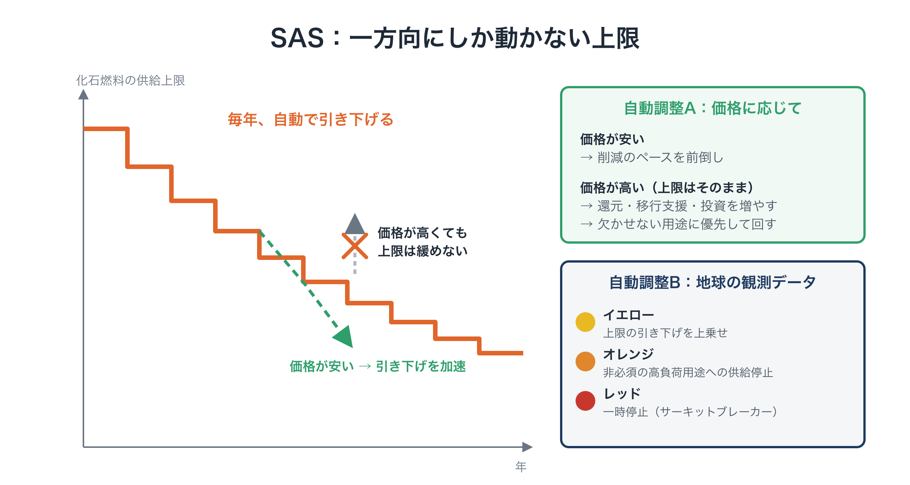
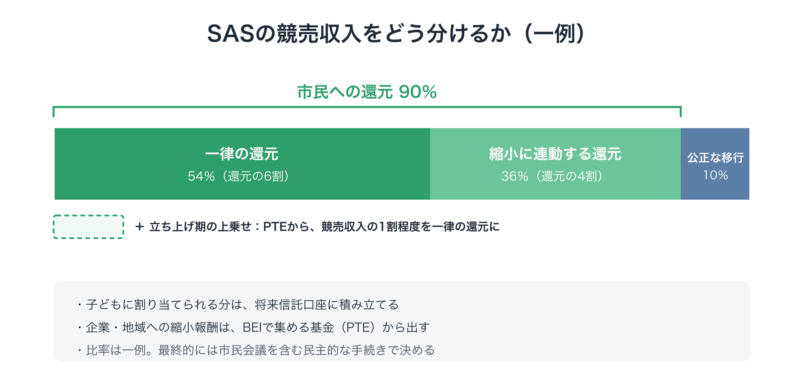
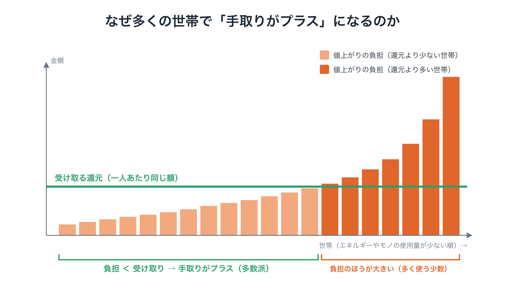
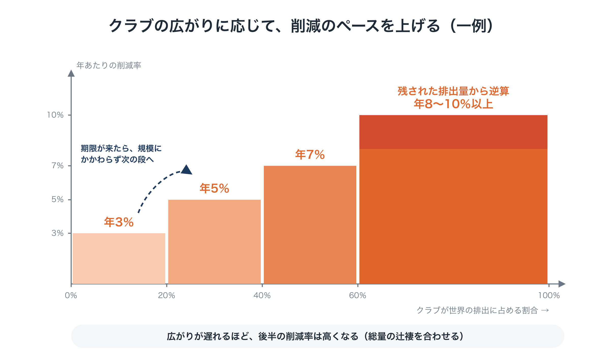
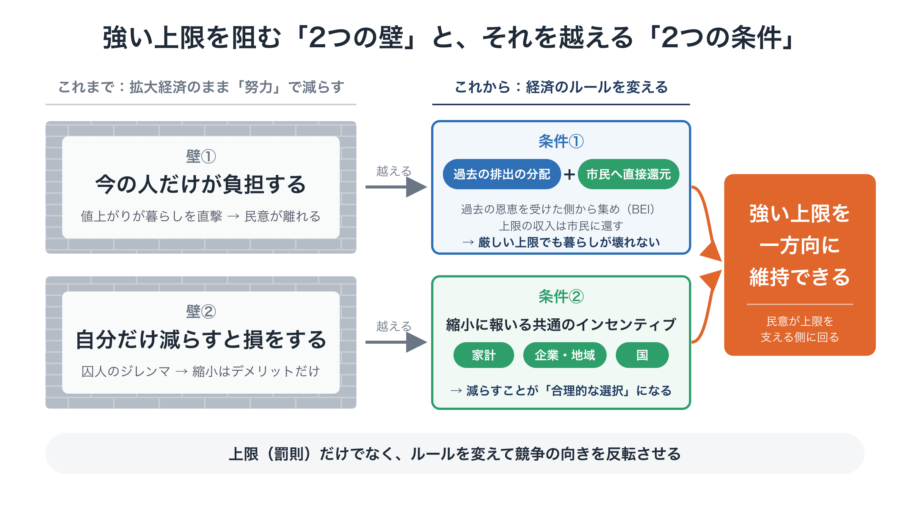
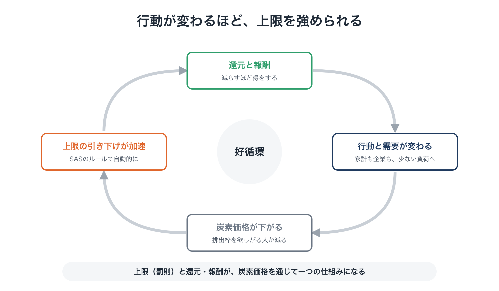

# 提案C：Planetary OS
## 減らすほど得をする社会への、地球規模の動作ルール

**本編（Full Proposal）**　第1版（草案）

---

### 本書について

- 本書は、若者主導の地球市民会議（Youth GCC）の構想を構成する3つの提案のうち、**提案C：Planetary OS** の本編です。
  - 提案A：Youth GCC ―― 誰が担うか（統治の枠組み）
  - 提案B：Global Citizen Will Platform ―― 市民の意思をどう集め、意思決定につなげるか
  - **提案C：Planetary OS ―― Youth GCC が最初に掲げる、具体的な政策の設計図**
- 要点だけを知りたい方は、要約版（2〜3ページ）をご覧ください。設計の背景と理由は、連載「地球のOSを書き換える」（全8回）で詳しく説明しています。
- 本書で示す制度の名前・比率・数値は、すべて**方向性を示すための一例**です。具体的な設計は、立ち上げの段階で、科学的な検討と民主的な議論を経て決めます。

---

## 目次

1. 要約
2. 背景と課題
3. 提案の全体像
4. 4つの部品の設計
5. 国際的な展開
6. 変化の理論
7. 実施計画（第1段階）
8. 成果の測り方
9. リスクと対策
10. 予算の考え方
11. 推進体制
12. 求めていること
13. 先行研究との位置づけ
14. 付録

---

## 1. 要約

気候危機に対して、莫大な資金と情熱が注がれてきました。それでも排出は高い水準のままで、炭素への価格づけは何度も停滞し、撤回されてきました。その根本の理由は、**「拡大するほど得をする」という経済の基本ルールに手をつけないまま、「努力」で排出を減らそうとしてきた**ことにあります。

この構造は、2つの壁を生みます。

- **今の人だけが負担する**：値上がりの負担が今の暮らしを直撃し、民意が離れる
- **自分だけ減らすと損をする**：個人・企業・国のいずれにとっても、自分だけ減らすのは損になる（囚人のジレンマ）

Planetary OS は、この2つの壁を越えるための条件を、最初から組み込んだ社会の動作ルールです。4つの部品からなります。

1. **BEI**：化石燃料経済から最も恩恵を受けてきた側に薄く広く負担を求め、**Planetary Transition Endowment（PTE）**として運用する
2. **SAS**：化石燃料の上流に**一方向にしか動かない上限**をかけ、排出枠を競売にかける
3. **清算と還元**：競売収入の90％を市民に直接還す。その一部は使用量が少ない人ほど多く受け取る形にし、**減らすほど得をする**ようにする。多数派保証ルールで、少なくとも7割の人の手取りがプラスになるようにする
4. **改ざん防止とルール変更**：分散型の検証と**二重の鍵**で、後戻りを防ぐ

広げ方は、全会一致を待つのではなく、**参加すると得をし、参加しないと損をするクラブ**です。目標は、**2℃を確実に下回ること**です。

第1段階で目指すのは、次の3つです。

- **Planetary OS 標準仕様書**の初版
- **還元シミュレーター（Citizen Dividend Simulator）**の公開版
- **Youth GCC** の立ち上げと、協力団体・専門家の連合づくり

---

## 2. 背景と課題

### 2.1 これまでの取り組みは、なぜ勝てなかったのか

炭素に価格をつけ、その収入を市民に還すという考え方は、新しいものではありません。けれども、現実の取り組みは何度も後退してきました。

- オーストラリアは2012年に炭素価格の制度を導入し、2014年に廃止した
- アメリカのワシントン州では、炭素への価格づけを問う住民投票が2016年と2018年の両方で否決された
- フランスは、大規模な抗議運動を受けて、予定していた燃料税の引き上げを撤回した
- カナダは2025年、家庭への還付とセットだった消費者向けの炭素課金を廃止した
- EUの排出量取引でさえ、長いあいだ厳しい上限を設けられず、排出枠の無償配布を続けてきた

これらの経験には、6つの共通する弱点があります。

| 弱点 | 何が起きたか |
|---|---|
| 1. 今の人だけが負担した | 価格がついたのは今の排出だけで、過去の恩恵を受けた側は得たものをそのまま保った |
| 2. 交渉で骨抜きにされた | 税率や上限が、産業界の圧力を受けて引き下げられた |
| 3. 選挙のあとで撤回された | 次の政権が、そのまま廃止できた |
| 4. 拡大経済の中での「努力」だった | 減らすことは、誰にとっても損だった |
| 5. 一国だけで導入しようとした | ただ乗りの問題：「他国がやらないなら、自国の競争力が落ちる」 |
| 6. 「平時の政策」として提案された | 目に見える値上がりの痛みが、遠いリスクより重く感じられた |

### 2.2 診断：2つの壁

6つの弱点には、一つの共通の根があります。**拡大するようにつくられた経済の中で、努力によって減らそうとした**ことです。そこから2つの壁が生まれます。

**壁①：今の人だけが負担する**
毎年の排出（フロー）だけを規制すると、上限を厳しくするたびに、暮らしと雇用と経済の安定が傷つきます。民意は離れ、政治家は上限を緩めます。

**壁②：自分だけ減らすと損をする**
全員が減らせば全員が得をするのに、一人ひとりにとっては自分だけ減らすと損をします。このジレンマが続く限り、「足るを知る暮らし」や「脱成長」を呼びかけても、そこにはデメリットしかありません。

**2つの壁の背景：不足ではなく、詰まり**：人類全体では、すでに十分に生産しています。食料の供給は一人1日約3,000kcal、世界のGDPは一人あたり年約1.4万ドル、家計の資産は約470兆ドルで、世界の年間GDPの4倍を超えます。欠けているのは、めぐりです。富と排出は、同じところに集中しています。

| 世界全体に占める割合 | 所得の下位50％ | 中間の40％ | 上位10％ |
|---|---|---|---|
| 所得 | 約8％ | 約40％ | 約52％ |
| 資産 | 約2％ | 約22％ | 約76％ |
| CO₂の排出 | 約12％ | 約40％ | 約48％ |

富が上に積み上がると、3つの詰まりが同時に起きます。多数派の購買力が細り、集中した消費と投資が排出を地球の限界の外へ押し出し、気候政策の負担が多数派にかかって拒まれます。Planetary OS は、このめぐりを取り戻し、地球の限界の内側で、市場が働き続け、暮らしの安心が保たれるように設計しています。炭素予算には限りがあるため、化石燃料の使用はいずれにせよ減ります。計画して公平に減らすか、最も弱い人から壊れながら減らされるかの違いです。

### 2.3 欠けていたもの：次に移る先の設計図

もう一つの空白があります。**移るべき仕組みの具体的な設計図を、誰も描いてこなかった**ことです。気候問題の資源の多くは、危機を訴えることと、政府により良い法律を求める請願に向けられてきました。専門分野が分断されていたため、科学・金融・法律・インセンティブ設計・運動の戦略を一つにまとめた設計は生まれませんでした。

本提案は、その設計図を示すものです。

---

## 3. 提案の全体像

### 3.1 目標

**2℃を確実に下回ること。**

1.5℃を一時的にも超えずに抑えることは、すでにほぼ手の届かないところにあります。それでも2℃を確実に下回るには、世界全体で**年8％前後**、高所得国ではそれ以上の速さで排出を減らす必要があります。この目安は、ケビン・アンダーソン氏らの見積もりを参考にしています。

### 3.2 設計の原則

1. **外枠は厳しく、内側は自由に**：地球の外枠となる限界だけを厳格に守る。その内側の暮らしや事業は自由に任せ、個人を監視しない
2. **一方向にしか動かない**：上限は加速することはあっても、緩めることはない
3. **財政を通さず、直接還す**：収入は一般財源に入れず、ルールに従って社会に還す
4. **罰則と報酬を組み合わせる**：上限が線を引き、報酬が競争を正しい方向へ向ける
5. **目標は民主的に、実行は自動で**：目標とルールは民主的に決め、日々の調整は政治の駆け引きから切り離す
6. **複雑さへの謙虚さ**：観測データに基づいて、軌道修正を続ける

### 3.3 4つの部品

| 部品 | 役割 | 扱う時間 |
|---|---|---|
| 1. ストック会計とBEI | 過去の負債を測り、分かち合う | 過去 |
| 2. SAS | これからの排出に、下がり続ける上限をかける | 未来 |
| 3. 清算と還元 | 減らすほど得をするように、収入を還す | 現在 |
| 4. 改ざん防止とルール変更 | 全体を守り、後戻りを防ぐ | 全体 |

お金の流れは、出どころによって2つに分かれます。

- **SASの競売収入**（これからの排出への負担）→ その負担を担う家計と働く人へ：市民への還元、公正な移行
- **BEIの収入**（過去の負債）→ 長く残る基金（PTE）へ：代わりの手段への投資、保証、企業・地域への縮小報酬、生態系の回復、そして立ち上げ期の還元の上乗せ

<figure markdown="span">
  
  <figcaption>Planetary OS の4つのモジュールと、2つのお金の流れ</figcaption>
</figure>

---

## 4. 4つの部品の設計

### 4.1 BEI と Planetary Transition Endowment（PTE）

**考え方**：過去の累積排出は、それによって富や利益を築いてきた側が負う負債です。BEIは、責任の対象を排出した者から、**化石燃料経済の恩恵を受けた者**へと広げます。対象は、大きな資産、企業の利益、化石燃料に依存してきた国家の資産です。

**規模（一例）**

| 対象 | 規模の目安 | 負担率 | 年間の見込み |
|---|---|---|---|
| 資産の上位1％ | 約200兆ドル | 0.3〜0.5％ | 約0.6〜1.0兆ドル |
| 大企業の利益（世界の大手上場企業2000社） | 約5兆ドル | 約5％ | 約0.25兆ドル |
| 合計 | ― | ― | **約1兆ドル規模（0.8〜1.3兆ドル）** |

資産は個人の純資産で、持っている株式を含むので、企業の資産も間接的に含まれています。企業の側の負担を軽くしているのは、そのためです。出典は、資産が UBS のグローバル富裕レポート、利益が Forbes Global 2000（2025年版）です。世界全体で導入した場合の数字です。クラブの段階では、参加国の分として年に数千億ドル規模になります。

**段階的な進め方**：最初から責任を企業ごとに特定し、訴訟で回収しようとすれば、何年もの争いが避けられません。そこでBEIは、**まず薄く広く始めます**。データと制度が整うにつれて、責任の特定や法的な回収を上乗せしていきます。

**PTEの使い方**

| 時期 | その年に使う分 | 元本に積み立てる分 |
|---|---|---|
| 立ち上げ期 | 約6割：参加国への投資と保証、気候被害を受けやすい国への支援、独立した科学研究、企業・地域への縮小報酬、市民への還元の上乗せ | 約4割 |
| 成熟期 | 約3割 | 約7割 |

**「配る」より「保証する」**：途上国の脱炭素を妨げる最大の要因の一つは、資金調達コストの高さです。PTEは、補助金よりも、**損失の最初の部分を引き受ける保証**と**為替リスクの肩代わり**を重視します。既存の保証の仕組みが小さいままだったのは、援助予算に頼り、開発銀行が財務の制約から慎重にならざるを得なかったためです。PTEは、独立した大きく安定した財源と、**損失を引き受けることを明確な役割**とすることで、この壁を越えることを目指します。

**モラルハザードへの備え**

- 引き受けるのは損失の最初の部分だけで、残りは投資家と事業者が負う
- 引き受けるのは、事業者が管理できないリスク（為替の急変、制度の急な変更、買い手の支払い不能）だけで、工事や経営の失敗は対象外とする
- リスクと実績に応じた保証料をとる
- 1件ずつではなくまとめて引き受け、個別の重い審査ではなく、ルールに沿った確認で進める
- 受け入れ国の政府が約束を破った場合、PTEが支払ったうえでその政府に請求し、クラブでの特典も下げる
- 年ごとに損失の許容枠を決め、損失の記録はすべて公開する

**資産の流出**：法人税の国際的な最低税率と同じように、参加国のあいだで**BEIの最低水準**をそろえます。

**統治**：PTEは、クラブのルールを決める組織から切り離し、独立した専門家が運用します。特定の国や企業に有利な投資を防ぎ、透明性を保つためです。

### 4.2 SAS（科学的自動安定化装置）

**上限をかける場所**

- 化石燃料の採掘と輸入、大規模な排出拠点という**上流**に、供給の上限をかけます。世界で数千規模の拠点を押さえれば、経済全体に影響が届き、個人を監視する必要はありません。
- 上限と同じ量の排出枠を発行し、**すべて競売**で売り出します。企業が限られた排出枠を競り合うことで、炭素の価格が決まります。仕組みの土台は、EUなどで使われてきたおなじみのキャップ・アンド・トレードです。
- **他所での削減による帳消し（オフセット）は認めません。** 上限を超えた排出を、他所で買った削減で打ち消すことはできません。

**上限の下げ方**

- 守るべき約束は、2℃を確実に下回るための**残された排出量（炭素予算）**です。
- 上限は、そこから逆算した道筋に沿って、毎年自動で下がります。目安は世界平均で年8％前後で、高所得国はより速く、途上国はより緩やかにします。
- 新しい技術の普及に合わせて、最初は緩やかに、後半は急に下げる道筋も選べます。ただし、総量は変えません。
- 出発点は**今の**排出量に置きます。これまでの超過分は、BEIと、CO₂の回収への投資で扱います。
- クラブの段階では、削減率をクラブの規模に応じて上げていきます（5章）。

**自動調整A：価格**

- 価格が想定より**安い**とき：削減が容易に進んでいるので、上限の引き下げを加速する
- 価格が想定より**高い**とき：**上限は緩めない**。代わりに、還元と移行支援を増やし、代わりの手段への投資を前倒しし、限られた供給を欠かせない用途に優先して回す

**自動調整B：地球の観測指標**
累積の水準、変化の速さ、システムの健全性という3種類の指標を組み合わせ、3段階で介入を強めます。

| 警報 | 状態 | 介入 |
|---|---|---|
| イエロー | 悪化の初期の兆し | 上限を、計画の道筋よりさらに厳しくする |
| オレンジ | 転換点への接近 | 欠かせないとは言えない高負荷の用途への供給を止め、融資の条件を厳しくする |
| レッド | 不可逆な崩壊の切迫 | 特定の活動や設備を一時停止する（サーキットブレーカー） |

<figure markdown="span">
  
  <figcaption>SAS の全体像：入口での、毎年下がる上限</figcaption>
</figure>

### 4.3 清算と還元：減らすほど得をする仕組み

**競売収入の配分（一例）**

| 使い道 | 割合 |
|---|---|
| 市民への還元（Citizen Dividend） | 90％ |
| 　うち一律の還元 | （還元の6割＝収入の54％） |
| 　うち縮小に連動する還元 | （還元の4割＝収入の36％） |
| 働く人と地域の公正な移行 | 10％ |

値上がりを負担するのは家計なので、その収入は家計に戻します。企業・地域への縮小報酬は、代わりにPTEから出します（4.1）。

**立ち上げ期のPTEからの上乗せ**：立ち上げ期には、PTEが一律の還元に上乗せをします。たとえば、競売収入の1割程度にあたる額です。BEIを負担するのは大きな資産と企業の利益なので、多くの世帯にとって、この上乗せはそのまま得になります。「過去の恩恵を受けた側が、その一部を返す」という原則が、口座に振り込まれる形で目に見えるようになります。

**なぜ多くの世帯で手取りがプラスになるのか**：エネルギーとモノの使用量は、所得とともに急に増えます。そのため、収入を一人あたり同じ額で還すと、平均より少なく使う多数派は、値上がりで払う分より多くを受け取ります。また、炭素のコストのすべてが家計にかかるわけではありません。一部は、政府の支出、設備投資、輸出に含まれます。カーボンフットプリントの研究では、家計の消費が全体の6割余りを占めるとされています。そこで本提案では、**炭素のコストの約8割が家計に届く**という、なお慎重な標準の前提を置きます。

この標準の前提のもとでは、計算上の目安として、**約7割の人の手取りがプラス**になります。家計に届くコストの割合や、エネルギー使用量のばらつきといった前提によって、この割合は、立ち上げ期の上乗せがある場合で6割前後から7割台前半まで変わり、上乗せがなければもっと低くなります。これは計算上の想定です。誰でも確かめられる還元シミュレーターは、直接の負担だけを計算しています。賃金、年金、経済全体を通じた間接の影響は、推計するしかありません。

**多数派保証ルール（標準の設計）**：得をする人の割合は前提によって変わるので、設計はこの見込みに頼りません。毎年、損益の境目にいて少しだけマイナスになる世帯に、その不足分をPTEから上乗せします。不足の小さい世帯から順に、**少なくとも7割の世帯の手取りがプラス**になるまでです。上乗せの額は、今の使用量ではなく、加盟した時点の使用量で決めます。そのため、その後に減らせば、そのぶん得をします。対象を絞るので、費用は小さく済みます。シミュレーターでは、最も慎重な前提でも競売収入の約1〜2.5％です。全員の一律の還元を増やす方法では、20〜30％かかります。PTEからの上乗せの合計には上限があるので、保証はPTEが出せる範囲に限られます。7割という水準は価値判断であり、市民会議を含む民主的な手続きで見直せます。

**縮小に連動する還元の設計**

- **基準**：主に**使用量の少なさ**に、次いで**減らした量**に報います。減らした量だけに報いると、もともと質素に暮らしてきた人が不利になるためです。
- **補正**：寒い気候、公共交通の少ない地域、医療や障害による必要など、本人が変えにくい使用には補正をかけます。比べるのは一人あたりの量です。
- **測り方**：電気・ガスの年間の合計、車の種類、建物のエネルギー性能など、すでにある粗い年次データだけを使います。モノの消費は、個々の購入を追うのではなく、種類ごとの平均的な係数を使って段階的に取り入れます。
- **参加は任意**：参加しない人には標準的な値を割り当て、一律の還元は全員が受け取ります。

**将来の拡張の一例：縮小行動ポイント**：年間のデータだけでは、日々の選択に報いることはできません。土台の仕組みが動き出したあと、試行を経て、2つ目の層を加えることも考えられます。PPAの科学の層のもとにある独立した機関が、確かめられた縮小の行動を評価し、市民はアプリでポイントを受け取ります。最も負荷が小さいのは、多くの場合、買わない・移動しない・作らないことです。そのためポイントは、「環境にやさしい」商品を買うことではなく、**負荷の小さい代わりの選択をしたこと**に報います。次の5つの原則に沿います。

1. **商品より行動。** 代わりの行動（修理、中古、借りる・シェア、自転車通勤、在宅勤務、地域の活動への参加）には大きく、代わりの商品（植物性のタンパク質、森林破壊のない原料であることが確かめられた商品、詰め替え）には中くらい、一般の「環境配慮」商品には小さく、またはなし。
2. **よくある代わりの選択と比べて、減らせた負荷に比例させる。**
3. **上限では捉えきれない負荷を優先する。** 家畜のメタン、森林破壊、生物多様性の損失などです。SASは化石燃料の炭素を上流で抑えます。ポイントは、上限の届かないところを補います。
4. **報いるだけで、個人の選択に罰を与えない。** 特に食のように、文化や個人の事情と深く結びついた分野ではそうします。
5. **今ある記録で確かめ、一人あたりの年間の上限を設け、購買の記録は本人の端末の中にとどめる。** 報告するのは年間の合計だけです。

ポイントには決まった現金の価値を持たせません。縮小に連動する還元の総額（収入の36％）を、ポイントの比率で分けるため、総額は増えません。年間の粗いデータによる土台はそのまま残すので、アプリを使わない人が不利になることもありません。商品をより広く評価することは、公共調達と企業への縮小報酬で扱う方が向いています。

**縮小への報酬（PTEから）**：生産量やモノの使用量を減らした企業、修理・シェア・長く使える製品へ転換した事業者、地域の循環経済をつくる自治体に、**排出枠ではなく、必ずお金で**報います。そのため、上限が緩むことはありません。公共調達でも、環境負荷の低さを評価します。

**将来信託**：子どもに割り当てられる還元は、半分を、子どもの分の値上がりを補うために今、親に支払います。残りの半分は本人の将来信託口座に積み立て、18歳や25歳などの節目に段階的に引き出せるようにします（分け方は一例）。

**還元は排出を増やさないか**：増やしません。上限がある以上、排出の総量は増えません。還元を使ってエネルギーの需要が増えても、排出枠の価格が上がるだけです。その結果、少なく使う人がさらに得をします。

**見える化**：カナダでは、多くの世帯で還付が負担を上回ると試算されていたにもかかわらず、それを実感した人は少なく、制度は廃止されました。そこで、Planetary OS には次の3つを組み込みます。

- 分かりやすい名前をつけ、決まった日に口座へ直接振り込む
- 各世帯の差し引きの手取りが分かる、公開のシミュレーター
- 還元を先に体験してもらう、小規模な試行

**規模の目安（一例）**：一人あたりの排出が年約10トンの高所得国を考えます。1トン100ドルなら、競売収入は一人あたり年約1,000ドルです。その90％を還し、PTEから約100ドルを上乗せすると、市民への還元は平均で一人あたり約1,000ドル、4人家族で約4,000ドルになります。平均より少なく使う中央の世帯では、還元が値上がりの負担を一人あたり約400ドル上回り、4人家族では年約1,600ドルのプラスになります。収入は上限が下がるにつれて長期的には減っていきます。長く続く財源の役割は、PTEが担います。

<figure markdown="span">
  
  <figcaption>競売収入の配分</figcaption>
</figure>

<figure markdown="span">
  
  <figcaption>手取りがプラスになる仕組み</figcaption>
</figure>

### 4.4 統治と、後戻りを防ぐ仕組み

**PPA（Planetary Protocol Assembly）**：どの国からも独立した開かれた共同体で、Planetary OS 標準仕様書をつくります。3つの層からなり、信頼は3つがそろって初めて生まれます。

| 層 | 構成 | 保証するもの |
|---|---|---|
| 科学・システム設計 | 地球システム科学者、生態経済学者、システム工学者 | 科学的な正しさ |
| 市民・将来世代 | くじ引きで選ばれた市民、若者 | 民主的な正当性 |
| オープンソースのエンジニア | 公開コード、分散型の記録 | 実装と改ざんへの強さ |

**二重の鍵**：ルールの変更には、科学的な裏付けと、市民の代表の4分の3以上の承認の両方が必要です。クラブのルールの変更には、さらに参加国の圧倒的多数の同意が必要です。ルールを緩める変更には、いっそう厳しい条件を課します。

**将来世代の声**

- **未来代表議会**：地球の限界を超える政策を差し戻すことができる
- **仮想の将来市民**：将来世代の視点を、政策評価の必須の判断材料にする
- **くじ引きの世界市民会議**：国民投票にかける提案や、法案の提出ができる

**データの検証**：衛星、海洋センサー、貿易決済のデータを、世界中の大学・研究機関・市民の拠点で記録し、相互に検証します。

**役割の分担**

- **政治が決めること**：目標、ルール（上限のペース、国ごとの差、価格の目安の幅、警報の基準、還元の比率）、測る機関の監督、補償
- **仕組みが行うこと**：事前に承認されたルールに従った、日々の実行

---

## 5. 国際的な展開：参加する価値のあるクラブ

### 5.1 考え方

Planetary OS は、190か国の全会一致を待ちません。意欲のある国々の**クラブ**から始め、**標準**として広げます。インターネットの通信規格のように、採用が広がるほど採用しないことの不利が大きくなる形で広がります。この考え方は、筆者の別の提案「Green Gain Economy（GGE）」をもとにしています。

| 組織 | 役割 |
|---|---|
| PPA | 標準をつくる（科学データと設計） |
| GGC（クラブ） | 標準を採用し、クラブのルールを決める |
| PTE | 投資と保証を行う（ルールを決める組織から切り離す） |

### 5.2 参加すると得をする

| 得 | 内容 | 特に効く相手 |
|---|---|---|
| エネルギー安全保障 | 化石燃料の輸入代金が減る | 輸入国 |
| 市場へのアクセス | 加盟国どうしの関税の優遇、取引を円滑にする認証 | 輸出産業を持つ国 |
| 資金調達コストの引き下げ | PTEの保証に支えられた投資 | 途上国 |
| 市民への還元 | 目に見える、民意の支え | すべての加盟国 |
| 先行者利益 | 新しい産業の標準に先に対応できる | 技術で先行する国 |

特典は**削減の実績に応じて配分**します。国のレベルでも「減らすほど得をする」が成り立つようにするためです。

**高所得国にとっての得**：お金の出し入れだけを見れば、高所得国は出す側です。それでも、間接的で大きな得があります。

- 自国の企業が、投資・建設・保険の主な担い手になる
- クラブが大きくなるほど、市場が広がり、産業の流出（カーボンリーケージ）が減る
- 資源と供給網の安定が高まる
- 自国に跳ね返ってくる気候被害が減る
- 標準づくりで主導権を握れる

BEIを負担するのは、大きな資産と企業の利益であり、**一般の納税者ではありません**。

### 5.3 参加しないと損をする

- **国境での炭素コストの調整**：クラブの外からの輸入品には、同じ炭素コストがかかります。参加しない国は、その収入を自国で集めて自国の市民に還すか、他国の国境で支払うかという、単純な選択を迫られます。
- **金融と保険**：標準が、気候リスクを評価する物差しになります。
- **責任**：過去の負債のデータが、法的な請求の裏付けになりえます。

### 5.4 産業の競争力

- **輸入**：国境での調整によって、炭素コストを負担していない製品との不公平な競争を防ぐ
- **輸出**：主な答えは、クラブを早く大きくし、クラブ内を主な市場にすること。輸出時の払い戻しは、貿易のルールに照らした慎重な検討が必要
- **国内**：政府調達で低炭素の素材を優先し、新しい製品の最初の買い手をつくる
- **残る負担**：縮小への報酬と公正な移行で受け止める

このルールのもとで、産業は損をする側（化石燃料に依存してきた既存の企業）と得をする側（環境負荷の低い新しい分野）に分かれます。得をする側は、市民とともに、この仕組みを支える勢力になります。

### 5.5 クラブの規模とともに高まる目標

最初から全員に年8％を求めるのではなく、クラブは**「他の国もやるなら、うちもやる」**という条件付きの約束を採用します。

| クラブが世界の排出に占める割合 | クラブ全体の年間削減率（一例） |
|---|---|
| 20％未満 | 3％ |
| 20〜40％ | 5％ |
| 40〜60％ | 7％ |
| 60％以上 | 残された排出量から決める（8〜10％以上） |

- **計算し直しのルール**：段階が上がるたびに、残された排出量と残りの年数から、必要な率を計算し直します。広がりが遅いほど、後半の道筋は急になります。
- **期限**：段階は、クラブの規模か期限か、早いほうで上がります。目標を低く保つためにクラブを小さいままにする、という抜け道を防ぐためです。
- **時間が足りなくなった場合**：2℃を超える分は、CO₂の回収への投資で一部を取り戻します。地球の観測指標に応じた警報は、クラブの規模にかかわらず働きます。

<figure markdown="span">
  
  <figcaption>クラブの規模と削減率</figcaption>
</figure>

### 5.6 早く加わるほど得をし、ルールは発足時に固める

- **創設国**：削減率が低いうちに参加でき、標準づくりを主導し、投資と保証を優先的に受けられます。
- **後から加わる国**：その時点の、より厳しい率をすぐに採用し、参加しなかった期間のBEIの一部を負担します。
- **参加しない国**：クラブが大きくなるにつれて、国境での炭素コストが重くなります。

これらのルールはすべて、**発足時に決めて公開**します。段階の区切り、率、期限、計算し直しの時期と方法、参加の時期による得と負担、後から加わる条件です。変更はあえて難しくします。ルールの先が見通せることで、「今加わる」ことが合理的な選択になり、長期の投資も動き出します。

### 5.7 既存の制度への接続

新しい税の仕組みを一からつくる必要はありません。各国は**連動条項**を通じて接続します。

- **税と上限**：水準が、標準に合わせて自動で更新される
- **還元**：既存の本人確認と振込の仕組みを通じて、収入を家計に還す（下記）
- **通関**：国境での炭素コストを、既存の関税の仕組みで徴収する

**共通にすることと、各国が決めること**：クラブで決めるのは、還し方の細部ではなく「結果」です。法人税の国際的な最低税率が、税率の下限だけを決めて、税制の中身は各国に任せているのと同じ考え方です。

| | 内容 |
|---|---|
| 共通のルール（加盟の条件） | ① 収入の大部分（たとえば9割）を家計に還す ② 少なくとも7割の世帯の手取りがプラスになる（多数派保証ルール） ③ 還元の額と方法を公開する |
| 各国が選ぶこと | 還し方（直接の振り込み、税額控除、既存の給付への上乗せなど）と、一律の還元と縮小に連動する還元の比率 |
| 標準の設計 | 4.3で示した直接の還元（一律6割、縮小連動4割）を、そのまま使える型として示す |

では、なぜ上限だけでなく、還元まで共通のルールにするのでしょうか。還元こそが、上限を政治的に守る仕組みだからです。多くの世帯が得をしてはじめて、民意は上限を守る側に回ります。また、加盟国は「ほかの国も減らすなら」という約束のもとで減らすので、一国が反発を受けて上限を緩めれば、全員の約束が弱まります。共通のルールは、それぞれの上限が守られ続けることを、互いに保証し合うためのものです（FAQ E7）。

加盟するかどうかは、各国が自国の議会を通じて決めます。したがって、加盟は主権を手放すことではなく、主権を行使することです。憲法や財政の原則で、税収の使い道を特定の目的に縛ることに制約がある国も、自国に合った還し方で、共通のルールを満たせます。

### 5.8 最初に動く国々

最初に動くと考えられるのは、化石燃料の輸入国、気候被害を受けやすい国、保険会社と長期投資家、意欲のある都市や州です。設計の前提として、化石燃料の輸出国は最初は加わらないと考えます。そのため、創設時のクラブがどれだけ大きな市場を取り込めるかが、決定的に重要になります。

---

## 6. 変化の理論

### 6.1 2つの壁を越える2つの条件

| 壁 | 条件 | 結果 |
|---|---|---|
| 1. 今の人だけが負担する | 過去の負債の分かち合い（BEI）と、市民への直接還元 | 厳しい上限が、もう暮らしを壊さない |
| 2. 自分だけ減らすと損をする | 家計・企業・地域・国に共通する、縮小への報酬 | 減らすことが、合理的な選択になる |

この2つがそろうと、民意は**上限を緩めさせる側から、上限を守る側**へと移ります。

<figure markdown="span">
  
  <figcaption>2つの壁と、それを越える2つの条件</figcaption>
</figure>

### 6.2 好循環

> 還元と報酬 → 行動と需要が変わる → 炭素価格が下がる → 上限の引き下げが加速する → 還元と報酬が続く

同じ構造は、国と国のあいだでも働きます。

> 早く加わる国は負担が少なく得が大きい → クラブが大きくなる → 参加しない国の不利が増す → 参加を急ぐ → クラブがさらに大きくなる

<figure markdown="span">
  
  <figcaption>行動が変わるほど、上限を強められる</figcaption>
</figure>

### 6.3 請願から実装へ

政府により良い法律を**請願する**のではなく、運動の側が**動く仕組みを先につくり**、一つの問いを投げかけます。「この仕組みに接続しますか？」。法案を一から起草して交渉するのに比べて、骨抜きにされる余地ははるかに小さくなります。

### 6.4 危機への備え

最終的に多くの国を動かすのは、気候のショックかもしれません。そのとき転換がどれだけ速く進むかは、**設計され、試され、小さくても動いている代わりの仕組みが、すでにあるかどうか**にかかっています。

---

## 7. 実施計画（第1段階）

### 7.1 全体の4段階

| 段階 | 内容 |
|---|---|
| 1. 仕様書をつくる | PPAの中核をつくり、最初の Planetary OS 標準仕様書を公開する |
| 2. 市民が検証する | くじ引きの市民会議で検証し、シミュレーターを公開する |
| 3. 小さく試す | 自治体や小島しょ国などで、小規模に試行する |
| 4. 政治に問う | 選挙や国際会議の場で「接続しますか？」と問う |

本提案が支援を求めるのは、主に**段階1と2、および段階3の準備**で、期間は1年半程度を目安とします。

### 7.2 進め方の目安

各段階の長さは、協力者の集まり方に合わせて調整します（全体で1年半程度が目安）。

| 段階 | 主な活動 | 成果物 |
|---|---|---|
| 準備期 | 協力者（若者の団体・専門家）との対話。連載をもとにした仕様書の骨子づくり | 仕様書の骨子 |
| 作業期 | 作業部会の発足、仕様書の執筆、シミュレーターの試作 | 仕様書の初版、シミュレーターの試作版 |
| 立ち上げ | Youth GCC の立ち上げ、仕様書とシミュレーターの公開 | 立ち上げ宣言 |
| 検証期 | 市民会議による検証、広報、試行先との協議 | 検証の報告、改訂版の仕様書 |

### 7.3 作業部会

| 作業部会 | 担当 |
|---|---|
| 経済・還元 | 還元の設計、BEIの算定、シミュレーター |
| 科学・上限 | 上限の道筋、地球の観測指標、警報の基準 |
| 法務 | 連動条項、国境での調整と貿易のルール、過去の負債 |

成果物は、特定の団体の名前ではなく、**共同の標準**として公開します。それぞれの参加者は、自分が何に貢献したかを示すことができます。

---

## 8. 成果の測り方

### 8.1 第1段階の指標

- 仕様書の初版が公開され、検証を経て改訂されている
- 複数の分野の専門家が、査読や共同執筆に参加している
- 若者の団体や個人が、共同発起人として加わっている
- シミュレーターが公開され、使われている
- 市民会議による検証が行われ、報告が公開されている
- 試行の場を提供する自治体や小島しょ国との協議が始まっている

具体的な目標値は、協力者とともに設定します。

### 8.2 長期の指標

- クラブが世界の排出に占める割合
- 上限の実際の道筋と、残された排出量との比較
- 手取りがプラスになる世帯の割合
- PTEの保証が呼び込んだ民間投資
- 途上国の資金調達コストの変化

---

## 9. リスクと対策

| リスク | 内容 | 対策 |
|---|---|---|
| 貿易のルールとの整合 | 国境での調整や輸出時の扱いが、貿易のルールに抵触するおそれ | 法務の作業部会での早期の検討。EUの国境炭素調整（CBAM）の運用に学ぶ |
| 政治的な反発 | 値上がりへの反対、「エリートの押しつけ」という批判 | 直接の、目に見える還元。公開のシミュレーター。早い段階の小規模な試行 |
| 資産の流出 | BEIを逃れるための資産の移転 | 参加国に共通するBEIの最低水準 |
| 監視への懸念 | 使用量の測定が監視につながるという不安 | 粗い年次データのみ。参加は任意。データは最小限 |
| モラルハザード | 保証が手抜きを招く | 損失の最初の部分のみ。対象のリスクを限定。保証料 |
| データの不確実さ | 誤った警報や見逃し | 3種類の指標。分散型の検証 |
| クラブの拡大の遅れ | 2℃の炭素予算に間に合わない | 期限による段階上げ。計算し直しのルール。CO₂の回収への投資 |
| 統治の乗っ取り | 国や企業による不当な影響 | ルールとお金の分離。二重の鍵。全面的な公開 |
| 一人による設計 | 見落としや偏り | 叩き台として公開し、専門家と市民の検証を通じて書き換える |

---

## 10. 予算の考え方

予算の規模と内訳は、協力の輪ができた段階で、協力者とともに検討します。主な費目は次のとおりです。

- 仕様書の策定：作業部会、専門家の参加、法務の分析
- シミュレーターの開発と運用（多言語版を含む）
- 立ち上げと連合づくり：立ち上げの場、市民会議、試行先との協議
- 運営と監査：事務局、会計、独立した評価

---

## 11. 推進体制

| 担い手 | 役割 |
|---|---|
| 発起人（個人） | 最初の設計図（仕様書の草案、運営の手引き、シミュレーターの試作）を描き、その質と論理を支える |
| Youth GCC | 前に立つ実行の主体。会議の運営、連合づくり、立ち上げの主催、発信 |
| PPAの作業部会 | 科学者・法律家・経済学者・エンジニアによる、仕様書の執筆と検証 |
| 助言者 | 科学者、経験のある元政策担当者、先住民族のリーダーなど |
| 財政面の受け皿 | 助成金の受け入れと管理。**現時点では未定**で、引き受けてくれる既存の協力団体を探している |

**利益相反と透明性**：資金の提供者、参加団体、意思決定の記録、会計を公開します。資金の提供が、標準の中身に影響することはありません。

---

## 12. 求めていること

| 相手 | お願いしたいこと |
|---|---|
| 若者の団体・個人 | Youth GCC の共同発起人として参加する |
| 研究者・専門家 | 作業部会に参加し、仕様書を査読・共同執筆する |
| 気候の問題に取り組む団体 | 連合に参加し、シミュレーターをキャンペーンに活用する |
| 助成財団・資金提供者 | 第1段階を支援する |
| 自治体・小島しょ国 | 小規模な試行の場を提供する |
| 既存のNGO・大学など | 助成金の財政面の受け皿を引き受ける |
| エンジニア | シミュレーターと公開の仕組みづくりに参加する |

---

## 13. 先行研究との位置づけ

Planetary OS は、すでに確立した考え方を意図して土台にしています。この提案の貢献は、それらを一つの設計に**まとめ上げ**、政治的に長続きしないという問題に向けた要素をいくつか加えたことにあります。

| 既存の考え方 | Planetary OS が受け継ぐもの | 新たに加えるもの |
|---|---|---|
| プラネタリー・バウンダリー（Rockström ほか 2009、Steffen ほか 2015） | 物理的な限界を、交渉の余地のない外枠とする | 限界の指標に連動した、自動の政策対応 |
| 価格と数量（Weitzman 1974） | 累積の総量が決まっている場合は、数量による管理が適している | 一方向の上限と、上限を決して緩めない価格の目安の幅の組み合わせ |
| キャップ・アンド・ディビデンド、フィー・アンド・ディビデンド（Barnes、Boyce、Hansen、Citizens' Climate Lobby など） | 炭素の収入を市民に直接還す | 縮小に連動する部分、過去の負債（BEI）、撤回を防ぐ仕組み |
| 気候クラブ（Nordhaus 2015）と相互の約束（Cramton、MacKay、Ockenfels、Stoft 2017） | クラブの特典と国境措置。「他の国もやるなら、うちもやる」 | クラブの規模に応じて上がる率、期限、計算し直し、発足時に固めるルール |
| 足るを知る（sufficiency）（IPCC 第6次評価報告書 第3作業部会） | 需要の側の削減を、緩和策の手段とする | 我慢ではなく、報われる合理的な選択にする |
| 熟議民主主義（OECDの「熟議の波」、各国の気候市民会議など） | くじ引きの市民会議 | 二重の鍵を通じた、ルール変更への拘束力のある関与 |
| 将来世代のための制度（ウェールズの将来世代法、日本のフューチャー・デザイン研究など） | 将来世代の正式な代表 | 地球の限界に結びついた差し戻しの権限 |
| ブレンデッド・ファイナンスと資金調達コスト（IEA、ODI など） | 保証によって資金調達コストを下げる | 損失を引き受けることを明確な役割とする、大きく独立した財源（BEI） |
| 世界市民ガバナンス憲章（2026年。本パッケージの一部として作成）[→](../charter/charter.md) | 世界市民の立場から、課題ごとに必ず複数の政策の選択肢をつくる。気候については「世界炭素配当型」の案を例示（3節） | その「世界炭素配当型」を具体的に設計したもの。世界市民会議で、別の案と並べて比べる |

**主な参考文献**：表のほかの項目は、特定の一冊ではなく、研究や実践の積み重ねを指しています。

- Barnes, P. (2001). *Who Owns the Sky? Our Common Assets and the Future of Capitalism*. Island Press.
- Boyce, J. K. (2019). *The Case for Carbon Dividends*. Polity.
- Cramton, P., MacKay, D. J. C., Ockenfels, A., & Stoft, S. (Eds.) (2017). *Global Carbon Pricing: The Path to Climate Cooperation*. MIT Press.
- IPCC (2022). *Climate Change 2022: Mitigation of Climate Change*. Contribution of Working Group III to the Sixth Assessment Report (Chapter 5: Demand, services and social aspects of mitigation).
- Ivanova, D., et al. (2016). Environmental impact assessment of household consumption. *Journal of Industrial Ecology*, 20(3), 526–536.
- Nordhaus, W. (2015). Climate clubs: Overcoming free-riding in international climate policy. *American Economic Review*, 105(4), 1339–1370.
- OECD (2020). *Innovative Citizen Participation and New Democratic Institutions: Catching the Deliberative Wave*. OECD Publishing.
- Rockström, J., et al. (2009). A safe operating space for humanity. *Nature*, 461, 472–475.
- Steffen, W., et al. (2015). Planetary boundaries: Guiding human development on a changing planet. *Science*, 347(6223).
- Weitzman, M. L. (1974). Prices vs. quantities. *Review of Economic Studies*, 41(4), 477–491.
- Well-being of Future Generations (Wales) Act 2015.

---

## 14. 付録

### A. 本書で使った数値の一例

| 項目 | 一例 |
|---|---|
| 目標 | 2℃を確実に下回る |
| 削減のペース | 世界で年8％前後（高所得国はより速く）。クラブの段階では3％→5％→7％→炭素予算から決める率 |
| BEIの規模 | 世界全体で年約1兆ドル規模（0.8〜1.3兆ドル。クラブの段階では年数千億ドル） |
| PTEの配分 | 立ち上げ期：6割を使い4割を元本へ。成熟期：3割と7割 |
| 競売収入 | 市民への還元90％（一律6割、縮小に連動4割）、公正な移行10％ |
| PTEからの上乗せ（立ち上げ期） | 競売収入の1割程度を、一律の還元に上乗せ |
| 炭素のコストのうち家計に届く割合 | 約8割（標準の前提） |
| 手取りがプラスになる人の割合（目安） | 標準の前提で約7割（6割前後〜7割台前半） |
| 多数派保証ルール | 標準の設計。損益の境目にいる世帯に、加盟時の使用量を基準として上乗せし、少なくとも7割をプラスにする。費用は競売収入の約1〜2.5％。水準は民主的に見直せる |
| 縮小行動ポイント | 将来の拡張の一例。負荷の小さい代わりの選択にポイントを付け、縮小に連動する還元の総額をその比率で分ける |
| 二重の鍵 | 市民の代表の4分の3以上の承認 |

### B. 連載との対応

| 本書の章 | 連載「地球のOSを書き換える」 |
|---|---|
| 2. 背景と課題 | 第1回、第2回、第7回 |
| 3. 提案の全体像 | 第2回 |
| 4.1 BEIとPTE | 第2回、第6回 |
| 4.2 SAS | 第3回 |
| 4.3 清算と還元 | 第5回 |
| 4.4 統治 | 第2回、第4回 |
| 5. 国際的な展開 | 第6回 |
| 6. 変化の理論 | 第3回、第7回 |
| 7. 実施計画 | 第8回 |

### C. 用語

英語版と日本語版の用語をそろえるために、日英の用語集を使っています。作業用の文書のため公開していませんが、ご希望があればお送りします。

### D. 関連資料

- 連載「地球のOSを書き換える」（全8回）[→](../series/part-0.md)
- 要約版（英語・日本語）[→](c-summary.md)
- よくある質問（FAQ）：よく出る反論と、それへの答え（英語・日本語）[→](c-faq.md)
- 提案A：Youth GCC[→](a-youth-gcc.md)
- 世界市民ガバナンス憲章[→](../charter/charter.md)
- もう一つの世界政治をつくる[→](../charter/another-world-politics.md)
- 提案B：Global Citizen Will Platform[→](b-platform.md)
- Green Gain Economy（GGE）[↗](https://ttmori.substack.com/p/green-gain-economy-gge-policy-proposal)
- BEI 政策白書[↗](https://ttmori.substack.com/p/policy-white-paper-proposal-a-new?r=5dzcae)
- 関連する構想：Designed Model Economy[↗](https://ttmori.substack.com/p/proposal-for-introducing-a-designed)／Global Shrinkage Evaluation System（S.I.R.）[↗](https://ttmori.substack.com/p/proposal-for-the-establishment-of)／Dual Value Economy[↗](https://ttmori.substack.com/p/dual-value-economy-concept-book)

**連絡先**：森　達哉 · [Substack](https://ttmori.substack.com) · [note](https://note.com/ttmori) · [X](https://x.com/ttmori) · [お問い合わせフォーム](https://docs.google.com/forms/d/e/1FAIpQLSexBpD4BcRWIV--FuhMC9BxbP4I9fXl6pi9nxQPmX2bjivjqw/viewform)

---

この文書は、次の場所でも公開しています： [note（日本語）](https://note.com/ttmori/n/n9114cc3d1929)
