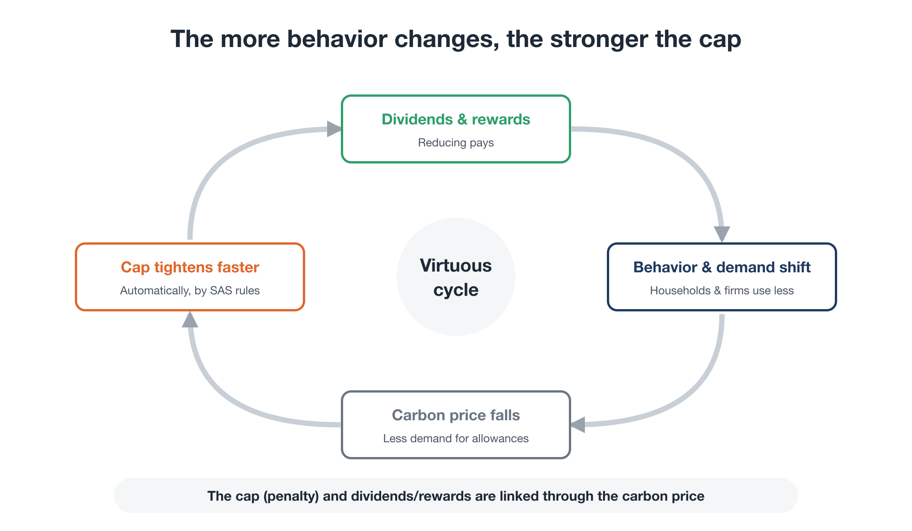
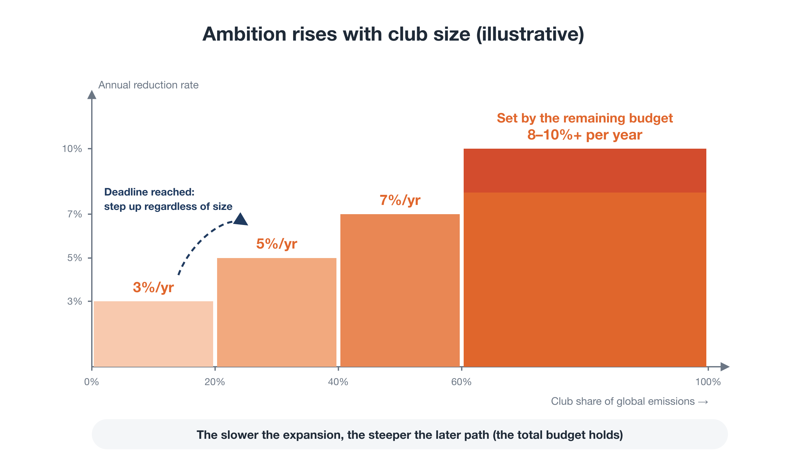

# Proposal C: Planetary OS — An Operating System for a World Where Reducing Pays

**Executive Summary**

---

## Where this proposal fits

This is one of three proposals behind the Youth-Led Global Citizens' Congress for Future Generations (Youth GCC):

- **Proposal A — Youth GCC:** a youth-led body for planetary decision-making (the governance framework)
- **Proposal B — Global Citizen Will Platform:** the infrastructure for gathering global civic will, making it visible, and connecting it to political, legal, and economic decisions
- **Proposal C — Planetary OS (this document):** the **concrete policy blueprint** that the Youth GCC launches with and asks societies to adopt

Proposals A and B answer *who* and *how*. Proposal C answers *what*. Planetary OS is the Youth GCC's first flagship mission.

The full reasoning behind the design is set out in the companion series *Rewriting the Planet's OS* (8 parts).

---

## 1. The problem: why so much effort has changed so little

Decades of funding, research, and activism have gone into the climate crisis. Emissions remain high, and each round of international negotiations ends with commitments that fall short.

The cause is not a lack of human capability or goodwill. It is that **the effort has been channeled into arenas where it structurally cannot win.**

- Legislatures and UN negotiations dilute ambition through fossil-fuel lobbying power and consensus rules.
- Appeals to "sacrifice for the planet" are experienced as a cost of living, and provoke backlash.
- Above all, **no one has drawn a workable blueprint for what comes next.**

Carbon pricing has been tried many times. Australia repealed its carbon price two years after introducing it. Canada scrapped its consumer carbon charge in 2025, even though most households received rebates. Even the EU Emissions Trading System, the world's most developed carbon market, spent years unable to impose a strict cap.

## 2. The diagnosis: reducing through "effort" inside a growth economy

These systems could not become strict because they **left the core rule of the economy, "the more you expand, the more you gain," untouched, and layered a reduction target on top.** That design runs into two barriers.

- **Barrier 1: the burden falls only on the present.**
  By pricing only current emissions, these systems put the full cost on today's households and workers. Those who built wealth on past emissions contribute almost nothing. Public support erodes, and caps get loosened.
- **Barrier 2: reducing alone means losing.**
  For individuals, firms, and nations alike, cutting back unilaterally is a loss. This is the prisoner's dilemma. As long as the rules stay the same, reducing has only downsides.

## 3. The proposal: Planetary OS

Planetary OS is a set of operating rules for society that builds in, from the start, the two conditions needed to overcome these barriers. Its target is **staying well below 2°C**. Holding warming to 1.5°C without overshoot is now very likely out of reach.

### Four modules

1. **BEI (Benefit Equity Internalization): sharing historical liability.**
   A thin, broad levy on those who benefited most from the fossil economy, namely large concentrations of wealth and corporate profits. One illustrative estimate puts global potential on the order of USD 1 trillion per year (0.8–1.3 trillion). The proceeds go into the **Planetary Transition Endowment (PTE)**, which invests in alternatives, provides first-loss guarantees to cut the cost of capital in developing countries, and funds ecosystem restoration.
2. **SAS (Scientific Automatic Stabilizers): a one-way cap on future emissions.**
   A cap on fossil fuels at the upstream point of extraction and import, with emission allowances sold at auction. The cap declines automatically at a pace derived from the remaining carbon budget: around 8% a year globally on average, and faster for high-income countries. The cap can tighten faster, but it never loosens.
3. **Settlement and return: rewarding those who reduce.**
   90% of auction revenue goes directly to citizens as a **Citizen Dividend**. Of that amount, 60% is paid equally to everyone, and 40% is a **sufficiency-linked dividend** that pays more to people who use less energy and fewer materials. The remaining 10% funds a **Just Transition** for workers. In the launch phase, the PTE adds a top-up to the dividend, paid for by those who benefited most from the past. As a rough calculation, about 70% of people come out ahead under the standard assumptions, and from about 60% to the low 70s depending on the assumptions. The standard design does not rely on that estimate: under a **majority-benefit rule**, households just short of break-even receive a top-up from the PTE so that **at least 70%** come out ahead. These are model estimates, not promises: indirect effects through wages and the wider economy can only be estimated, and the guarantee is limited by what the PTE can spend. **Sufficiency rewards** for firms and regions are funded by the PTE.
4. **Tamper-resistance and rule amendment: no going back.**
   Data is cross-verified across a distributed network of institutions. Changing the rules requires a **double key**: scientific justification *and* approval by at least three-quarters of a sortition-based citizens' assembly.

<figure markdown="span">
  
  <figcaption>The four modules of Planetary OS and the two money flows</figcaption>
</figure>

### Why it can work this time

| Until now | Under Planetary OS |
|---|---|
| Only the present paid | Past beneficiaries contribute through BEI |
| Reducing was a loss | The less you use, the more you receive |
| Public opinion pushed caps down | Public opinion defends the cap |
| Caps were reversed after elections | The cap moves one way, protected by the double key |

There is also a feedback loop. **As rewards change behavior, demand falls. Lower demand pushes down the allowance price, and the rules then accelerate the decline of the cap.** The more people's behavior changes, the faster emissions fall.

<figure markdown="span">
  
  <figcaption>The more behavior changes, the faster the cap can tighten</figcaption>
</figure>

## 4. Scaling without a world government: a club worth joining

Rather than waiting for consensus among all countries, Planetary OS starts with a **club** of willing countries, building on the climate-club idea.

- **Joining pays.** Members gain energy security, market access, guaranteed investment, Citizen Dividends, and first-mover advantage in new industries. Benefits are allocated according to reduction performance.
- **Staying out costs.** A carbon border adjustment applies the same carbon cost to imports from outside the club.
- **Ambition rises with the club's size.** "We will if you will." As an illustration, the club-wide reduction rate rises with the members' share of global emissions:
    - under 20%: 3% a year
    - 20–40%: 5% a year
    - 40–60%: 7% a year
    - 60% or more: a rate derived from the remaining budget

    If expansion is slow, the later trajectory becomes steeper. A time-based trigger moves the club to the next step on a fixed date regardless of size, so members cannot keep the club small to avoid tighter targets.

- **The rules are fixed at launch.** Thresholds, rates, recalibration timing, and the terms for early and late entrants are all published in advance. Changing them is deliberately hard, and loosening them is harder still. Predictable rules create the momentum to join early.
- **Sovereignty is respected.** Countries connect through a single **linkage clause** in their existing tax, payment, and customs systems. The club agrees on outcomes, such as returning most of the revenue to households; how to return it is each country's choice.

<figure markdown="span">
  
  <figcaption>Club size and the reduction rate</figcaption>
</figure>

The natural first movers are fossil-fuel importers, climate-vulnerable nations, insurers and long-term investors, and ambitious cities and states.

## 5. Pathway to implementation

| Stage | What happens |
|---|---|
| 1. Draft the Standard | Scientists, legal scholars, economists, and engineers publish the first *Planetary OS Standard* |
| 2. Civic verification | A sortition-based citizens' assembly reviews it, and a public **Citizen Dividend Simulator** is launched |
| 3. Pilot | Small-scale pilots run in willing municipalities and small island states |
| 4. Put the question to politics | Elections and summits face a single question: "Will you connect to this system?" |

**Stage 1 deliverables**

1. *Planetary OS Standard*, first edition
2. *Citizen Dividend Simulator*, public version
3. Launch of the Youth GCC with a coalition of partner organizations and experts

## 6. What we are asking for

| Who | Ask |
|---|---|
| Youth organizations and individuals | Join the Youth GCC as Co-Initiators |
| Researchers and experts (climate science, economics, international and trade law, engineering) | Review and co-author the Standard |
| Foundations and funders | Support Stage 1 (Standard, Simulator, launch). The budget will be developed together with partners |
| Municipalities and small island states | Host small-scale pilots |
| Established NGOs and universities | Act as a fiscal host for grants |

## 7. Notes

- All names, ratios, and figures in this proposal are **illustrative**. They show a direction, not a final design. The specifics will be set during the launch phase through scientific review and democratic deliberation.
- No mechanism can guarantee that warming stays below 2°C. That is exactly why a working alternative needs to be designed, piloted, and ready **before** the next crises force a decision.

---

## Related materials

- Series: *Rewriting the Planet's OS* (8 parts) [→](../series/part-0.md)
- Proposal A: Youth GCC (Youth-Led Global Citizens' Congress for Future Generations) [→](a-youth-gcc.md)
- Proposal B: Global Citizen Will Platform [→](b-platform.md)
- Green Gain Economy (GGE) [↗](https://ttmori.substack.com/p/green-gain-economy-gge-policy-proposal)
- BEI policy white paper [↗](https://ttmori.substack.com/p/policy-white-paper-proposal-a-new?r=5dzcae)
- Co-Initiator invitation page [→](../join.md)

**Contact:** Tatsuya Mori · [Substack](https://ttmori.substack.com) · [note](https://note.com/ttmori) · [X](https://x.com/ttmori)
