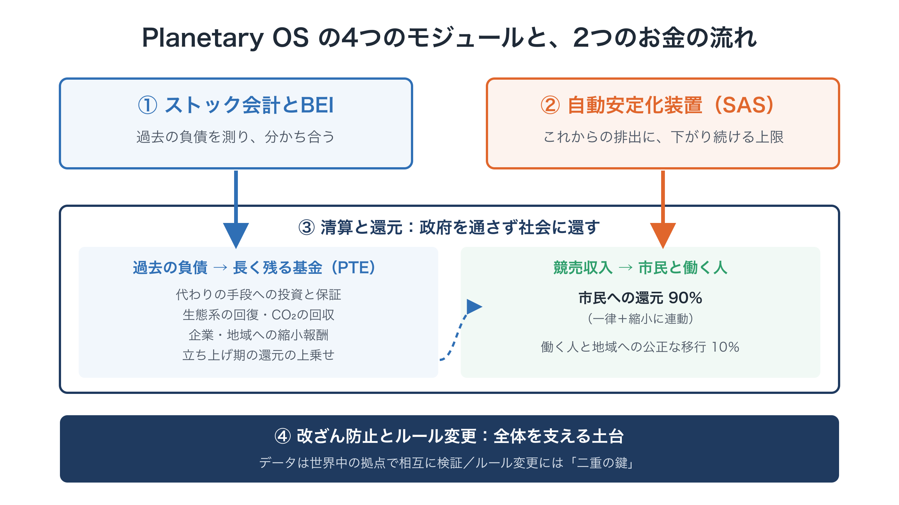
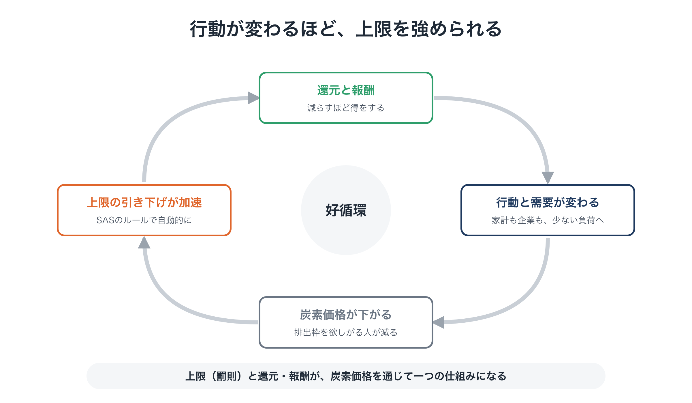
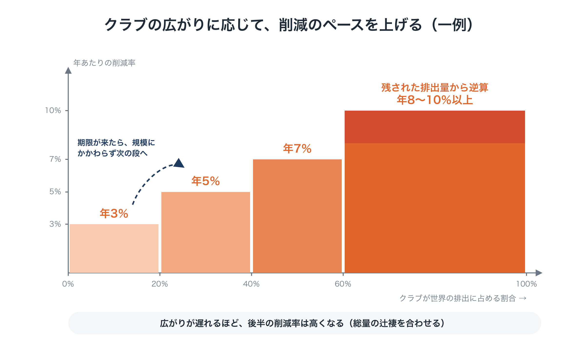

# 提案C：Planetary OS ― 減らすほど得をする社会への、地球規模の動作ルール

**要約版（Executive Summary）**

---

## この提案の位置づけ

本提案は、若者主導の地球市民会議（Youth GCC）を支える3つの提案のうちの一つです。

- **提案A：Youth GCC**：若者が主導する、地球規模の意思決定の担い手（統治の枠組み）
- **提案B：Global Citizen Will Platform**：世界の市民の意思を集め、目に見える形にし、政治・法・経済の意思決定につなぐ基盤
- **提案C：Planetary OS（本提案）**：Youth GCC が最初に掲げ、社会に採用を求める**具体的な政策の設計図**

提案AとBは「誰が」と「どうやって」に答えます。提案Cは「何を」に答えます。Planetary OS は、Youth GCC が最初に掲げる旗印です。

設計の理由の全体は、連載「地球のOSを書き換える」（全8回）で説明しています。

---

## 1. 課題：なぜ、これだけ頑張っても変わらないのか

気候危機には、何十年にもわたって資金と研究と運動が注がれてきました。それでも排出は高い水準のままで、国際交渉は毎回、不十分な約束で終わっています。

原因は、人類の能力や善意が足りないことではありません。**努力が、構造的に勝てない場に注がれてきた**ことにあります。

- 議会や国連の交渉では、化石燃料業界の働きかけの力と全会一致のルールによって、目標が弱められる
- 「地球のために我慢を」という訴えは、生活費の負担として受け止められ、反発を招く
- そして何より、**次に移る先の、実際に使える設計図を、誰も描いてこなかった**

炭素への価格づけは、何度も試みられてきました。オーストラリアは、導入から2年で炭素価格を廃止しました。カナダは、多くの世帯が還付を受けていたにもかかわらず、2025年に消費者向けの炭素課金を廃止しました。世界で最も進んだ炭素市場であるEUの排出量取引でさえ、長いあいだ厳しい上限を設けられずにきました。

## 2. 診断：拡大経済の中での「努力」による削減

これらの仕組みが厳しくなれなかったのは、**「拡大するほど得をする」という経済の基本ルールに手をつけず、その上に削減目標を重ねただけ**だったからです。この設計は、2つの壁にぶつかります。

- **壁①：今の人だけが負担する**
  今の排出だけに価格をつけるため、費用はすべて今の家計と働く人にかかります。過去の排出で富を築いた側は、ほとんど負担しません。民意は離れ、上限は緩められます。
- **壁②：自分だけ減らすと損をする**
  個人にとっても、企業にとっても、国にとっても、自分だけ減らすのは損です。これが囚人のジレンマです。ルールが変わらない限り、減らすことにはデメリットしかありません。

## 3. 提案：Planetary OS

Planetary OS は、この2つの壁を越えるための条件を、最初から組み込んだ社会の動作ルールです。目標は**2℃を確実に下回ること**です。1.5℃を一時的にも超えずに抑えることは、すでにほぼ手の届かないところにあります。

### 4つの部品

1. **BEI（恩恵の内部化）：過去の負債を分かち合う**
   化石燃料経済から最も恩恵を受けてきた側、つまり大きな資産と企業の利益に、薄く広く負担を求めます。試算の一例では、世界全体で年約1兆ドル規模（0.8〜1.3兆ドル）になります。集めたお金は **Planetary Transition Endowment（PTE）** に入れます。PTEは、代わりの手段に投資し、途上国の資金調達コストを下げるために損失の最初の部分を引き受ける保証を提供し、生態系の回復に資金を出します。
2. **SAS（科学的自動安定化装置）：これからの排出に、一方向の上限をかける**
   化石燃料の採掘と輸入という上流に上限をかけ、排出枠を競売で売り出します。上限は、残された排出量（炭素予算）から逆算したペースで自動的に下がります。目安は世界平均で年8％前後で、高所得国はより速くします。上限は加速することはあっても、緩めることはありません。
3. **清算と還元：減らした人に報いる**
   競売収入の90％を、**市民への還元（Citizen Dividend）**として直接還します。そのうち6割は全員に同じ額を、4割は**縮小に連動する還元**として、エネルギーやモノの使用量が少ない人ほど多く支払います。残りの10％は、働く人の**公正な移行**に充てます。立ち上げ期には、過去に最も恩恵を受けてきた側が負担するPTEから、還元に上乗せをします。計算上の目安では、標準的な前提で約7割、前提によって6割前後から7割台前半の人の手取りがプラスになります。標準の設計は、この見込みに頼りません。**多数派保証ルール**により、損益の境目にいる世帯にPTEから上乗せして、**少なくとも7割**の人がプラスになるようにします。これは計算上の想定で、約束ではありません。賃金や経済全体を通じた間接の影響は推計するしかなく、保証もPTEが出せる範囲に限られます。企業・地域への**縮小報酬**は、PTEから出します。
4. **改ざん防止とルール変更：後戻りしない**
   データは、分散した機関のネットワークで相互に検証します。ルールの変更には**二重の鍵**が必要です。科学的な裏付けと、くじ引きで選ばれた市民会議の4分の3以上の承認の両方です。

<figure markdown="span">
  
  <figcaption>Planetary OS の4つのモジュールと、2つのお金の流れ</figcaption>
</figure>

### なぜ、今度は機能するのか

| これまで | Planetary OS のもとで |
|---|---|
| 今の人だけが負担した | 過去の恩恵を受けた側も、BEIで負担する |
| 減らすことは損だった | 使う量が少ないほど、多く受け取る |
| 民意は、上限を引き下げる側だった | 民意が、上限を守る |
| 上限は、選挙のあとで撤回された | 上限は一方向にしか動かず、二重の鍵で守られる |

さらに、好循環もあります。**報酬によって行動が変わると、需要が減ります。需要が減ると排出枠の価格が下がり、ルールに従って上限の引き下げが加速します。** 人々の行動が変わるほど、排出は速く減っていきます。

<figure markdown="span">
  
  <figcaption>行動が変わるほど、上限を強められる</figcaption>
</figure>

## 4. 世界政府なしで広げる：参加する価値のあるクラブ

すべての国の合意を待つのではなく、Planetary OS は意欲のある国々の**クラブ**から始めます。気候クラブの考え方を土台にしています。

- **参加すると得をする**：加盟国は、エネルギー安全保障、市場へのアクセス、保証つきの投資、市民への還元、新しい産業での先行者利益を得ます。特典は、削減の実績に応じて配分します。
- **参加しないと損をする**：クラブの外からの輸入品には、国境での炭素コストの調整によって、同じ炭素コストがかかります。
- **目標はクラブの規模とともに高まる**：「他の国もやるなら、うちもやる」という考え方です。一例として、クラブ全体の削減率を、加盟国の排出が世界の排出に占める割合に応じて、次のように上げていきます。
    - 20％未満：年3％
    - 20〜40％：年5％
    - 40〜60％：年7％
    - 60％以上：残された排出量から逆算した率

    広がりが遅ければ、後半の道筋は急になります。期限が来たら規模にかかわらず次の段へ進む仕組みを設け、目標を低く保つためにクラブを小さいままにする動きを防ぎます。

- **ルールは発足時に固める**：段階の区切り、率、計算し直しの時期、早く加わる国と後から加わる国の条件は、すべて事前に公開します。変更はあえて難しくし、緩める変更はさらに難しくします。先が見通せるルールが、早く加わる勢いを生みます。
- **国の主権を尊重する**：各国は、既存の税・支払い・通関の仕組みに**連動条項**を一つ加えることで接続します。クラブで決めるのは、収入の大部分を家計に還すといった「結果」で、還し方は各国が選べます。

<figure markdown="span">
  
  <figcaption>クラブの規模と削減率</figcaption>
</figure>

最初に動くと考えられるのは、化石燃料の輸入国、気候被害を受けやすい国、保険会社と長期投資家、意欲のある都市や州です。

## 5. 実現への道筋

| 段階 | 内容 |
|---|---|
| 1. 仕様書をつくる | 科学者・法律家・経済学者・エンジニアが、最初の Planetary OS 標準仕様書を公開する |
| 2. 市民が検証する | くじ引きの市民会議が検証し、公開の**還元シミュレーター**を立ち上げる |
| 3. 小さく試す | 意欲のある自治体や小島しょ国で、小規模な試行を行う |
| 4. 政治に問う | 選挙や国際会議の場に、一つの問いを投げかける。「この仕組みに接続しますか？」 |

**第1段階の成果物**

1. Planetary OS 標準仕様書（初版）
2. 還元シミュレーター（公開版）
3. Youth GCC の立ち上げと、協力団体・専門家の連合

## 6. 求めていること

| 相手 | お願いしたいこと |
|---|---|
| 若者の団体・個人 | Youth GCC の共同発起人として参加する |
| 研究者・専門家（気候科学、経済、国際法・通商法、エンジニアリング） | 仕様書を査読し、共同で執筆する |
| 助成財団・資金提供者 | 第1段階（仕様書・シミュレーター・立ち上げ）を支援する。予算は協力者とともに検討する |
| 自治体・小島しょ国 | 小規模な試行の場を提供する |
| 既存のNGO・大学など | 助成金の財政面の受け皿を引き受ける |

## 7. 留意事項

- 本提案で示す名前・比率・数値は、すべて**一例**です。方向性を示すものであり、最終的な設計ではありません。具体的な内容は、立ち上げの段階で、科学的な検討と民主的な熟議を通じて決めます。
- 温暖化が2℃を下回ることを保証できる仕組みはありません。だからこそ、次の危機が決断を迫る**前に**、実際に動く代わりの仕組みを設計し、試し、用意しておく必要があります。

---

## 関連資料

- 連載「地球のOSを書き換える」（全8回）[→](../series/part-0.md)
- 提案A：Youth GCC（将来世代のための、若者主導の地球市民会議）[→](a-youth-gcc.md)
- 提案B：Global Citizen Will Platform[→](b-platform.md)
- Green Gain Economy（GGE）[↗](https://ttmori.substack.com/p/green-gain-economy-gge-policy-proposal)
- BEI 政策白書[↗](https://ttmori.substack.com/p/policy-white-paper-proposal-a-new?r=5dzcae)
- 共同発起人の募集ページ[→](../join.md)

**連絡先**：森　達哉 · [Substack](https://ttmori.substack.com) · [note](https://note.com/ttmori) · [X](https://x.com/ttmori) · [お問い合わせフォーム](https://docs.google.com/forms/d/e/1FAIpQLSexBpD4BcRWIV--FuhMC9BxbP4I9fXl6pi9nxQPmX2bjivjqw/viewform)
