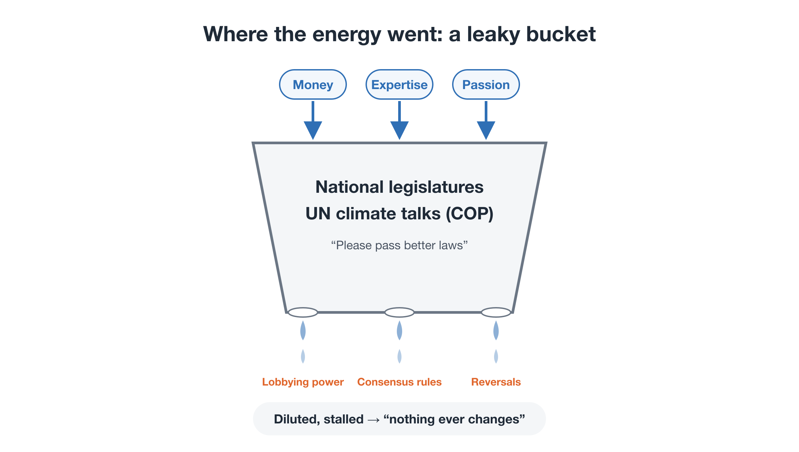

# Why Hasn't All This Effort Changed the World?

**Rewriting the Planet's OS — Part 1**

We already know a great deal about the climate crisis. Scientists have been warning us for decades. Millions of people around the world have raised their voices. Enormous sums of money have been spent.

And yet fossil-fuel use keeps rising, and every year's international climate summit ends with an agreement described as "progress, but not enough."

Many people have quietly concluded that humanity simply can't do it.

This series disagrees. The world has not changed because **we have kept sending our energy to the wrong address**, not because humanity lacks the ability or the goodwill. And no one has yet drawn a concrete blueprint for the system that should come next.

---

## About this series

Over eight parts, this series introduces **Planetary OS**: a set of operating rules designed to keep human society running within the physical limits of the planet.

- Part 1: Why hasn't all this effort changed the world? (this post)
- Part 2: Planetary OS: the big picture
- Part 3: SAS: a cap that only moves one way
- Part 4: Giving future generations a voice
- Part 5: Not sacrifice, but gain: a dividend that rewards using less
- Part 6: Scaling without a world government
- Part 7: Why climate campaigns keep losing: from petition to implementation
- Part 8: The first step: a blueprint and the young people who carry it

One note before we begin. All the names, ratios, and figures in this series are **illustrations**. They are meant to show a direction worth considering. The actual design should be settled later, through scientific review and democratic deliberation.

This first part looks at the problem itself.

---

## 1. The spreading sense that "it's hopeless"

The most serious part of the climate crisis today may not be the temperature numbers. It may be the sense of powerlessness spreading through society, sometimes called *climate fatalism*.

- Every COP ends with "progress, but not enough."
- Climate policy is postponed at every election, and sometimes reversed.
- Any attempt to raise a carbon tax meets fierce resistance over the cost of living.

After watching this happen again and again, many people have stopped thinking "our political machinery is failing." They have started thinking "humanity is incapable of solving this."

Those are two very different conclusions. Telling them apart is where we have to start.

---

## 2. What's missing is not resources, but direction

The resources devoted to climate have not been small. They include large amounts of money, the work of some of the world's best scientists and experts, and the passion of a generation of young people.

The problem is that all of it has been poured into a **leaky bucket**.

<figure markdown="span">
  
  <figcaption>The leaky bucket: money, expertise, and passion → national legislatures / UN negotiations (COP) → fossil-fuel lobbying, consensus rules, reversal after elections → dilution and stalemate</figcaption>
</figure>

Most of the energy has gone into two battles that could not be won.

### Battle 1: lobbying legislatures, on the opponent's home ground

However hard climate groups lobby, the fossil-fuel industry can spend many times more on political donations and lobbying. And politicians must put survival at the next election above almost everything else. Little in that system encourages anyone to put physical limits decades away at the center of their decisions.

### Battle 2: asking people to sacrifice

"Make sacrifices for the planet." "Accept higher taxes." However right these appeals are, people struggling to get by hear them as one more burden. In France, a planned fuel-tax increase triggered the mass "yellow vest" protests and was abandoned.

The exhaustion of "we've tried so hard and nothing changes" is not a sign of humanity's limits. It is **the fatigue of pushing, with all our strength, against a wall that does not move.**

---

## 3. Expecting control from a forum built for coordination

The other major destination for this energy has been the UN climate negotiations.

In practice, UN climate talks make decisions by consensus. That means a single country determined to protect its fossil-fuel industry or its short-term economic interests can water down any meaningful agreement.

The key point is this. The UN is a forum for **coordination between countries**. It was never designed to be an institution that **steers the Earth system**.

Even so, society and the media have long assumed, or simply hoped, that "the UN and national governments will eventually sort this out." And each time a summit disappointed, people drew the wrong lesson. They did not conclude "this mechanism can't do it." They concluded "humanity can't do it."

---

## 4. No one drew the blueprint for what comes next

So where has the climate money and talent actually gone? Broadly, into two things:

1. **Raising the alarm**: scientific reports, media campaigns, protest movements
2. **Asking broken institutions to change**: summit declarations, appeals to raise national targets, petitions for legislation

Both matter. But the result has been that **the evidence that "the current system doesn't work" kept growing**, while one thing stayed missing.

When citizens, investors, or young people asked, "So what should we move to?", there was almost no concrete answer to point to: no working design of institutions, mechanisms, and money flows that said "here are the next rules."

Without a blueprint, even the most willing politician or citizen has nothing specific to support or join. Vague anxiety and powerlessness are the natural result.

### Why didn't anyone draw it?

One reason is that expertise is siloed.

<figure markdown="span">
  
  <figcaption>Siloed expertise: environmental movements (strong on justice and urgency, weak on institutional design and finance), economists and financiers (strong on risk within existing markets, not on rewriting governance), engineers (strong on technology, weaker on climate dynamics and international law)</figcaption>
</figure>

Because each group of experts stayed inside its own field, almost no one tried to build **a social-system blueprint that integrates science, finance, law, incentive design, and movement strategy.**

That gap is what this series sets out to fill.

---

## 5. A deeper cause: the limits of a civilization that just "grows"

So far we have looked at where our energy has gone. Behind that lies a deeper problem: the way our civilization itself works.

### Eight billion people change the premise

Human civilization has always grown spontaneously. No one designed where it was going. Society grew as the sum of countless individuals and firms pursuing their own interests.

When there were few of us and our technology was weak, that was fine. Now there are more than eight billion of us. Actions that are trivial for one person, such as everyday food choices or how we get around, add up until they push the Earth system past its physical limits, the **planetary boundaries**.

The trouble is that this change of premise exists mainly as statistics. It is hard to feel in daily life. So society as a whole does not experience it as an emergency, and the old "normal" simply continues.

### Don't blame the brain

This gap is often explained by saying that the human brain did not evolve to grasp distant futures or very large numbers. There may be some truth in that. But using it as the explanation distracts us from the real problem.

The core of the problem is not the structure of our brains. It is **the design philosophy of our societies**:

- the idea that no one should deliberately define or steer where society is heading
- faith that markets and technology, left to develop naturally (the "invisible hand"), will work things out

The real problem is that these ideas are built into the basic rules of our societies.

### A one-time brake versus continuous steering

Cold War nuclear deterrence is often cited as a successful example of managing an existential risk. But deterrence was essentially an agreement *not* to do something: not to press a particular button. It was a brake.

The climate crisis demands something of a completely different kind. Energy, food, finance, and urban design must all be kept within planetary limits **continuously**, year after year. What we need is ongoing steering, not a single brake.

Trying to do that with the old toolbox of diplomatic compromise between sovereign states and the UN framework is a fundamental mismatch.

---

## 6. Neither central planning nor market fundamentalism

Does "steering" society mean going back to central planning? No.

The twentieth century was shaped by the clash of two great ideologies. One was Marxist central planning, in which the state tried to plan the economy from the center. The other was market fundamentalism, which tried to leave everything to the market.

They looked like opposites, but they shared the same assumption, a characteristically modern arrogance: **that human reason, or a single model, can fully describe and control the world.**

Giving up on both and concluding that "we don't need large systems, let every community govern itself" is not an answer either. It would mean abandoning the coordination that eight billion people depend on.

This series proposes a third path:

- Drop the arrogance that the world can be fully calculated.
- Accept that the world is complex and cannot be fully predicted.
- At the same time, treat the planet's physical limits as **non-negotiable guardrails**.
- Within those guardrails, allow freedom and diversity, and keep correcting course based on real data.

I call this a shift from a **spontaneously grown civilization** to a **consciously steered civilization**.

It combines **the humility to accept that the world can't be fully calculated** with **the firmness to never cross physical limits**. Designing institutions that hold both, in other words rewriting society's operating system, is the civilizational decision now in front of us.

---

## Closing: there was no reason to despair

To sum up:

- The world has not changed because our energy was **pointed in the wrong direction**, not because resources or goodwill were lacking.
- Legislatures and the UN are forums for coordination. They were not built to steer the Earth system continuously.
- What was missing was **a concrete blueprint for what comes next**.
- Behind all this lies a civilization designed to simply grow, never to be steered.

If the problem were the limits of humanity, despair would be the only response. But if the problem is **a wiring mistake**, that changes everything. Wiring can be fixed.

In Part 2, I'll lay out that new wiring diagram: **Planetary OS**. It has three main pieces: a mechanism to share responsibility for past emissions, a cap on future emissions that only ever moves down, and a way to return the money it raises directly to everyone. We'll look at how they fit together into one operating system.
