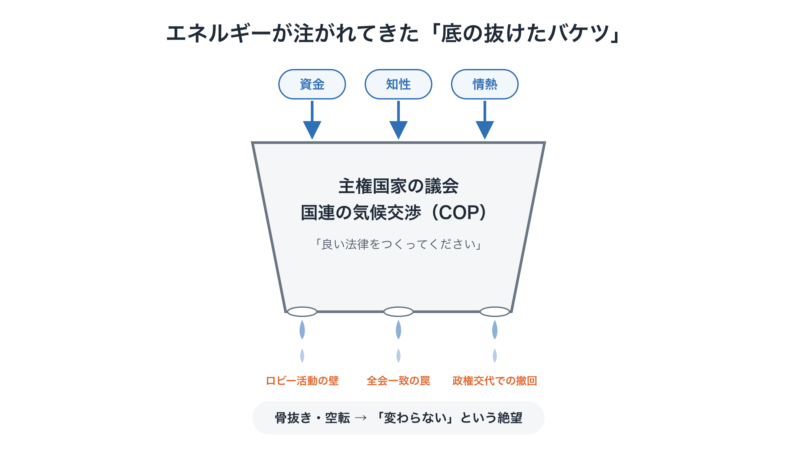
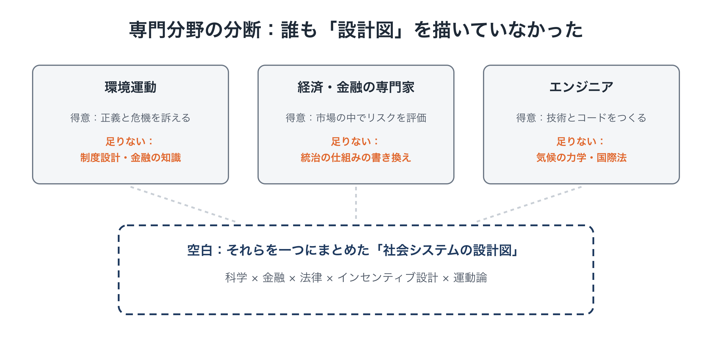

# なぜ「これだけ頑張っても世界は変わらない」のか

**連載「地球のOSを書き換える」第1回**

気候危機について、私たちはもう十分すぎるほど知っています。科学者は何十年も前から警告を続け、世界中で何百万人もの人が声を上げ、莫大な資金が投じられてきました。

それなのに、化石燃料の消費は減らず、国際会議は毎年「不十分な合意」で幕を閉じます。

「人類にはもう無理なのではないか」。そう感じている人は少なくないはずです。

この連載では、その諦めにはっきり異を唱えます。世界が変わらなかったのは、人類の能力や善意が足りなかったからではありません。**エネルギーを注ぎ込む「宛先」を間違え続けてきたから**です。そして、正しい宛先となる「次の社会の設計図」を、これまで誰も具体的に描いてこなかったからです。

---

## この連載について

全8回で、地球の物理的な限界の内側で社会を回し続けるための新しい仕組み「Planetary OS（プラネタリーOS）」の構想を紹介します。

- 第1回：なぜ「これだけ頑張っても世界は変わらない」のか（今回）
- 第2回：地球の新しいOS「Planetary OS」の全体像
- 第3回：政治の先送りを止める装置「SAS」
- 第4回：将来世代の声を意思決定に組み込む
- 第5回：「我慢」ではなく「得」で動く：減らすほど得をする還元の設計
- 第6回：世界政府なしで、どう世界に広がるのか
- 第7回：なぜ今までの運動は勝てなかったのか：請願から実装へ
- 第8回：最初の一歩：仕様書と、それを担う若者たち

なお、この連載で示す制度の名前や比率、数値は、すべて「この方向が良いのではないか」を考えてもらうための**一例**です。具体的な制度の設計は、実際の立ち上げの段階で、科学的な検討と民主的な議論を経て決めるべきものだと考えています。

今回は、その前提となる「問題の正体」を考えます。

---

## 1. 世界を覆う「どうせ無理」という空気

気候危機をめぐって今いちばん深刻なのは、気温の数字そのものよりも、社会に広がる無力感かもしれません。英語では「Climate Fatalism（気候宿命論）」と呼ばれることもあります。

- 毎年のCOP（国連気候変動枠組条約締約国会議）は「進展はあったが不十分」で終わる
- 選挙のたびに環境政策は後回しにされ、ときには撤回される
- 炭素税を上げようとすれば「生活が苦しくなる」と強い反発を受ける

こうした光景を何度も目にするうちに、多くの人は「政治の仕組みが失敗している」とは考えず、「人類には気候危機を解決できない」と受け止めるようになりました。

けれども、この二つはまったく別の話です。この違いを見分けるところから始めましょう。

---

## 2. 足りないのは資源ではなく「行き先」

まず確認しておきたいのは、これまで気候問題に投じられてきたものは決して小さくない、ということです。

莫大な資金、世界で最も優秀な科学者や専門家の知性、そして若者たちの情熱。これだけのものが注がれてきました。

問題は、それらが「底の抜けたバケツ」に注がれ続けてきたことです。

<figure markdown="span">
  
  <figcaption>底の抜けたバケツ</figcaption>
</figure>

具体的には、二つの「勝てない戦い」にエネルギーが使われてきました。

### ① 議会へのロビー活動という、相手に有利な土俵

気候NGOが議員に働きかけても、化石燃料業界はその何倍もの資金を政治献金やロビー活動に投じることができます。しかも政治家は、数年ごとの選挙で生き残ることを何より優先せざるをえません。数十年先の物理的な限界を判断の中心に置く動機が、この仕組みの中にはほとんどないのです。

### ② 「我慢してください」という説得

「環境のために我慢を」「税負担を受け入れて」という呼びかけは、どれほど正しくても、日々の生活に追われる人にとっては負担の増加にしか聞こえません。フランスの「黄色いベスト運動」のように、燃料税の引き上げが大規模な抗議を招いて撤回された例もあります。

つまり、「これだけ頑張っても変わらない」という徒労感の正体は、人類の限界ではありません。**動かない壁を、力任せに押し続けてきたことによる疲れ**だったのです。

---

## 3. 「調整の場」に「制御」を期待してきた

もう一つの大きな行き先が、国連の気候変動交渉でした。

国連の気候交渉は、加盟国のコンセンサス（全会一致）を基本にして物事を決めます。裏を返せば、自国の化石燃料産業や目先の経済的利益を守りたい国が一つでもあれば、実効性のある合意は骨抜きにされてしまいます。

ここで押さえておきたいのは、国連はもともと**国と国のあいだを「調整」する場**であって、**地球システムを「制御」する機関**として設計されたものではない、ということです。

にもかかわらず、社会もメディアも長いあいだ「国連や各国の政治家が、いつか解決してくれるはずだ」という期待（あるいは惰性）に関心を注いできました。そして毎年の会議が期待外れに終わるたびに、人々は「この仕組みでは無理だ」ではなく「人類には無理だ」と学習してしまったのです。

---

## 4. 誰も「移行先の設計図」を描いていなかった

では、気候問題に注がれてきた資金と人材は、具体的に何に使われてきたのでしょうか。大きく分けると、ほぼ次の二つです。

1. **危機の深刻さを訴え、知らせること**
   科学的な報告書、メディアのキャンペーン、抗議運動など
2. **うまく機能していない仕組みに、変化をお願いすること**
   国際会議での宣言、政府への目標引き上げの要請、法案の請願など

どちらも大切な取り組みです。ただ、その結果として**「今の仕組みはうまくいかない」という認識だけが膨らんでいきました**。

市民や投資家、若者が「では、何に移ればいいのか？」と尋ねたとき、「これが次のルールです」と示せる具体的な設計図、つまり実際に動く制度・仕組み・お金の流れの図は、ほとんど存在しなかったのです。

設計図がなければ、どれほど意欲のある政治家や市民でも、賛成することも参加することもできません。漠然とした不安と無力感だけが積み重なっていくのは、当然の結果だったと言えます。

### なぜ誰も描かなかったのか

理由の一つは、専門分野ごとの分断です。

<figure markdown="span">
  
  <figcaption>専門分野の分断</figcaption>
</figure>

それぞれの専門家が自分の領域の中にとどまっていたため、**科学・金融・法律・インセンティブ設計・社会運動をひとつにまとめた「社会システムの設計図」**を描こうという発想そのものが、生まれにくかったのです。

この連載が描こうとしているのは、まさにその空白を埋める設計図です。

---

## 5. もっと深い原因：「自然に任せる」文明の限界

ここまでは、運動や資金の「向け先」の問題を見てきました。ただ、その背後にはもう一段深い問題があります。それは、私たちの文明そのものの成り立ちです。

### 80億人という「前提の変化」

人類の文明は、これまで「自然に発生し、自然に拡大していく」ものでした。誰かが全体の行き先を設計したわけではなく、無数の個人や企業がそれぞれの利益を追い求めた結果として、社会は成長してきました。

人口が少なく技術の力も小さかった時代には、それで問題ありませんでした。ところが人口が80億人を超えた今、一人ひとりにとってはささやかな行為（たとえば肉を多く食べるといった日常の選択）が積み重なり、地球システムの物理的な限界（プラネタリー・バウンダリー）を超えつつあります。

厄介なのは、この「前提が根本から変わった」という事実が、統計上の数字としてしか存在しないことです。日々の暮らしの中では実感しにくいため、社会全体として非常事態とは受け止められず、これまでの「普通」がそのまま続いています。

### 「脳の限界」のせいにしない

このずれは、よく「人間の脳は、遠い未来や大きな数字を実感できるようにできていない」と説明されます。それ自体は一面の真実かもしれません。ただ、それを理由にしてしまうと、本当の問題から目をそらすことになります。

問題の核心は脳の構造ではなく、**社会の設計思想**にあります。

- 「社会の行き先を人為的に決めたり制御したりしてはならない」という考え方
- 市場や技術が自然に発展していけばうまくいく、という「見えざる手」への信頼

こうした考え方が、私たちの社会の基本ルールとして組み込まれていることこそが問題なのです。

### 「一度きりのブレーキ」と「継続的なハンドル操作」

人類がこれまでに成功させた危機管理の例として、冷戦期の核抑止がよく挙げられます。ただ、核抑止は「特定のボタンを押さない」という、一度きりの「何もしない」合意でした。いわばブレーキです。

気候危機が求めているのは、それとは性質がまったく違います。エネルギー、農業、金融、都市計画まで、社会のあらゆる領域を、地球の物理的な限界の内側に**常に**収め続ける必要があります。必要なのは、継続的なハンドル操作なのです。

これを、国家どうしの政治的な妥協や国連の枠組みといった「過去の道具箱」の延長で行おうとすること自体に、根本的なミスマッチがあります。

---

## 6. 計画経済でも、市場任せでもなく

では、社会全体を「制御」すると言うなら、それはかつての計画経済に戻ることなのでしょうか。そうではありません。

20世紀には二つの大きな思想がぶつかり合いました。一つは、国家が経済を中央から計画しようとしたマルクス主義。もう一つは、市場にすべてを委ねようとした新自由主義です。

正反対に見えるこの二つは、実は同じ思い込みを共有していました。**「人間の理性や一つの計算モデルで、世界を完全に記述し、制御できる」**という、近代に特有の思い上がりです。

だからといって、どちらにも失望して「大きな仕組みはいらない、地域ごとに自律すればいい」と考えるのも答えにはなりません。80億人の暮らしを支える調整の仕組みを、手放すことになってしまうからです。

この連載が提案するのは、そのどれでもない第三の道です。

- 世界を完全に計算できるという思い上がりは捨てる
- 世界は複雑で、予測しきれないものだと認める
- そのうえで、地球の物理的な限界だけは「交渉の余地のない柵（ガードレール）」として厳格に定める
- 柵の内側では自由と多様性を認めつつ、実際のデータを見ながら試行錯誤と軌道修正を続ける

私はこれを、「自然に任せる文明」から**「意識して舵を取る文明（意識的制御文明）」**への転換と呼んでいます。

**世界は計算しきれないと認める謙虚さ**と、**物理的な限界は譲らない厳格さ**。この二つを両立させた社会の仕組みを設計すること、言い換えれば社会の「OS」を書き換えることこそが、いま求められている文明的な決断だと考えています。

---

## おわりに：絶望する理由はなかった

今回の内容をまとめます。

- 世界が変わらなかったのは、資源や善意が足りなかったからではなく、**エネルギーの向け先がずれていた**から
- 国連や各国の議会は「調整の場」であり、地球システムを継続的に制御するようには作られていない
- 必要なのに欠けていたのは、**移行先となる具体的な設計図**
- その背景には、「自然に任せる」ことを前提にした文明の設計思想がある

もし問題が「人類の能力の限界」なら、絶望するしかありません。けれども問題が「配線の間違い」なら、話は違います。配線は、つなぎ直すことができるからです。

次回は、そのつなぎ直し先となる設計図、**「Planetary OS」の全体像**を紹介します。過去に積み上がった環境負荷への責任を分かち合う仕組み、これからの排出にかける一方向に下がり続ける上限、そして集めたお金をすべての人に直接還す仕組み。それらがどう組み合わさって一つのOSになるのかを、地図を広げるように見ていきます。

---

この文書は、次の場所でも公開しています： [note（日本語）](https://note.com/ttmori/n/nf4d1edd6c44a)
