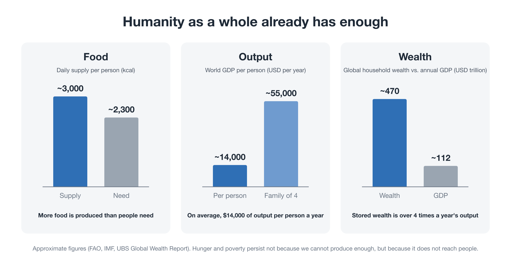
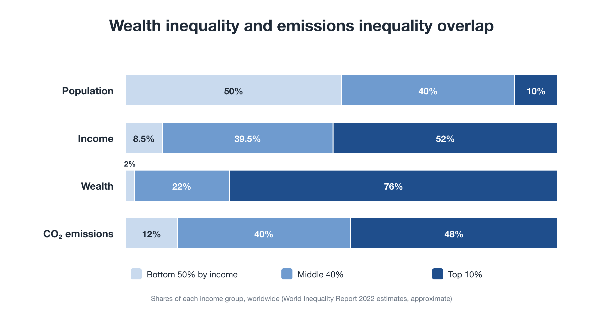
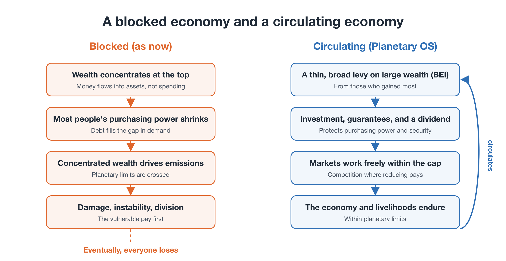
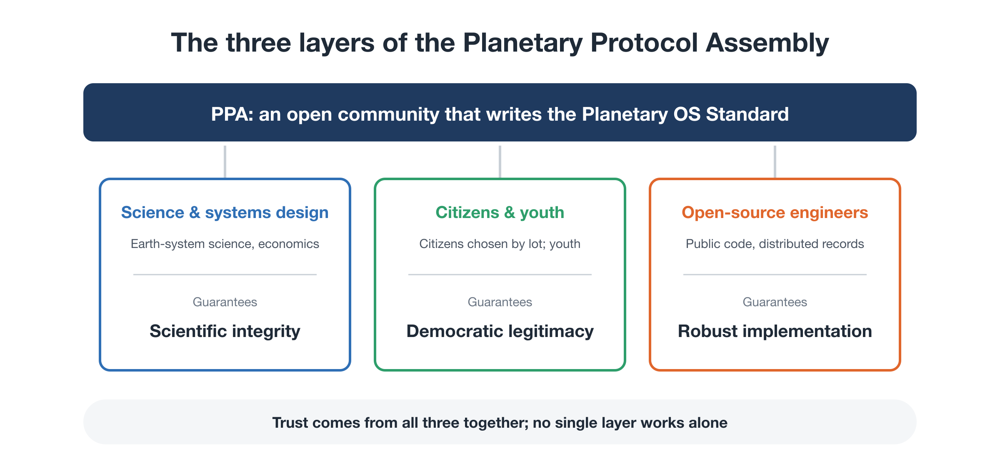

# Planetary OS: The Big Picture

**Rewriting the Planet's OS — Part 2**

In Part 1, we looked at why so much effort has changed so little. The cause was not a shortage of resources or goodwill. Our energy was pointed in the wrong direction, and **no one had drawn a blueprint for the system that should come next.**

This part presents that blueprint in outline. I call it **Planetary OS**.

Later parts look at each component in detail. The aim here is to unfold the map: what the pieces are and how they connect.

---

## Why call it an "OS"?

Every computer and smartphone has an operating system. It is not an app. It is the set of underlying rules that lets apps run.

Societies have something similar. Tax systems, money flows, election rules, and accounting standards sit underneath our daily activity, our "apps," and shape how everything behaves.

Today's social OS was written on two assumptions: **keep growing**, and **leave it to nature**. The climate crisis is not a bug in one particular app. It arises because **the OS itself no longer fits a new condition: the physical limits of the planet.**

So patching individual policies is not enough. We need to rewrite the OS.

---

## 1. Four requirements for a new OS

Before drawing the design, let's set out what a new OS must achieve. There are four requirements.

### Requirement 1 — The basis for decisions: from political compromise to physical limits

Today, even "how much should we cut emissions?" is settled by negotiation. But the atmosphere and the oceans don't negotiate.

A new OS **takes the planet's physical capacities off the negotiating table**: cumulative carbon, freshwater use, the rate of biodiversity loss. It treats them as the constraints society must respect first.

That requires data infrastructure that continuously measures not only annual flows of emissions but also what has accumulated: the **stock**.

*Open question: data always carries uncertainty. Choosing which indicators become the shared "source of truth" needs careful design.*

### Requirement 2 — The purpose of society: from endless growth to wellbeing within limits

Today's societies measure success by GDP, the expansion of markets and consumption.

A new OS replaces that with a different primary purpose: **meeting everyone's basic needs while staying within planetary limits.**

That also means putting past environmental damage, such as accumulated carbon debt and destroyed ecosystems, on the books.

*Open questions: how do we move corporate and national accounting toward standards that reflect natural capital? And how do we change a culture that equates success with owning and consuming more?*

### Requirement 3 — Institutional form: neither central planning nor laissez-faire

As Part 1 noted, central planning, which tried to calculate and manage everything from the center, failed. Leaving everything to the market brought us here.

A new OS takes a middle path: **strict outer limits, freedom within.**

- **Outer limits:** the planet's total capacity and the rules for allocating it are strictly enforced.
- **Within:** daily life, business creativity, and markets remain free.

And the rules are not fixed once and for all. They keep updating in response to feedback from the planet, meaning observational data.

*Open questions: how do we get past a system of sovereign states that put national interest first? And how do we stop "deliberate design" from sliding into surveillance or authoritarianism?*

### Requirement 4 — Transition and consent: from moral appeals to structural support

Calls to "do the right thing for the environment" have not changed society.

A new OS builds in **ways to make visible** how each person's choices connect to changes at planetary scale, and a **just transition** that spreads the pain of change across society.

*Open questions: can democracy, driven by short electoral cycles, reach agreement on change this large in time? And how do we overcome strong resistance from incumbent industries and finance?*

---

Planetary OS is an attempt to meet these four requirements with concrete components.

---

## 2. Not a shortage, but a blockage

Requirement 2 set the goal of a new OS as "meeting everyone's basic needs, indefinitely, within planetary limits." Is that even possible?

The answer is surprisingly clear. **Humanity as a whole already has the productive capacity and the wealth to do it.** The problem is not quantity. It is how wealth is distributed and how it flows.

### Humanity as a whole already has enough

<figure markdown="span">
  
  <figcaption>Humanity as a whole already has enough</figcaption>
</figure>

- **Food:** the world's food supply is about 3,000 kcal per person per day, above the average requirement of about 2,300 kcal.
- **Output:** world GDP divided by the world's population comes to about $14,000 per person per year, or more than $55,000 for a family of four.
- **Wealth:** households worldwide hold about $470 trillion in assets, more than four times a year's world GDP.

Hunger and poverty persist not because we cannot produce enough, but because **what we produce does not reach the people who need it**.

### Wealth inequality and emissions inequality overlap

<figure markdown="span">
  
  <figcaption>Wealth inequality and emissions inequality overlap</figcaption>
</figure>

Divide the world's people into three groups by income, and the shape of the imbalance becomes clear:

| | Bottom 50% | Middle 40% | Top 10% |
|---|---|---|---|
| Income | ~8% | ~40% | ~52% |
| Wealth | ~2% | ~22% | ~76% |
| CO₂ emissions | ~12% | ~40% | ~48% |

The top 10% hold about three-quarters of the world's wealth and produce about half of its emissions. The bottom 50% hold only about 2% of the wealth and produce about 12% of the emissions, yet they are hit hardest by climate damage.

**The pattern of wealth and the pattern of emissions are nearly the same.** Large homes, several cars, frequent flights, and investment in fossil-fuel businesses: what pushes against planetary limits is mainly the spending and investment of concentrated wealth.

### Circulate it, and the system works; block it, and it breaks

Think of money as the blood of an economy. Blood keeps a body alive by circulating through it. If it pools in one place and stops flowing, the body fails, however much blood that one place holds. Money works the same way: it supports a society only as long as it keeps circulating.

Today, the steady concentration of wealth is causing three blockages at once.

<figure markdown="span">
  
  <figcaption>A blocked economy and a circulating economy</figcaption>
</figure>

- **An economic blockage:** money at the top flows into shares and property more than into spending. Most people's purchasing power shrinks, and many economists argue that the gap in demand is increasingly filled by debt. Asset prices rise, but daily life does not get easier.
- **A planetary blockage:** concentrated wealth drives emissions through spending and investment, pushing past planetary limits.
- **A social blockage:** when the burden of climate policy falls on the majority, the policy is reversed, as in France (Part 1). Action itself becomes unsustainable.

These are not three separate problems. They are **three faces of the same blockage**.

Restore circulation, and all three ease together:

- a thin, broad levy on the large wealth that benefited most from the past (BEI)
- invested in alternatives and guarantees (the PTE)
- revenue from pricing emissions returned directly to citizens (the dividend)
- and, within the cap, prices, competition, and free choice left to work as markets do

This protects most people's purchasing power and security, turns markets toward "reducing pays," and keeps the economy running within planetary limits. It does not abandon economic principles. **It restores the conditions under which they can keep working.**

### Reduce, or be reduced

One more point matters.

The amount of carbon we can still emit, the carbon budget, is finite. Whichever path we take, fossil-fuel use will fall. The only difference is how:

- **planned and fair:** set the rules, and share burdens and benefits while reducing
- **through breakdown:** climate damage, scrambles for resources, and financial turmoil force the reduction, and livelihoods break from the most vulnerable up

If we keep crossing limits without restoring circulation, breakdown is no longer something that *might* happen. It becomes a question of *when*, and *in what form*.

The four modules of Planetary OS, introduced next, are a design for that circulation.

---

## 3. Who writes the OS? The Planetary Protocol Assembly

First, who designs it and presents it to society?

Not any single state or party. Instead, an open community combining three very different layers. Let's call it the **Planetary Protocol Assembly (PPA)**.

<figure markdown="span">
  
  <figcaption>The three layers of the PPA: scientists and systems designers (scientific integrity) / citizens and representatives of future generations (democratic legitimacy) / open-source engineers (implementation and tamper-resistance)</figcaption>
</figure>

### Layer 1 — Scientists and systems designers: scientific integrity

Earth-system scientists, ecological economists, and systems engineers. Independent of political pressure from any government, they calculate where the planetary limits lie and how far we have already exceeded them.

### Layer 2 — Citizens and future generations: democratic legitimacy

Citizens selected by lot from around the world, together with young people and others who speak for future generations. Selection by lot, or **sortition**, makes it harder for any single interest group to capture the process. This layer checks whether the design is fair and acceptable.

### Layer 3 — Open-source engineers: implementation and tamper-resistance

Developers who build code anyone can inspect, open data, and distributed records. They maintain verifiable infrastructure that depends on no single government or tech giant.

### Why combine all three?

Governments are places where elected politicians bargain over interests. The UN is a place where states bring their national interests.

The PPA combines **objective data (science) × citizens free of vested interests (sortition) × verifiable implementation (open source)** to build a kind of trust existing politics lacks. Take any one away and it falls apart. Science alone becomes technocracy. Citizens alone lack a solid evidence base. Technology alone loses sight of whom it serves.

---

## 4. The four modules of Planetary OS

Now the contents. Planetary OS has four modules.

<figure markdown="span">
  
  <figcaption>The four modules and two money flows: ① BEI (past liability) and ② SAS (future emissions) feed into ③ Settlement and return. BEI revenue goes to an endowment; SAS revenue goes to citizens and workers. ④ Tamper-resistance underpins everything.</figcaption>
</figure>

### Module 1 — Stock accounting and BEI: measuring and sharing past liability

Climate policy has traditionally focused on annual emissions, the **flow**. But warming is driven by the **total accumulated so far**, the **stock**.

Think of a bathtub. Turning down the tap (annual emissions) doesn't lower the water already in the tub (cumulative emissions). It's the water level that is about to overflow.

This module does two things:

- **Calculates past liability.** It identifies cumulative emissions, land-use change, and resource extraction since the industrial era (for example, since 1850).
- **Asks those who benefited to contribute.** Cumulative emissions are a liability owed by those who built wealth and profit on them. So contributions are drawn from surplus corporate profits and large concentrations of wealth. This includes not only fossil-fuel companies but also the downstream industries and wealthy individuals who grew on cheap fossil energy. The levy is **thin and broad**. I call this **BEI (Benefit Equity Internalization)**. Even a very small annual rate on top wealth and corporate profits could, by one illustrative estimate, raise more than USD 1 trillion a year worldwide.

Trying to pin liability on each company and recover it in court from day one would mean years of conflict. So the approach is phased: **start thin and broad with BEI, then add liability attribution and legal recovery as data and institutions mature.**

### Module 2 — SAS: a cap that only moves one way

This module keeps future emissions, the flow, within planetary limits.

- **An upstream cap.** It sets a supply cap on fossil fuels at the point of extraction and import. Allowances equal to the cap are sold at auction.
- **Automatic tightening every year.** The cap falls each year on a path derived from the remaining carbon budget for staying well below 2°C: around 8% a year globally.
- **One direction only.** If cutting gets easier, the cap tightens faster. If it gets harder, the cap still never loosens. The pain is absorbed by dividends and support instead.
- **Stronger action when the planet signals danger.** If observational data worsen, the system escalates in three stages (yellow, orange, red), going beyond the planned path.

All of this runs **automatically, according to rules agreed democratically in advance, without waiting for political bargaining.**

"Automatic, without politics" may sound alarming. Why do we need it? How can it keep a cap strict when even the EU Emissions Trading System couldn't? And how does it fit with democracy? Part 3 takes these questions on.

### Module 3 — Settlement and return: giving the money back to society

This module is the heart of the OS. The money raised by Modules 1 and 2 does not go into general government budgets. It goes directly back to society, by rule.

There are two flows, depending on where the money comes from.

**Flow 1: SAS auction revenue → citizens and workers (90% Citizen Dividend, 10% Just Transition)**

The burden of future emissions shows up as higher prices in today's daily life. So this revenue goes back to today's households.

- **Citizen Dividend:** two parts. A **universal dividend** pays everyone the same amount per person. A **sufficiency-linked dividend** pays more to people who use less energy and fewer materials, or who cut back.
- **Just Transition:** retraining, re-employment, and income support for people working in shrinking industries.

**Flow 2: BEI revenue → a lasting endowment**

Past liability is owed not only to people alive today but to all of humanity, including future generations. So it is not spent all at once. Part of each year's revenue builds the principal of an endowment, the **Planetary Transition Endowment (PTE)**. The rest is used that year for:

- investment in alternatives (renewables, grids, public transport, next-generation technology)
- guarantees that lower the cost of capital in developing countries
- ecosystem restoration and carbon removal
- **sufficiency rewards** for firms and regions that reduce output or material use, or that move to repair, sharing, and durable products
- in the launch phase, **a top-up to the Citizen Dividend**, so that what past beneficiaries give back shows up visibly in people's accounts
- **a majority-benefit top-up** for households just short of break-even, so that at least 70% of people come out ahead (not limited to the launch phase)

Because the PTE does not shrink as auction revenue declines with falling emissions, it becomes the long-term financial foundation of the whole OS.

**Repricing assets.** Fossil-fuel reserves and high-impact facilities are booked today as valuable assets. Writing their environmental liability onto the balance sheet, and repricing them to reflect physical reality, naturally shifts capital toward low-impact infrastructure and regenerative businesses.

**Correcting North–South inequality.** Most of the money comes from the countries and wealthy groups that emitted most and benefited most. It reaches people in countries that emitted least and suffer most, through dividends and investment. The money flow itself pushes toward fairness.

Part 5 explores why we pay people rather than ask them to sacrifice, and how large the dividend might be. Part 6 explores how the endowment helps bring countries on board.

### Module 4 — Tamper-resistance and rule amendment: protecting the foundation

Even the best system is useless if the data can be falsified or the rules quietly rewritten. This module guards against both.

- **Distributed verification.** Satellite data, ocean sensors, trade-settlement records, and similar data are recorded and cross-checked by universities, independent research institutes, and civic nodes worldwide, not stored on a single server. This makes falsification or political manipulation extremely difficult.
- **A double key for rule changes.** The formulas can only be changed if the PPA's scientists provide supporting evidence **and** at least three-quarters of the citizens' representatives approve. No single country or legislature can change them alone.

---

## 5. How the modules meet the four requirements

- **Requirement 1 (physical limits first)**
  → Modules 1 and 2 link physical data directly to social rules.
- **Requirement 2 (wellbeing within limits)**
  → Module 1 puts past liability on the books. Module 3 changes asset values and money flows.
- **Requirement 3 (strict outer limits, freedom within)**
  → SAS moves only the outer limit, the upstream supply cap. It does not micromanage individual lives.
- **Requirement 4 (structural support for transition)**
  → Module 3's dividend and rewards make change a **gain, not a sacrifice**, for most people. The BEI endowment absorbs the shocks of transition.

The PPA's three layers and Module 4 hold the whole system's trustworthiness together.

---

## 6. "Isn't this a surveillance state?"

You might be thinking: "Steering society at planetary scale sounds like a recipe for control," or "Won't scientists and engineers end up running the world?" These are fair concerns. The design includes three safeguards.

1. **Only the outer limit is controlled.**
   No one monitors the behavior of eight billion individuals. What gets adjusted is a limited number of upstream points: fossil-fuel extraction, major trade flows, and finance. Choices within those limits remain free (Part 3 explains how).
2. **Humans decide what to aim for and how to adjust.**
   Only the *execution* of democratically agreed rules is automatic. Goals cannot be set, and rules cannot be changed, without citizens' approval.
3. **Anyone can check it.**
   Code and data are public and verified at nodes around the world. Nothing is decided behind closed doors.

I don't claim this is a perfect answer. Remembering the humility from Part 1, that the world can't be fully calculated, and continuing to improve in response to criticism, is part of the design philosophy of this OS.

---

## Closing: we now have a map

To sum up:

- A new OS must meet four requirements: **physical limits first; wellbeing within limits; strict outer limits with freedom within; structural support for transition.**
- It is designed and presented by an open, three-layer community of scientists, citizens, and engineers: the **PPA**.
- The OS has four modules: **stock accounting (BEI), the Scientific Automatic Stabilizers (SAS), settlement and return, and tamper-resistance**.
- Money flows in two directions: **the burden of future emissions goes back to today's households, and past liability builds a lasting endowment.**

In one sentence, Planetary OS is a set of operating rules designed to **share past liability to fund the future, place a steadily falling cap on future emissions, and return the proceeds to people, so that the economy rewards those who reduce.**

Part 3 turns to the most easily misunderstood component: **SAS, the Scientific Automatic Stabilizers.**

"If we can predict the problem, why not just plan ahead?"
"Even the EU Emissions Trading System couldn't keep a strict cap. Why would this work?"

We'll answer those questions, and look at what it really means for a policy to run "automatically," and what makes a strict cap possible at all.

---

This document is also published on: [note (Japanese)](https://note.com/ttmori/n/n5e9395aa8df7)
