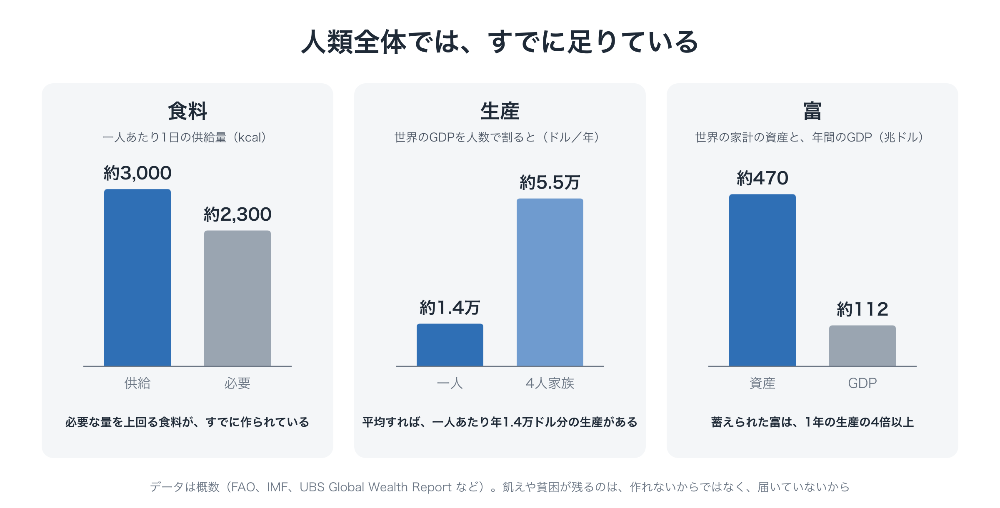
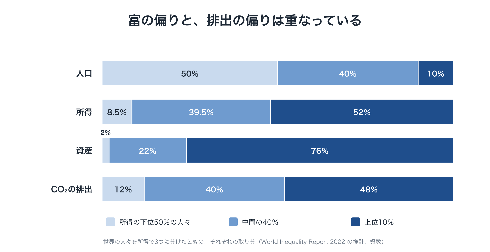
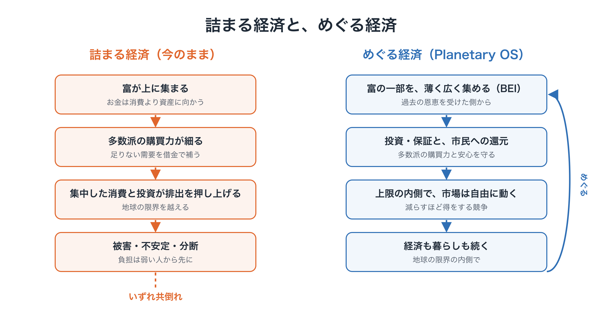
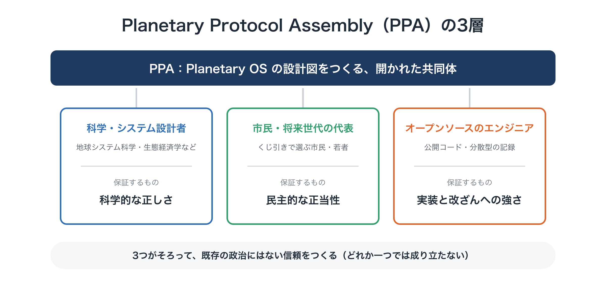

# 地球の新しいOS「Planetary OS」の全体像

**連載「地球のOSを書き換える」第2回**

前回は、「これだけ頑張っても世界は変わらない」という絶望感の正体を考えました。

世界が変わらなかったのは、資源や善意が足りなかったからではありません。エネルギーの向け先がずれていたこと、そして**移行先となる具体的な設計図が、誰にも描かれていなかったこと**が原因でした。

今回は、その設計図の全体像を紹介します。名前は「Planetary OS（プラネタリーOS）」です。

細かい仕組みは次回以降で一つずつ掘り下げます。今回の目的は、地図を広げて「どんな部品があり、どうつながっているのか」をつかんでもらうことです。

---

## なぜ「OS」と呼ぶのか

パソコンやスマートフォンには、OS（オペレーティング・システム）があります。アプリそのものではなく、アプリが動くための土台となるルールの集まりです。

社会にも同じような土台があります。税の仕組み、お金の流れ、選挙のルール、企業会計の基準。私たちが日々の活動をする「アプリ」の下で、それらが社会の動き方を決めています。

今の社会のOSは、「成長し続けること」と「自然に任せること」を前提に書かれています。気候危機は、個々のアプリの不具合ではなく、**このOSそのものの設計が、地球の物理的な限界という新しい条件に合わなくなった**ことから生じています。

だから必要なのは、個別の政策というパッチを当て続けることではなく、OSを書き換えることです。

---

## 1. 新しいOSに求められる4つの条件

設計図を描く前に、「新しいOSは何を満たしていなければならないか」という要件を整理しておきます。大きく4つあります。

### 条件① 判断の土台：「政治的な妥協」から「物理的な限界」へ

今の社会では、「どこまで排出を減らすか」も交渉で決まります。けれども、大気や海は交渉に応じてくれません。

新しいOSでは、累積の炭素量、淡水の利用、生物多様性が失われる速さといった**地球の物理的な許容量を、交渉の対象から外し**、社会が最優先で守る制約として扱います。

あわせて、毎年の排出量（フロー）だけでなく、これまでに積み上がった量（ストック）を常に測り続けるデータ基盤が必要です。

*残る論点：データには不確実さが付きまといます。どの指標を世界共通の「正本」とするのかは、慎重な設計が求められます。*

### 条件② 社会の目的：「無限の成長」から「限界の内側での豊かさ」へ

今の社会は、GDPの拡大、つまり市場規模や消費が増えることを成功とみなしています。

新しいOSでは、社会の第一の目的を**「地球の限界の内側で、すべての人の基本的なニーズを満たし続けること」**に置き換えます。

そのためには、過去に積み上げてきた環境への負荷（炭素の負債や自然の破壊）を、帳簿の上できちんと扱う仕組みも必要になります。

*残る論点：企業や国家の会計を、自然の損耗まで反映する基準へどう移行させるか。そして「たくさん持ち、たくさん消費すること」を成功とみなす文化を、どう変えていくか。*

### 条件③ 制度の形：「中央計画」でも「市場任せ」でもなく

前回触れたとおり、すべてを中央で計算し管理しようとする計画経済は失敗しました。一方で、市場に任せきりにした結果が今の危機です。

新しいOSは、その中間にあたる**「外枠だけを厳しく守り、内側は自由にする」**設計をとります。

- **外枠**：地球全体の許容量と、その配分のルールは厳格に守る
- **内側**：個人の暮らしや企業の創意工夫、市場の働きは自由に任せる

さらに、ルールは一度決めたら終わりではありません。地球からの「フィードバック」（観測データ）に応じて、配分や数値を更新し続ける作りにします。

*残る論点：国益を最優先する主権国家の仕組みを、どう乗り越えるのか。そして「意図して設計する社会」が監視社会や全体主義に滑り落ちないよう、どう歯止めをかけるのか。*

### 条件④ 移行と合意：「倫理への呼びかけ」から「仕組みによる後押し」へ

「環境のために正しい行動を」と呼びかけるだけでは、社会は変わりませんでした。

新しいOSでは、一人ひとりの行動と地球全体の変化のつながりを**目に見える形にする仕組み**と、移行の痛みを社会全体で受け止める**公正な移行（ジャスト・トランジション）**の仕組みを組み込みます。

*残る論点：数年ごとの選挙で動く民主主義で、ここまで大きな転換への合意が間に合うのか。そして既存の産業や金融の強い抵抗を、どう乗り越えるのか。*

---

この4つの条件に、具体的な部品で答えようとするのが Planetary OS です。

---

## 2. 足りないのではなく、めぐっていない

条件②で、新しいOSの目的を「地球の限界の内側で、すべての人の基本的なニーズを満たし続けること」と書きました。そんなことが本当にできるのか、と思われるかもしれません。

答えは、意外なほどはっきりしています。**人類全体で見れば、そのための生産力と富は、すでにあります。** 問題は量ではなく、偏りと流れ方です。

### 人類全体では、すでに足りている

<figure markdown="span">
  
  <figcaption>人類全体では、すでに足りている</figcaption>
</figure>

- **食料**：世界で供給されている食料は、一人あたり1日約3,000kcal。平均して必要とされる量（約2,300kcal）を上回っています。
- **生産**：世界のGDPを人数で割ると、一人あたり年約1.4万ドル。4人家族なら、年5.5万ドルを超える生産がある計算です。
- **富**：世界の家計が持つ資産は、約470兆ドル。1年間の世界のGDPの4倍以上が、すでに蓄えられています。

それでも飢えや貧困がなくならないのは、作れないからではありません。**必要なところに届いていない**からです。

### 富の偏りと、排出の偏りは重なっている

<figure markdown="span">
  
  <figcaption>富の偏りと、排出の偏りは重なっている</figcaption>
</figure>

世界の人々を所得で3つのグループに分けると、偏りの形がよく分かります。

| | 所得の下位50％ | 中間の40％ | 上位10％ |
|---|---|---|---|
| 所得 | 約8％ | 約40％ | 約52％ |
| 資産 | 約2％ | 約22％ | 約76％ |
| CO₂の排出 | 約12％ | 約40％ | 約48％ |

上位10％の人々が、世界の資産の約4分の3を持ち、排出の約半分を出しています。下位50％の人々は、資産のわずか2％ほどしか持たず、排出も12％ほどです。それなのに、気候の被害を最も強く受けるのは、この下位50％の人々です。

**富の偏りと、排出の偏りは、ほぼ同じ形をしています。** 大きな家、何台もの車、頻繁な飛行機での移動、そして化石燃料の事業への投資。地球の限界を押し広げているのは、主に、富が集中した部分の消費と投資なのです。

### めぐらせれば成り立ち、詰まらせれば壊れる

お金を、体をめぐる血液にたとえてみてください。血液は、全身をめぐり続けることで、体を支えています。一か所に溜まって流れが止まれば、その場所にどれほど血液があっても、体はうまく働きません。お金も同じで、めぐり続けてはじめて、社会全体を支えます。

今の経済では、富が上に集まり続けることで、3つの「詰まり」が同時に起きています。

<figure markdown="span">
  
  <figcaption>詰まる経済と、めぐる経済</figcaption>
</figure>

- **経済の詰まり**：上に集まったお金は、消費よりも株や不動産などの資産に向かいます。多数派の購買力は細り、足りない需要を借金で補う形になりやすい、という指摘があります。資産の価格だけが上がり、暮らしは楽になりません。
- **地球の詰まり**：集中した富は、消費と投資を通じて排出を押し上げ、地球の限界を越えさせます。
- **社会の詰まり**：対策の負担が多数派にのしかかれば、政策は撤回されます（第1回の「黄色いベスト運動」）。対策そのものが、続かなくなります。

この3つは、別々の問題ではありません。**同じ「詰まり」の、3つの顔**です。

逆に、富をめぐらせれば、3つは同時にほどけます。

- 過去の恩恵を受けた大きな富から、薄く広く集める（BEI）
- それを、代わりの手段への投資や保証に回す（PTE）
- 排出にかかる価格の収入は、市民に直接還す（還元）
- そのうえで、上限の内側では、価格・競争・自由な選択という市場の仕組みをそのまま働かせる

こうすれば、多数派の購買力と暮らしの安心は守られ、市場は「減らすほど得をする」方向に動き、地球の限界の内側で経済が回り続けます。経済の原則を捨てるのではありません。**経済の原則が働き続けられる条件を、取り戻す**のです。

### 「減らすか、減らされるか」

最後に、もう一つ大切なことがあります。

使える炭素の量（炭素予算）には、限りがあります。どの道を選んでも、化石燃料の使用は、いずれ必ず減ります。違いは、その減り方だけです。

- **計画して、公平に減らす**：ルールを決め、負担と恩恵を分かち合いながら減らす
- **壊れながら、減らされる**：気候の被害、資源の奪い合い、金融の混乱によって、弱い人から順に暮らしが壊れながら減っていく

めぐらせないまま限界を越え続ければ、破綻は「起こるかもしれないこと」ではなくなります。「いつ、どんな形で起こるか」の問題になるのです。

これから紹介する Planetary OS の4つのモジュールは、この「めぐり」を設計したものです。

---

## 3. 誰がこのOSを書くのか：Planetary Protocol Assembly

まず、「誰が書くのか」から見ていきます。

このOSを設計し、社会に示す主体は、特定の国家や政党ではありません。性格の異なる3つの層が組み合わさった、開かれた共同体を想定しています。仮に **Planetary Protocol Assembly（PPA）** と呼びます。

<figure markdown="span">
  
  <figcaption>PPAの3層</figcaption>
</figure>

### 層① 科学・システム設計者：科学的な正しさを支える

地球システム科学、生態経済学、システム工学などの研究者たちです。各国政府の政治的な圧力から独立した立場で、地球の限界がどこにあり、すでにどれだけ超えているのかを客観的に算定します。

### 層② 市民・将来世代の代表：民主的な正当性を支える

くじ引き（無作為抽出）で選ばれた世界各地の市民と、将来世代の権利を代弁する若者や代理人です。くじ引きで選ぶのは、特定の利害を持つ団体からの働きかけを受けにくくするためです。仕組みが公正で、人々に受け入れられるものかどうかを確かめる役割を担います。

### 層③ オープンソースのエンジニア：実装と改ざんへの強さを支える

誰でも中身を確かめられるコード、公開データ、分散型の記録の仕組みを作る開発者たちです。特定の政府や巨大IT企業に頼らず、誰でも検証できる基盤を維持します。

### なぜこの3つを組み合わせるのか

今の政府は「選挙で選ばれた政治家が利害を調整する」場です。国連は「各国が国益を持ち寄る」場です。

PPAは、**客観的なデータ（科学）× 利害に縛られない市民（くじ引き）× 誰でも検証できる実装（オープンソース）**を組み合わせることで、既存の政治にはない種類の信頼を得ることを目指します。どれか一つが欠けても成り立ちません。科学だけなら専門家の独走になり、市民だけなら根拠が揺らぎ、技術だけなら誰のためのものかが曖昧になります。

---

## 4. Planetary OS を構成する4つのモジュール

次に、OSの中身です。Planetary OS は4つのモジュール（部品）でできています。

<figure markdown="span">
  
  <figcaption>4つのモジュールと2つのお金の流れ</figcaption>
</figure>

### モジュール① ストック会計とBEI：「過去の負債」を測り、分かち合う

従来の気候政策は、毎年どれだけ排出したか（フロー）に注目してきました。けれども、地球の温暖化を決めているのは、**これまでに積み上がった総量（ストック）**です。

浴槽にたとえるとわかりやすいかもしれません。蛇口から出る水（毎年の排出）を少し絞っても、浴槽にすでにたまっている水（累積の排出）は減りません。あふれそうになっているのは、浴槽の水位のほうです。

このモジュールでは、次のことを行います。

- **過去の負債を算定する**：産業革命以降（たとえば1850年から現在まで）の累積の炭素排出、土地利用の変化、天然資源の消費を、国や主要企業・金融資本ごとに特定します。
- **「本当に残っている枠」を計算する**：地球の安全な範囲のうち、まだ使える残りの量から、過去に超過した分を差し引きます。
- **過去の恩恵を受けてきた側が負担する**：過去の累積排出は、それによって富や利益を積み上げてきた側にとっての「環境負債」です。そこで、企業の余剰利益や大きな資産から、この負債の分を負担してもらいます。対象は化石燃料企業だけではありません。安いエネルギーの恩恵を受けて成長してきた下流の産業や富裕層も含めて、**薄く広く**集めます。この仕組みを **BEI（Benefit Equity Internalization：恩恵の内部化）** と呼びます。たとえば、資産の上位層や企業の利益に毎年わずかな率の負担を求めるだけでも、世界全体では年に1兆ドルを超える規模になりうるという試算があります（一例）。

最初から排出の責任を企業ごとに細かく特定し、訴訟で回収しようとすると、合意までに長い年月と激しい争いが避けられません。そこで、**まずはBEIで薄く広く集め始め、データと制度が整うにつれて、責任の特定や訴訟による回収で上乗せしていく**という段階的な進め方をとります。

### モジュール② 科学的自動安定化装置（SAS）：上限を一方向に引き下げ続ける

これからの排出（フロー）を、地球の限界の内側に収めるための仕組みです。

- **上流に上限をかける**：化石燃料の採掘や輸入といった経済の最も上流に、供給量の上限を設けます。上限の分だけ「排出枠」を発行し、競売で売り出します。
- **上限を毎年、自動で引き下げる**：2℃を確実に下回るために残された排出量の総量から逆算して、世界全体で年8％前後のペースで上限を下げていきます。
- **一方向にしか動かない**：削減が楽に進めば引き下げを加速し、苦しいときも上限は緩めません。痛みは、還元や支援で受け止めます。
- **地球の状態に応じて強まる**：観測データが悪化すれば、イエロー・オレンジ・レッドの3段階で、計画よりさらに強く介入します。

これらは、**政治の交渉を待たずに、あらかじめ民主的に決めたルールどおり自動で動きます**。

「政治の判断を挟まずに自動で動く」と聞くと、不安を感じる人もいるでしょう。なぜこれが必要なのか、EUの排出量取引でさえ厳しくできなかった上限を、なぜ維持できるのか。そして民主主義とどう両立させるのか。次回、くわしく扱います。

### モジュール③ 清算と還元：集めたお金を社会に還す

このモジュールが、OS全体の心臓部です。①と②で集めたお金を、政府の一般財源に入れずに、ルールに従って社会に直接還します。

お金の流れは、出どころによって2つに分かれます。

**流れ1：SASの競売収入 → 市民と働く人へ（9割を市民への還元、1割を公正な移行に）**

これからの排出に対する負担は、エネルギーや製品の値上がりとして、今の暮らしにかかってきます。だから、その収入は今の暮らしに還します。

- **市民への還元**：一人あたり同じ額を配る「一律の還元」と、エネルギーやモノの使用量が少ない世帯、減らした世帯ほど多く受け取る「縮小に連動する還元」の2本立てにします。
- **公正な移行**：縮小する産業で働く人々の再教育、再就職、生活を支えます。

**流れ2：BEIで集めた過去の負債 → 長く残る基金へ**

過去の負債は、今の世代だけでなく、将来世代も含めた人類全体に対する負債です。だから、一度に使い切らず、毎年集まるお金の一部を**元本を守る基金（エンドウメント）**として積み立て、長く続く財源にします。残りは、その年のうちに投資や保証、支援に使います（使い分けは第6回で扱います）。

- 代わりの手段（再エネ、送電網、公共交通、次世代技術）への投資
- 途上国の資金調達コストを下げるための保証
- 失われた生態系の回復や、大気中のCO₂を回収する取り組み
- **縮小への報酬**：生産やモノの使用量を減らした企業や地域、修理・シェア・長く使える製品などへ転換した企業に報います
- **立ち上げ期の還元の上乗せ**：市民への還元に上乗せし、過去の恩恵を受けた側から今の人々へ、目に見える形で返します
- **多数派を守るための上乗せ**：損益の境目にいる世帯に上乗せし、少なくとも7割の人の手取りがプラスになるようにします（立ち上げ期に限りません）

基金は、排出が減って競売収入が細っていっても目減りしない、OS全体の財源の土台になります。

**資産の価値を現実に合わせる**

あわせて、化石燃料の資産や環境負荷の高い設備にも、環境への負債を帳簿に書き込み、物理的な現実に基づいて評価を引き下げます。そうすれば、市場のお金は自然と、負荷の低いインフラや再生型の事業へ移っていきます。

**南北格差の是正**

過去に多く排出し、その恩恵を受けてきた先進国や富裕層から多くのお金が集まります。それが、排出が少なく被害を最も受けやすい国々の人々への還元や投資として届きます。お金の流れそのものが、格差を正す方向に働きます。

なぜ「我慢」ではなく「得」で人を動かすのか、還元がどのくらいの額になりうるのかは第5回で、基金を使って国々を巻き込む仕組みは第6回で、じっくり考えます。

### モジュール④ 改ざん防止とルール変更：全体を守る土台

どれほど良い仕組みでも、データを書き換えられたり、ルールを都合よく変えられたりすれば意味がありません。そのための守りの仕組みです。

- **分散型の検証**：衛星データ、海洋センサー、貿易の決済データなどを、一つのサーバーではなく、世界中の大学、独立研究機関、市民などの拠点で互いに確かめ合いながら記録します。データの改ざんや政治的なでっち上げを、極めて難しくするためです。
- **ルール変更の「二重の鍵」**：計算式そのものを変えられるのは、PPAの科学者がデータで裏付けを示し、**かつ**市民の代表の4分の3以上が承認した場合に限ります。一つの国や議会の判断だけでは変えられません。

---

## 5. 4つの条件と4つのモジュールの関係

最初に挙げた4つの条件に、モジュールがどう応えているかを整理します。

- **条件① 判断の土台（物理的な限界を最優先に）**
  → モジュール①（ストック会計）とモジュール②（SAS）が、物理データを社会のルールに直結させる
- **条件② 社会の目的（限界の内側での豊かさ）**
  → モジュール①が過去の負債を帳簿に載せ、モジュール③が資産の評価とお金の流れを変える
- **条件③ 制度の形（外枠は厳しく、内側は自由に）**
  → SASが動かすのは、上流の供給上限という「外枠」だけ。一人ひとりの暮らしを細かく管理するわけではない
- **条件④ 移行と合意（仕組みによる後押し）**
  → モジュール③の還元と縮小への報酬によって、多くの人にとって転換が「我慢」ではなく「得」になる。BEIの基金が、移行の痛みを吸収する土台になる

そして、これら全体の信頼を、PPAの3層構造とモジュール④が支えています。

---

## 6. 「それは管理社会では？」という懸念について

ここまで読んで、「地球規模で社会を制御するなんて、管理社会ではないか」「科学者やエンジニアが社会を支配するのではないか」と感じた方もいると思います。もっともな懸念です。この設計では、次の3つの歯止めを置いています。

1. **制御するのは「外枠」だけ**
   80億人の一人ひとりの行動を監視するのではありません。調整するのは、化石燃料の採掘や大規模な貿易、金融といった、経済の上流にある限られた要所です。その内側での選択は自由です（具体的なやり方は第3回で説明します）。
2. **「何を目標にし、どう調整するか」を決めるのは人間**
   自動で動くのは、事前に民主的な手続きで合意されたルールの「実行」だけです。目標の設定やルールの変更は、市民の承認なしにはできません。
3. **誰でも中身を確かめられる**
   コードもデータも公開され、世界中の拠点で検証されます。密室で決まる仕組みではありません。

完璧な答えだとは言いません。前回お話しした「世界は計算しきれないと認める謙虚さ」を忘れずに、批判を受けて改善し続けることも、このOSの設計思想の一部です。

---

## おわりに：地図を手に入れた

今回の内容をまとめます。

- 新しいOSには、**物理的な限界を最優先にする／限界の内側での豊かさを目指す／外枠は厳しく内側は自由に／仕組みで後押しする**という4つの条件がある
- 設計し、社会に示すのは、科学者・市民・エンジニアの3層からなる開かれた共同体（PPA）
- OSは、**ストック会計（BEI）・自動安定化装置（SAS）・清算と還元・改ざん防止**の4つのモジュールでできている
- お金の流れは2つ。**これからの排出の負担は今の暮らしへ、過去の負債は長く残る基金へ**

一言でまとめると、Planetary OS とは**「過去の負債を分かち合って未来への基金とし、これからの排出には一方向に下がり続ける上限をかけ、その収入を人々に還すことで、減らすほど得をする社会へと経済のルールを書き換える」**ための、社会の動作ルールです。

次回は、このOSの中で最も誤解されやすい部品、**科学的自動安定化装置（SAS）**を取り上げます。

「予測できるなら、前もって計画すればいいのではないか？」
「EUの排出量取引でさえ厳しい上限を設けられなかったのに、なぜそれ以上ができるのか？」

そんな疑問に答えながら、「自動で動く」ことの本当の意味と、強い上限を可能にする条件を考えます。
