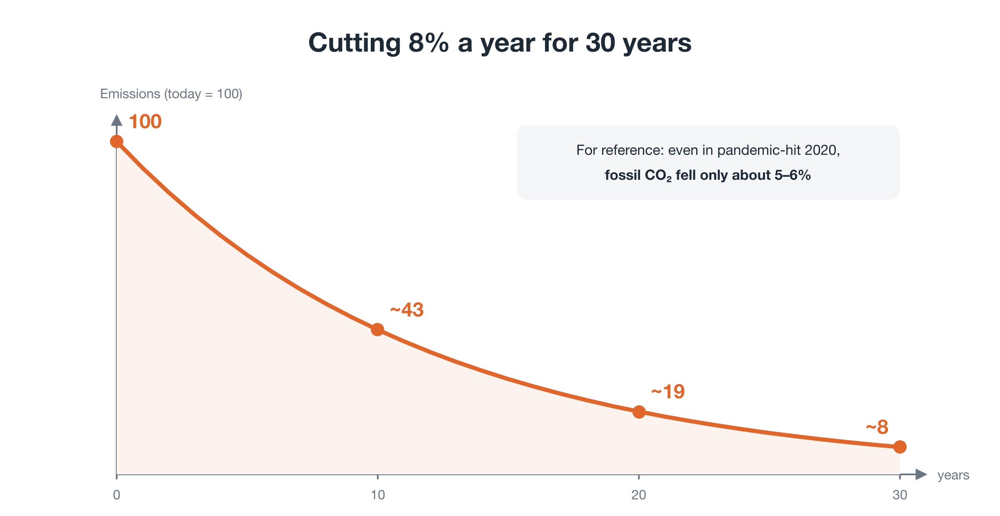
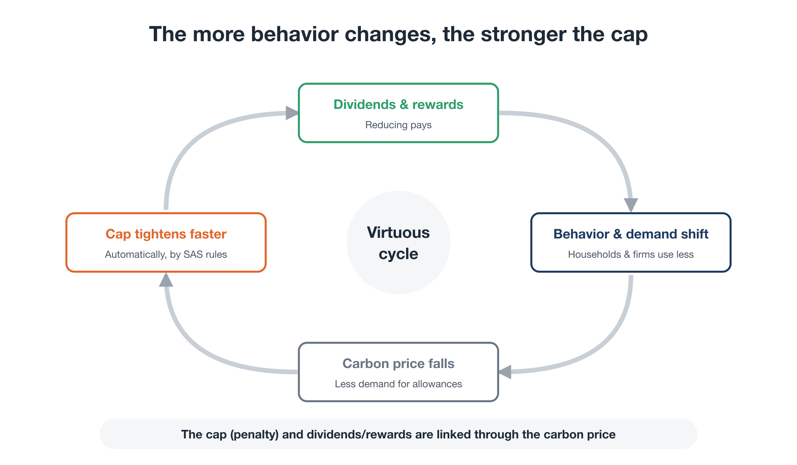

# SAS: A Cap That Only Moves One Way

**Rewriting the Planet's OS — Part 3**

Part 2 gave the big picture of Planetary OS. This part examines the second of its four modules: the **Scientific Automatic Stabilizers (SAS)**.

In one sentence, SAS **puts a cap on the supply of fossil fuels and lowers it automatically every year at a set pace**. It also adjusts to market prices and planetary data without waiting for political bargaining, according to rules agreed in advance.

This usually raises four questions:

- If we can predict the problem, why not just plan ahead?
- Why a cap on quantity rather than a price, such as a carbon tax?
- Even the EU Emissions Trading System couldn't impose a strict cap. Why could this?
- Isn't a policy that runs "without politics" a denial of democracy?

Let's take them in turn.

---

## 1. First, an honest target

Before going further, let me be candid about the target.

The Paris Agreement aims to hold warming "well below 2°C" and to "pursue efforts" toward 1.5°C. But global emissions remain high, and the remaining budget for 1.5°C is almost gone. In my view, staying below 1.5°C without overshoot is now realistically out of reach.

So this series takes **staying well below 2°C** as the line we must actually hold.

Even that requires enormous cuts. The climate scientist Kevin Anderson and colleagues estimate that, to align with the Paris goals and its principles of equity, developed countries need double-digit annual cuts from 2020. Even for the UK and Sweden, leaders in climate legislation, they find minimum rates of 10% and 12% a year, about twice what those countries plan (Anderson, Broderick & Stoddard, 2020). Drawing on that work, this proposal uses **around 8% a year globally, and more in high-income countries**, as a guide.

Cutting 8% a year means:

- after 10 years: about 43% of today's emissions
- after 20 years: about 19%
- after 30 years: about 8%

<figure markdown="span">
  
  <figcaption>Emissions under a sustained 8% annual reduction (today = 100)</figcaption>
</figure>

For comparison: even in 2020, when the pandemic brought much of the world economy to a halt, fossil CO₂ emissions fell by only around 5–6%. **An 8% annual cut means beating that, every single year.**

There is also reason for hope. Renewables and batteries have become dramatically cheaper over the past decade. The IPCC's Sixth Assessment Report found that options costing USD 100 per tonne of CO₂-equivalent or less could cut global emissions by at least half from 2019 levels by 2030. **In terms of technology and cost, this is not impossible.**

What is missing is a mechanism that makes sure it actually happens, year after year, and economic rules that make it possible.

---

## 2. Question 1: If we can predict it, why not just plan?

Climate science has long been able to forecast these changes accurately. How fast emissions need to fall has been known for decades.

The problem is not a lack of forecasts or plans. It is that **plans don't get carried out**.

### "Just this year, as an exception"

Set a goal like "cut emissions X% by 2030," and here is what tends to happen:

- policy shifts at every election
- in a recession or energy crisis, "just this year" exceptions are granted
- compromises such as "let's delay the rules by five years" pile up

Each exception has its reasons. But accumulate them for a few years and the remaining carbon budget is gone before anyone notices.

### SAS protects the plan

SAS is not a device for coping with the unpredictable. It is **a device that protects an agreed plan from political temptation and delay**.

Behavioral economics calls this a **commitment device**: a choice made in advance so that your future self can't give in to temptation. SAS is a commitment device for society as a whole.

### We already use automatic mechanisms

"Automatic policy" may sound like science fiction, but similar mechanisms already exist:

- When unemployment rises, unemployment-benefit payments increase automatically. No new legislation is needed.
- Many central banks adjust interest rates to keep inflation around 2%. Society sets the goal; a specialist institution makes day-to-day adjustments according to the rules.

SAS applies the same idea to **keeping within the planet's physical limits**.

---

## 3. Question 2: Why a cap, not a price?

Climate policy tools fall into two broad families:

- **Price-based**: put a price on emissions, as a carbon tax does, and let people respond.
- **Quantity-based**: cap emissions or fossil-fuel supply and allow no more.

SAS puts the **cap** at the center for two reasons.

### Reason 1: what we must protect is a quantity

The remaining carbon budget for staying well below 2°C is **a fixed total**. Exceed it and the damage can't be undone. When the total is fixed, controlling quantity is more reliable than controlling price. Economists have long made this argument; Martin Weitzman's 1974 analysis of "prices vs. quantities" is the classic reference.

### Reason 2: responses to price are hard to predict

Nobody can say in advance exactly how much a given carbon tax will cut emissions. On a path as tight as 8% a year, any misjudgment turns straight into irreversible overshoot. **A cap guarantees the quantity itself.**

### The cap applies upstream

The cap does not apply to eight billion individuals. It applies at **the top of the economy**: fossil-fuel extraction and import, and large point sources such as smelters and cement plants. Controlling a few thousand nodes worldwide reaches the whole economy. No one needs to monitor anyone's shopping.

### So who sets the carbon price?

Once the cap is set, **emission allowances** are issued up to that amount. Each allowance is the right to emit one tonne of CO₂. Anyone selling fossil fuels must hold allowances matching the carbon content of what they sell.

Allowances are sold at **auction**, and companies can trade them with each other. Because there are only as many allowances as the cap allows, **companies bid against each other for a scarce supply, and that sets the carbon price**. A tighter cap makes allowances scarcer and the price higher. Cheaper alternatives reduce demand for allowances and lower the price.

This is the same **cap-and-trade** mechanism already used in the EU and elsewhere. SAS builds on a proven foundation. What differs is how the cap is set and moved, and where the money goes.

One more rule: **offsetting is not allowed**. Emissions above the cap cannot be cancelled by buying reductions elsewhere. Allowing that would quietly loosen the cap.

---

## 4. How SAS works: a one-way cap

SAS has two parts: **a base cap** and **automatic adjustments**.

<figure markdown="span">
  
  <figcaption>SAS overview: the upstream supply cap falls automatically every year. Adjustment A (price): if the price is too low, the decline accelerates; if too high, relief measures kick in, but the cap does not loosen. Adjustment B (planetary data): yellow / orange / red alerts.</figcaption>
</figure>

### The base: the cap falls automatically every year

- The fossil-fuel supply cap is **lowered automatically every year at a set pace**, around 8% globally as a guide.
- The pace differs by country: faster for high-income countries that emitted most in the past (more than 10%), more gradual at first for developing countries.

The commitment is **not "exactly 8% every year," but "never exceed the remaining carbon budget."**

New technologies spread slowly at first and then rapidly. So the path can start a little gentler and steepen later, as long as the total does not change.

In practice, the system will not start worldwide. It will start with a **club** of willing countries. So the pace will also **rise in steps as the club grows**, with rules fixed in advance that make the later path steeper if expansion is slow. Part 6 covers this in detail.

The starting point is **today's emissions**, not where we "should" have been. Trying to make up all past overshoot on day one would cause chaos and could bring the whole system down. Past overshoot is handled instead through shared past liability (BEI) and investment in removing CO₂ from the atmosphere.

### Adjustment A: responding to price

SAS sets a **price corridor** for allowances and acts automatically when the price moves outside it.

**If the price is lower than expected**, cuts are coming more easily than anticipated, perhaps because alternatives got cheaper or behavior changed. **The cap's decline accelerates**, for example from 8% to 10%.

**If the price is higher than expected**, cuts are putting serious strain on households or the economy. **The cap still does not loosen.** Instead, these measures kick in automatically:

- larger Citizen Dividends
- more support for workers and regions hit by the transition
- faster investment in alternatives (renewables, grids, public transport)
- priority for essential uses of the limited supply. Non-essential high-impact uses, such as private-jet fuel, come last.

The cap **only moves one way**. When cutting is easy, it speeds up. When cutting is hard, it does not go back. Society shares the pain instead.

Allowing "just a little loosening" even once would be the start of another round of "just this year, as an exception."

### Adjustment B: responding to the planet

The cap is planned on the basis of scientific projections. But the Earth system is complex, and things can deteriorate faster than projected. So SAS continuously monitors the planet and steps in harder when danger signs appear.

It combines three kinds of indicators:

- **Cumulative levels**: how much of the remaining budget has been used
- **Rates of change**: whether deterioration is accelerating
- **System health**: how far forests, ice sheets, coral reefs, and other systems are from irreversible tipping points

It covers not only climate but also biodiversity, nitrogen and phosphorus cycles, and the pace of resource use. Data are gathered by scientific bodies independent of politics and cross-verified across institutions worldwide, as described in Part 2.

When these indicators worsen, intervention escalates in three stages:

- **Yellow (caution):** early signs of deterioration. The cap is tightened beyond the planned path.
- **Orange (warning):** signs of approaching a tipping point. Supply to non-essential high-impact uses is halted, and lending to high-impact activities is restricted.
- **Red (crisis):** irreversible collapse is imminent. Like a stock-market circuit breaker, new development in specific areas or the operation of high-impact facilities is suspended until the indicators return to safe levels.

(The thresholds for each stage would be set through scientific review and democratic agreement.)

---

## 5. Question 3: Why could this succeed where even the EU couldn't?

This is the most important question in this part.

The EU Emissions Trading System began in 2005 and is often described as the world's most advanced carbon market. Yet for many years its cap declined only slowly. Under industry pressure, most allowances were given away for free. In its early years, oversupply crashed the price to near zero, and for a time the system had little effect.

Why couldn't it be made strict?

### The root cause: trying to cut through "effort" inside a growth economy

In today's economy, firms succeed by growing sales, regions by producing more, and nations by raising GDP.

Emissions trading **left those growth rules untouched** and placed a cap on top. In an economy where expansion pays, cutting emissions is, for everyone, **an "effort" that means accepting a loss**.

Any system that relies on effort hits two barriers. As long as they stand, every attempt to tighten the cap gets pushed back, and the cap ends up loosened.

<figure markdown="span">
  
  <figcaption>The two barriers to a strict cap, and the two conditions that overcome them. Barrier 1: the burden falls only on the present → Condition 1: share historical liability and return revenue directly to citizens. Barrier 2: reducing alone means losing → Condition 2: a common incentive that rewards reduction.</figcaption>
</figure>

---

### Barrier 1: the burden falls only on the present

Emissions trading regulates only **this year's emissions, the flow**.

Tighten the cap and energy and goods get more expensive. The burden falls on **today's consumers and today's workers**. Meanwhile, those who built wealth, assets, and profits on decades of past emissions keep their gains and contribute almost nothing.

So tightening the cap means **directly damaging livelihoods, jobs, and economic stability**. As the French example in Part 1 showed, public support evaporates, and politicians have no choice but to loosen the cap.

#### Condition 1: share historical liability, and return revenue directly to citizens

This barrier is overcome by two mechanisms.

**Sharing historical liability**
A thin, broad levy is collected from those who benefited from past emissions: surplus corporate profits and large concentrations of wealth. The money goes into an endowment that funds alternatives, supports workers and regions in transition, and absorbs economic shocks. The burden is no longer carried by the present alone. **Those who benefited from the past share it.** And this endowment doesn't shrink as emissions fall.

**Direct return to citizens**
Auction revenue is not put into general government budgets. It is **returned directly to citizens**. Because energy use rises steeply with income, most households receive more than they pay in higher prices. Workers in shrinking industries automatically receive retraining, re-employment support, and income support.

Together, these mean that **a strict cap no longer breaks livelihoods or the economy**. Public opinion shifts from pushing the cap down to defending it.

---

### Barrier 2: reducing alone means losing

The second barrier runs deeper.

If everyone cut emissions, the climate would stabilize and everyone would be better off. But for each individual actor, **cutting back alone is simply a loss**:

- An individual who sacrifices alone just makes their own life harder.
- A company that cuts output alone loses sales and market share to competitors.
- A country that cuts faster alone sees its industries move abroad.

So everyone chooses not to cut, and everyone loses. Game theory calls this the **prisoner's dilemma**.

As long as this dilemma holds, appeals to "choose sufficiency over growth" or "consume less" offer **nothing but downside**. If people won't agree, it's not because they don't care. It's because the rules are set up that way.

#### Condition 2: a common incentive that rewards reduction

The way out is not a moral appeal. It is to **change the rules everyone plays by, so that the payoffs themselves flip**: apply the same rule to everyone at once, so that whoever reduces comes out ahead.

**Households: a universal dividend plus a sufficiency-linked dividend**

The Citizen Dividend has two parts (the ratio is illustrative):

- **Universal dividend (60%):** the same amount per person for everyone. This is the floor that supports daily life.
- **Sufficiency-linked dividend (40%):** households that use less energy and fewer materials, or that cut back, receive more.

Even the universal dividend alone means that using less leaves more money in your pocket. Adding a sufficiency-linked part makes **"the less you use, the more you gain" plainly visible**.

**Firms and regions: sufficiency rewards**

Firms and regions that reduce output or material use, and firms that shift to repair, sharing, or durable products, receive monetary rewards, funded by the endowment built from past liability (BEI). Public procurement also scores low environmental impact.

(Rewards are paid in money, never in allowances. So no matter how much is paid out, the cap does not loosen by a single tonne.)

**Nations: the Club**

The dilemma between countries is handled through a club of participating countries. Inside the club, members receive investment and trade benefits in proportion to their reduction performance. Imports from outside face the same carbon cost at the border (Part 6).

Because the rule is common to everyone, the situation of "losing by acting alone" disappears. **Reducing becomes the rational choice for each actor.**

---

### What changes when both conditions are in place

Compare what happens when the cap is tightened, before and after adding the two conditions:

- **When the cap tightens**
  Before: higher prices hit livelihoods and jobs.
  After: dividends cushion the impact, and those who use less come out ahead.
- **Cutting emissions is**
  Before: an "effort" in which you alone take the loss.
  After: a "rational choice" that pays for everyone.
- **Public opinion**
  Before: pushes the cap down.
  After: defends the cap.
- **The outcome**
  Before: the cap has to be loosened.
  After: the cap can keep tightening in one direction.

And here the design of SAS clicks into place:

> **Rewards change behavior → demand falls → allowance prices fall → by rule, the cap's decline accelerates**

The more people's behavior changes, the faster emissions fall, automatically. The vicious cycle of "we can't impose a strict cap" becomes **a virtuous cycle: the more behavior changes, the stronger the cap can become.**

<figure markdown="span">
  
  <figcaption>The virtuous cycle: dividends and rewards → behavior and demand shift → carbon price falls → cap tightens faster → dividends and rewards continue</figcaption>
</figure>

Two features protect this cycle to the end. The cap moves only one way, and changing the rules requires a double key, so **there is no sliding back**. And a border carbon adjustment on imports from outside the club means **international competition can't break the cycle**.

How the sufficiency-linked dividend is measured, and how to keep it fair, is covered in Part 5.

---

## 6. Question 4: Isn't automatic policy undemocratic?

SAS does not abandon democracy. It **separates the roles of politics and the mechanism**.

### What politics (legislatures and citizens' assemblies) decides

1. **The goal**: for example, "stay well below 2°C," and the remaining carbon budget that implies
2. **The rules**: the pace of the cap, how countries are differentiated, the price corridor, alert thresholds, dividend ratios
3. **Oversight of the measuring bodies**: governing and auditing the independent scientific institutions that collect the data
4. **Compensation and redistribution**: who is supported, and how

### What the mechanism does

It carries out the pre-approved rules, applying the cap's decline and the automatic adjustments, steadily and without drama.

Just as a central bank adjusts interest rates in line with an inflation target, **democracy decides what to aim for, and execution is insulated from political bargaining.**

And as described in Part 2, changing the rules themselves requires a **double key**: scientific evidence *and* approval by at least three-quarters of the citizens' representatives. The mechanism can't rewrite its own rules, and no single government can hollow it out.

---

## 7. Remaining challenges

In fairness, the design still has problems to solve:

- **How to measure reduction.** Close monitoring of individual lives must be avoided. One option is to combine existing data, such as electricity, gas, and fuel totals, with average coefficients by type of activity (Part 5).
- **How to set each country's pace.** How far to differentiate between high-income and developing countries is a question of fairness that science alone can't answer.
- **What about countries that stay out?** If only some countries cap emissions and others increase theirs, nothing is achieved. How to grow participation is the subject of Part 6.
- **Data uncertainty.** Earth-system change comes with wide uncertainty. Reducing false alarms and missed signals needs continued work.

---

## Closing: penalties alone won't turn a civilization around

Environmental policy has so far left the growth-based rules of the economy untouched and relied on **human effort**: whether politicians can make tough decisions, whether citizens can accept sacrifice. That is why it kept running into the same two barriers: the burden falls only on the present, and reducing alone means losing.

SAS turns this around:

- By **sharing historical liability and returning revenue directly to citizens**, a strict cap no longer breaks people's lives.
- By **a common rule that rewards those who reduce**, the prisoner's dilemma dissolves, and reducing becomes the rational choice.
- On that foundation, the cap **moves only one way**, following democratically agreed rules.

Don't rely on effort. Change the rules. Penalties draw the line that must not be crossed. Rewards point competition in the direction we need to go. Only with both can a civilization that has drifted along on autopilot finally be given working brakes and a steering wheel.

But SAS protects a plan that *today's* people agreed on. Who protects the interests of children who can't vote yet, and of generations not yet born?

Part 4 looks at **how to give future generations a voice in our decisions.**

---

This document is also published on: [note (Japanese)](https://note.com/ttmori/n/ncdf3f11504d1)
