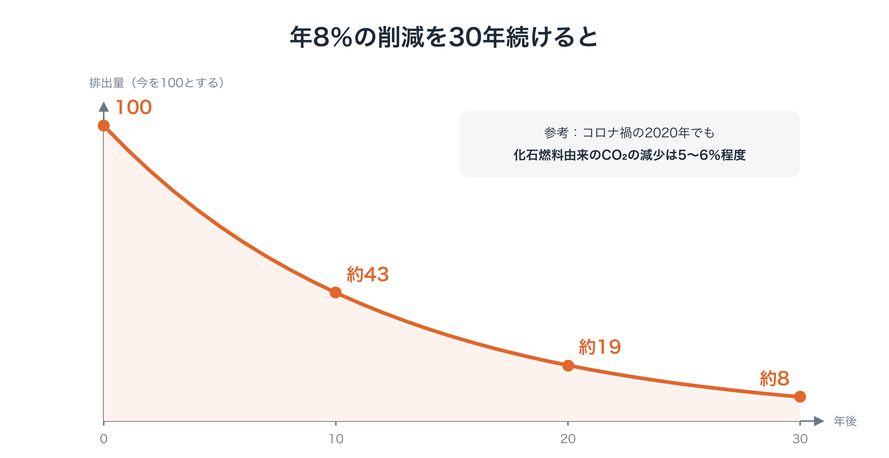
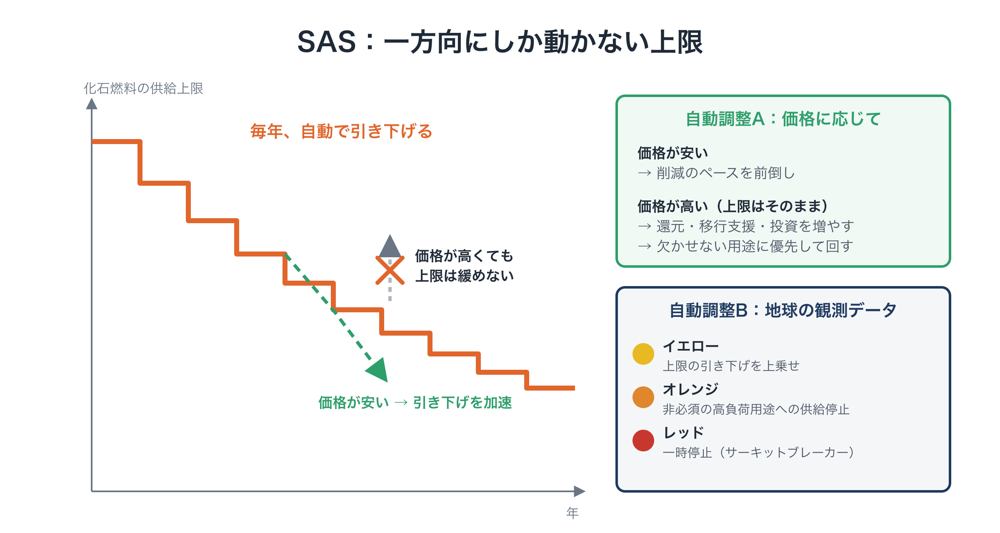
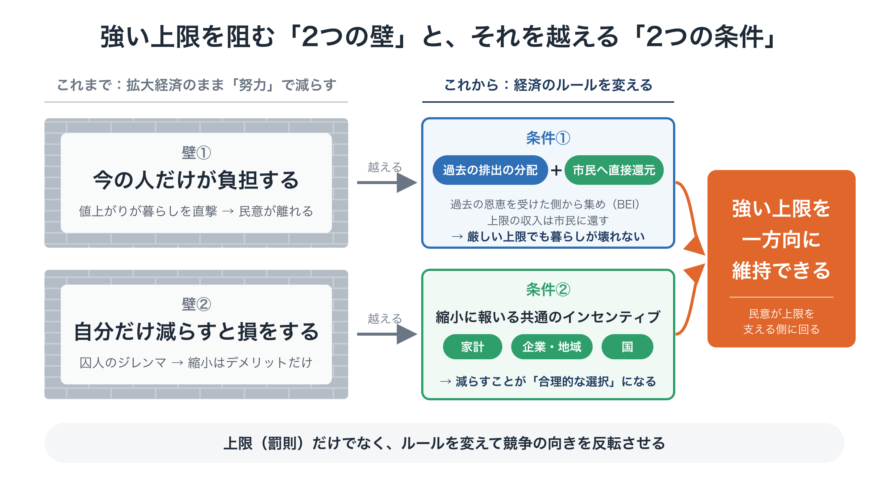
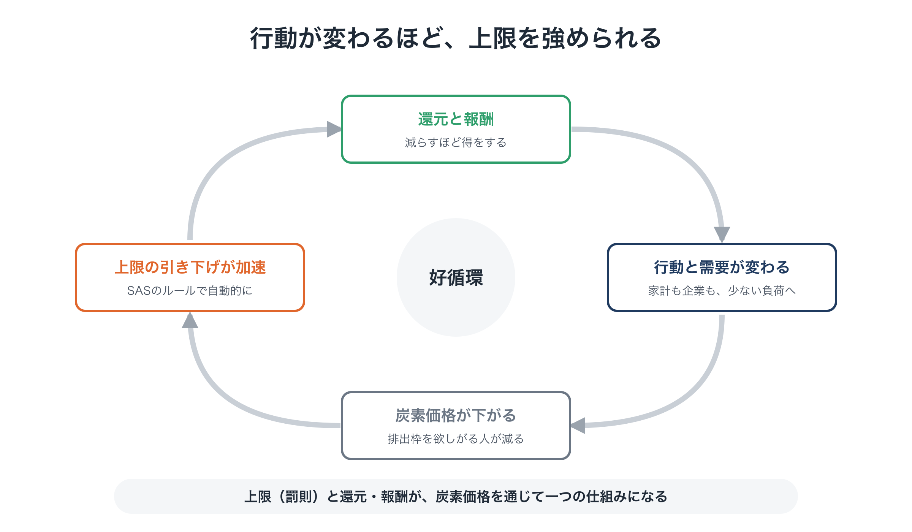

# 政治の先送りを止める装置「SAS」

**連載「地球のOSを書き換える」第3回**

前回は、新しい社会のOS「Planetary OS」の全体像を紹介しました。4つのモジュールのうち、今回取り上げるのは2つ目の**科学的自動安定化装置（Scientific Automatic Stabilizers：SAS）**です。

SASの役割をひとことで言えば、**化石燃料の供給に上限を設け、それを毎年、決められたペースで自動的に引き下げていくこと**です。地球の観測データや市場の状況に応じた調整も、政治の交渉を待たずに、あらかじめ決めたルールどおり自動で行います。

こう聞くと、たいてい次のような疑問が浮かびます。

- 予測できるなら、前もって計画すればいいのではないか？
- なぜ炭素税のような「価格」ではなく、「上限」なのか？
- EUの排出量取引でさえ厳しい上限を設けられなかったのに、なぜそれ以上ができるのか？
- 「政治を通さずに自動で動く」なんて、民主主義の否定ではないか？

今回は、これらの疑問に答えながら、SASの中身を見ていきます。

---

## 1. まず、目標を正直に置き直す

本題に入る前に、目標について率直に書いておきます。

パリ協定は「気温上昇を2℃を十分に下回る水準に抑え、1.5℃に抑える努力を追求する」と定めています。けれども、世界の排出は今も高い水準が続いています。1.5℃に抑えるために残された排出量は、すでにほとんど残っていません。1.5℃を超えないという目標は、現実的にはもう手の届かないところにあると私は考えています。

ですから、この連載では、**「2℃を確実に下回ること」を現実の防衛線**として置きます。

それでも必要な削減の規模は、とても大きなものです。気候科学者のケビン・アンダーソン氏らは、パリ協定の目標と公平性の原則に沿うには、先進国には2020年から年10％を超える削減が必要だと見積もっています。気候政策で先を行く英国とスウェーデンでも、必要な削減率はそれぞれ少なくとも年10％と年12％で、両国の計画の約2倍にあたります（Anderson, Broderick & Stoddard, 2020）。この構想では、その見積もりを参考に、**世界全体で年8％前後、先進国はそれ以上**を削減の目安とします。

年8％の削減を続けると、排出量は次のように減っていきます。

- 10年後：今の約43％
- 20年後：今の約19％
- 30年後：今の約8％

<figure markdown="span">
  
  <figcaption>年8パーセント削減の推移</figcaption>
</figure>

参考までに、コロナ禍で世界の経済活動が止まった2020年でも、化石燃料由来のCO₂の減少は5〜6％程度でした。**年8％とは、それを上回る削減を、毎年続ける**ということです。

一方で、希望もあります。再生可能エネルギーや蓄電池は、この10年で劇的に安くなりました。IPCC（気候変動に関する政府間パネル）の第6次評価報告書は、1トンあたり100ドル以下で実施できる対策だけで、2030年までに世界の排出を2019年の半分以上減らせるとしています。**技術とコストの面では、不可能な数字ではありません**。

足りないのは、それを確実に実行し続ける仕組みと、それを可能にする経済のルールです。

---

## 2. 疑問①：予測できるなら、計画すればいいのでは？

気候変動について、科学はかなり前から精度よく予測してきました。どのくらいのペースで排出を減らす必要があるかも、何十年も前から示されています。

問題は、予測や計画が足りないことではありません。**計画どおりに実行されないこと**です。

### 「今年だけは特別に」が積み重なる

「2030年までに〇％削減する」という計画を立てても、実際には次のようなことが起こります。

- 選挙のたびに方針が揺れる
- 景気が悪い年やエネルギー危機の年には、「今年だけは特別に」と例外が認められる
- 「規制の適用を5年延期しよう」という妥協が重なる

一つひとつの例外には、それなりの理由があります。けれども、それが何年も積み重なると、気づいたときには残された排出量を使い果たしてしまいます。

### SASは「計画を守るための装置」

SASは、予測できないから使う装置ではありません。**すでに立てた計画を、政治的な誘惑や先送りから守るための装置**です。

行動経済学には「コミットメント・デバイス」という言葉があります。未来の自分が誘惑に負けないよう、今の自分が先に決めておく仕組みのことです。SASは、社会全体にとってのコミットメント・デバイスにあたります。

### 実は身近にある「自動の仕組み」

「自動で動く政策」と聞くとSFのようですが、似た仕組みは今の経済にもすでにあります。

- 景気が悪くなって失業者が増えると、国会で新しく決めなくても、失業保険の給付が自動的に増える
- 多くの国の中央銀行は、「物価上昇率を2％程度に保つ」という目標に沿って金利を調整している。目標は社会の合意で決め、日々の調整は専門機関がルールに従って行う

SASは、この考え方を**地球の物理的な限界を守るため**に応用したものです。

---

## 3. 疑問②：なぜ「価格」ではなく「上限」なのか

気候政策の道具には、大きく分けて2つの種類があります。

- **価格で動かす方法**：炭素税のように、排出に値段をつけて、減らす動機を与える
- **量で動かす方法**：排出や化石燃料の供給量に上限を設け、それ以上は認めない

SASが量で動かす「上限」を主役にするのは、次の2つの理由からです。

### 理由① 守るべきものが「量」だから

2℃を下回るために残された排出量は、**総量として決まっています**。超えてしまえば、取り返しがつきません。使える総量が決まっている問題では、価格ではなく量で管理するほうが確実です。

### 理由② 価格への反応は、読み切れないから

炭素税をいくらにすれば排出が何％減るのか、事前に正確に知ることはできません。年8％という余裕のない計画では、その「読み違い」がそのまま、取り返しのつかない超過になってしまいます。**上限なら、削減量そのものを保証できます**。

### 上限は「上流」にかける

上限をかけるのは、80億人一人ひとりの排出ではありません。**経済の最も上流**、つまり化石燃料の採掘や輸入、大規模な製錬所やセメント工場など、排出が集中する拠点です。世界で数千規模の拠点を押さえれば、そこから先の経済全体に影響が伝わります。個人の買い物を監視する必要はありません。

### では、炭素の価格は誰がつけるのか

上限を決めたら、その量だけ「**排出枠**」を発行します。排出枠は、1枚で1トン分のCO₂を出す権利です。化石燃料を売る企業は、売る燃料に含まれる炭素の量に応じて、この排出枠を持っていなければなりません。

排出枠は**競売（オークション）**で売り出され、企業どうしで売り買いすることもできます。枠の数は上限の分しかないので、**企業が限られた枠を競り合うことで、炭素の価格が決まります**。上限が厳しくなるほど枠は貴重になり、価格は上がります。逆に、代わりの技術が安くなって枠を欲しがる企業が減れば、価格は下がります。

これは、EUなどがすでに使っている「**排出量取引（キャップ・アンド・トレード）**」と同じ仕組みです。SASは、仕組みの土台そのものは実績のある方法を使います。違うのは、上限の決め方と動かし方、そして集まったお金の使い道です。

なお、**上限を超えた排出を、他所での削減を買って帳消しにする仕組みは認めません**。それを許せば、上限が実質的に緩んでしまうからです。

---

## 4. SASの仕組み：一方向にしか動かない上限

ここから、SASの具体的な動き方を見ていきます。全体は、**「土台となる上限」と、「状況に応じた自動調整」**の2つからできています。

<figure markdown="span">
  
  <figcaption>SASの全体像</figcaption>
</figure>

### 土台：上限を毎年、自動で引き下げる

- 化石燃料の供給上限を、**毎年、決められたペースで自動的に引き下げます**。世界全体の目安は年8％前後です。
- 国ごとにペースに差をつけます。過去に多く排出してきた先進国はより速く（年10％超）、途上国はより緩やかに始めます。

ここで大事なのは、守るべき約束を「毎年きっかり8％」ではなく、**「残された排出量の総量を超えないこと」**に置く点です。

新しい技術は、最初はゆっくり広がり、ある時点から一気に普及が進みます。そこで、立ち上がりの数年は削減のペースをやや緩やかにし、そのぶん後半で速める、といった道筋も選べるようにします。ただし総量は動かしません。

実際には、この仕組みは最初から世界全体で始まるわけではなく、意欲のある国々のクラブから始まります。そのため、削減のペースも、**クラブが広がるにつれて段階的に上げていく**設計にします。広がりが遅れれば、後半のペースが急になるルールもあらかじめ決めておきます。くわしくは第6回で扱います。

また、上限の出発点は「本来いるべきだった水準」ではなく、**今の排出量**に置きます。それを初日に一気に取り戻そうとすれば、社会は混乱し、制度ごと壊されかねません。過去に超過してきた分は、第2回で紹介した「過去の負債の清算」と、大気中のCO₂を回収する取り組みへの投資で扱います。

### 自動調整A：価格に応じた調整

SASは、炭素の価格に「目安となる幅」を設け、価格がその幅を外れたときに自動で動きます。

**価格が想定より安いとき**
代わりの技術が予想以上に安くなったり、人々の行動が変わったりして、削減が楽に進んでいるサインです。この場合は、**上限の引き下げを前倒しし、削減のペースを加速させます**（たとえば年8％を10％に）。

**価格が想定より高いとき**
削減が生活や経済に大きな負担をかけているサインです。この場合でも、**上限は緩めません**。その代わりに、次の対策が自動で発動します。

- 市民への還元を増やす
- 打撃を受ける産業で働く人や地域への支援を増やす
- 代わりの手段（再エネ、送電網、公共交通など）への投資を前倒しする
- 限られた供給を、暮らしに欠かせない用途に優先して回す。プライベートジェットの燃料のように、欠かせないとは言えない用途は後回しにする

つまり、この上限は**一方向にしか動きません**。削減が楽に進めば加速し、苦しいときも後戻りはしない。そのかわり、痛みは社会全体で受け止めます。「苦しいときは少しだけ緩めよう」を一度でも許せば、それがまた「今年だけは特別に」の始まりになるからです。

### 自動調整B：地球の観測データに応じた警報

上限の計画は、科学の予測に基づいて立てます。けれども地球システムは複雑で、予測より早く悪化が進むこともありえます。そこでSASは、地球の状態を常に観測し、危険の兆しが見えたら、計画よりさらに強く介入します。

観測する指標は、一つに頼らず、性質の異なる3種類を組み合わせます。

- **累積量**：残された排出量をどれだけ使ったか
- **変化の速さ**：悪化のスピードが上がっていないか
- **システムの健全性**：森林、氷床、サンゴ礁などが、取り返しのつかない転換点からどれだけ離れているか

対象は気候だけではありません。生物多様性、窒素やリンの循環、資源の消費速度など、地球の限界に関わる分野を広く見張ります。データは政治から独立した科学機関が観測し、第2回で紹介したとおり、世界中の拠点で互いに検証しながら記録します。

これらの指標が悪化したとき、介入は3段階で強まります。

- **イエロー（注意）**：悪化の兆しが見えた段階。上限の引き下げを、計画よりさらに数％上乗せする
- **オレンジ（警戒）**：転換点への接近が示唆される段階。欠かせないとは言えない用途で負荷の高いものへの供給を止め、負荷の高い事業への融資の条件も自動で厳しくする
- **レッド（危機）**：取り返しのつかない崩壊が迫っている段階。株式市場の「サーキットブレーカー」のように、特定の地域での新規開発や負荷の高い設備の運用を、指標が安全な範囲に戻るまで一時停止する

（※各段階の具体的な基準は、科学的な検討と民主的な合意によって定めます。）

---

## 5. 疑問③：EUにもできなかったことが、なぜできるのか

ここで、この回で最も重要な疑問に向き合います。

EUの排出量取引は2005年に始まり、世界で最も進んだ炭素市場と言われてきました。それでも、上限の引き下げは長いあいだ緩やかなままでした。産業界の反発を受けて排出枠の多くは無償で配られ、初期には排出枠が余って価格が大きく落ち込み、ほとんど効果を持たない時期もありました。

なぜ、厳しくできなかったのでしょうか。

### 根本の理由：拡大経済のまま、「努力」で減らそうとした

今の経済では、企業は売上を伸ばすほど、地域は生産を増やすほど、国はGDPを増やすほど「成功」とされます。

排出量取引は、この**拡大を前提にした経済のルールには手をつけず**、その上に上限だけをかぶせる仕組みでした。拡大するほど得をする経済の中で排出を減らすことは、誰にとっても「損を引き受ける努力」でしかありません。

努力に頼る仕組みには、必ず2つの壁が立ちはだかります。この2つの壁がある限り、上限を厳しくしようとするたびに押し返され、緩めざるを得なくなります。

<figure markdown="span">
  
  <figcaption>2つの壁と2つの条件</figcaption>
</figure>

---

### 壁①：今の人だけが負担する

排出量取引が調整するのは、**今年の排出（フロー）**だけです。

上限を厳しくすれば、エネルギーや製品の値段が上がり、その負担は**今を生きる消費者と、今の産業で働く人**にのしかかります。一方で、過去の大量の排出によって富や資産、利益を積み上げてきた側は、その恩恵を手にしたまま、ほとんど負担しません。

その結果、上限を厳しくすることは、そのまま**暮らしと雇用と経済の安定を傷つけること**になります。第1回で触れたフランスの例のように、民意は離れていきます。政治は、上限を緩めるしかありません。

#### 条件①：過去の排出の分配と、市民への直接還元

この壁は、2つの仕組みで越えます。

**過去の排出の分配**
過去の累積排出から利益を得てきた側、つまり企業の余剰利益や大きな資産から、負担を薄く広く集めます。集めたお金は基金として積み立て、代わりの手段への投資、働く人と地域の移行支援、経済へのショックの吸収に使います。負担を「今の人」だけに負わせず、**過去の恩恵を受けてきた側にも分け持ってもらう**のです。この基金は、排出が減っても目減りしない財源になります。

**市民への直接還元**
上限の競売で得たお金は、政府の一般財源に入れず、**市民に直接還します**。エネルギーを多く使うのは所得の高い人ほど多い傾向があるので、多くの世帯では、値上がりで増えた負担よりも、受け取る還元のほうが多くなります。縮小する産業で働く人々には、再教育、再就職の支援、生活保障を自動で給付します。

この2つがそろうと、**上限を厳しくしても、暮らしと経済が壊れなくなります**。民意は、上限を緩めさせる側から、上限を支える側に回ります。

---

### 壁②：自分だけ減らすと損をする

2つ目の壁は、もっと根深いものです。

全員が排出を減らせば、気候が安定し、全員が得をします。けれども一人ひとりにとっては、**自分だけが減らしても損をするだけ**です。

- 個人なら、自分だけ我慢しても、暮らしが不便になるだけ
- 企業なら、自分だけ生産を減らせば、売上も市場も競合に奪われる
- 国なら、自国だけ削減を急げば、産業が他国に流れる

だから、誰もが「減らさない」を選び、結果として全員が損をします。ゲーム理論でいう**「囚人のジレンマ」**です。

このジレンマがある限り、「成長より縮小を」「消費を減らそう」と呼びかけても、縮小には**デメリットしかありません**。市民の合意を得られないのは、人々の意識が低いからではなく、ルールがそうなっているからです。

#### 条件②：縮小に報いる共通のインセンティブ

ジレンマを解く方法は、道徳に訴えることではなく、**全員に共通するルールを変えて、損得の構造そのものを入れ替える**ことです。つまり、減らした者が得をするルールを、全員に同時に適用します。

**家計：一律の還元と、縮小に連動する還元**

市民への還元は、2つの部分に分けます（比率は一例です）。

- **一律の還元（6割）**：一人あたり同じ額を、すべての人に配ります。暮らしの土台を支える部分です。
- **縮小に連動する還元（4割）**：エネルギーやモノの使用量が少ない世帯、それを減らした世帯ほど多く受け取ります。

**企業と地域：縮小への報酬**

生産量やモノの使用量を減らした企業や地域、修理、シェア、長く使える製品といった事業へ転換した企業に、お金で報酬を払います。財源は、過去の負債（BEI）から積み立てる基金です。公共調達でも、負荷の少なさを評価の基準にします。

**国：参加国のクラブ**

国どうしのジレンマには、参加国のクラブで対応します。クラブの中では、削減の実績に応じて投資や貿易の優遇を受けられます。クラブの外からの輸入には、国境で同じ炭素コストを課します（第6回でくわしく扱います）。

ルールが全員に共通なので、「自分だけ損をする」という状況が消えます。**減らすことが、一人ひとりにとって合理的な選択になる**のです。

なお、報酬はお金で払い、排出枠では払いません。そのため、どれだけ報酬を払っても、上限は1トンも緩みません。

---

### 2つの条件がそろうと、何が変わるか

2つの条件を加える前と後で、上限を厳しくしたときに起きることを比べてみます。

- **上限を厳しくすると**
  これまで：値上がりが暮らしと雇用を直撃する
  これから：還元が支えになり、減らした人ほど得をする
- **排出を減らすことは**
  これまで：自分だけが損を引き受ける「努力」
  これから：誰にとっても得になる「合理的な選択」
- **民意は**
  これまで：上限を緩めさせる側
  これから：上限を支える側
- **その結果**
  これまで：上限は緩めざるを得ない
  これから：上限を一方向に厳しくし続けられる

さらに、ここでSASの設計がかみ合います。

> **報酬が効いて需要が減る → 排出枠の価格が下がる → SASのルールで上限の引き下げが加速する**

人々の行動が変わるほど、削減が自動的に速まります。「強い上限が入れられない」という悪循環が、**「行動が変わるほど、上限を強められる」という好循環**に反転するのです。

<figure markdown="span">
  
  <figcaption>好循環</figcaption>
</figure>

この好循環を最後まで守るのが、ここまでに説明した2つの装置です。上限は一方向にしか動かず、ルールの変更には二重の鍵が必要なので、**途中で後戻りすることはありません**。そして、クラブの外からの輸入に国境で同じ炭素コストを課すので、**国際競争によって好循環が崩されることもありません**。

縮小に連動する還元で何をどう測り、どう公平にするのかは、第5回でくわしく扱います。

---

## 6. 疑問④：自動で動くのは、民主主義の否定では？

SASは民主主義を捨てる仕組みではありません。**政治と装置の役割を、はっきり分ける仕組み**です。

### 政治（議会や市民会議）が決めること

1. **目標を決める**：たとえば「2℃を確実に下回る」と、そのために残された排出量の総量
2. **ルールを決める**：上限を引き下げるペース、国ごとの差のつけ方、価格の幅、警報の基準、還元の比率
3. **測る機関を監督する**：データを観測する独立科学機関を統制し、監査する
4. **補償と再分配の方法を決める**：誰をどう支えるか

### 装置が行うこと

事前に承認されたルールに従って、上限の引き下げや自動調整を、淡々と実行します。

中央銀行が物価の目標に沿って金利を調整するのと同じように、**「何を目指すか」は民主的に決め、「その実行」は政治の駆け引きから切り離す**ということです。

さらに第2回で紹介したとおり、ルールそのものを変えるには、科学者によるデータの裏付けと、市民の代表による4分の3以上の承認という「二重の鍵」が必要です。装置が勝手にルールを書き換えることはなく、一つの政権の判断で骨抜きにすることもできません。

---

## 7. それでも残る課題

公平のために、この設計にもまだ解くべき課題があることを書いておきます。

- **縮小をどう測るか**：一人ひとりの生活を細かく監視することは避けなければなりません。電気・ガス・燃料の購入量など、すでにあるデータと、行動の種類ごとの平均的な数値を組み合わせる方法を考えています（第5回）。
- **国ごとのペースをどう決めるか**：先進国と途上国の差をどこまでつけるかは、科学だけでは決まらない、公正さに関わる問いです。
- **上限に参加しない国をどうするか**：一部の国だけが上限を設けても、残りの国が排出を増やせば意味がありません。どうやって参加国を広げていくかは、第6回で正面から扱います。
- **データの不確実さ**：地球システムの変化には予測の幅があります。誤った警報や見逃しをどう減らすかは、引き続き検討が必要です。

---

## おわりに：罰則だけでは、文明は向きを変えない

これまでの環境政策は、拡大を前提とした経済のルールをそのままにして、「政治家が決断できるか」「市民が我慢できるか」という**人間の努力**に頼ってきました。だから、「今の人だけが負担する」「自分だけ減らすと損をする」という2つの壁に、何度も押し返されてきました。

SASは発想を逆にします。

- **過去の排出を分かち合い、集めたお金を市民に直接還す**ことで、厳しい上限でも暮らしが壊れないようにする
- **減らした者が得をする共通のルール**で、囚人のジレンマを解き、縮小を合理的な選択に変える
- そのうえで、上限は民主的に決めたルールに従って、**一方向にだけ動かし続ける**

努力に頼るのではなく、ルールを変える。罰則で「越えてはいけない線」を引き、報酬で「進むべき方向」に競争を向ける。この両方がそろって、はじめて自然に任せてきた文明に、実効性のある「ブレーキとハンドル」が取り付けられます。

ただし、SASが守るのは「今の私たち」が合意した計画です。では、まだ投票できない子どもたちや、これから生まれてくる世代の利益は、誰が守るのでしょうか。

次回は、**将来世代の声を意思決定に組み込む仕組み**について考えます。
