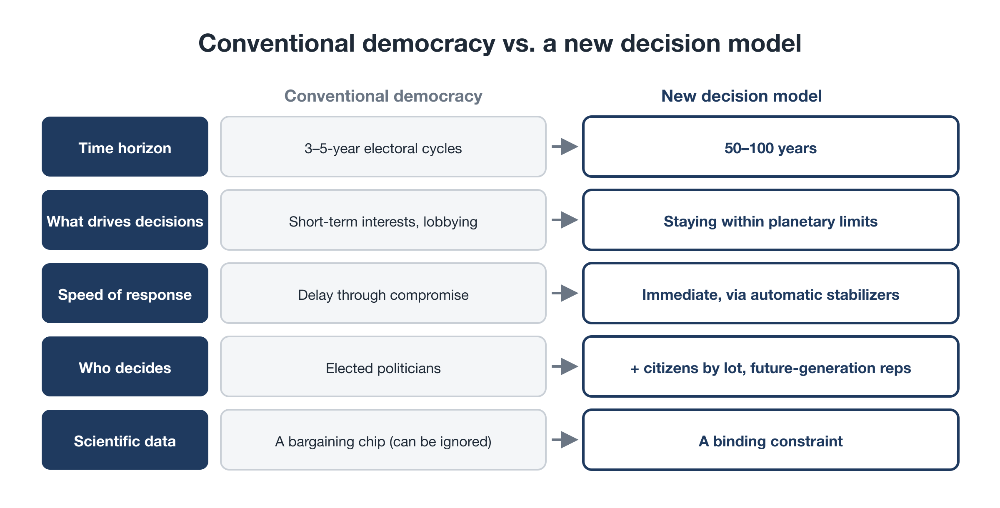

# Giving Future Generations a Voice

**Rewriting the Planet's OS — Part 4**

Part 3 introduced SAS: a mechanism that automatically brakes society, according to democratically agreed rules, when it strays from its agreed path.

That left one big question open:

**Whose interests define the path?**

The people most affected by the climate crisis are not today's voters. They are today's children and the generations not yet born. And they can't vote.

This part asks **how to build the voices of future generations into society's decisions.**

---

## 1. Democracy's time mismatch

Representative democracy rests on a few assumptions:

- Representatives are chosen in elections every few years.
- They seek re-election by serving the interests of today's voters.
- National politics puts national interest first.

For problems that unfold over a few years, this works reasonably well. The climate crisis is a different kind of problem:

- Its causes build up over decades, and its effects last for decades to centuries.
- Once tipping points are crossed, deterioration accelerates and can't be reversed.
- Every cost we postpone is passed on to people who haven't been born.

As long as there is a gap between **electoral cycles of three to five years** and **planetary change unfolding over fifty to a hundred years**, even the most conscientious politicians will struggle to protect future generations. Those generations have no votes. To politics, they are **stakeholders without a voice**.

This is not a failing of individual politicians. It is **a blind spot in time built into the system**.

---

## 2. Mechanism 1: a Future Generations Council

The first proposal is to formally create an institution that speaks for future generations.

### What it is

- A **third body**, a **Future Generations Council**, alongside existing legislatures that represent the present generation
- Members: citizens selected by lot and trained to think from the perspective of future generations, together with experts
- It assesses policy on the basis of scenarios fifty to a hundred years ahead.

### What powers it has

If a policy or bill would breach planetary boundaries and undermine the living conditions of people fifty to a hundred years from now, the council can **refer it back or suspend it**.

### Real-world precedents

This is not fanciful. Wales, part of the United Kingdom, has passed a law requiring public bodies to safeguard the wellbeing of future generations and created a **Future Generations Commissioner** to oversee it.

Most existing examples are advisory. This proposal goes one step further: **real power to stop policies that would cross planetary limits**.

---

## 3. Mechanism 2: bringing "virtual future citizens" into the room

The second mechanism brings the perspective of future generations directly into decision-making.

In Japan, researchers and local governments have developed an approach called **Future Design**. Some participants role-play "residents who have come back from several decades in the future" and deliberate on that basis. It has been tried in long-term municipal planning, and studies report that it tends to produce more far-sighted proposals.

Planetary OS considers taking this further:

- simulating the state of the climate and ecosystems a century from now as a set of "virtual future citizens"
- requiring every policy appraisal to show whether a policy helps or harms those virtual future citizens

Future generations can't sit at our table. That is exactly why **we need to set a place for them on purpose.**

(How much weight this should carry in decisions needs careful debate. For now, the proposal is to treat it as a **mandatory consideration** in policy appraisal.)

---

## 4. Mechanism 3: a global citizens' assembly chosen by lot

The third mechanism changes *who* takes part in decisions.

### Why lottery?

Elected politicians can't help thinking about the next election. They are also influenced by donors and organized interests.

So citizens are **selected by lot, with quotas so that age, region, and income reflect society as a whole**, and asked to deliberate on long-term issues.

Citizens chosen this way:

- don't need to worry about re-election
- owe nothing to any industry or organization
- bring a balanced mix of perspectives from across society

Participants hear from scientists about the facts and long-term scenarios, then take time to discuss before deciding. This is called **deliberation**.

### Precedents and lessons

Sortition-based citizens' assemblies are already in use around the world:

- In Ireland, a citizens' assembly's deliberations led to a referendum on an issue that had long divided the country.
- In France, around 150 citizens chosen by lot deliberated on climate policy and produced many concrete proposals.

In the French case, however, many of the assembly's proposals were reportedly weakened later by the government and parliament. **Good proposals can still be hollowed out if there is no power to turn them into action.**

### So give it real powers

Learning from this, citizens' assemblies need real powers. These work at two levels.

- **At the global level**, the World Citizens' Assembly adopts recommendations that governments and international bodies are asked to answer publicly. And as described in Part 2, changing the rules of Planetary OS itself requires approval by at least three-quarters of the citizens' representatives. Citizens chosen by lot hold **one of the two keys** to this OS.
- **Within each participating country**, that country's citizens' assemblies could be given, for example, **the power to send structural reforms to a referendum** when the national parliament keeps postponing them because of lobbying or electoral calculation, and **the power to propose legislation** to that parliament. Whether and how to do this is for each country to decide.

### Local adaptation decided locally

Within the shared outer limits, how each country, region, or community adapts is chosen and revised by citizens themselves. Not everything is decided centrally. The design principle from Part 2, **a common outer limit and distributed choices within it**, applies here too.

---

## 5. Mechanism 4: a Future Trust for every child

So far we've looked at giving future generations a *voice*. The fourth mechanism gives them actual *assets*.

As Part 2 explained, Planetary OS returns the revenue from auctioning the fossil-fuel cap directly to every person. That includes children.

### Half now, half saved

- Dividends allocated to minors (for example, ages 0 to 18) are split. **Half is paid to the parents now**, to cover the higher prices the household pays for the child. **The other half is automatically saved in each child's own Future Trust account.** (The split is illustrative.)
- They can be withdrawn in stages at milestones such as 18 and 25.
- The money can be used for education, housing, starting a sustainable business, or whatever the young person chooses.

### What it means for parents

This also matters to today's parents. Because half of each child's dividend is paid now, raising children does not leave a family worse off in the present. And seeing "my child's future savings grow every year" turns the interests of future generations from an abstract ideal into **a concrete family interest**.

### The greatest asset is a livable planet

There is one more point. The greatest inheritance future generations can receive is not money. It is **a livable planet** with a stable climate and thriving ecosystems.

That is why the endowment funded by past liability (BEI), the Planetary Transition Endowment described in Part 2, preserves its principal for the long term and uses part of its returns for carbon removal, reforestation, and restoring damaged ecosystems. **Past liability is repaid to future generations in the form of a livable Earth.**

(How the dividend money is divided is covered in Part 5.)

---

## 6. How the pieces fit together

Put SAS from Part 3 together with these mechanisms and a new picture of decision-making emerges:

- **Speed:** SAS responds automatically and immediately as physical limits approach.
- **Legitimacy:** what to aim for and how to adjust are decided through democratic processes, including citizens' assemblies chosen by lot.
- **Time horizon:** the Future Generations Council, virtual future citizens, and Future Trust accounts build the interests of generations fifty to a hundred years ahead into today's decisions.

Compared with conventional democracy:

- **Time horizon:** 3–5-year electoral cycles → 50–100 years
- **What drives decisions:** voters' short-term interests, lobbying, re-election → keeping within planetary limits
- **Speed of response:** postponement through political compromise → immediate response by automatic stabilizers
- **Who decides:** elected politicians → elected politicians *plus* citizens chosen by lot and representatives of future generations
- **Role of scientific data:** one bargaining chip among many, which can be ignored → a binding constraint

<figure markdown="span">
  
  <figcaption>Conventional democracy vs. the new decision-making model</figcaption>
</figure>

---

## 7. "Should unelected people be allowed to decide?"

Finally, a common objection: is it legitimate for citizens chosen by lot, or for representatives of future generations, to block decisions made by elected legislatures, meaning each country's parliament?

This proposal is **not about abandoning democracy for strong-arm rule, nor about leaving everything to short-term popularity.** It is about updating democracy for the times.

- Elected representation remains at the center of politics.
- Citizens' assemblies and the Future Generations Council add what elections alone can't provide: **a long time horizon and independence from vested interests**.
- The power to block applies only to policies that would breach planetary limits.
- Powers over national decisions, such as referrals and referendums, apply only in the countries that choose to adopt them. At the global level, the assembly's role is to recommend and to hold one of the two keys.

### Open questions

Some points still need work:

- How far should the Future Generations Council's power to refer back extend?
- Who selects and oversees the representatives of future generations, and how?
- How should these bodies work at national and global levels?

These are exactly the questions citizens' assemblies themselves should deliberate on.

---

## Closing: representing both the present and the future

To sum up:

- Today's democracy has a structural blind spot: **electoral cycles and planetary change run on different clocks.**
- To fill it, four mechanisms are proposed: **a Future Generations Council, virtual future citizens, a global citizens' assembly chosen by lot, and Future Trust accounts.**
- SAS provides speed, citizens' assemblies provide legitimacy, and the future-generation mechanisms provide the long time horizon. Together, they **reconcile democratic legitimacy with the pace of planetary change**.

We have now seen the "control" and "decision-making" sides of Planetary OS.

But even the best-designed system won't happen without broad public support. And that is exactly where environmental policy has kept stumbling: it has been experienced as sacrifice and as a burden.

Part 5 turns to the engine of the whole design: **the Citizen Dividend**. In Part 3 we saw why a society where reducing pays is necessary. Can it actually be built? What would we measure, how do we keep it fair, and how much money are we talking about?
