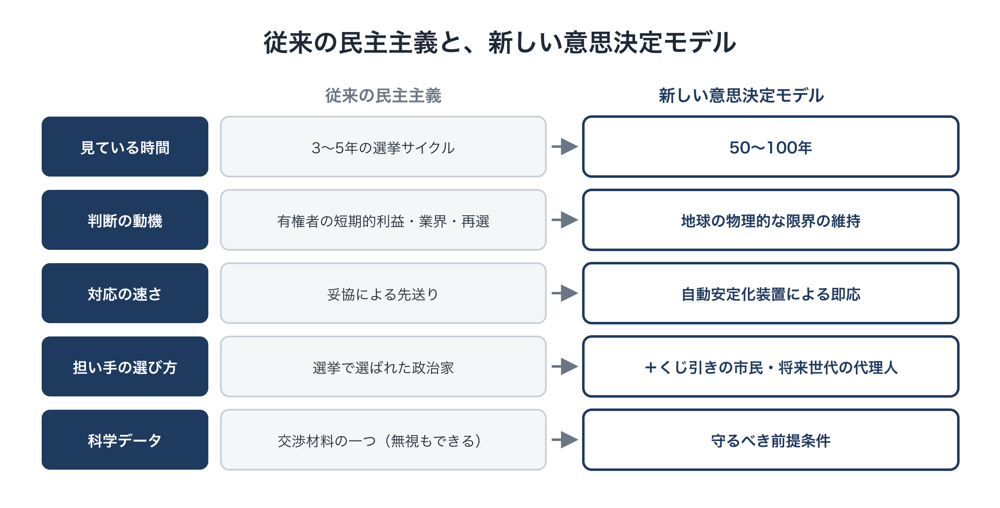

# 将来世代の声を意思決定に組み込む

**連載「地球のOSを書き換える」第4回**

前回は、政治の先送りを止める装置「SAS（科学的自動安定化装置）」を紹介しました。あらかじめ民主的に決めた軌道から社会が外れたとき、ルールどおり自動でブレーキがかかる仕組みです。

ただし、ここには一つ大きな問いが残っていました。

**その「軌道」は、誰の利益を基準に決めるのか。**

気候危機の影響を最も受けるのは、今の有権者よりも、まだ投票できない子どもたちや、これから生まれてくる世代です。けれども、彼らは選挙で一票を投じることができません。

今回は、**将来世代の声を、社会の意思決定の中にどう組み込むか**を考えます。

---

## 1. 民主主義が抱える「時間のずれ」

今の代表制民主主義は、次のような前提の上に成り立っています。

- 数年ごとの選挙で、代表者が選ばれる
- 代表者は、今の有権者の利益に応えることで再選を目指す
- 国の政治は、まず自国の利益を優先する

数年単位で起こる問題であれば、この仕組みはそれなりにうまく機能してきました。けれども気候危機は、性質がまったく違います。

- 原因は数十年かけて積み上がり、影響は数十年から数百年続く
- 転換点を越えると、悪化が急に加速し、元に戻らない
- 負担を先送りすれば、その請求書はまだ生まれていない世代に回る

**3〜5年の選挙のサイクル**と、**50〜100年単位で進む地球の変化**。このずれがあるかぎり、どれほど誠実な政治家でも、将来世代の利益を十分に守ることは構造的に難しくなります。将来世代は票を持たないので、政治にとっては「声のない利害関係者」になってしまうのです。

これは政治家個人の資質の問題ではなく、**仕組みに組み込まれた時間の盲点**です。

---

## 2. 仕組み①：「未来代表議会」をつくる

一つ目の提案は、将来世代の利益を代弁する機関を、制度として正式に設けることです。

### どんな機関か

- 今の議会（現役世代の代表）とは別に、**第3の機関として「未来代表議会（Future-Generations Council）」**を置く
- メンバーは、将来世代の立場で考える訓練を受けた市民（くじ引きで選ぶ）と専門家で構成する
- 50〜100年後のシナリオ分析をもとに、政策を評価する

### どんな権限を持つか

政策や法案が地球の物理的な限界を突き破り、50〜100年後の世代の生存基盤を壊すと判断される場合に、**執行の停止や見直しを求める権限（差し戻し・拒否権）**を持ちます。

### 現実の先例

荒唐無稽な話ではありません。たとえばイギリスのウェールズでは、将来世代の幸福を守ることを公的機関に義務づける法律がつくられ、それを監督する「将来世代コミッショナー」という役職が置かれています。

既存の先例の多くは、助言や勧告にとどまっています。ここで提案しているのは、そこから一歩進めて、**地球の限界を超える政策に対しては実際に歯止めをかけられる権限**を持たせることです。

---

## 3. 仕組み②：「仮想の将来市民」の視点を取り入れる

二つ目は、意思決定の場に、将来世代の視点を具体的に持ち込む工夫です。

日本でも「フューチャー・デザイン」という研究と実践が行われています。住民の一部が「数十年後の未来から来た住民」になりきって話し合う手法で、自治体の長期計画づくりなどで試されてきました。そうした話し合いでは、より長期を見据えた提案が出やすくなると報告されています。

Planetary OS では、これをさらに発展させる案も検討しています。

- 100年後の平均気温や生態系の状態を、シミュレーションで「仮想の将来市民」として表す
- 政策を評価する際に、その仮想の将来市民にとってプラスかマイナスかを、判断材料として必ず示す

将来世代は、私たちの議論の場に座ることができません。だからこそ、**彼らの席を意識的に用意しておく**必要があるのです。

（※この案を意思決定にどこまで反映させるかは、慎重な議論が必要です。今の段階では「必ず考慮される判断材料」として位置づけることを想定しています。）

---

## 4. 仕組み③：くじ引きで選ぶ「世界市民会議」

三つ目は、意思決定に参加する人の選び方そのものを変えることです。

### なぜ「くじ引き」なのか

選挙で選ばれる政治家は、どうしても次の選挙を意識せざるをえません。献金や業界団体の支持にも左右されます。

そこで、**年齢・地域・所得などの構成が社会全体の縮図になるよう、市民をくじ引きで選び**、長期的な課題について話し合ってもらいます。

くじ引きで選ばれた市民には、次のような特徴があります。

- 再選を気にする必要がない
- 特定の業界や団体に恩義がない
- 社会のさまざまな立場の人が、偏りなく含まれる

参加者は、科学者から事実と長期的なシナリオについて説明を受け、時間をかけて話し合ったうえで判断します。これは「熟議」と呼ばれる進め方です。

### 現実の先例と、その教訓

くじ引きによる市民会議は、すでに世界各地で行われています。

- アイルランドでは、市民会議での議論が、国を二分していたテーマの国民投票につながった例があります。
- フランスでは、くじ引きで選ばれた約150人の市民が気候政策について話し合い、多くの具体的な提案をまとめました。

一方、フランスの例では、市民会議の提案の多くが、その後の政府や議会の段階で大幅に弱められたとも指摘されています。**良い提案が出ても、それを実行につなげる権限がなければ骨抜きにされてしまう**のです。

### だから、権限を持たせる

この教訓から、市民会議には実際の権限を持たせることを提案します。権限は、2つのレベルで働きます。

- **地球全体のレベル**では、世界市民会議が提言を採択し、各国政府や国際機関に、公開で応答するよう求めます。あわせて、第2回で紹介したとおり、Planetary OS のルールそのものを変えるときには、市民の代表による4分の3以上の承認を必要とします。くじ引きで選ばれた市民は、このOSの「鍵」の一つを預かる存在です。
- **参加する国の中**では、その国の市民会議に、たとえば、議会がロビー活動や選挙への配慮で先送りしている構造改革案を**国民投票にかける権限**や、その国の議会に**法案を提出する権限**を持たせることが考えられます。採り入れるかどうか、どう採り入れるかは、それぞれの国が決めます。

### 地域ごとの工夫は、地域で決める

地球全体の外枠（物理的な限界）の中で、具体的にどう適応していくかは、国や地域、コミュニティごとに市民自身が選び、見直し続けます。すべてを中央で決めるのではなく、**外枠は共通、中身は分散**という第2回の設計思想が、ここでも生きています。

---

## 5. 仕組み④：子どもたちのための「将来信託」

ここまでは、将来世代の「声」を意思決定に組み込む仕組みでした。四つ目は、将来世代に**実際の資産**を届ける仕組みです。

第2回で紹介したように、Planetary OS では、化石燃料の上限を競売にかけて得たお金を、一人ひとりに直接還します。この還元は、子どもを含むすべての人に割り当てられます。

### 半分は今、半分は積み立て

- 未成年（たとえば0〜18歳）の子どもに割り当てられる還元は、2つに分ける。**半分は、子どもの分の値上がりを補うために、今、親に支払う**。**残りの半分は、一人ひとりの「将来信託口座」に自動で積み立てる**（分け方は一例）
- 18歳、25歳といった節目に、段階的に引き出せるようにする
- 使い道は、教育、住まい、持続可能な事業の立ち上げなど、本人が自由に選べる

### 親にとっての意味

この仕組みは、子どもを育てている現役世代にとっても大きな意味を持ちます。子どもの分の半分は今支払われるので、子育て中の家計が、今の暮らしで不利になることはありません。

そして、「自分の子どもの将来の資産が、毎年着実に増えていく」。それが目に見えることで、将来世代の利益は抽象的な理念ではなく、**家族の具体的な利益**として感じられるようになります。

### 最大の資産は「住める地球」

もう一つ大事な点があります。将来世代が受け取る最大の財産は、現金ではありません。**安定した気候と豊かな生態系を持つ、住み続けられる地球**そのものです。

そのため、第2回で紹介した、過去の負債（BEI）から積み立てる基金は、元本を守って長く残し、その運用益の一部を、大気中のCO₂を回収する技術や植林、失われた生態系を回復させる取り組みなど、**地球の環境そのものを回復させること**に直接投資します。過去の負債を、将来世代に「住める地球」として返していくのです。

（還元のお金をどう分けるかは、第5回で整理します。）

---

## 6. 3つの仕組みが組み合わさると

第3回のSASと今回の仕組みを合わせると、新しい意思決定の全体像が見えてきます。

- **スピード**：物理的な限界に近づいたら、SASが自動で即座に対応する
- **正当性**：何を目指し、どんなルールで調整するかは、くじ引きの市民会議を含む民主的な手続きで決める
- **時間軸**：未来代表議会、仮想の将来市民、将来信託によって、50〜100年先の世代の利益を意思決定に組み込む

従来の民主主義と比べると、違いは次のように整理できます。

- **見ている時間の長さ**：従来は3〜5年の選挙サイクル → 新しいモデルは50〜100年
- **判断の動機**：従来は有権者の短期的な利益、業界の働きかけ、再選 → 新しいモデルは地球の物理的な限界の維持
- **対応の速さ**：従来は政治的な妥協による先送り → 新しいモデルは自動安定化装置による即応
- **担い手の選び方**：従来は選挙で選ばれた政治家 → 新しいモデルはそれに加えてくじ引きの市民と将来世代の代理人
- **科学データの位置づけ**：従来は交渉材料の一つで、無視や曲解もできた → 新しいモデルは守るべき前提条件

<figure markdown="span">
  
  <figcaption>従来と新しい意思決定</figcaption>
</figure>

---

## 7. 「選挙で選ばれていない人が決めていいのか」という懸念

最後に、よく出る懸念について考えます。

「くじ引きで選ばれた人や、将来世代の代理人が、選挙で選ばれた議会（それぞれの国の議会）の決定を止められるのはおかしいのではないか」という疑問です。

この提案は、**民主主義を捨てて強い権力に委ねることでも、目先の人気取りに任せることでもありません**。目指しているのは、民主主義を時代に合わせて更新することです。

- 選挙による代表制は、引き続き政治の中心にあります
- くじ引きの市民会議と未来代表議会は、選挙だけでは届かない「長い時間軸」と「利害からの独立」を補う役割を担います
- 歯止めをかける権限は、地球の物理的な限界を超える場合に限ります
- 差し戻しや国民投票のように、国の決定にかかわる権限は、それを採り入れると決めた国の中だけで働きます。地球全体のレベルでの世界市民会議の役割は、提言をつくることと、「鍵」の一つを預かることです

### 残る課題

もちろん、詰めるべき点は残っています。

- 未来代表議会の拒否権は、どの範囲まで認めるのか
- 将来世代の代理人を、誰がどう選び、どう監督するのか
- 国のレベルと地球全体のレベルで、これらの機関をどう組み合わせるのか

これらは、まさに市民会議そのもので話し合われるべきテーマです。

---

## おわりに：「今」と「未来」の両方を代表する

今回の内容をまとめます。

- 今の民主主義には、**選挙のサイクルと地球の変化の時間軸がずれている**という構造的な盲点がある
- それを補うために、**未来代表議会、仮想の将来市民、くじ引きの世界市民会議、将来信託**という4つの仕組みを組み込む
- SASが「スピード」を、市民会議が「正当性」を、将来世代の仕組みが「時間軸」を担い、**民主的な正しさと地球の変化の速さを両立させる**

ここまでで、Planetary OS の「制御」と「意思決定」の仕組みを見てきました。

けれども、どれほど正しい仕組みでも、多くの人に支持されなければ実現しません。そしてこれまでの環境政策は、まさにその点、つまり「我慢」や「負担」として受け止められることでつまずいてきました。

次回は、この構想の推進力となる**還元の仕組み**を、具体的に設計します。第3回で書いた「減らすほど得をする」社会は、どうすれば本当に作れるのでしょうか。何を測り、どう公平にし、どのくらいの額になるのかを考えます。
