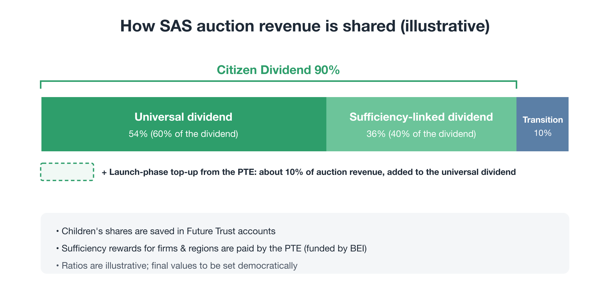
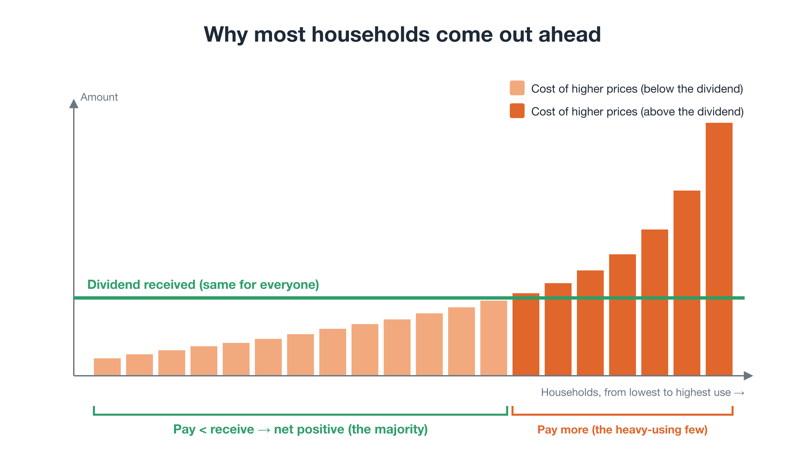
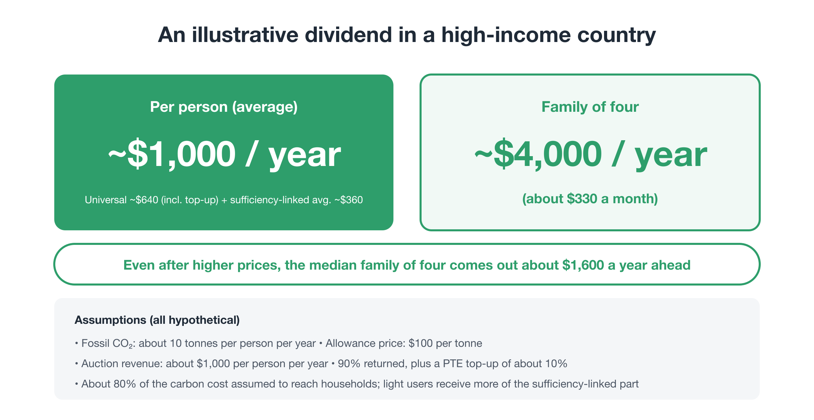

# Not Sacrifice, but Gain: Designing a Dividend That Rewards Using Less

**Rewriting the Planet's OS — Part 5**

In Part 3, we saw why even the EU Emissions Trading System couldn't impose a strict cap, and framed the answer as two barriers:

- **Barrier 1: the burden falls only on the present** → overcome by sharing historical liability and returning revenue directly to citizens
- **Barrier 2: reducing alone means losing** → overcome by a common incentive that rewards reduction

Part 4 looked at giving future generations a voice. This part works out the substance behind those two conditions: **how exactly the money goes back to society.**

- Why return it to citizens rather than government?
- What would a dividend that rewards reduction actually measure?
- Can it be fair without becoming surveillance?
- How much money are we talking about?

---

## 1. Why return the money to citizens, not governments?

Let's start with a common objection:

"Wouldn't it cut emissions more efficiently to let governments invest the money in renewables and industrial transition?"

On pure technical efficiency, perhaps. But history shows that **money handed to governments makes the whole system easy to tear down**, for three reasons.

### 1. It becomes a magnet for vested interests

The moment the money takes the form of subsidies or investment funds, the most politically connected firms and groups line up for it. Money drifts toward cosmetic "green" projects and away from where it is really needed.

### 2. People feel it was simply taken from them

"The revenue will go to industry and infrastructure" sounds, to many people, like "my living costs went up while government and big business split the proceeds." As with the French protests mentioned in Part 1, that distrust can force a policy into reversal very quickly.

### 3. No central authority knows exactly where to invest

No government or committee can know in advance which technologies, sectors, or behaviors will deliver the best results.

### Direct return is the most decentralized adaptation mechanism there is

Return the money to citizens, and two things happen at once:

- products and services that rely on fossil fuels get more expensive (**the price signal**)
- people have the returned money in hand (**purchasing power**)

People then naturally shift toward lower-impact options: efficient homes, public transport, local food, repairing and keeping things longer. Eight billion people each choose what fits their own circumstances, which is far more fine-grained and flexible than any central plan. Businesses then adapt to meet that new demand.

Direct return is not "populism at the expense of efficiency." It is **the foundation that keeps the system from being torn down, and the most decentralized transition mechanism available.**

(Investment in shared infrastructure that markets won't build alone, such as power grids and public transport, is funded by the endowment built from past liability, the Planetary Transition Endowment, introduced in Part 2.)

---

## 2. How the auction revenue is divided

Revenue from auctioning allowances under SAS is divided as follows (the ratios are illustrative):

<figure markdown="span">
  
  <figcaption>Allocation of auction revenue: Citizen Dividend 90% (universal 60% / sufficiency-linked 40%); Just Transition for workers and regions 10%; plus a launch-phase top-up from the BEI endowment</figcaption>
</figure>

- **Citizen Dividend (90%)**
  - **Universal dividend (60% of the dividend):** the same amount for every person
  - **Sufficiency-linked dividend (40% of the dividend):** more for people who use less, or who cut back
- **Just Transition for workers and regions (10%):** retraining, re-employment, and income support for people in shrinking industries

Half of each child's share is paid to the parents now, to cover the higher prices the household pays for the child; the other half is saved in the **Future Trust account** introduced in Part 4.

Why give 90% back to citizens? Higher prices ultimately land on households. **What households pay should come back to households.** That is the condition for most of them to come out net positive. Sufficiency rewards for firms and regions are paid not from auction revenue but from the endowment built from past liability, the Planetary Transition Endowment (PTE).

### A launch-phase top-up from past liability

In the launch phase, the PTE also adds a top-up to the universal dividend, for example an amount equal to about 10% of auction revenue.

BEI is paid by large concentrations of wealth and by corporate profits. So for most households, this top-up is a straightforward gain. The idea that "those who benefited most from the past give part of it back" becomes something people can see in their accounts every year. Beyond the launch phase, a separate rule also protects the majority who come out ahead (Section 3).

---

## 3. The universal dividend: why most households come out ahead

Here is the core arithmetic.

When the cap raises fossil-fuel prices, living costs rise: fuel, electricity, and everything made with fossil energy. How much each person pays depends on **how much energy and material they use**.

And **energy and material use rise steeply with income**. Bigger homes, more cars, frequent flights. Higher incomes mean more energy. Globally, by some estimates, the richest 10% of people account for roughly half of all emissions.

So what happens when the revenue is shared out equally per person?

<figure markdown="span">
  
  <figcaption>Households ranked from lowest to highest use: the burden of higher prices rises steeply with use, while the dividend is a flat line. Most households sit below the line and come out ahead.</figcaption>
</figure>

A small number of very heavy users pull the average up. So **most people use less than the average**, and that majority receives more in dividends than it pays in higher prices.

And because the dividend doesn't depend on how much you use, **the more you cut back, the more money you keep**. Even the universal dividend alone already makes "use less, gain more" true.

### How many people come out ahead?

So how many people actually come out net positive?

First, not all of the carbon cost lands on households. Part of it is embodied in government spending, business investment, and the price of exports. Carbon-footprint studies suggest that household consumption accounts for more than 60% of the total (Ivanova et al., 2016). To stay cautious, we assume that **about 80% of the carbon cost reaches households**.

On that assumption, returning 90% of auction revenue and adding a launch-phase top-up from the PTE means that, as a rough calculation, **about 70% of people come out net positive**. The share depends on the assumptions, ranging roughly from 60% to the low 70s. So that anyone can test those assumptions, we are publishing a Citizen Dividend Simulator. It counts only direct costs; indirect effects through wages and the wider economy can only be estimated. These figures are model estimates, not promises.

### The "majority-benefit rule"

Because the share depends on assumptions, Planetary OS does not rely on the estimate alone. Its standard design includes a rule:

> Each year, households just short of break-even receive a top-up from the PTE that makes up their shortfall, until at least 70% of households come out ahead.

Two details matter. First, the top-up goes only to households near the break-even line, not to everyone. Raising everyone's dividend to reach 70% could take 20–30% of auction revenue; a targeted top-up takes about 1–2.5%. Second, the amount is fixed by each household's use when it joined, not by its current use. If it made up whatever a household lost each year, cutting back would no longer pay. With a fixed baseline, every cut still adds to the household's gain.

This follows the same logic as the SAS rule in Part 3 that raises dividends when prices run high. It would turn "most people come out ahead" from a goal into a rule.

The guarantee holds only within what the PTE can spend. And how large a majority to guarantee is a value judgment, not a scientific one. The higher the guarantee, the larger the top-up the PTE must provide. The standard design uses 70%, and the level can be revisited democratically, including through citizens' assemblies.

---

## 4. The sufficiency-linked dividend: what to measure, and how

If the universal dividend already rewards using less, why add a sufficiency-linked part?

With the universal dividend alone, the gain from using less shows up only **indirectly**, as higher costs avoided. A sufficiency-linked part makes **reductions show up directly as a bigger payment**. As Part 3 argued, flipping the direction of competition requires that kind of visible gain.

But get the design wrong and you get unfairness or surveillance. Four principles matter.

### Principle 1: reward low use first, reductions second

There are two possible bases:

- **Level of use:** people who use little receive more.
- **Reduction:** people who cut back compared with their own past receive more.

Rewarding reduction alone creates a problem. Heavy users can cut a lot and collect a lot, while people who have always lived frugally have little left to cut and receive little. Lower-income households would lose out.

So the proposal is to **reward low levels of use first, with reductions as a secondary factor**. Frugal living is rewarded, and so is a big effort to cut back.

### Principle 2: adjust for use people can't easily change

Two people using the same energy may be in very different situations:

- Colder regions need more heating.
- Where public transport is scarce, it's hard to live without a car.
- Illness or disability can mean higher energy needs.

Use that **people can't easily change by choice** is adjusted for by region and circumstance. Comparisons are made **per person**, not per household, so family size doesn't distort the result.

### Principle 3: measure without monitoring

Anything that scores people's individual purchases must be avoided. Only **coarse data that already exist** are used:

- annual electricity and gas totals from meter readings
- vehicle type, from registration records (petrol or electric, for example)
- building energy ratings

No detailed purchase histories, only annual totals. For consumption of goods, the system doesn't track individual purchases. Instead, it phases in **average coefficients by category of activity or product** (for example, "a repaired appliance" or "second-hand furniture").

### Principle 4: keep it optional

Participation in the sufficiency-linked dividend is **a personal choice**. People who prefer not to share data are assigned a standard value. Everyone still receives the universal dividend.

"Those who want to gain can opt in, and those who don't lose nothing." This design eases fears of surveillance and preserves trust.

### A possible future extension: sufficiency action points

This way of measuring is enough to start with. But annual totals alone cannot reward everyday choices. To make sufficiency a real driver, a finer mechanism will eventually be needed.

Once the base layer is working, a second layer could be added after pilots. An independent rating body assesses how much various actions and products reduce impact, and sets points for them. Citizens collect points in an app when they shop or take part in activities.

One point matters above all. **Often the lowest-impact choice is to do nothing**: not to buy, not to travel, not to produce. Points for "buying green products" could end up increasing consumption. So the points reward **choosing the lower-impact alternative to what one would usually do**.

The principles could be, for example:

- **Weight actions over products**
  - Alternative actions: repair, second-hand, renting and sharing, cycling to work, working from home, community activities → large
  - Alternative products: plant-based protein such as tofu and beans, products with verified deforestation-free ingredients, refills → medium
  - Ordinary "eco" products → small or none
- **Points in proportion to avoided impact**, compared with the usual alternative
- **Priority to impacts the cap cannot reach.** SAS caps fossil carbon. Methane from livestock, deforestation, and biodiversity loss are invisible to an upstream fossil cap. Food and raw materials are where points add the most.
- **Reward, never penalize.** Rather than a minus for eating meat, there is a plus for choosing plant-based options. Diet is tied closely to culture and personal circumstances.
- **No monitoring.** Verification uses existing records, with an annual cap per person. Purchase records stay on the user's own phone, and only an annual total is reported. Cycling to work or working from home can be confirmed through an employer's annual declaration rather than by tracking daily movement.

Details matter. Oil palm, for example, yields far more oil per hectare than other oil crops. Simply rewarding "palm-free" products could mean more land cleared for other oils. So the target should be "products with verified deforestation-free ingredients" rather than "palm-free." Publishing every rating method and its evidence, and reviewing them regularly, is how judgments like this get corrected in the open.

Points carry no fixed cash value. They divide the sufficiency-linked pool, so the total does not grow as more actions earn points. The base layer of annual data stays in place, so people who do not use the app are not disadvantaged.

---

## 5. How much money are we talking about?

To get a feel for the scale, take an illustrative high-income country.

> **Assumptions (all hypothetical)**
>
> - Fossil CO₂ emissions: about 10 tonnes per person per year
> - Allowance price: USD 100 per tonne

<figure markdown="span">
  
  <figcaption>An illustrative calculation of the dividend</figcaption>
</figure>

On these assumptions, auction revenue is about **USD 1,000 per person per year**. Returning 90% and adding a PTE top-up of about USD 100 gives:

- **about USD 1,000 per person per year on average, or about USD 4,000 for a family of four**
  - universal dividend (including the top-up): about USD 640 per person
  - sufficiency-linked dividend: about USD 360 per person on average. People who use less get more, and heavy users get less.

For the median household, which uses less than the average, the dividend exceeds the higher prices by about USD 400 per person, or roughly **USD 1,600 a year for a family of four** (assuming about 80% of the carbon cost reaches households).

### The amount changes over time

This amount won't last forever:

- As the cap falls, the number of allowances shrinks year by year (and, as the club grows, the pace approaches about 8% a year).
- As allowances get scarcer, their price rises.

Revenue may hold up for a while, but over the long run it falls along with emissions. That is a sign the system is working.

At that point, the **Planetary Transition Endowment** keeps funding transition support and shared infrastructure. **Auction revenue is a transitional dividend; the endowment is the lasting foundation.**

### Seen globally

Apply the same logic worldwide and the dividend matters even more.

In lower-income countries, emissions per person are far lower than in rich countries, so price increases hit less hard. Meanwhile, a per-person dividend can be large relative to local incomes. The system starts country by country within the club, but delivering benefits across borders is the job of the club and the endowment, covered in Part 6.

---

## 6. Rewarding firms and regions: flipping the direction of competition

When household behavior changes, demand changes. When demand changes, the direction of business competition changes too. Sufficiency rewards, funded by the PTE, accelerate that shift.

### Rewards for firms

- Firms that **reduce output or material throughput** receive monetary rewards.
- So do firms that **shift to lower-impact business models**: repair, maintenance, sharing, durable products, second-hand markets.
- **Public procurement** scores low environmental impact, not just price.

Measurement follows the same logic as for households. A firm's activity is scored on energy and material use and on contributions to repair and reuse, using **average coefficients by type of activity** to keep evaluation simple.

It bears repeating: **rewards are paid in money, never in allowances.** So no matter how much is paid, the cap does not loosen. Paying for some reductions that would have happened anyway is wasted money, but it doesn't add to warming.

### Rewards for regions

Municipalities and regions are eligible too. Efforts to circulate materials and energy locally, such as local recycling loops and community energy, are scored and rewarded.

Starting with pilot municipalities and expanding as results come in is the practical path.

### Paying for "not producing" isn't strange

Paying firms for producing less may sound odd. But there are precedents:

- the U.S. Conservation Reserve Program, which pays farmers to take environmentally sensitive land out of production
- Germany's compensation to power companies for phasing out coal plants
- EU subsidies to reduce the size of fishing fleets

Each of these **pays for reductions society needs**. Planetary OS turns this from an exceptional measure for particular industries into a common rule for the whole economy.

---

## 7. "Won't people spend the dividend and raise emissions?"

One more common objection:

"If people spend the dividend on other things, won't emissions just go back up?"

Without a cap, that would be a fair worry. But SAS has a cap. Even if people use their dividend to buy more energy, **total emissions can't exceed the cap**. Higher demand only pushes up the allowance price. And a higher price makes heavy use even more expensive, strengthening the advantage of those who use less.

Because the dividend sits under a cap, **it can't push emissions up**.

---

## 8. If people can't see it, it doesn't count

One point is easy to overlook: **if citizens don't feel the benefit, the system won't survive.**

### The lesson from Canada

Canada ran a carbon charge whose revenue was returned to households as rebates. Most households were estimated to receive more than they paid. Yet many people never noticed the rebates, the message that "the carbon tax is making life unaffordable" took hold, and the consumer charge and rebate were abolished in 2025.

The lesson: **even a well-designed dividend won't be defended if people can't see it.**

### The Alaska example

Contrast this with Alaska. Since the 1980s, the state has paid an annual dividend to every resident from a fund built on oil revenues. The dividend is widely known, and politicians touch it at their peril.

### Making it visible

So the dividend is designed with three features:

1. **A clear name and a fixed date.** Give it a recognizable name and pay it straight into people's accounts on a set day.
2. **A way to see your own net position.** Publish a simulator: enter where you live and how you live, and see how much more you'd pay, how much you'd receive, and what's left.
3. **Start small and let people experience it.** Before the full system launches, run small pilots in willing municipalities so people experience "the money really arrives" first.

---

## 9. Remaining challenges

In fairness, some questions remain open:

- **Where to draw adjustments.** Finer adjustments for cold regions or areas without public transport are fairer but more complex.
- **Measuring consumption of goods.** Goods are harder to measure than energy. Making category-level coefficients and action points reliable is a challenge, and the rating body must be protected from lobbying by firms that want their products to earn points.
- **Getting dividends across borders.** How to deliver benefits to people in lower-income countries is covered in Part 6.
- **Setting the ratios.** The 90/10 split, the 60/40 split, and the size of the top-up shown here are illustrations. In the end, they should be set democratically, including through citizens' assemblies.

---

## Closing: turning self-interest into planetary protection

One reason environmental problems have gone unsolved is that we relied on a fuel that is precious but runs out quickly: **goodwill and ethics**.

The dividend described here runs on a different fuel: **the wish to be better off**, a motive everyone has, which is strong and durable.

- The universal dividend supports most households.
- The sufficiency-linked dividend makes "use less, gain more" visible.
- Rewards for firms and regions flip the direction of competition.
- And because there is a cap, the dividend can't push emissions up.

The fruitless argument over whether to "sacrifice for the environment" can end. The real question becomes: **do we choose a society where reducing pays?**

But none of this can be completed inside a single country. If one country imposes a strict cap alone, industry will simply move elsewhere.

Part 6 asks **how this system can spread across countries without a world government**: combining reasons to join with costs for staying out, to solve the "reducing alone means losing" dilemma between nations.

---

This document is also published on: [note (Japanese)](https://note.com/ttmori/n/n84695650a13b)
