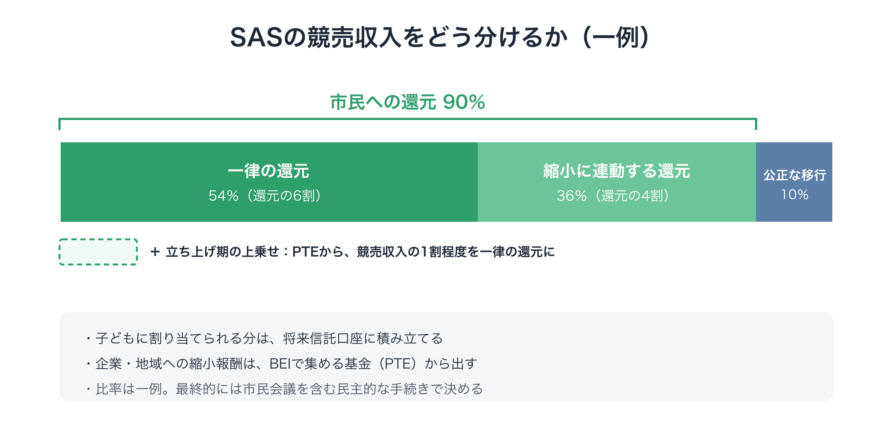
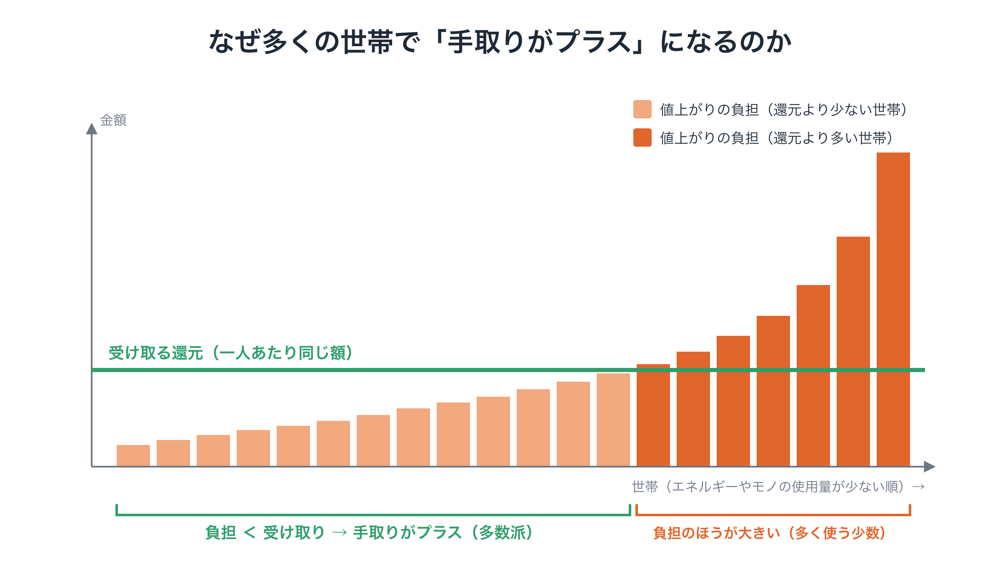
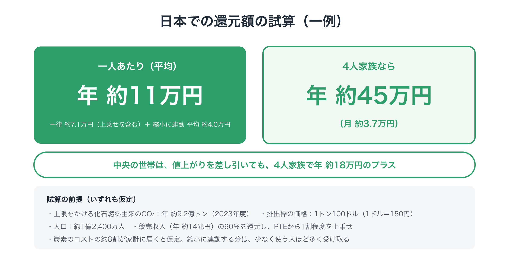

# 「我慢」ではなく「得」で動く：減らすほど得をする還元の設計

**連載「地球のOSを書き換える」第5回**

第3回では、EUの排出量取引でさえ厳しい上限を設けられなかった理由を、2つの壁として整理しました。

- **壁①：今の人だけが負担する** → 過去の排出の分配と、市民への直接還元で越える
- **壁②：自分だけ減らすと損をする** → 縮小に報いる共通のインセンティブで越える

前回は、将来世代の声を意思決定に組み込む仕組みを見ました。今回は、第3回の2つの壁を越えるための中身、つまり**集めたお金を、どう社会に還すのか**を具体的に設計します。

- なぜ政府ではなく、市民に直接還すのか
- 「減らすほど得をする」還元で、何をどう測るのか
- 監視社会にならずに、公平に測ることはできるのか
- 実際に、どのくらいの額になるのか

一つずつ考えていきます。

---

## 1. なぜ政府ではなく、市民に直接還すのか

最初に、よく出る疑問から考えます。

「集めたお金は、政府が再エネや産業の転換に投資したほうが、削減の効率は高いのではないか」

純粋に技術的な効率だけを見れば、その通りかもしれません。けれども、これまでの歴史は、**政府に預けたお金は、制度ごと壊されやすい**ことを示しています。理由は3つあります。

### ① 利権の温床になる

補助金や投資基金の形をとった瞬間、政治的な影響力の強い企業や団体が、その分配に群がります。見かけだけの環境対策にお金が流れ、本当に必要なところには届きにくくなります。

### ② 「取られただけ」と感じられる

「集めたお金は産業界やインフラに使います」と言われても、市民の実感は「自分たちの生活費が上がっただけで、裏で政府と大企業がお金を分け合っている」になりがちです。第1回で触れたフランスの抗議運動のように、こうした不信は、制度をあっという間に撤回へと追い込みます。

### ③ 何に投資すべきかを、中央は正確に知りえない

どの技術、どの産業、どの行動に投資するのが最も効果的かを、政府や委員会が事前に正確に見通すことはできません。

### 直接還元は、最も分散した「適応の仕組み」でもある

一方、市民に直接還すと、次のことが同時に起こります。

- 化石燃料に頼る製品やサービスは値上がりする（価格の信号）
- 手元には、還元されたお金がある（購買力）

すると、人々は自然に、負荷の低い製品やサービスを選ぶようになります。省エネ住宅、公共交通、地域の食べ物、修理して長く使うこと。80億人がそれぞれの事情に合わせて選ぶので、中央が計画するよりもはるかに細かく、柔軟に適応が進みます。そして企業は、その需要の変化に応えるために、自ら事業を転換していきます。

直接還元は「効率を犠牲にした人気取り」ではありません。**制度を壊されないための土台であり、同時に、最も分散した転換の仕組み**です。

（なお、市場だけでは進まない送電網や公共交通などの基盤への投資は、第2回で紹介した、過去の負債（BEI）から積み立てる基金で担います。）

---

## 2. 競売収入をどう分けるか

SASで化石燃料の上限を競売にかけて得たお金は、次のように分けます（比率は一例です）。

<figure markdown="span">
  
  <figcaption>競売収入の配分</figcaption>
</figure>

- **市民への還元（90％）**
  - **一律の還元（6割）**：一人あたり同じ額を、すべての人に
  - **縮小に連動する還元（4割）**：エネルギーやモノの使用量が少ない人、減らした人ほど多く
- **働く人と地域への移行支援（10％）**：縮小する産業で働く人の再教育、再就職、生活保障

子どもに割り当てられる分は、半分を、子どもの分の値上がりを補うために今、親に支払い、残りの半分を、前回紹介した**将来信託口座**に積み立てます。

市民への還元を90％と高くしているのには、理由があります。値上がりの負担は、最終的には暮らしにかかってきます。**家計が払ったお金は、家計に戻す**。それが、多くの世帯で「手取りがプラス」になるための条件だからです。企業や地域への縮小報酬は、競売収入からではなく、過去の負債（BEI）から積み立てる基金（PTE）から出します。

### 立ち上げ期は、過去の負債から上乗せする

さらに立ち上げ期には、PTEが一律の還元に上乗せをします。たとえば、競売収入の1割程度にあたる額です。

BEIを負担するのは、大きな資産を持つ層と企業の利益です。そのため、多くの世帯にとって、この上乗せはそのまま得になります。「過去の恩恵を受けてきた側が、その一部を返す」という考え方が、毎年の振り込みとして目に見える形になります。立ち上げ期に限らず、多数の世帯が得をすることを守るルールも置きます（3節）。

---

## 3. 一律の還元：なぜ多くの世帯で「手取りがプラス」になるのか

ここで、還元の仕組みの核にある計算を見ておきます。

上限によって化石燃料が値上がりすると、私たちの生活費は上がります。ガソリン代、電気代、そして化石燃料を使って作られる製品の値段。上がり方は、**その人がどれだけエネルギーやモノを使っているか**によって決まります。

ここで大事なのは、**エネルギーやモノの使用量は、所得と強く結びついている**ことです。大きな家、何台もの車、頻繁な飛行機での移動。所得が高い人ほど、多くのエネルギーを使います。世界全体では、所得上位10％の人々が排出のおよそ半分を占めるという推計もあります。

そこに一人あたり同じ額を配ると、どうなるでしょうか。

<figure markdown="span">
  
  <figcaption>手取りがプラスになる仕組み</figcaption>
</figure>

使用量の分布は、ごく一部の人が平均を大きく押し上げる形をしています。そのため、**平均より少なく使う人が多数派**になります。その多数派は、値上がりで増えた負担よりも、受け取る還元のほうが多くなります。

しかも、還元の額は自分の使用量とは関係なく決まります。だから、**暮らしを省エネ型に変えるほど、値上がりの影響が減り、手元に残るお金が増えます**。一律の還元だけでも、「減らすほど得」の仕組みはすでに働いているのです。

### どのくらいの人が得をするのか

では、実際にどのくらいの人の手取りがプラスになるのでしょうか。

一つ押さえておきたいのは、炭素のコストのすべてが家計にかかるわけではないことです。一部は、政府の支出、企業の設備投資、輸出品の価格に含まれます。カーボンフットプリントの研究では、家計の消費が全体の6割余りを占めるとされています（Ivanova ほか、2016年）。そこで、なお慎重に見て「炭素のコストの約8割が家計に届く」と置きます。

この前提で、競売収入の9割を還元し、立ち上げ期にPTEから上乗せをすると、計算上の目安として、**国全体で約7割の人の手取りがプラス**になります。前提によってこの割合は変わり、6割前後から7割台前半ほどの幅があります。誰でもその前提を変えて確かめられるよう、還元シミュレーターを公開しています。シミュレーターが計算するのは直接の負担だけで、賃金や経済全体を通じた間接の影響は推計するしかありません。これらの数字は計算上の想定で、約束ではありません。

### 「多数派保証ルール」

得をする人の割合は前提によって変わるので、Planetary OS は、この見込みだけに頼りません。標準の設計に、次のルールを入れます。

> 毎年、損益の境目にいる世帯に、その不足分をPTEから上乗せし、少なくとも7割の世帯の手取りがプラスになるようにする。

大事な点が2つあります。一つは、上乗せするのは、損益の境目にいる世帯だけで、全員ではないことです。全員の還元を増やして7割に届かせようとすると、競売収入の20〜30％がかかることもあります。境目の世帯に絞れば、約1〜2.5％で済みます。もう一つは、上乗せの額を、今の使用量ではなく、加盟した時点の使用量で決めることです。毎年の損をそのまま埋めると、減らしても得をしなくなります。基準を固定しておけば、減らした分だけ、得が増え続けます。

第3回で紹介した「価格が高すぎるときは還元を増やす」という仕組みと、同じ考え方です。「市民の多数が得をすること」を、目標ではなくルールとして約束できます。

保証は、PTEが出せる範囲に限られます。また、何割を保証するかは、科学ではなく社会の価値判断です。保証の水準を高くするほど、PTEから必要な上乗せも大きくなります。標準の設計では7割とし、その水準は、市民会議を含む民主的な手続きで見直せるものとします。

---

## 4. 縮小に連動する還元：何を、どう測るのか

では、なぜ一律の還元に加えて、縮小に連動する還元が必要なのでしょうか。

一律の還元では、「減らすと得をする」効果は、値上がりを避けた分として**間接的に**しか表れません。縮小に連動する部分を加えると、**減らした分が、受け取る額の増加としてはっきり目に見えます**。第3回で書いたように、競争の向きを変えるには、この「目に見える得」が欠かせません。

ただし、設計を誤ると、不公平や監視社会につながります。4つの点を考えます。

### ① 何を基準にするか：「少なさ」を主に、「減らした量」を従に

基準の候補は2つあります。

- **使用量の少なさ（水準）**：もともと少なく使っている人ほど多く受け取る
- **減らした量（改善）**：自分の過去と比べて、減らした人ほど多く受け取る

「減らした量」だけで測ると、問題が起きます。もともと大量に使っていた人は大きく減らせるので多く受け取り、もともと質素に暮らしてきた人は減らす余地がないので受け取れません。これでは、所得の低い人ほど不利になってしまいます。

そこで、**使用量の少なさを主な基準にし、減らした量を従の基準として加える**ことを提案します。質素な暮らしがきちんと報われ、同時に、大きく減らす努力にも報いる形です。

### ② やむを得ない使用には、補正をかける

同じ量のエネルギーを使っていても、事情は人によって違います。

- 寒い地域では、暖房に多くのエネルギーが必要になる
- 公共交通の少ない地域では、車なしで暮らすのが難しい
- 病気や障害のために、エネルギーを多く必要とする人がいる

こうした**本人の選択では変えにくい使用**には、地域や事情に応じた補正をかけます。数字は世帯単位ではなく一人あたりで比べ、家族の人数による不公平も生まないようにします。

### ③ 監視しない測り方

一人ひとりの買い物を記録して点数をつけるような仕組みは、避けなければなりません。そこで、次のような**すでにある、粗いデータ**だけを使います。

- 電気・ガスの年間の使用量（検針の合計値）
- 車の種類（登録情報から、ガソリン車か電気自動車かなど）
- 住宅の断熱性能（性能の証明書など）

細かい購買履歴は使わず、年に1回の集計値だけを使います。モノの消費については、一つひとつの買い物を追うのではなく、**行動や製品の種類ごとに決めた平均的な数値**（たとえば「修理した家電」「中古で買った家具」）を使う方法を、段階的に取り入れていきます。

### ④ 参加しない自由を残す

縮小に連動する還元への参加は、**本人が選べる**ようにします。データを出したくない人は、標準的な値として扱います。それでも一律の還元は、全員が受け取れます。

「得をしたい人は参加し、そうでない人も損はしない」。この設計にしておくことが、監視社会への不安を和らげ、制度への信頼を保つ鍵になります。

### 将来の拡張の一例：縮小行動ポイント

ここまでの測り方は、最初の段階としては十分です。ただ、年に1回の集計値だけでは、日々の選択に報いることはできません。縮小を本格的に後押しするには、もう一歩細かい仕組みも必要になるでしょう。

そこで、土台の仕組みが動き出したあと、試行を経て、2つ目の層を加えることが考えられます。独立した評価機関が、さまざまな行動や商品について「どれだけ負荷を減らすか」を評価し、ポイントを決めます。市民は、買い物や活動への参加のときにアプリでポイントを受け取り、貯めていきます。

このとき、一つ大事な点があります。**最も環境負荷が小さいのは、多くの場合「何もしないこと」**、つまり買わない・移動しない・作らないことです。「環境にやさしい商品を買うとポイント」にすると、かえって消費を増やしかねません。そのためポイントは、**普通ならこうするところを、負荷の小さい方を選んだこと**に報います。

原則は、たとえば次の5つです。

- **商品より行動に大きく**
  - 代わりの行動：修理、中古、借りる・シェア、自転車通勤、在宅勤務、地域の活動への参加 → 大きい
  - 代わりの商品：納豆や豆腐などの植物性のタンパク質、森林破壊のない原料であることが確かめられた商品、詰め替え → 中くらい
  - 一般の「環境配慮」商品 → 小さい、またはなし
- **よくある代わりの選択と比べて、減らせた負荷に比例させる**
- **上限では捉えきれない負荷を優先する**：SASが抑えるのは化石燃料の炭素です。家畜のメタン、森林破壊、生物多様性の損失は、上流の上限では捉えられません。食や原料の分野は、ポイントで補う意味が最も大きいところです。
- **報いるだけで、罰を与えない**：たとえば肉を食べることにマイナスを付けるのではなく、植物性を選ぶことにプラスを付けます。食は文化や個人の事情と深く結びついているからです。
- **監視しない**：確かめるのは今ある記録で行い、一人あたりの年間の上限を設けます。購買の記録は本人のスマートフォンの中にとどめ、報告するのは年間の合計だけです。自転車通勤や在宅勤務なら、日々の移動を追うのではなく、勤務先の年単位の届け出で確かめられます。

細かいところにも注意が要ります。たとえばアブラヤシは、同じ面積から取れる油がとても多い作物です。単純に「パーム油を使わない」商品に報いると、別の油のために、かえって多くの土地が必要になることがあります。そのため対象は、「パームフリー」より、「森林破壊のない原料であることが確かめられた商品」とする方が正確です。評価の方法と根拠をすべて公開し、定期的に見直すのは、こうした判断を開かれた場で正していくためです。

ポイントには、決まった現金の価値を持たせません。縮小に連動する還元の総額を、ポイントの比率で分けます。そのため、ポイントを付ける行動が増えても、総額は増えません。年間のデータによる土台はそのまま残すので、アプリを使わない人が不利になることもありません。

---

## 5. 実際に、どのくらいの額になるのか

ここで、おおまかな規模の感覚をつかむために、日本を例に試算してみます。

> **試算の前提（いずれも仮定です）**
>
> - 上限をかける化石燃料由来のCO₂：年に約9.2億トン（2023年度のエネルギー起源のCO₂をもとにした概算）
> - 排出枠の価格：1トン100ドル（1ドル＝150円として、1トン1万5千円）
> - 人口：約1億2,400万人

<figure markdown="span">
  
  <figcaption>日本での還元額の試算</figcaption>
</figure>

この場合、競売収入は年に約14兆円になります。その90％を市民に還し、さらにPTEから1割程度を上乗せすると、**一人あたり平均で年に約11万円、4人家族なら年に約45万円（月に約3万7千円）**になります。

- 一律の還元（上乗せを含む）：一人あたり年に約7万1千円
- 縮小に連動する還元：平均で一人あたり年に約4万円。少なく使う人ほど多く、多く使う人ほど少なく受け取る

平均より少なく使う中央の世帯では、受け取る還元が値上がりの負担を一人あたり年に約4万5千円上回り、4人家族では年に約18万円のプラスになります（炭素のコストの約8割が家計に届くという前提）。

### 額は、時間とともに変わる

注意しておきたいのは、この額がずっと続くわけではないことです。

- 上限が下がるにつれて、排出枠の数は毎年決められたペースで減っていく（クラブが広がるにつれて、年8％前後に近づいていく）
- 一方で、枠が貴重になるほど、価格は上がる

しばらくは収入が保たれても、長い目で見れば、競売収入は排出とともに減っていきます。それは、制度が目的を果たしつつある証拠でもあります。

そのとき、移行支援や基盤への投資を支え続けるのが、BEIで積み立てる基金です。**競売収入は「移行期の還元」、基金は「長く残る土台」**という役割分担になっています。

### 世界全体で見ると

同じ考え方を世界全体に当てはめると、還元が持つ意味はさらに大きくなります。

所得の低い国々では、一人あたりの排出は先進国よりずっと少なく、値上がりの影響も小さくなります。一方で、一人あたりの還元額は、現地の所得と比べてかなり大きな額になりえます。最初は参加国ごとの制度として始まりますが、国を越えて還元を届ける仕組みは、第6回で扱うクラブと基金の役割になります。

---

## 6. 企業と地域への報酬：競争の向きを変える

家計の行動が変われば、需要が変わります。需要が変われば、企業の競争の向きも変わります。その変化を後押しするのが、過去の負債（BEI）から積み立てる基金（PTE）を財源とする、企業と地域への縮小報酬です。

### 企業への報酬

- **生産やモノの使用量を減らした企業**に、お金で報酬を払います。
- **負荷の少ない事業への転換**も報酬の対象です。修理、メンテナンス、シェア、長く使える製品、中古品の流通などです。
- **公共調達**では、価格だけでなく、負荷の少なさを評価の基準にします。

測り方は、家計と同じ考え方をとります。企業の活動を、エネルギーやモノの使用量、修理や再利用への貢献などをもとに点数化し、**行動の種類ごとの平均的な数値**で、簡単に評価できるようにします。

ここで改めて強調しておきたいのは、**報酬はお金で払い、排出枠では払わない**ことです。そのため、どれだけ報酬を払っても、上限は1トンも緩みません。「どうせ減っていた分にまで払ってしまう」ことがあっても、それは無駄な出費にはなりますが、温暖化を進めることはありません。

### 地域への報酬

自治体や地域も、報酬の対象です。地域の中でモノやエネルギーを循環させる取り組み、たとえば地域の資源循環やエネルギーの地産地消を点数化し、成果に応じて報います。

まずは一部の自治体で試験的に始め、効果を確かめながら広げていく方法が現実的です。

### 「生産しないことに払う」のは突飛ではない

「生産を減らした企業にお金を払う」と聞くと、奇妙に感じるかもしれません。けれども、先例はあります。

- 日本でかつて行われていた、米の生産調整（減反）への支払い
- ドイツが石炭火力の廃止にあたって電力会社に払った補償
- EUが漁船の数を減らすために出してきた補助

いずれも、**社会にとって必要な縮小に、お金で報いる**仕組みです。Planetary OS は、これを特定の産業への例外的な措置ではなく、経済全体の共通のルールにします。

---

## 7. 「配ったお金を使えば、結局排出が増えるのでは？」

よく出る疑問に、もう一つ答えておきます。

「還元されたお金で、人々が別のものを買えば、その分また排出が増えるのではないか」

上限がない仕組みなら、その心配はもっともです。けれども、SASには上限があります。還元されたお金でエネルギーを使う人が増えても、**排出の総量は上限を超えられません**。需要が増えれば、排出枠の価格が上がるだけです。そして価格が上がれば、エネルギーを多く使うことはさらに割高になり、少なく使う人ほど得をする構造がより強まります。

上限と還元を組み合わせているからこそ、**配ったお金が排出を押し上げることはない**のです。

---

## 8. 見えなければ、意味がない

還元の仕組みを設計するうえで、見落とされがちな点があります。それは、**市民が実感できなければ、制度は守られない**ということです。

### カナダの教訓

カナダでは、炭素への課金で集めたお金を、家庭に還付する制度が続けられていました。多くの世帯で、負担よりも還付のほうが多いと試算されていました。それでも、多くの人がその還付を実感できず、「炭素税で生活が苦しくなった」という声が強まりました。消費者向けの課金と還付は、2025年に廃止されています。

ここから学べるのは、**還元の中身が正しくても、見えなければ守られない**ということです。

### アラスカの例

対照的なのが、アメリカのアラスカ州です。アラスカでは、石油収入を積み立てた基金から、住民一人ひとりに毎年「配当」が支払われてきました。1980年代から続くこの配当は住民に広く知られ、政治家が簡単には手をつけられない制度として定着しています。

### 見える化の仕組み

そこで、還元の仕組みには、次の3つを組み込みます。

1. **名前とタイミングをはっきりさせる**：「地球配当」のように分かりやすい名前をつけ、決まった日に、本人の口座へ直接振り込みます。
2. **「我が家の手取り」を計算できるようにする**：住んでいる地域や暮らし方を入力すると、値上がりでいくら負担が増え、還元をいくら受け取り、差し引きいくらプラスになるのかが分かるシミュレーターを公開します。
3. **小さく始めて、実際に体験してもらう**：制度全体が動く前に、意欲のある自治体などで小さな規模の還元を試し、「本当に振り込まれる」という体験を先に届けます。

---

## 9. それでも残る課題

公平のために、残る課題も書いておきます。

- **補正の線引き**：寒い地域や公共交通の少ない地域への補正を、どこまで細かくするか。細かくするほど公平になりますが、仕組みは複雑になります。
- **モノの消費の測り方**：エネルギーに比べて、モノの消費は測るのが難しい分野です。行動や製品の種類ごとの平均的な数値や、縮小行動ポイントを、どう信頼できるものにしていくかが課題です。自社の商品をポイントの対象にしたい企業からの働きかけから、評価機関をどう守るかも問われます。
- **国を越えた還元**：所得の低い国の人々に、どのような仕組みで還元を届けるか。第6回で扱います。
- **比率の決め方**：今回示した90％・10％や、6割・4割、上乗せの額、保証の水準（7割）という比率は、あくまで一例です。最終的には、市民会議を含む民主的な手続きで決めるべきものです。

---

## おわりに：欲を、地球を守る力に変える

これまで環境問題が解決しなかった理由の一つは、**人間の善意や倫理観**という、とても大切だけれど長続きしにくい燃料に頼ってきたことでした。

今回設計した還元の仕組みは、それとは逆の燃料を使います。**「得をしたい」「暮らしを良くしたい」という、誰もが持っている、強くて長続きする動機**です。

- 一律の還元で、多くの世帯の暮らしを支える
- 縮小に連動する還元で、減らすほど得をすることを目に見える形にする
- 企業と地域への報酬で、競争の向きを変える
- 上限があるから、配ったお金が排出を押し上げることはない

環境のために我慢するかどうか、という不毛な対立は終わりにできます。代わりに問われるのは、**「減らすほど得をする社会を選ぶかどうか」**です。

ただし、ここまでの仕組みは、一つの国の中だけでは完成しません。自国だけが厳しい上限を設ければ、産業は他国に流れてしまいます。

次回は、**世界政府がなくても、この仕組みがどうやって国々に広がっていくのか**を考えます。参加すると得をする仕組みと、参加しないと損をする仕組み。その両方を組み合わせて、国どうしの「自分だけ減らすと損」というジレンマを解いていきます。

---

この文書は、次の場所でも公開しています： [note（日本語）](https://note.com/ttmori/n/n84695650a13b)
