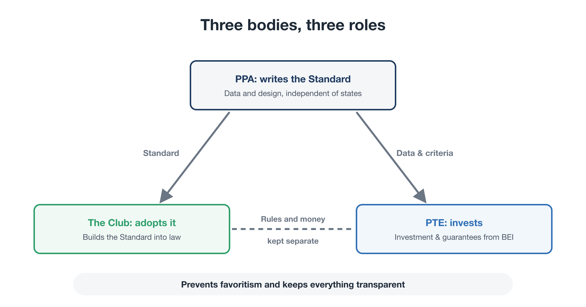
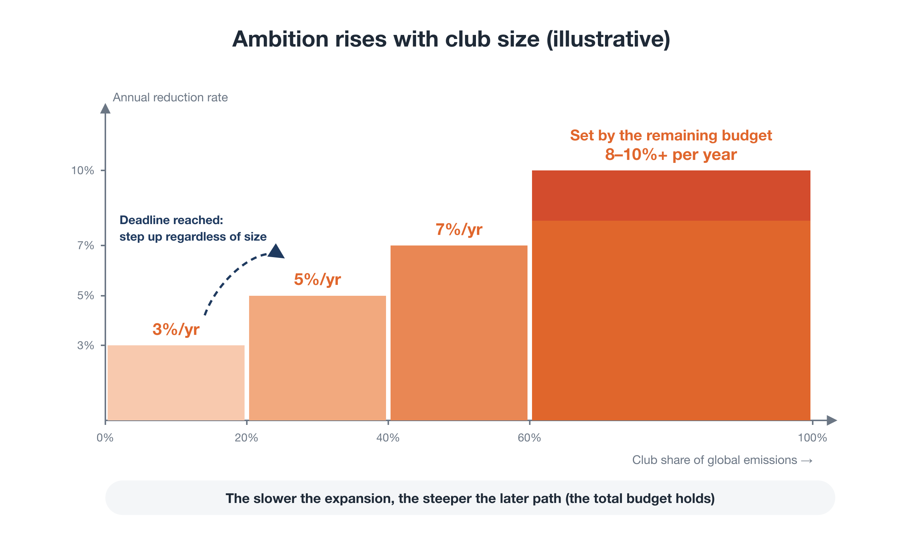
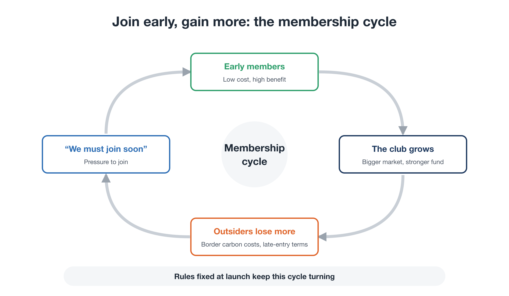

# Scaling Without a World Government

**Rewriting the Planet's OS — Part 6**

So far we have seen how Planetary OS would work inside a single country:

- a cap on fossil fuels that only ever moves down (Part 3)
- a voice for future generations in decision-making (Part 4)
- a dividend that returns the money to citizens, so that reducing pays (Part 5)

But this alone isn't enough.

**If one country imposes a strict cap alone, its industries will move elsewhere.** If one country cuts 8% a year while others increase their emissions, nothing changes for the planet.

The prisoner's dilemma from Part 3, "reducing alone means losing," also plays out between nations. And there is no world government to resolve it.

This part asks **how this system can spread across countries without a world government.**

---

## 1. "Reducing alone means losing," between nations

International climate efforts have stumbled in three main ways.

### 1. The consensus trap

As noted in Part 1, UN climate talks work by consensus. A single country whose economy depends on fossil-fuel exports can water down any meaningful agreement.

### 2. Free-riding

A stable climate benefits every country equally, whether or not it cut emissions. So every country is tempted to let others do the cutting.

### 3. Carbon leakage

A country that puts a cost on carbon alone puts its industries at a disadvantage against competitors elsewhere who pay nothing. If factories move abroad, jobs are lost at home and emissions simply move to another country.

As long as these three problems remain, no country can afford to move first.

---

## 2. A shift in approach: from universal treaties to clubs and standards

So we change the approach. **Instead of waiting for consensus among 190 countries, start with a club of willing countries and spread the system as a standard.**

This is how technical standards such as internet protocols and Wi-Fi spread. No one ordered the whole world to adopt them. As more countries and companies used them, not using them became a disadvantage, until they became the global norm.

In Planetary OS, three bodies with distinct roles drive this process:

<figure markdown="span">
  
  <figcaption>The three bodies: the PPA (writes the standard), the Club (adopts it), the PTE (invests). Rules and money are kept separate.</figcaption>
</figure>

- **The PPA** (Part 2) is an open community of scientists, citizens, and engineers, independent of any state. It writes the scientific data and the design, the **Planetary OS Standard**.
- **The Club** is the group of countries that have built the Standard into their own laws. It sets, updates, and arbitrates club rules. (In the author's related *Green Gain Economy* proposal, this is the **GGC, the Global Green Consortium**.)
- **The Planetary Transition Endowment (PTE)** invests and provides guarantees using money raised through BEI. Independent experts manage it, separately from the Club.

Keeping the body that **sets the rules** separate from the body that **moves the money** prevents investments from favoring particular countries or firms, and keeps everything transparent.

This idea of a club that is worth joining builds on the author's separate proposal, the *Green Gain Economy (GGE)*, and on the broader economics literature on climate clubs.

(See: Green Gain Economy (GGE) Policy Proposal — [↗](https://ttmori.substack.com/p/green-gain-economy-gge-policy-proposal) )

For the club to grow, it needs two forces: **reasons to join** and **costs of staying out**.

---

## 3. Joining pays

What do countries gain by joining?

### Benefit 1: energy security

For countries that import fossil fuels, a falling cap is not just a burden. It also means **a shrinking import bill**.

For many importing economies, fossil fuels are among the largest items on the national import bill. That money can stay at home as investment in renewables and efficiency. Countries also become less exposed to volatile fuel prices and to the politics of producer states. For importers, this is among the biggest benefits of all.

### Benefit 2: access to a large market

Club members grant each other preferential tariffs on goods that meet the Standard. Projects that meet it can be certified with something like a "green passport," making trade within the club smoother.

The bigger the club, the more valuable access to its market becomes.

### Benefit 3: a lower cost of capital

One of the biggest obstacles to renewables in developing countries is not technology. It is **the high cost of raising capital**: not just interest rates on loans, but also the returns equity investors demand. Currency risk and political instability add a premium, so building the same power plant can cost around twice as much to finance as in a high-income country.

That is why the PTE prioritizes **guarantees over grants**:

- absorbing the first portion of any losses (a first-loss guarantee)
- covering losses caused by currency swings

A guarantee only pays out when losses actually occur. So, when well designed, **the same money can mobilize more investment than a grant**. The PTE's most important job is to make private investors confident enough to invest.

> **Note: why haven't guarantees scaled until now?**
>
> Guarantee instruments already exist, for example within the World Bank Group. They have stayed small for several reasons:
>
> - **They depend on aid budgets.** Budgets are set year to year and stay small. When losses occur, governments face criticism for "using taxpayers' money to cover losses on foreign projects."
> - **Development banks have to be cautious.** Protecting their high credit ratings makes them reluctant to take on losses.
> - **Currency-risk tools are tiny, and the landscape is fragmented.** Instruments that absorb local-currency risk are very small, and many small funds each run their own approval process.
>
> As a result, hopes that guarantees would "multiply private investment many times over" have not been fully realized. The PTE aims to break through by combining a large, stable, independent funding base with **a mandate that explicitly includes taking losses**.
>
> **Note: won't guarantees encourage carelessness?**
>
> To prevent moral hazard:
>
> - **Cover only part of the loss.** The PTE absorbs only the first slice; investors and developers bear the rest.
> - **Cover only risks developers can't control.** Currency crashes, abrupt policy changes, and payment defaults by state utilities are covered. Construction delays and management failures are not.
> - **Charge for it.** Guarantee fees reflect risk and track record, so reliable developers pay less.
> - **Insure portfolios, not single deals.** Like an insurer, the PTE covers many projects together, using simple checks against common criteria instead of slow, bespoke screening.
> - **Respond as a club when governments break their word.** If a host government breaches its commitments, the PTE pays out, then seeks recovery from that government and reduces its club benefits.
>
> Trying to eliminate losses entirely would make the fund as overcautious as existing institutions. So an annual loss budget is set in advance, losses within it are treated as expected, and all loss records are published.

### Benefit 4: Citizen Dividends

As Part 5 showed, joining the club means auction revenue is returned directly to citizens. For governments, that is a visible achievement that underpins public support.

### Benefit 5: first-mover advantage in new industries

Firms that meet the Standard early gain a head start in the industries of the future: low-carbon steel and cement, renewables, repair and reuse.

### Benefits allocated by reduction performance

One more design choice matters here. Club benefits, such as PTE investment and guarantees and preferential tariffs, are not shared out equally. They are **allocated according to each country's reduction performance**.

Part 3 built "reducing pays" into the rules for households and firms. The same principle applies to countries. **The more a country reduces, the more benefits it receives.** That creates competition *within* the club to cut faster.

### "Isn't this a bad deal for rich countries?"

A question many readers will have.

In pure cash terms, high-income countries are **net contributors**. BEI falls more heavily on countries with more wealth and corporate profits, and much of the PTE's investment and guarantees flows to developing countries. So is the fund a losing proposition for rich countries?

Their gains come not from money received from the fund, but from **what the fund makes possible**:

- **Their own firms become the main players.** The investors, equipment suppliers, builders, and insurers in developing-country projects are often firms and financial institutions from high-income countries. Lower risk makes it easier for them to do business abroad.
- **The club grows faster.** For developing countries, the biggest reason to join is PTE investment and guarantees. A bigger club means bigger markets for high-income countries' firms, less risk of carbon leakage, and more leverage from border carbon adjustment.
- **Supply chains become more secure.** Many resources essential to decarbonization, such as critical minerals and green hydrogen, are in developing countries. Building supply chains among countries that share common standards stabilizes access.
- **Less damage comes back home.** Climate disasters in developing countries spill over to rich ones. The 2011 floods in Thailand, for example, disrupted global automotive and electronics supply chains. Reducing supply-chain shocks, food-price spikes, climate-driven migration, and conflict is in rich countries' own security interest.
- **Diplomatic influence and leadership in setting standards.** Leading a transparent, rule-based investment framework strengthens relationships with developing countries. And when the rules a country's firms already know become the global standard, that is a lasting competitive advantage.

In short, the fund is less "aid" to developing countries than **an investment in spreading, worldwide, a system that protects high-income countries' own industries.**

One more point: BEI is paid **by large concentrations of wealth and by corporate profits, not by ordinary taxpayers**. Ordinary citizens separately receive Citizen Dividends from SAS auction revenue (Part 5). So this is not "using taxpayers' money to help developing countries." It is **"those who benefited most from the fossil economy giving part of that benefit back, in a way that also protects their own country's industry and security."**

No one can guarantee, in numbers, that the gains will exceed the contribution. Most gains are indirect and take time. But compared with the costs of staying out, including mounting climate damage, border carbon charges, and lost access to growing markets, joining is the rational choice.

---

## 4. Staying out costs

What do countries face if they stay out?

### Cost 1: border carbon adjustment

Club members apply **a carbon cost, at the border, to imports from outside the club, in proportion to the carbon emitted in making them**. This extends to the whole club the Carbon Border Adjustment Mechanism (CBAM) that the EU has already begun to implement.

For a non-member, the choice becomes simple:

- **adopt a cap at home and return the revenue to its own citizens**, or
- **stay out and pay the same amount at someone else's border**.

Either way, carbon has a cost. The only difference is whether the money **goes back to its own citizens or to another country**. Adopting at home becomes the rational choice.

### Cost 2: finance and insurance

As climate disasters intensify, insurers and investors are taking climate risk more seriously. The Standard becomes a **yardstick** for that assessment.

Assets of countries and firms that don't meet it are seen as "high-risk assets" that may carry large future liabilities. Their cost of capital rises, and insurance cover gets harder to find. Even if governments hesitate, **financial markets move first**.

### Cost 3: accountability based on historical liability

The PPA's data on liability from past cumulative emissions can also support legal claims over climate damage. In 2025, the International Court of Justice delivered an advisory opinion on states' obligations regarding climate change, part of a broader trend toward legal accountability for climate harm.

For firms facing legal risk, accepting the Standard and joining the liability-settlement process becomes **a way to reduce that risk**.

---

## 5. Protecting industrial competitiveness

Even with reasons to join and costs of staying out, we need to ask whether industries inside the club will be at a disadvantage. This matters especially for energy-intensive, trade-exposed sectors such as steel, cement, chemicals, and aluminium.

Three directions:

- **Imports:** border carbon adjustment applies the same carbon cost to imports, so domestic industries don't face unfair competition from goods that pay nothing.
- **Exports:** goods sold outside the club may still be at a disadvantage. Rebating carbon costs on exports needs careful review against international trade rules. The practical answer is to **grow the club quickly and make it the main market.**
- **At home:** club governments use public procurement to buy low-carbon steel, cement, and other materials first, creating a **first buyer** for new materials and helping their costs fall with scale.

Any remaining burden is absorbed by the **sufficiency rewards** and **Just Transition** support described in Part 5.

### Industry is not monolithic

One more important point: not every firm loses under this system.

- **Losers:** firms heavily dependent on fossil fuels with no path to transition
- **Winners:** renewables, grids, efficiency, circular businesses, low-carbon materials, and insurers and financial firms that want to manage climate risk

Citizen Dividends flow into demand for lower-impact products and services, growing the winners' markets. So **a large constituency within industry emerges that supports the system**. The divide is no longer "industry versus environmentalists" but "legacy industry versus new industry plus citizens."

---

## 6. Connecting without taking away sovereignty

"Building the Standard into national law" may sound like giving up sovereignty. But Planetary OS doesn't replace any country's tax authority or parliament. It **connects to existing systems**.

<figure markdown="span">
  
  <figcaption>The PPA Standard (data and calculation rules) → a "linkage clause" in national law → existing systems: tax and cap levels update automatically; dividends go directly to citizens' accounts via existing ID and payment systems; border carbon costs are collected through existing customs</figcaption>
</figure>

Three connections are envisaged:

1. **Tax and cap:** national law gains one clause stating that "the levels of the cap and related charges are updated automatically in line with the values published in the PPA Standard." No new tax system is built from scratch.
2. **Dividend:** the revenue goes back to households through each country's existing identification and payment systems. The club agrees on the outcome: most of the revenue is returned, at least 70% of households come out ahead, and the methods are published. Whether to pay it as a direct dividend, a tax credit, or a top-up to existing benefits is each country's choice. Why share even this much, rather than only the cap? Because the return is what keeps each cap politically in place, and members cut emissions on the understanding that the others' caps will hold.
3. **Customs:** border carbon costs are collected through existing tariff infrastructure.

Each country decides for itself whether to adopt the Standard. And as described in Part 2, changing the Standard requires a double key, so no single country can rewrite it. **Shared rules, without a world government**: that is the design philosophy.

---

## 7. Who joins first?

Which countries might form the first club?

To be honest, hopes that "environmentally minded rich countries will voluntarily lead" have been disappointed many times. So we start with **countries and institutions whose interests clearly align**.

### Four likely core groups

- **Fossil-fuel importers:** clear gains in energy security and lower import bills.
- **The most climate-vulnerable countries:** for small island states facing sea-level rise, and countries hit by drought and floods, this is a matter of national survival. Liability settlement, dividends, and guaranteed investment also bring direct benefits.
- **Insurers and long-term investors:** for insurers facing mounting disaster losses and investors with long horizons, a world where emissions fall by rule protects their assets.
- **Ambitious cities and states:** they can connect to the Standard without waiting for national consensus. Once dividends start in one region, neighbors will ask, "Why don't we get this too?"

### Fossil-fuel exporters won't join at first

Countries that depend on fossil-fuel exports will probably not join at first, and the design should assume that.

That makes it decisive **how large a market the founding club can bring in**. Once a club covers a meaningful share of the global economy and trade, the forces of border adjustment and market access start to work, and membership can snowball.

<figure markdown="span">
  
  <figcaption>Three stages of spread: a founding club (importers, vulnerable countries, finance, ambitious cities) → spillover (border adjustment and access to markets and investment force a choice on non-members) → standardization (no reason left to stay out; countries connect one after another)</figcaption>
</figure>

---

## 8. How to win acceptance for an 8% annual cut

For a joining country, the biggest hurdle is the pace: around 8% a year.

So we change the approach. **Instead of demanding 8% from everyone from day one, the required pace rises in steps as the club grows.** In effect, a conditional commitment: **"we will if you will."**

(All stages and numbers below are illustrative.)

### 1. Commit to a total, not to "8% every year"

As Part 3 explained, the real commitment is the **remaining carbon budget** for staying well below 2°C. The year-by-year pace is set to fit within that total.

### 2. Raise the pace as the club grows

For example, the club-wide annual reduction rate could depend on the club's share of global emissions:

- **Under 20%:** 3% a year
- **20–40%:** 5% a year
- **40–60%:** 7% a year
- **Over 60%:** a rate derived from the remaining budget (8–10% a year or more)

<figure markdown="span">
  
  <figcaption>Club size and the reduction rate: a rising staircase</figcaption>
</figure>

While the club is small, its members are more exposed to competition from outside and to carbon leakage, so the pace starts gently. As the club grows, leakage risk falls and the benefits of membership rise, so the pace moves toward what is actually required.

As before, the pace is differentiated within the club. High-income countries with large historical emissions cut faster, developing countries more gradually, and the club as a whole meets the average.

### 3. Delay makes the later path steeper: the recalibration rule

Starting gently means catching up later. So these rules are fixed in advance:

- **Recalculate at every step.** Each time the club moves up a stage, the required rate is recalculated from the remaining budget and the years left. The slower the expansion, the steeper the later path.
- **Step up by size or by deadline, whichever comes first.** If steps depended only on size, members could keep the club small to keep targets low. So a deadline is added: "if the next stage isn't reached within X years of launch, the rate rises regardless of size."

To be honest, this does not guarantee that we stay below 2°C. If expansion is very slow, the required later pace may become unrealistic. In that case, overshoot beyond 2°C would be partly reversed through PTE investment in carbon removal. And the planetary-indicator alerts from Part 3 keep working regardless of the club's size.

Even so, starting gently, spreading reliably, and moving toward the required pace as the club grows is far more likely to work than demanding 8% from everyone and having no one join.

### 4. The earlier you join, the more you gain

This stepped design has another important effect: it **rewards joining early**.

- **Founding members** join while the pace is gentle, take a leading role in setting the Standard, and get priority access to PTE investment and guarantees.
- **Late joiners** must adopt the stricter pace in force when they join, and pay part of the BEI contributions they missed.
- **Non-members** face rising border carbon costs as the club grows and the price inside it rises.

<figure markdown="span">
  
  <figcaption>The virtuous cycle of membership: early members bear little cost and gain much → the club grows → non-members' disadvantage grows → pressure to join → the club grows further</figcaption>
</figure>

For founders, the burden is light and the gains come quickly. For those outside, waiting only makes things worse. This structure creates **the momentum that makes countries feel they have to join.**

### 5. Fix the rules at launch, and make them hard to change

The most important point of all: **all these rules are decided and published when the club is founded**:

- the size thresholds and the reduction rate for each
- the deadlines for stepping up
- when and how the required pace is recalculated
- how benefits and obligations depend on when a country joins
- the terms for late joiners

Changing these rules mid-course requires **meeting strict conditions**: the double key (scientific justification plus approval by at least three-quarters of citizens' representatives) and an overwhelming majority of member countries. Changes that loosen the rules face even stricter conditions.

Why insist on fixing the rules?

If the rules could be renegotiated at any time, countries would think, "Better terms might come along if we wait." Firms and investors couldn't plan ahead. **Because future rules are fixed and can't easily be changed, "joining now is better" becomes a rational judgment, and long-term investment starts to flow.**

Rules fixed in advance are themselves a source of momentum.

### 6. Delivering benefits early: how the endowment is used

The key to delivering early benefits to founding members is the endowment funded by historical liability (BEI).

BEI asks those who benefited from the fossil economy, meaning large concentrations of wealth and corporate profits, for a thin, broad contribution. In one illustrative estimate by the author, global adoption could raise **on the order of USD 1 trillion a year** (0.8–1.3 trillion), around ten times the USD 100 billion a year that developed countries pledged to developing countries in climate finance. Even at the club stage, members' share could amount to several hundred billion dollars a year.

The endowment is not simply accumulated. Its use changes over time (the ratios are illustrative):

- **Launch phase:** around 60% of each year's revenue is spent that year: investment and guarantees for members, support for the most climate-vulnerable countries, funding for independent science free of political or industry influence, sufficiency rewards for firms and regions, and a top-up to the Citizen Dividend. Around 40% is added to principal.
- **Mature phase:** spending falls to around 30%, with around 70% added to principal to build a lasting financial base.

Spending more in the launch phase lets **countries that join early see tangible benefits right away**. And using the endowment for guarantees as well as grants can draw in substantially more private investment.

Of course, asking large fortunes to contribute will push some wealth to move outside the club. To prevent that, members agree on **a common minimum BEI rate**, much as countries have agreed a global minimum corporate tax.

---

## 9. What finally tips the balance

We've looked at how countries might join because it pays, or because staying out costs. In the end, though, what pushes many countries over the line may be something else:

**unavoidable climate shocks**.

Simultaneous harvest failures in the world's major breadbaskets. Extreme heatwaves that shut down cities. Disasters so large they shake the foundations of insurance and finance. Such events may hit rich countries themselves.

When that happens and conventional policies are seen to fail, politics will reach for **an alternative that is already designed and already running**.

Major systemic transitions in history have rarely come from goodwill or moral awakening alone. They have come when three things lined up: the visible limits of the old system, fear of economic crisis, and an alternative ready to go.

That is why it matters to **prepare the blueprint, the club, and the endowment before the crisis, and to have them running, even on a small scale.**

---

## Closing: spreading by changing incentives, not by command

To sum up:

- Countries face their own "reducing alone means losing" dilemma, which consensus-based negotiations can't solve.
- So we start with **a club of willing countries** and spread the system **as a standard**.
- **Joining pays:** energy security, market access, guaranteed investment, Citizen Dividends, and first-mover advantage. Benefits are allocated by reduction performance.
- **Staying out costs:** border carbon adjustment, scrutiny from finance and insurance, and accountability based on historical liability.
- The system **connects** to existing tax, payment, and customs systems without taking away sovereignty.
- The pace **rises in steps as the club grows**, and a recalibration rule makes the totals add up if expansion is slow.
- Joining early pays and joining late costs. **Fixing and publishing these rules at launch, and making them hard to change**, is what creates the momentum to join.

Not waiting for a world government to issue orders, but **changing the incentives so that countries want to join**: that is how this proposal expects the system to spread.

With that, the blueprint of Planetary OS is complete. But who will actually bring it into the world, and how?

Part 7 looks back at why climate campaigns have kept losing, and proposes **shifting the movement's energy from petition to implementation.**

---

This document is also published on: [note (Japanese)](https://note.com/ttmori/n/n687934699ad7)
