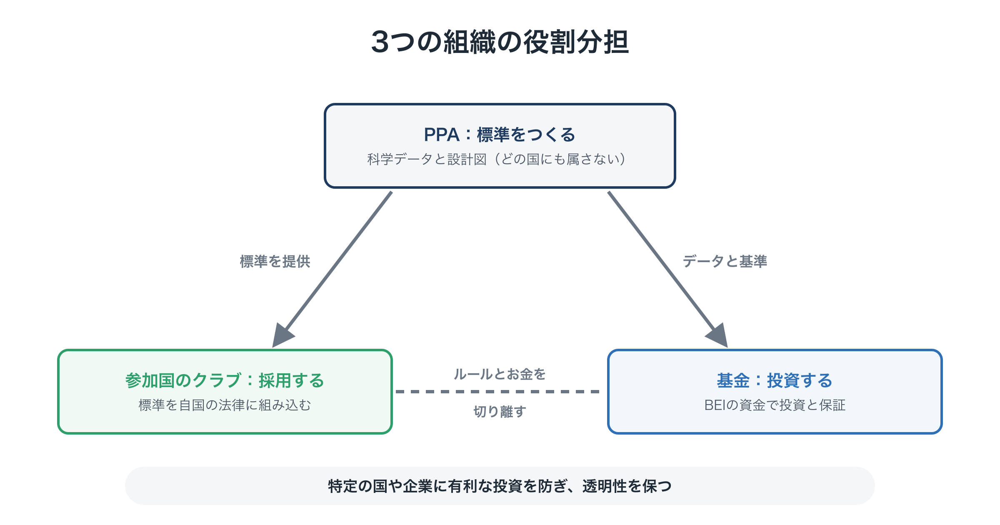
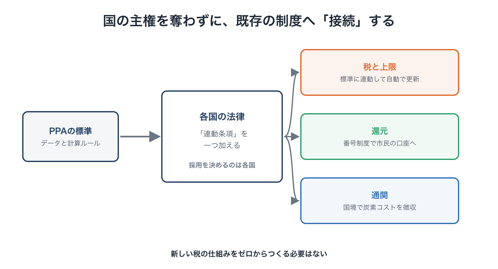
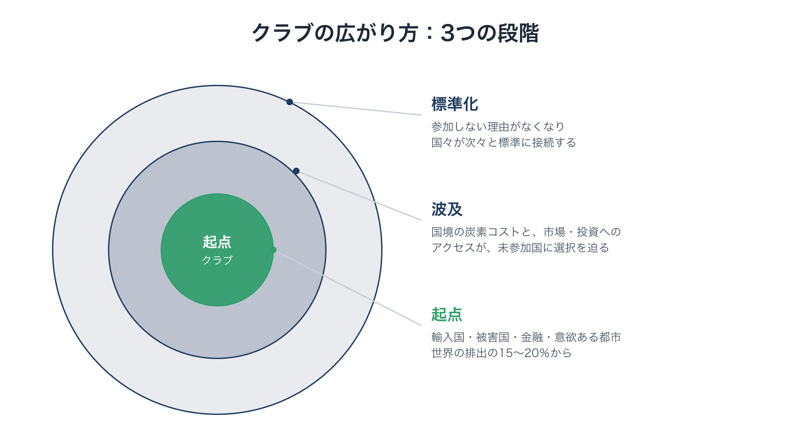
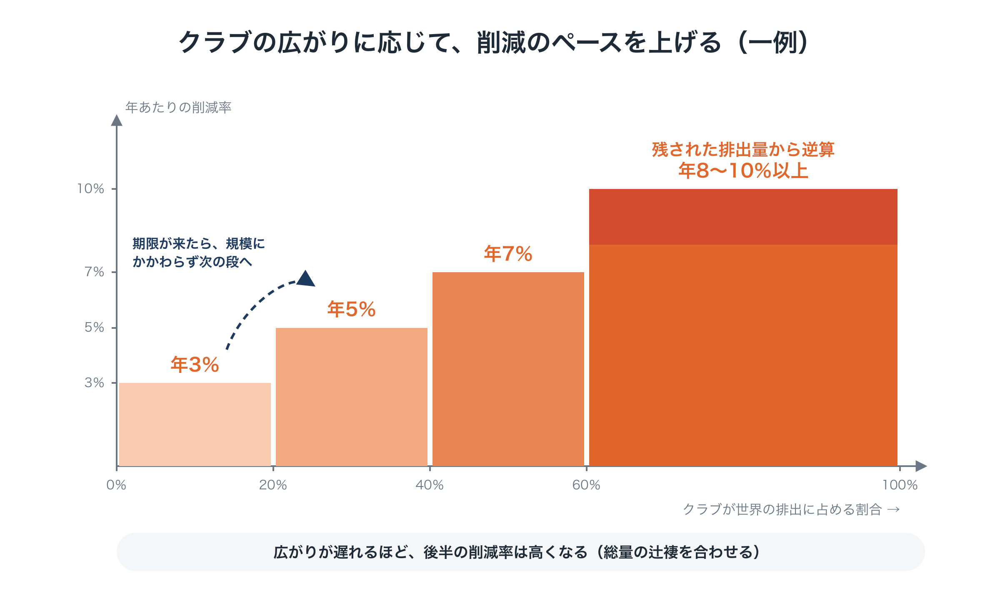
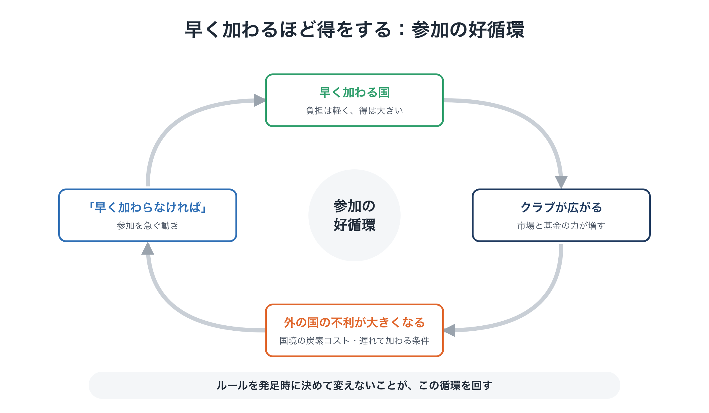

# 世界政府なしで、どう世界に広がるのか

**連載「地球のOSを書き換える」第6回**

前回までで、Planetary OS が一つの国の中でどう動くのかを見てきました。

- 化石燃料の上限を、一方向に引き下げ続ける（第3回）
- 将来世代の声を、意思決定に組み込む（第4回）
- 集めたお金を市民に還し、減らすほど得をする社会にする（第5回）

けれども、これだけでは完成しません。

**自国だけが厳しい上限を設ければ、産業は他国に流れてしまいます。** 自国だけが年8％の削減を急いでも、他の国が排出を増やせば、地球全体では何も変わりません。

第3回で紹介した「自分だけ減らすと損をする」という囚人のジレンマは、国と国のあいだでも起きています。そして、それを解く「世界政府」は存在しません。

今回は、**世界政府なしで、この仕組みがどうやって国々に広がっていくのか**を考えます。

---

## 1. 国どうしの「自分だけ損をする」

これまでの国際的な気候対策は、主に3つの点でつまずいてきました。

### ① 全会一致の罠

第1回で触れたとおり、国連の気候交渉は、加盟国の合意（コンセンサス）を基本にして物事を決めます。化石燃料の輸出で成り立つ国が一つでも反対すれば、実効性のある合意は骨抜きになります。

### ② ただ乗り

気候が安定するという恩恵は、削減した国にも、しなかった国にも等しく届きます。だから、どの国にも「他の国に減らしてもらい、自分は減らさない」という誘惑が生まれます。

### ③ 産業の流出

自国だけが炭素にコストをかけると、自国の産業は、コストのかからない国の産業との競争で不利になります。工場が海外に移れば、自国の雇用は失われ、排出は他の国に移るだけです。

この3つがある限り、どの国も「自分から先に動く」ことができません。

---

## 2. 発想の転換：「全員の条約」から「クラブと標準」へ

そこで発想を変えます。**190か国の全会一致を待つのではなく、まず意欲のある国々でクラブをつくり、その仕組みを標準として広げていく**のです。

これは、インターネットの通信規格や Wi-Fi のような技術標準が広がってきたやり方に似ています。誰かが世界中に命令して広めたわけではありません。使う国や企業が増えるほど、その標準を使わないことが不利になり、気づけば世界の基準になっていました。

Planetary OS では、役割の違う3つの組織がこの広がりを担います。

<figure markdown="span">
  
  <figcaption>3つの組織の役割分担</figcaption>
</figure>

- **PPA**：第2回で紹介した、科学者・市民・エンジニアからなる開かれた共同体です。どの国にも属さない立場で、科学データと仕組みの設計図（標準）をつくります。
- **参加国のクラブ**：その標準を自国の法律に組み込んだ国々の連合です。クラブのルールを決め、更新し、もめごとを調整します。
- **基金**：BEIで集めた基金を、クラブとは切り離された独立した専門家の判断で運用し、投資と保証を行います。

「ルールを決める組織」と「お金を動かす組織」を分けておくのは、特定の国や企業に有利な投資を防ぎ、透明性を保つためです。

この「参加すると得をするクラブ」の構想は、筆者が別に提案している「**Green Gain Economy（GGE）**」をもとにしています。

（参考：Green Gain Economy (GGE) Policy Proposal [↗](https://ttmori.substack.com/p/green-gain-economy-gge-policy-proposal) ）

クラブが広がるためには、2つの力が必要です。**参加すると得をする力**と、**参加しないと損をする力**です。順に見ていきます。

---

## 3. 参加すると得をする仕組み

まず、国がクラブに加わることで得られるものです。

### 得① エネルギーの安全保障

化石燃料を輸入に頼る国にとって、上限を引き下げることは「負担」だけではありません。**輸入代金が減っていく**ことでもあります。

日本の化石燃料の輸入額は、近年は年に20兆〜30兆円台にのぼります（2022年には30兆円を超えました）。そのお金が、国内の再エネや省エネへの投資として国内に残るようになります。燃料価格の乱高下や、産出国の政治情勢に振り回されることも少なくなります。日本、EU、韓国、インドのような輸入国にとって、これは最も大きなメリットの一つです。

### 得② 大きな市場へのアクセス

クラブの国どうしは、標準を満たした製品の関税を優遇し合います。標準を満たした事業には「グリーン・パスポート」のような認証を与え、クラブ内の取引を円滑にします。

クラブが大きくなるほど、この市場にアクセスできることの価値は増していきます。

### 得③ 資金調達コストの引き下げ

途上国で再エネの導入が進まない最大の理由の一つは、技術がないことではなく、**資金を調達するコストが高すぎる**ことです。資金調達コストとは、銀行から借りるときの金利だけでなく、出資する投資家が求める見返りも含めた、事業のお金を集めるためのコストです。途上国では、為替の変動や政治の不安定さなどのリスクが上乗せされるため、同じ発電所をつくるのでも、先進国の2倍前後の資金調達コストがかかることが珍しくありません。

そこで、基金のお金は「配る」よりも「**保証する**」ことに使います。

- 事業で損失が出たとき、最初の部分を基金が引き受ける
- 為替の変動による損失を、基金がカバーする

保証は、実際に損失が出たときにしかお金が出ていきません。そのため、うまく設計すれば、**同じ額のお金でも、補助金として配るより多くの投資を動かせます**。民間の資金が「これなら安心して投資できる」と判断できるようにすることが、基金の最も大事な役割です。

> **補足：保証の仕組みは、なぜ今まで十分に広がらなかったのか**
>
> 保証の仕組み自体は、世界銀行グループなどにすでにあります。それでも規模が足りなかったのは、主に次の理由からです。
>
> - **財源が各国の援助予算に頼っている**：毎年の予算で決まるため規模が小さく、損失が出れば「自国の税金で外国の事業の損をかぶるのか」と批判されます。
> - **国際開発銀行は慎重にならざるを得ない**：高い格付けを守るため、損失の引き受けに慎重です。
> - **為替リスクへの備えが小さく、仕組みがばらばら**：現地通貨のリスクを肩代わりする仕組みはごく小さく、多くの小さな基金がそれぞれ別の手続きで審査しています。
>
> そのため、「保証で民間の投資を何倍にも引き出す」という期待は、これまで十分には実現してきませんでした。BEIの基金は、大きく安定した独立の財源を持ち、損失を引き受けることを最初から役割とすることで、この壁を越えることを目指します。
>
> **補足：損失を引き受けると、手抜きを招かないか**
>
> いわゆるモラルハザードを防ぐために、次の設計をとります。
>
> - **一部だけを引き受ける**：基金がかぶるのは損失の最初の一部だけで、それを超える分は投資家や事業者が負います。
> - **当事者がどうにもできないリスクだけを引き受ける**：為替の急落、制度の急な変更、国営企業の支払い遅れなどは引き受けますが、工事の遅れや経営の失敗など、事業者が自分で管理できるリスクは引き受けません。
> - **料金をとる**：リスクと実績に応じた保証料をとり、きちんとした事業者ほど安く使えるようにします。
> - **まとめて引き受ける**：保険のように多くの事業をまとめて引き受け、1件ずつの重い審査ではなく、共通の基準に沿った簡単な確認で進めます。
> - **政府の約束違反には、クラブとして対応する**：受け入れ国の政府が契約を守らなかった場合、基金が払ったうえでその政府に請求し、クラブでの特典や評価も下げます。
>
> 損失をゼロにしようとすれば、今と同じように慎重すぎて投資が進みません。あらかじめ「許容する損失の枠」を決め、その範囲の損失は想定どおりと扱います。損失の記録はすべて公開します。

### 得④ 市民への還元

第5回で見たように、クラブに参加すれば、上限の競売収入が市民に直接還されます。政府にとっては、国民の支持を支える目に見える成果になります。

### 得⑤ 新しい産業での先行者利益

クラブの標準をいち早く満たした企業は、低炭素の鉄やセメント、再エネ、修理や再利用といった、これから伸びる市場で先頭に立てます。

### 得は「削減の実績」に応じて配る

ここで大事な工夫があります。基金による投資や保証、関税の優遇といった特典を、すべての参加国に一律に配るのではなく、**削減の実績に応じて配分する**のです。

第3回で、家計や企業に対して「減らすほど得をする」ルールを組み込みました。それと同じ原理を、国にも当てはめます。**多く減らした国ほど、多くの特典を受けられる。** そうすれば、クラブの中で「削減を競い合う」動きが生まれます。

### 先進国にとっては、損にならないのか

ここで、多くの人が抱く疑問に答えておきます。

お金の出し入れだけを見れば、先進国は**出す側**になります。BEIの負担は資産や企業の利益が多い先進国ほど大きく、保証や投資の多くは途上国に向かうからです。では、先進国にとって、この基金は損なのでしょうか。

先進国にとっての得は、基金から直接受け取るお金ではなく、**基金があることで生まれる効果**のほうにあります。

- **自国の企業が主な担い手になる**：途上国で投資し、設備を納め、建設を担い、保険を引き受けるのは、多くの場合、先進国の企業や金融機関です。保証でリスクが下がれば、自国の企業が海外で事業を進めやすくなります。
- **クラブが早く大きくなる**：途上国にとって、クラブに加わる最大の動機は、基金による投資と保証です。クラブが大きくなれば、先進国の企業が売れる市場が広がり、産業が流出するおそれは小さくなり、国境で炭素コストを課す仕組みの圧力も強まります。
- **資源と供給網が安定する**：重要な鉱物やグリーン水素など、脱炭素に欠かせない資源の多くは途上国にあります。共通の標準を持つ国どうしで供給網をつくれば、資源の確保が安定します。
- **自国に跳ね返る被害を減らせる**：途上国の気候災害は、先進国にも跳ね返ってきます。2011年のタイの大洪水では、現地に工場を持つ日本のメーカーが大きな打撃を受けました。供給網の寸断、食料価格の高騰、気候による移民や紛争を減らすことは、先進国自身の安全保障です。
- **外交上の発言力と、標準づくりの主導権**：透明で共通のルールに基づく投資の枠組みを主導することは、途上国との関係を強めます。自国の企業が慣れたルールが世界の基準になれば、長く続く競争上の強みにもなります。

つまり、この基金は途上国への「援助」というより、**先進国の産業を守る仕組みを世界に広げるための投資**なのです。

もう一つ大事な点があります。BEIを負担するのは、先進国の**一般の市民ではなく、大きな資産を持つ層と企業の利益**です。一般の市民は、それとは別に、SASの競売収入から還元を受け取ります（第5回）。そのため、「国民の税金で途上国を助けるのか」という構図にはなりません。代わりに、**「化石燃料経済で最も恩恵を受けてきた層が、その恩恵の一部を返し、それが自国の産業と安全を守る投資にもなる」**という構図になります。

もちろん、出したお金以上の得が確実に返ってくると、数字で保証することはできません。得の多くは間接的で、時間もかかります。それでも、気候被害の拡大、国境での炭素コストの負担、成長する市場の喪失といった、参加しない場合の代償と比べれば、参加するほうが合理的な選択だと考えます。

---

## 4. 参加しないと損をする仕組み

次に、クラブに加わらない国が直面するものです。

### 損① 国境での炭素コストの調整

クラブの国々は、**クラブの外から輸入する製品に対して、その製品をつくるときに出た炭素の量に応じたコストを、国境で課します**。EUがすでに始めている「炭素国境調整措置（CBAM）」を、クラブ全体に広げる形です。

クラブに入っていない国の立場から見ると、次の二択になります。

- **自国でも上限を導入し、そのお金を自国の市民に還す**
- **導入せず、同じ額をクラブの国の税関に払う**

どちらにしても、炭素のコストはかかります。違うのは、そのお金が**自国の市民に還るのか、他国に払われるのか**だけです。こうなれば、自国で導入するほうが合理的な選択になります。

### 損② 金融と保険の評価

気候災害が激しくなるにつれて、保険会社や投資家は、気候のリスクを真剣に評価し始めています。クラブの標準は、その評価の「物差し」になります。

標準を満たさない国や企業の資産は、将来大きな負債を負うおそれのある「リスクの高い資産」と見なされ、資金調達のコストが上がったり、保険を引き受けてもらえなくなったりします。政府が参加をためらっていても、**金融市場の側が先に動く**のです。

### 損③ 過去の負債に基づく責任の追及

PPAが算定する「過去の累積排出の負債」のデータは、気候被害の責任を問う訴訟の根拠にもなりえます。2025年には国際司法裁判所が、気候変動に関する国家の義務について勧告的意見を示すなど、気候の責任を法の場で問う流れは強まっています。

訴訟のリスクを抱えた企業にとって、クラブの標準を受け入れて負債の清算に参加することは、**法的なリスクを減らす道**にもなります。

---

## 5. 産業の競争力を、どう守るのか

「参加すると得」「参加しないと損」の仕組みがあっても、クラブの中の産業が国際競争で不利にならないかは、別に考える必要があります。特に、エネルギーを大量に使い、国際競争にさらされている鉄鋼、セメント、化学、アルミなどの産業です。

輸入、輸出、国内の3方向で考えます。

- **輸入**：クラブの外から入ってくる製品には、国境で同じ炭素コストを課します。国内の産業は、炭素のコストを払っていない海外製品と不公平な競争をせずに済みます。
- **輸出**：クラブの外へ売る製品は、不利になる可能性が残ります。輸出時にコストを払い戻す方法は、国際貿易のルールとの関係で慎重な検討が必要です。現実的な答えは、**クラブを早く大きくし、クラブの中を主な市場にする**ことです。
- **国内**：クラブの政府調達で、低炭素の鉄やセメントなどを優先して買います。新しい素材に「最初の買い手」をつくり、量産によるコストの低下を後押しします。

それでも残る負担は、第5回で紹介した**縮小への報酬**と**働く人への移行支援**で受け止めます。

### 産業界は一枚岩ではない

もう一つ大事な点があります。この仕組みで損をするのは、すべての企業ではありません。

- **損をする側**：化石燃料に大きく依存し、転換の道を持たない企業
- **得をする側**：再エネ、送電網、省エネ、循環型の事業、低炭素素材、気候リスクに備えたい保険・金融

市民に還元されたお金は、負荷の低い製品やサービスへの需要として、得をする側の市場を大きく育てます。そのため、**産業界の中に、この仕組みを支持する大きな勢力が生まれます**。「産業界対環境派」という対立ではなく、「古い産業対新しい産業と市民」という構図に変わるのです。

---

## 6. 国の主権を奪わずに、どうつなぐのか

「クラブの標準を自国の法律に組み込む」と聞くと、国の主権が奪われるように感じるかもしれません。けれども、Planetary OS は、各国の税務署や議会に取って代わるものではありません。**既存の制度に「接続」する**ものです。

<figure markdown="span">
  
  <figcaption>既存の制度への接続</figcaption>
</figure>

具体的には、次の3つの接続を想定しています。

1. **税と上限**：国の法律に、「上限や課金の水準は、PPAの標準が示す数値に連動して、自動的に更新される」という条項を一つ加えます。新しい税の仕組みをゼロからつくる必要はありません。
2. **還元**：日本ならマイナンバーのように、各国がすでに持っている番号制度や振込の仕組みを使って、市民の口座に直接振り込みます。クラブで決めるのは「結果」です。収入の大部分を家計に還すこと、少なくとも7割の世帯の手取りがプラスになること、還し方を公開することです。直接の振り込み、税額控除、既存の給付への上乗せのどれで還すかは、各国が選べます。上限だけでなく、ここまでを共通にするのは、還元こそが上限を政治的に守る仕組みであり、加盟国は互いの上限が守られることを前提に減らしているからです。
3. **通関**：既存の関税の仕組みの上で、国境での炭素コストを徴収します。

標準を採用するかどうかを決めるのは、あくまで各国です。そして第2回で紹介したとおり、標準そのものを変えるには「二重の鍵」が必要で、特定の国が勝手に書き換えることはできません。**世界政府をつくらずに、共通のルールで動く**。それがこの設計の考え方です。

---

## 7. 誰が最初に加わるのか

では、最初にクラブをつくるのは、どの国でしょうか。

正直に言えば、「環境意識の高い先進国が自発的にリーダーシップをとる」という期待は、これまで何度も裏切られてきました。そこで、**利害がはっきりと一致する国々や組織**から始めることを考えます。

### 中心になりうる4つの勢力

- **化石燃料の輸入国**：エネルギーの安全保障と輸入代金の削減という、明確な得があります。日本、EU、韓国などです。
- **気候変動の被害を最も受けやすい国々**：海面上昇に直面する小さな島国や、干ばつや洪水に苦しむ国々にとって、これは国の存続がかかった問題です。過去の負債の清算や還元、保証による投資は、直接の利益にもなります。
- **保険と金融**：激しくなる気候災害による損失に苦しむ保険会社や、長期的な投資家にとって、ルールに基づいて排出が減っていく世界は、資産を守ることにつながります。
- **意欲のある都市や州**：国全体の合意を待たずに、州や大都市が先に標準に接続することもできます。ある地域で還元が始まれば、隣の地域の住民から「なぜうちでは受け取れないのか」という声が上がるでしょう。

### 産油国は、最初は加わらない

一方、化石燃料の輸出に頼る国々は、最初は加わらないでしょう。それを前提に設計する必要があります。

だからこそ、**最初のクラブにどれだけ大きな市場を取り込めるか**が決定的に重要です。世界の経済や貿易の15〜20％程度を占めるクラブができれば、国境での調整と市場へのアクセスの力が働き始めます。そこから、雪崩のように参加国が増えていく道筋が見えてきます。

<figure markdown="span">
  
  <figcaption>クラブの広がり方</figcaption>
</figure>

---

## 8. 年8％の削減を、どう受け入れてもらうか

クラブに加わる国にとって、最大のハードルは、やはり年8％前後という削減のペースです。

ここで発想を変えます。**最初から全員に8％を求めるのではなく、クラブが広がるにつれて、削減のペースを段階的に上げていく**のです。いわば「他の国もやるなら、うちもやる」という、条件付きの約束です。

（以下で示す段階や数値は、すべて考え方を示すための一例です。）

### ① 約束するのは「毎年8％」ではなく「総量」

第3回で書いたとおり、守るべき約束は、2℃を下回るために残された**排出量の総量**です。年ごとのペースは、その総量に収まるように組み立てます。

### ② クラブの規模に応じて、削減のペースを上げていく

たとえば、クラブが世界の排出に占める割合に応じて、クラブ全体の年あたりの削減率を次のように決めておきます。

- **20％未満**：年3％
- **20〜40％**：年5％
- **40〜60％**：年7％
- **60％以上**：残された排出量から逆算した率（年8〜10％以上）

<figure markdown="span">
  
  <figcaption>クラブの規模と削減率</figcaption>
</figure>

クラブが小さいうちは、クラブの外との競争にさらされる度合いが大きく、産業が流出するおそれも大きくなります。だから、最初は緩やかに始めます。クラブが大きくなれば、流出のおそれは小さくなり、参加の得は大きくなります。そこで、ペースを本来必要な水準へと近づけていきます。

これまでと同じく、クラブの中では国ごとに差をつけます。過去に多く排出してきた先進国はより速く、途上国はより緩やかに削減し、クラブ全体の平均でこの率を確保します。

### ③ 遅れれば、後半が急になる：計算し直しのルール

最初を緩やかにすれば、当然、その分を後で取り戻さなければなりません。そこで、次のルールをあらかじめ決めておきます。

- **段階が上がるたびに、必要なペースを計算し直す**：残された排出量の総量と残りの年数から、必要な削減率を計算し直します。広がりが遅れれば遅れるほど、後半のペースは急になります。
- **「規模」か「期限」か、早いほうで段階を上げる**：規模の条件だけだと、「クラブを小さいままにしておけば、削減は緩やかで済む」という抜け道ができてしまいます。そこで、「発足から〇年以内に次の段階に達しなければ、規模にかかわらず率を上げる」という期限を設けます。

正直に書いておくと、この仕組みで2℃に間に合うという保証はありません。広がりがあまりに遅ければ、後半に必要なペースは現実的でない水準になります。その場合は、2℃を超えてしまう分を、基金による大気中のCO₂の回収で少しでも取り戻すことになります。また、第3回で紹介した、地球の観測データに応じた警報は、クラブの規模とは関係なく働き続けます。

それでも、最初から全員に8％を求めて誰も参加しないよりは、**緩やかに始めて確実に広がり、広がるほど必要なペースに近づいていく**設計のほうが、現実に動かせる見込みははるかに高いと考えます。

### ④ 早く加わるほど得をする

この段階的な設計には、もう一つ大事な効果があります。**早く加わるほど得をする**構造をつくれることです。

- **最初に加わる国**：削減のペースが緩やかな時期から参加でき、標準づくりで主導的な役割を担い、基金の投資や保証も優先的に受けられます。
- **後から加わる国**：参加した時点の、すでに厳しくなったペースをそのまま受け入れます。さらに、参加していなかった期間のBEIの一部を、さかのぼって負担します。
- **加わらない国**：クラブが大きくなるほど、クラブの中の炭素価格は上がり、国境で課される炭素コストも重くなります。

<figure markdown="span">
  
  <figcaption>参加の好循環</figcaption>
</figure>

最初に加わる国にとっては、負担が軽く、目に見える得がすぐに手に入る。外にいる国にとっては、待てば待つほど不利になる。この構造が、**「参加しなくては」と思わせる勢い**を生み出します。

### ⑤ ルールは最初に決め、途中で簡単には変えない

ここで最も大切なのは、これらのルールを**クラブの発足時に、すべて決めて公開しておく**ことです。

- 規模の段階と、それぞれの削減率
- 段階を上げる期限
- 必要なペースを計算し直すタイミングと、その計算方法
- 参加のタイミングによって変わる得と負担
- 後から加わる国の条件

そして、これらのルールを途中で変えるには、**厳しい条件**をクリアしなければならないようにします。科学者によるデータの裏付けと、市民の代表による4分の3以上の承認という「二重の鍵」に加えて、参加国の圧倒的多数の同意を必要とします。特に、ルールを緩める方向の変更には、さらに厳しい条件を課します。

なぜ、ここまでルールの固定にこだわるのでしょうか。

ルールが途中でいくらでも変えられるなら、国々は「待っていれば、もっと有利な条件が出てくるかもしれない」と考えます。企業や投資家も、将来の見通しを立てられません。**先のルールが決まっていて、変えられないからこそ、「今加わるのが得だ」という判断が成り立ち、長期の投資も動き出す**のです。

ルールがあらかじめ決まっていること自体が、勢いを生む力になります。

### ⑥ 得を先に届ける：基金の使い方

早く加わる国に得を先に届けるうえで、中心になるのが、過去の負債（BEI）から集める基金です。

BEIは、化石燃料経済から恩恵を受けてきた側、つまり大きな資産や企業の利益に、薄く広く負担を求める仕組みです。筆者の試算の一例では、世界全体で導入した場合、**年に約1兆ドル規模**（0.8〜1.3兆ドル）になります。これは、先進国が途上国に約束してきた気候資金の目標（年1,000億ドル）の約10倍の規模です。クラブの段階でも、参加国の分だけで年に数千億ドル規模が見込めます。

（参考：関連記事「気候不公正の解決（6-3）：政策白書案——持続可能社会のための新しい社会契約」）

この基金は、全額を積み立てるのではなく、時期によって使い分けます（比率は一例です）。

- **立ち上げ期**：毎年集まるお金の6割程度を、その年のうちに使います。参加国への投資と保証、気候の被害を受けやすい国への支援、政治や業界から独立した科学の研究への資金、企業と地域への縮小報酬、そして市民への還元の上乗せです。残りの4割程度は、元本として積み立てます。
- **成熟期**：その年に使う分を3割程度に下げ、7割程度を元本として積み立て、長く続く財源にしていきます。

立ち上げ期に多くを使うのは、**クラブに加わった国が、すぐに目に見える得を受け取れるようにするため**です。そして、基金のお金を補助金として配るだけでなく、損失の一部を引き受ける「保証」として使えば、民間の投資を何倍にも引き出せます。

もちろん、富裕層の資産に負担を求めれば、資産をクラブの外に移そうとする動きも出てきます。それを防ぐために、法人税の国際的な最低税率と同じように、**参加国のあいだでBEIの最低水準をそろえる**必要があります。

---

## 9. 最後に背中を押すもの

ここまで、国々が「得だから」「損をしたくないから」クラブに加わる仕組みを見てきました。それでも、最後に多くの国の背中を押すのは、おそらく別のものです。

**避けられない気候のショック**です。

世界の主要な穀倉地帯で同時に不作が起きる。極端な熱波で都市の機能が止まる。巨大な災害で、保険と金融の仕組みが揺らぐ。そうした事態が、先進国自身を直撃する日が来るかもしれません。

そのとき、従来の政策が通用しないと分かった政治は、**すでに用意され、すでに動いている代わりの仕組み**に手を伸ばすはずです。

歴史上の大きな仕組みの転換も、国々の善意や道徳的な目覚めだけで起きたことはほとんどありません。古い仕組みの限界、経済的な危機への恐れ、そして代わりの仕組みの存在。この3つがそろったときに起きてきました。

だから大切なのは、危機が来る前に、**設計図とクラブと基金を準備し、小さくても実際に動かしておくこと**です。

---

## おわりに：命令ではなく、損得の構造で広げる

今回の内容をまとめます。

- 国どうしにも「自分だけ減らすと損をする」ジレンマがあり、全会一致の国際交渉では解けない
- そこで、**意欲のある国々のクラブ**から始め、その仕組みを**標準として**広げていく
- **参加すると得をする**：エネルギーの安全保障、市場へのアクセス、保証による投資、市民への還元、新しい産業での先行者利益。しかも、特典は削減の実績に応じて配る
- **参加しないと損をする**：国境での炭素コストの調整、金融と保険の評価、過去の負債に基づく責任の追及
- 国の主権を奪わず、既存の税・還元・通関の仕組みに**接続**する
- 削減のペースは、クラブの広がりに応じて段階的に上げ、遅れれば後半が急になるルールで総量の辻褄を合わせる
- 早く加わるほど得をし、遅れるほど不利になる。こうしたルールを**発足時にすべて決めて公開し、途中で簡単には変えられないようにする**ことが、「参加しなくては」という勢いを生む

世界政府に命令してもらうのではなく、**損得の構造そのものを変えることで、国々が自ら加わりたくなる**ようにする。それが、この構想が描く広がり方です。

ここまでで、Planetary OS の設計図はひととおり描き終えました。では、この設計図を、誰が、どうやって現実の世界に持ち込むのでしょうか。

次回は、これまでの気候運動がなぜ勝てなかったのかを振り返り、**運動の向け先を「請願」から「実装」へ切り替える**ことを考えます。
