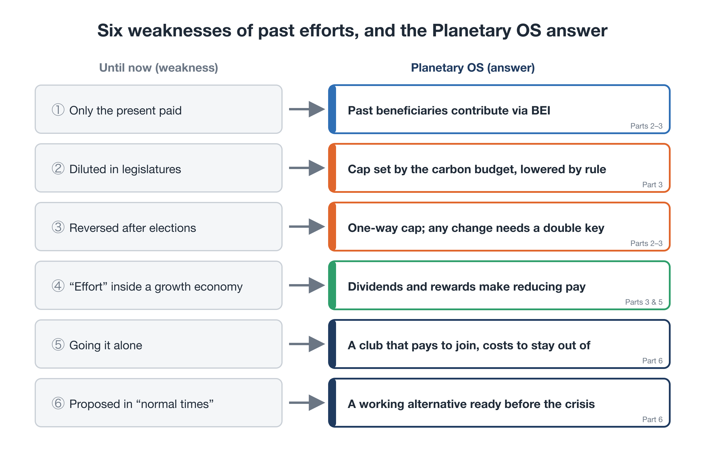
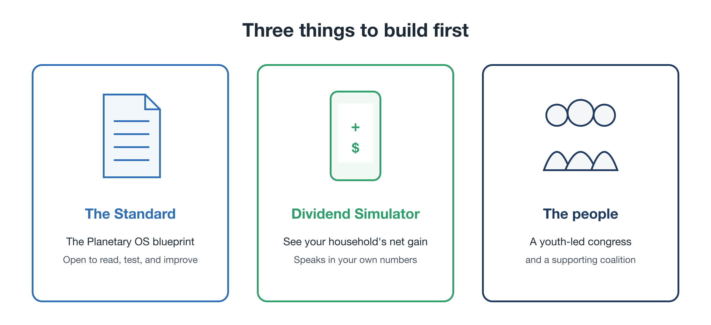

# Why Climate Campaigns Keep Losing: From Petition to Implementation

**Rewriting the Planet's OS — Part 7**

With Part 6, the blueprint of Planetary OS is complete:

- share historical liability (BEI)
- put a cap on future emissions that only moves down (SAS)
- return the money to citizens, so that reducing pays
- give future generations a voice in decisions
- spread through a club that pays to join and costs to stay out of

So who will bring this blueprint into the real world, and how?

First, one question needs an honest answer: **why have climate campaigns kept losing?** To avoid repeating the same mistakes, that is where this part begins.

---

## 1. "Carbon fee and dividend" is not a new idea

You may be thinking: "Putting a price on carbon and giving the money back to people? I've heard that before." You're right.

The idea of carbon **fee and dividend**, or **cap and dividend**, has been around for at least two decades. In the United States, citizen groups have campaigned for it with remarkable persistence, and bills have been introduced in Congress repeatedly. None has passed.

Elsewhere, carbon pricing has stumbled again and again:

- **Australia** introduced a carbon price in 2012 and repealed it in 2014 after a change of government.
- In **Washington State**, voters rejected carbon-pricing ballot initiatives in both 2016 and 2018.
- In **France**, a planned fuel-tax increase triggered mass protests and was abandoned.
- In **Canada**, the consumer carbon charge, which came with household rebates, was abolished in 2025 (Part 5).

The idea itself wasn't wrong. So why did it keep losing?

---

## 2. Six weaknesses shared by the efforts that failed

Looking back, the same weaknesses recur. The design of Planetary OS in this series answers each of them.

<figure markdown="span">
  
  <figcaption>Six weaknesses of past efforts, and the Planetary OS answer to each</figcaption>
</figure>

### Weakness 1: only the present paid

**Until now:** only annual emissions were priced. Those who grew rich on decades of past emissions kept their gains, and the burden fell on today's consumers and industries.

**Planetary OS:** those who benefited from the past contribute through BEI. The burden isn't placed on the present alone (Parts 2 and 3).

### Weakness 2: diluted in legislative bargaining

**Until now:** tax rates and caps were negotiated in legislatures, where industry pressure kept them too low to matter.

**Planetary OS:** the cap is derived from the remaining carbon budget and falls automatically, by rule (Part 3).

### Weakness 3: reversed after elections

**Until now:** whatever one government introduced, the next could repeal.

**Planetary OS:** the cap only moves one way, and changing the rules requires a double key. No single government can hollow it out (Parts 2 and 3).

### Weakness 4: cutting through "effort" inside a growth economy

**Until now:** the economy still rewarded expansion, so reducing was a loss for everyone.

**Planetary OS:** a universal dividend plus a sufficiency-linked dividend, and sufficiency rewards for firms and regions, change the rules themselves so that reducing pays (Parts 3 and 5).

### Weakness 5: going it alone

**Until now:** efforts stalled on free-riding: "if others don't act, we lose competitiveness."

**Planetary OS:** a club combining reasons to join with border carbon adjustment for those outside, plus rules fixed in advance that reward joining early (Part 6).

### Weakness 6: proposed in "normal times"

**Until now:** to people who felt things were still fine, the immediate pain of higher prices outweighed distant risks.

**Planetary OS:** a working alternative is prepared in advance, so that when climate shocks deepen and conventional policy fails, it is **already designed and already running, even on a small scale** (Part 6).

---

Laid out like this, it's clear that past efforts didn't lose because the idea was wrong. They lost because **they tried to push the right idea through on top of broken rules.**

---

## 3. Where has the movement's energy gone?

There is something else worth looking back on: **where the movement's energy has been directed.**

As Part 1 noted, climate funding and public passion have mostly gone into two things:

1. **raising awareness of how serious the crisis is**
2. **asking politicians to pass good laws**

Both mattered. Public awareness of the crisis has spread worldwide largely thanks to these campaigns.

But the second, the **petition**, had structural limits. In legislatures, campaigners can't match industry's financial power. Even when laws pass, they are diluted in negotiation and repealed after a change of government.

The sense of futility, "we've tried so hard and nothing changes," is not because the people in these movements didn't try hard enough. It is because **they kept fighting on their opponent's home ground, by their opponent's rules.**

---

## 4. A shift in approach: from petitions to specifications

So what should change?

The history of the internet offers a clue. The protocols that run the internet weren't enacted by any national parliament. Engineers **published working specifications and code first**, and they became global standards as more people and organizations adopted them.

Open-source software such as Linux spread the same way. No one asked permission. People built something that worked, published it, and people around the world improved it and used it.

Apply that to social systems:

- **Until now:** debate → political compromise → weak targets → targets not met
- **From now on:** write the specification → citizens verify it → test it at small scale → ask politics, "Will you connect to this?"

**Instead of asking politicians to please pass good laws, citizens, scientists, and engineers build a working system first and show it.** That is the shift this series proposes for the movement.

---

## 5. Changing the question we put to politics

This shift changes the question we put to politicians.

**The old question:**
"By how many percent will you cut emissions by 2030?"

That question is easy to dodge. A politician can announce a target and postpone the measures.

**The new question:**
"Will you connect your country, or your city, to this system, the Planetary OS Standard: yes or no?"

That question is much harder to fudge. The system already exists, its contents are public, and the results of pilots elsewhere are visible.

And citizens will have used the simulator to see how much their own household would receive if their government connected. "Why can't *we* get this dividend?" can become an election issue.

Of course, connecting a country or city to the system still requires a decision by its legislature. Politics can't be bypassed. But **drafting and negotiating new legislation from scratch leaves far more room for dilution than deciding whether to connect to a system that already works.**

---

## 6. Three things to build first

To set this shift in motion, three things are needed first:

<figure markdown="span">
  
  <figcaption>The three things to build first: (1) the Planetary OS Standard (the blueprint); (2) the Citizen Dividend Simulator (a tool that shows each household's net position); (3) the people to carry it (a youth-led body and the coalition behind it)</figcaption>
</figure>

### 1. The Standard

The design laid out in this series becomes a **public specification** that anyone can read, verify, and propose improvements to. It covers the rules for lowering the cap, the dividend, how BEI is calculated, the club's membership rules, and how to connect to existing systems.

### 2. The Citizen Dividend Simulator

A tool where you enter where you live and how you live, and see: "If this system ran, how much more would I pay, how much would I receive, and what would I be left with?"

Instead of abstract arguments about the need to decarbonize, it shows **people the specific numbers for their own household**, which can engage people across political and ideological lines. For a movement, it's the most powerful communication tool there is.

### 3. The people who carry it

Someone has to carry the Standard and the simulator, spread them through society, and put the question to politics. This series envisions **a youth-led body** at the center, supported by a coalition of established organizations and experts. Part 8 covers this in detail.

---

## 7. The resources already exist

"Starting something like this would take huge amounts of money and talent," you may think. But many of the resources needed already exist. What has been missing is **a blueprint that connects them.**

- **Money:** large pools of private capital are looking for sustainable destinations. A concrete, investable system could set it moving.
- **Knowledge:** climate scientists, economists, financial experts, international lawyers, and open-source engineers have each worked within their own fields. A shared blueprint can bring that knowledge together.
- **Passion:** the energy of young people who have taken to the streets can be channeled into a movement with a concrete goal: spreading this system and pressing local politicians to connect to it.

You don't need to push the whole ocean to change a ship's course. **Turning the rudder a few degrees is enough.**

If even a small share of the money and talent that has gone into petitioning were redirected to the Standard, the simulator, and the people who carry them, gears that have been spinning freely could start to engage.

---

## 8. A way to build it together

When many organizations and experts try to work together, turf battles tend to follow. So the joint effort follows the model of open-source software development.

### Working groups by field

The Standard is developed by working groups such as:

- **Economics and dividends:** design of the dividend and the simulator
- **Science and the cap:** rules for lowering the cap, and planetary indicators
- **Law:** how to connect to existing systems, border adjustment, and how to handle historical liability

### Outputs published as a shared standard

Outputs are published **as a shared standard**, not under any one organization's name. Each organization and individual can show what they contributed. The standard grows as the sum of everyone's contributions, not as one person's achievement. That makes it safe for many people to join.

### Redirecting funding

We also propose changing where funding for the movement goes:

- **Until now:** lobbying legislatures, short-term campaigns, statements
- **From now on:** a specification, a simulator, and pilots that anyone can keep using

Lobbying gains can vanish with a change of government. A specification and a simulator, once built, are **lasting assets that communities and organizations around the world can reuse.**

---

## 9. Not a rejection of past movements

To avoid any misunderstanding:

This part does not say "past campaigns were wasted." It was precisely these movements that alerted the world to the seriousness of the crisis and changed how many people think. Lobbying legislatures will still be needed in many situations.

What this part proposes is to **redirect part of the movement's energy from petition to implementation.**

The knowledge, networks, and trust that past movements have built up are the most valuable assets this new effort could have.

---

## Closing: stop petitioning, start showing the blueprint

To sum up:

- Fee and dividend has been around for a long time, but it kept losing because **it tried to win on top of broken rules.**
- The efforts that failed shared six weaknesses: **only the present paid, dilution in legislatures, reversal after elections, cutting within a growth economy, going it alone, and being proposed in normal times.** Planetary OS is designed to answer each one.
- The movement's energy should shift from **petitioning** politicians to **implementation**: building a working system first and showing it.
- The first things to build are **the Standard, the Citizen Dividend Simulator, and the people who carry them.**
- The resources already exist. What was missing was a blueprint to connect them.

So who takes the first step, and how?

In the final part, we'll look at **the blueprint and the youth-led body that will carry it**, and map out how one person's idea can grow into a movement that engages the world.

---

This document is also published on: [note (Japanese)](https://note.com/ttmori/n/n036203038185)
