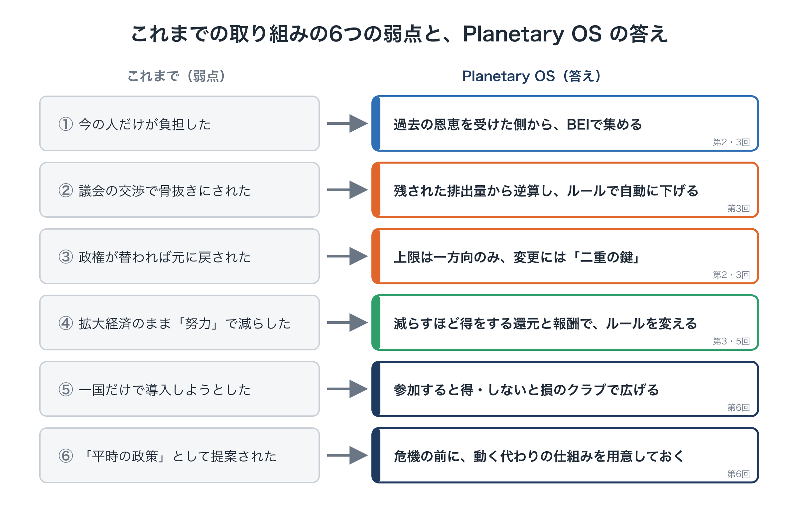
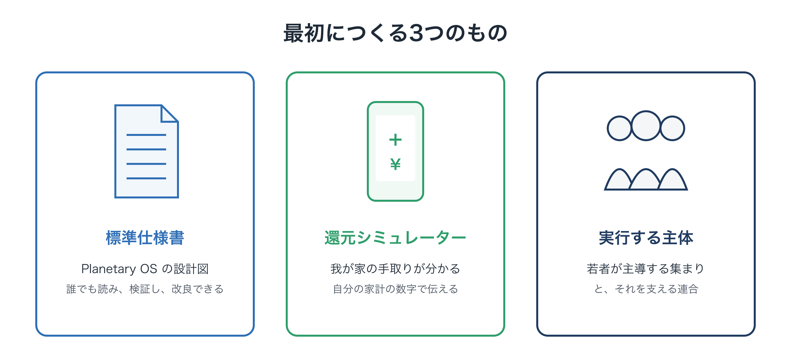

# なぜ今までの運動は勝てなかったのか：請願から実装へ

**連載「地球のOSを書き換える」第7回**

前回までで、Planetary OS の設計図はひととおり描き終えました。

- 過去の負債を分かち合う（BEI）
- これからの排出に、一方向に下がり続ける上限をかける（SAS）
- 集めたお金を市民に還し、減らすほど得をする社会にする
- 将来世代の声を意思決定に組み込む
- 参加すると得をし、参加しないと損をするクラブで、国々に広げていく

では、この設計図を、誰が、どうやって現実の世界に持ち込むのでしょうか。

その前に、一つ振り返っておくべきことがあります。**これまでの気候運動は、なぜ勝てなかったのか**です。同じ失敗を繰り返さないために、今回はそこから始めます。

---

## 1. 「炭素税と配当」は、ずっと前からあった

ここまで読んで、「炭素に価格をつけて、そのお金を市民に配るという考えは、前から聞いたことがある」と思った方もいるでしょう。その通りです。

「炭素税と配当（フィー・アンド・ディビデンド）」という考え方は、20年以上前から提案されてきました。アメリカでは市民団体が粘り強く働きかけ、議会には何度も法案が提出されています。けれども、成立には至っていません。

ほかの国でも、炭素への価格づけは何度もつまずいてきました。

- **オーストラリア**では、2012年に導入された炭素価格の制度が、政権交代を経て2014年に廃止されました。
- **アメリカのワシントン州**では、炭素への課金を問う住民投票が、2016年と2018年に続けて否決されました。
- **フランス**では、燃料への課税強化が大規模な抗議運動を招き、撤回されました。
- **カナダ**では、家庭への還付とセットの炭素課金が、2025年に廃止されました（第5回）。

考え方そのものが間違っていたわけではありません。それなのに、なぜ何度も敗れてきたのでしょうか。

---

## 2. 敗れてきた仕組みに共通する6つの弱点

これまでの取り組みを振り返ると、共通する弱点が見えてきます。そして、この連載で描いてきた Planetary OS の設計は、その一つひとつに答えるように組み立てられています。

<figure markdown="span">
  
  <figcaption>6つの弱点と答え</figcaption>
</figure>

### 弱点① 今の人だけが負担した

**これまで**：対象は毎年の排出（フロー）だけでした。過去に大量に排出して豊かになった側の恩恵はそのままで、負担は今の消費者と産業にかかりました。

**Planetary OS**：過去の恩恵を受けてきた側から、BEIで負担を集めます。負担を「今の人」だけに負わせません（第2回・第3回）。

### 弱点② 議会の交渉で、骨抜きにされた

**これまで**：税率や上限は、議会の交渉で決まりました。産業界の強い働きかけを受けて、実効性のない低い水準に抑えられがちでした。

**Planetary OS**：上限は、2℃を下回るために残された排出量から逆算され、ルールに従って自動で下がっていきます（第3回）。

### 弱点③ 政権が替われば、元に戻された

**これまで**：一度導入しても、次の政権が廃止できました。

**Planetary OS**：上限は一方向にしか動かず、ルールの変更には「二重の鍵」が必要です。一つの政権の判断では骨抜きにできません（第2回・第3回）。

### 弱点④ 拡大経済のまま、「努力」で減らそうとした

**これまで**：経済のルールは「拡大するほど得」のままで、減らすことは誰にとっても損でした。

**Planetary OS**：一律の還元に加えて、縮小に連動する還元と、企業や地域への縮小報酬を組み込み、減らすほど得をするように経済のルールそのものを変えます（第3回・第5回）。

### 弱点⑤ 一国だけで導入しようとした

**これまで**：「他国がやらないなら、自国だけ不利になる」というただ乗りの問題で行き詰まりました。

**Planetary OS**：参加国のクラブをつくり、参加すると得をする仕組みと、国境で炭素コストを課す仕組みを組み合わせます。早く加わるほど得をするルールを最初に決めておきます（第6回）。

### 弱点⑥ 「平時の政策」として提案された

**これまで**：「まだ大丈夫」と思っている人々にとっては、目の前の値上がりの不快さのほうが勝ちました。

**Planetary OS**：気候のショックが深まり、従来の政策が通用しなくなったときに、**すでに用意され、小さくても動いている代わりの仕組み**として示せるよう、前もって準備しておきます（第6回）。

---

こうして並べると、これまでの取り組みが敗れたのは、考え方が間違っていたからではないことが分かります。**壊れたゲームのルールの上で、正しい考え方を通そうとしたから**です。

---

## 3. 運動のエネルギーは、どこに向かっていたのか

もう一つ、振り返っておきたいことがあります。運動の**エネルギーの向け先**です。

第1回で書いたとおり、気候問題に投じられてきた資金と人々の情熱は、主に次の2つに向かってきました。

1. **危機の深刻さを訴え、知らせること**
2. **政治家に、良い法律をつくってほしいと「お願い」すること**

どちらも大切な取り組みでした。危機への認識が世界中に広がったのは、まさにこうした運動のおかげです。

けれども、2つ目の「お願い」には、構造的な限界がありました。議会という土俵では、産業界の資金力に太刀打ちできません。仮に法律ができても、交渉の過程で骨抜きにされ、政権が替われば廃止されます。

「これだけ頑張っても変わらない」という徒労感は、運動に関わる人々の努力が足りなかったからではありません。**相手に有利な土俵で、相手のルールに従って戦い続けてきたから**です。

---

## 4. 発想の転換：「お願い」から「仕様書」へ

では、どうすればいいのでしょうか。

ヒントは、インターネットの歴史にあります。インターネットの通信の仕組みは、どこかの国の議会が法律で決めたものではありません。技術者たちが**動く仕様書とコードを先に公開し**、それを使う人や組織が増えるにつれて、世界の標準になっていきました。

Linux のようなオープンソースのソフトウェアも同じです。誰かに許可を求めるのではなく、まず動くものを作って公開し、世界中の人がそれを改良し、使うことで広がっていきました。

これを、社会の仕組みに当てはめます。

- **これまで**：議論する → 政治的に妥協する → 緩い目標を宣言する → 守られない
- **これから**：仕様書をつくる → 市民が検証する → 小さく試す → 「この仕組みに接続するか」を政治に問う

**政治家に「良い法律をつくってください」とお願いするのではなく、市民と科学者とエンジニアが、先に「動く仕組み」をつくって示す**。それが、この連載が提案する運動の転換です。

---

## 5. 政治への問いを変える

この転換によって、政治家に突きつける問いも変わります。

**これまでの問い**
「2030年までに、排出を何％削減しますか？」

この問いには、いくらでも曖昧に答えられます。目標の数字だけを掲げ、具体策は先送りにできます。

**これからの問い**
「この仕組み（Planetary OS の標準）に、あなたの国や自治体を接続しますか、しませんか？」

この問いには、曖昧な答え方がしにくくなります。仕組みはすでにあり、中身は公開されていて、他の地域で試された結果も示されているからです。

さらに、市民はシミュレーターで「接続すれば、自分の家計には毎年いくら還ってくるのか」を知っています。「なぜ私たちの地域は、この還元を受け取れないのか」という問いは、選挙の争点になりえます。

もちろん、国や自治体が仕組みに接続するには、最終的には議会の決定が必要です。政治を避けて通ることはできません。けれども、**ゼロから法案をつくって交渉するのと、すでに動いている仕組みに「接続するかどうか」を決めるのとでは、骨抜きにされる余地がまったく違います**。

---

## 6. つくるべき3つのもの

この転換を実際に進めるために、まず必要になるのは、次の3つです。

<figure markdown="span">
  
  <figcaption>最初につくる3つのもの</figcaption>
</figure>

### ① 標準仕様書

この連載で描いてきた設計を、誰でも読めて、検証でき、改良を提案できる**公開の仕様書**にまとめます。上限の引き下げのルール、還元の仕組み、BEIの算定方法、クラブの参加ルール、既存の制度への接続方法などです。

### ② 還元シミュレーター

住んでいる地域や暮らし方を入力すると、「この仕組みが動いたら、値上がりでいくら負担が増え、いくら還元を受け取り、差し引きいくらプラスになるのか」が分かるツールです。

抽象的な「脱炭素の必要性」ではなく、**自分の家計の具体的な数字**を見せることで、立場や考え方の違いを超えて関心を持ってもらえます。運動にとっては、最も強力な伝える道具になります。

### ③ 実行する主体

仕様書とシミュレーターを掲げて、社会に広め、政治に問いを突きつける主体が必要です。この連載では、**若者が主導する集まり**を中心に、それを支える既存の団体や専門家の連合を想定しています。くわしくは次回扱います。

---

## 7. 資源は、すでにある

「そんなことを始めるには、莫大な資金と人材が必要だ」と思うかもしれません。けれども、必要な資源の多くは、すでに社会の中にあります。足りなかったのは、**それらをつなぐ設計図**です。

- **お金**：世界には、持続可能な行き先を探している巨額の民間資金があります。投資できる具体的な仕組みが示されれば、動き出す可能性があります。
- **知恵**：気候科学者、経済学者、金融の専門家、国際法の弁護士、オープンソースのエンジニア。それぞれの専門家は、自分の分野の中で仕事をしてきました。共通の設計図があれば、その知恵を一つにまとめられます。
- **情熱**：街頭で声を上げてきた若者たちのエネルギーは、「この仕組みを広め、地元の政治家に接続を迫る」という、具体的な目標を持った運動に向けることができます。

船の向きを変えるのに、海の水をすべて押し流す必要はありません。**舵を数度切るだけで、船全体の進路は変わります**。

これまで「お願い」に向けられてきた資金や人材の、ほんの一部でも、仕様書とシミュレーターと実行の主体づくりに向けられれば、空回りしていた歯車がかみ合い始めるはずです。

---

## 8. 一緒につくるための仕組み

多くの団体や専門家が一緒に取り組もうとすると、どうしても主導権争いが起きがちです。そこで、共同の取り組みは、オープンソースのソフトウェア開発にならった形にします。

### 分野ごとの作業部会

たとえば、次のような作業部会に分かれて、仕様書の各部分をつくります。

- **経済・還元**：還元の仕組みとシミュレーターの設計
- **科学・上限**：上限の引き下げのルールと、地球の観測指標
- **法務**：既存の制度への接続の方法、国境での調整、過去の負債の扱い

### 成果は「共同の標準」として

成果物は、特定の団体の名前ではなく、**共同の標準**として公開します。それぞれの団体や個人は、「どの部分に貢献したか」を示すことができます。誰か一人の手柄ではなく、全員の貢献の積み重ねとして標準が育っていく。それが、多くの人が安心して参加できる形です。

### 資金の向け先も変える

運動を支える助成金や寄付の向け先も、変えていくことを提案します。

- **これまで**：議会への働きかけ、一時的なキャンペーン、声明文
- **これから**：誰でも使い続けられる仕様書、シミュレーター、各地での試行

これまでの働きかけは、政権が替われば成果が失われがちでした。一方、仕様書やシミュレーターは**一度つくれば、世界中の地域や団体が繰り返し使える**、長く残る成果になります。

---

## 9. これまでの運動を否定するのではなく

最後に、誤解のないように書いておきます。

この回の主張は、「これまでの運動は無駄だった」ということではありません。危機の深刻さを世界に知らせ、多くの人の意識を変えてきたのは、まさにこれまでの運動です。議会への働きかけも、これからも必要な場面はあるでしょう。

提案しているのは、**運動が持つエネルギーの一部を、「お願い」から「実装」へと振り向けること**です。

これまでの運動が積み上げてきた知恵とネットワークと信頼は、この新しい取り組みにとって、何よりの財産になります。

---

## おわりに：お願いをやめて、設計図を示す

今回の内容をまとめます。

- 「炭素税と配当」の考え方は昔からあったが、**壊れたゲームのルールの上で通そうとした**ために、何度も敗れてきた
- 敗れた仕組みには、**今の人だけが負担する、議会で骨抜きにされる、政権交代で戻される、拡大経済のまま、一国だけ、平時の提案**という6つの弱点があり、Planetary OS はその一つひとつに答えるよう設計されている
- 運動の向け先を、政治家への「お願い」から、**動く仕組みを先につくって示す「実装」**へと切り替える
- 最初につくるべきは、**標準仕様書、還元シミュレーター、実行する主体**の3つ
- 必要な資源はすでにある。足りなかったのは、それをつなぐ設計図

では、その最初の一歩を、誰が、どのように踏み出すのでしょうか。

最終回となる次回は、**仕様書と、それを担う若者たちの集まり**について考えます。一人の構想が、どうすれば世界を巻き込む運動に変わっていくのか。その具体的な道筋を描きます。
