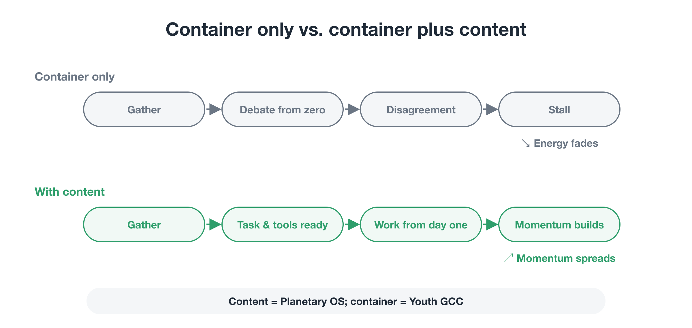
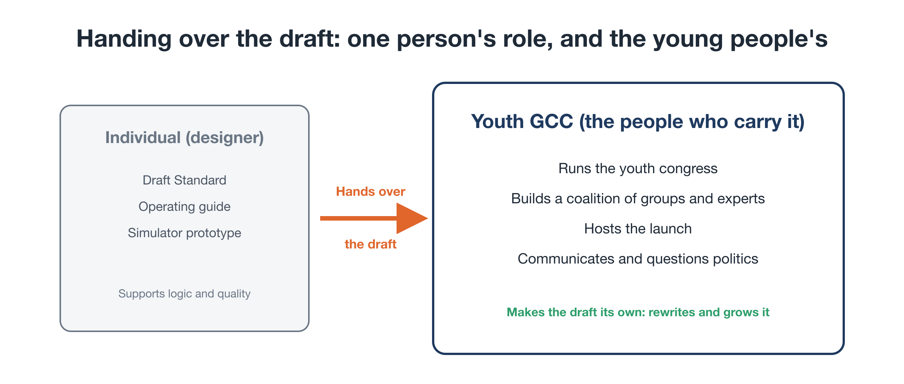
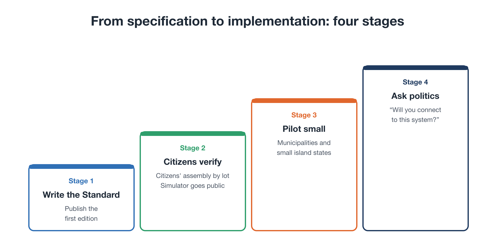

# The First Step: A Blueprint, and the Young People Who Carry It

**Rewriting the Planet's OS — Part 8 (final part)**

In Part 7, we looked back at why climate campaigns have kept losing, and proposed shifting the movement's energy from **petitioning** politicians to **implementation**: building a working system first and showing it.

Three things need to be built first:

1. **The Standard:** the Planetary OS blueprint
2. **The Citizen Dividend Simulator:** a tool that shows each household's net position
3. **The people who carry it:** those who take the Standard and the simulator out into society

This final part focuses on the third, and on **how one person's idea can grow into a movement that engages the world.**

---

## 1. A container alone won't move anyone

When a new movement starts, a common approach is to build the container first, an organization or a gathering, and only then ask, "So what should we do?"

That almost never works:

- Starting from an open question like "What can we do for the planet's future?" brings differences in ideals and values to the surface, and discussion stalls.
- Time passes without concrete results, and the initial energy fades.
- From outside, it looks like "just another discussion group."

But if **a clear first task, and the tools to tackle it, are ready from the start**, people can begin concrete work on day one.

<figure markdown="span">
  
  <figcaption>Container only: gather → debate from scratch → disagreement → stall. Container plus content: gather → a first task (Planetary OS) and tools are ready → work starts on day one → results create momentum.</figcaption>
</figure>

Planetary OS, as described in this series, is that **content**. The **container** to carry it is the youth-led body introduced next.

**Present the container and the content together, from the start.** That is the key to building momentum at launch.

---

## 2. Who carries it: a youth-led global citizens' congress

As the central force for spreading Planetary OS, I envision **an international, youth-led body**. Its name is the **Youth-Led Global Citizens' Congress for Future Generations**, or **Youth GCC**.

(See: Proposal: Global Citizens Congress — [↗](https://ttmori.substack.com/p/proposal-global-citizens-congress) )

### Why young people?

- **They have the most at stake.** Today's young people, and those not yet born, will live longest with the consequences of the climate crisis. As Part 4 noted, future generations are stakeholders without a voice in today's politics. Young people stepping forward helps carry that voice into society.
- **They are less bound by existing interests.** With fewer obligations to particular industries or organizations, they can consider new systems on their merits.
- **They can spread ideas.** They are fluent with digital tools and connect across borders. There is no better group to spread something like the dividend simulator.

### What kind of body? (one possible shape)

- **A Youth Council:** young people, roughly aged 15 to 35, representing regions of the world, set the agenda and run the organization.
- **A Global Citizens' Assembly:** citizens selected by lot from all generations deliberate on specific policy options, with youth and future-generation perspectives deliberately strengthened.
- **Advisors:** scientists and experts, experienced former policymakers, faith leaders, business leaders, and others in an advisory role.
- **A hub and local chapters:** a base, if any, chosen together with partners, with chapters around the world connected online.
- **Funding:** a mix of crowdfunding with per-person caps, so that no large donor gains outsized influence, and "intergenerational responsibility giving" from older generations to younger ones.

### Focus on a single first mission

The Youth GCC could take on many issues that matter to future generations: AI safety, economic models that don't depend on growth, education for global citizenship.

But in the launch phase, it **puts all its energy into Planetary OS alone**. Focusing like a spearhead delivers results and builds momentum. Broadening the agenda comes later.

---

## 3. One person's role, and the young people's role

Let me also say something about my own role.

My job is not to run the movement myself. It is **to draw the first blueprint and hand it over, so the movement can set off without losing its way.**

<figure markdown="span">
  
  <figcaption>The individual (designer): draft Standard, operating guide, simulator prototype → hands over a working draft → the Youth GCC (the people who carry it): runs the congress, builds the coalition, hosts the launch, communicates to the world</figcaption>
</figure>

The ones who step forward, communicate, gather people, and put the questions to society are the young people of the Youth GCC. My role is to publish the working draft and keep revising it in response to what people point out. Checking its substance and growing it is for the young people and the experts who join them.

To be candid: this blueprint does not come from my own knowledge and experience alone. I used AI extensively for research, structure, drafting, and the simulator code. Even so, I decided what to write and what to adopt, and I take responsibility for it. One citizen drafting a blueprint with the help of AI, and many people testing and growing it: I see that as a small practice of the principle this series has described, that AI supports but does not decide.

### A working draft is meant to be rewritten

One more important point: the blueprint I hand over is **a working draft, not a finished product.**

Part 1 spoke of the humility to accept that the world can't be fully calculated. That applies to this proposal too. A blueprint drawn by one person will have blind spots and mistakes. It is meant to be verified by young people, experts, and citizens, rewritten, and improved.

Bitcoin began with a single paper posted online. People around the world then examined it, improved it, and took part, and that is how it spread.

Planetary OS aims for the same: **publish the first blueprint, and let many people make it their own and grow it.**

---

## 4. The first step, in three moves

### Move 1: build a portable "starter kit"

Prepare a package that young people can read and immediately think, "We can work with this":

- **an operating guide:** how to run meetings, decision rules, how working groups are organized
- **a Planetary OS overview and declaration:** the theory turned into plain language and diagrams. This series is part of that.
- **a simulator prototype:** something that actually runs and produces numbers

### Move 2: gather the first companions

Rather than launching a large organization all at once, start with **a small group of motivated young people with a strong voice**. Read the proposal together, debate it, criticize it, rewrite it, until they can explain Planetary OS in their own words.

Then ask them to step forward as **co-founders**.

### Move 3: call on the world

At the launch of the Youth GCC, the call goes out in their name: to young people, climate organizations, scientists, and engineers around the world, **to build the Planetary OS Standard together.**

---

## 5. From specification to implementation: four stages

Beyond that first step, the path has four broad stages.

<figure markdown="span">
  
  <figcaption>Stage 1: write the Standard → Stage 2: citizens verify it → Stage 3: pilot at small scale → Stage 4: put the question to politics</figcaption>
</figure>

### Stage 1: write the Standard

Form the open community that will grow into the Planetary Protocol Assembly (PPA) described in Part 2. Climate scientists, economists, legal scholars, and engineers join to produce and publish **the first edition of the Planetary OS Standard**.

### Stage 2: citizens verify it

To keep the Standard from becoming a project of a few experts, it is reviewed by **a citizens' assembly selected by lot**:

- Experts explain the physical realities and how the system would work.
- Citizens examine its effects on daily life, its fairness, and unintended side effects, and propose improvements.

At the same stage, the dividend simulator goes public, so anyone can see what would happen to emissions, energy prices, and their own household's dividend ten years out if the system ran.

### Stage 3: pilot at small scale

Without waiting for national legislation, **the system is tested at small scale** in willing municipalities, small island states, and local communities. For example, a local dividend scheme, or a scoring system that rewards low environmental impact by firms and neighborhoods.

The experience that "the dividend really arrives," and the data from these pilots, become the strongest arguments for the next stage. And that experience spreads person to person, like a baton being passed.

### Stage 4: put the question to politics

Once there is a working system, a record of citizen verification, and results from local pilots, the question from Part 7 is finally put to national politics and the international community:

**"Will you connect your country, or your city, to this system: yes or no?"**

That leads into building the club described in Part 6.

---

## 6. What the first stretch might look like

Here is a rough picture of the early stages (an illustration only; the timing will depend on how partners come together):

1. **Quiet dialogue.** Talk one-on-one with climate organizations and experts, looking for shared understanding of the limits of petition-based campaigning and the case for implementation.
2. **Working groups.** Form working groups on economics and dividends, science and the cap, and law, and assemble a draft Standard.
3. **Launch.** Hold a public launch to present the Standard and the simulator to the world.
4. **Outreach.** Run "see your own dividend" campaigns in many places, and explore partnerships with pilot municipalities.

### A launch, not a protest

The launch should feel less like a protest rally and more like a **product launch: full of intellectual excitement and hope.**

At its center would be a live demonstration of the dividend simulator. Picture this: on a big screen, we enter the circumstances of a farmer in Kenya, an office worker in Paris, and a family in a small Japanese city, and show how much each household would receive every month if the system ran. People in the room and online check their own household's numbers on their phones and share them.

Alongside it:

- **easy sharing:** one tap to share simulator results on social media
- **a question for local politicians:** a tool that makes it easy to send local representatives and candidates a public question: "Do you support connecting to this system?"
- **a call to engineers:** an invitation to the tech community to "fix the bug in society called the climate crisis, open source"

---

## 7. What you can do

To everyone who has read this far, here is an invitation:

- **Read it and criticize it.** Point out weaknesses, blind spots, and mistakes. A working draft gets stronger through criticism.
- **Lend your expertise.** Climate science, economics, finance, law, software. Every field is needed to grow the Standard.
- **If you're young, join us.** The Youth GCC is looking for its first members.
- **Talk about it.** Share the idea of "not sacrifice, but a society where reducing pays" with family and friends.
- **Start locally.** If you work in or with local government, consider creating a space to test it at small scale.

(Co-initiator and participant sign-up: [link to be added])

---

## 8. Beyond: the deeper layers of the economic OS

Finally, a word about what lies beyond this series.

This series has focused on mechanisms to address the climate crisis. But as Part 3 showed, underneath lies a deeper problem: **an economy that has to keep expanding**. The cap and the dividend are only the first move against it.

I have also proposed longer-term ideas for rewriting the deeper layers of the economic OS:

- **Treating the economy as something we design.** The economy is not a law of nature but a set of human-designed rules. This proposal suggests democratically rebalancing the forces that drive endless growth.
  (See: Proposal for Introducing a Designed Model Economy — [↗](https://ttmori.substack.com/p/proposal-for-introducing-a-designed) )
- **An international system that values reduction.** A mechanism to evaluate, and give value to, reductions in emissions and resource use.
  (See: Proposal for the Establishment of a Global Shrinkage Evaluation System — [↗](https://ttmori.substack.com/p/proposal-for-the-establishment-of) )
- **An economy measured by two kinds of value.** An economy that measures not only human benefit, in today's money, but also benefit to the planet, with a second yardstick.
  (See: Dual Value Economy Concept Book — [↗](https://ttmori.substack.com/p/dual-value-economy-concept-book) )

I hope to introduce these on another occasion, as the next stage once Planetary OS is under way.

---

## Closing: there was never a reason to despair

Let's look back over the whole series:

- **Part 1:** the world hasn't changed not because of humanity's limits, but because our energy went in the wrong direction and no one drew a blueprint for what comes next.
- **Part 2:** that blueprint: a new operating system, Planetary OS, to keep society running within planetary limits.
- **Part 3:** a cap that only moves down (SAS), and the two conditions that make it possible: sharing historical liability and returning revenue directly to citizens, and a common incentive that rewards reduction.
- **Part 4:** building the voice of future generations into decision-making.
- **Part 5:** not sacrifice, but gain: a dividend that rewards using less.
- **Part 6:** spreading without a world government, through a club that pays to join and costs to stay out of.
- **Part 7:** shifting the movement's energy from petition to implementation.
- **Part 8:** the first step, taken by a blueprint and the young people who carry it.

At the end of Part 1, I wrote:

> If the problem were the limits of humanity, despair would be the only response. But if the problem is a wiring mistake, that changes everything. Wiring can be fixed.

The money, the knowledge, and the passion we need already exist. What was missing was a blueprint to connect them, and people to carry it.

The first edition of that blueprint is here. It isn't perfect. That is exactly why it needs to be tested, rewritten, and grown by many hands.

**From a civilization that drifts along on its own momentum, to one that consciously takes the helm.**

The people at the helm won't be anyone special. They will be each of us who picks up this blueprint.

Thank you for reading to the end.
