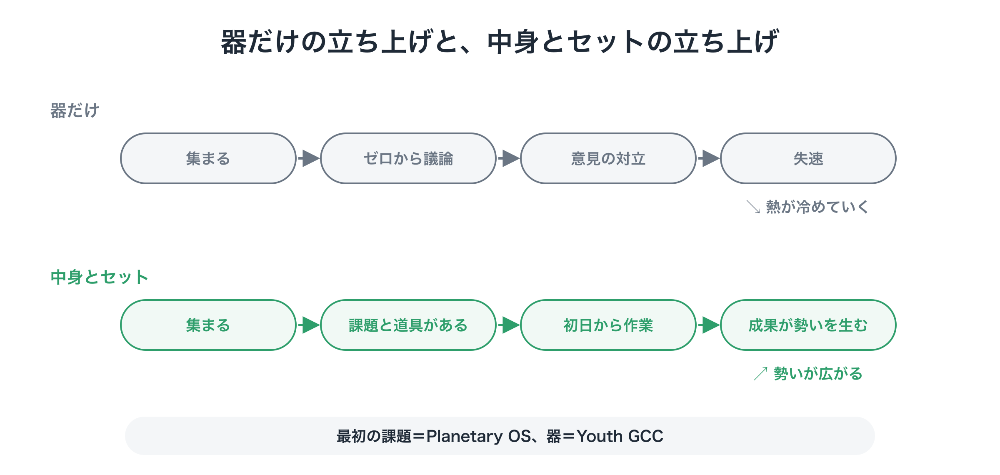
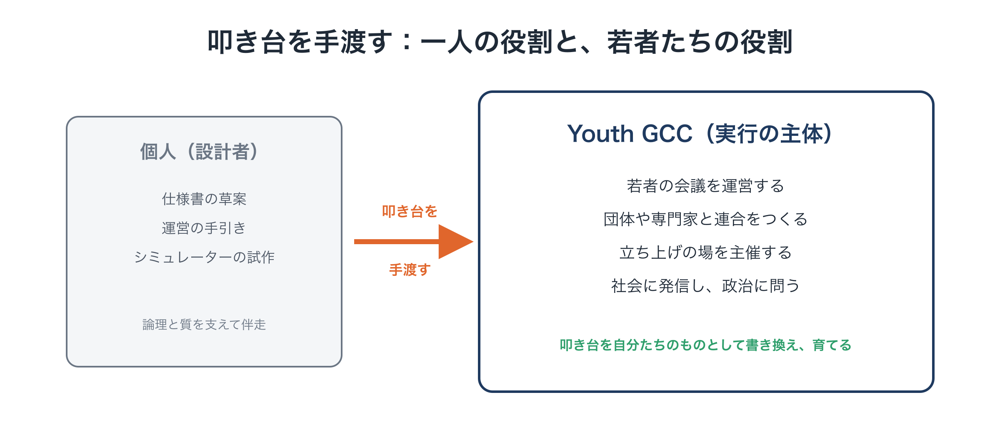
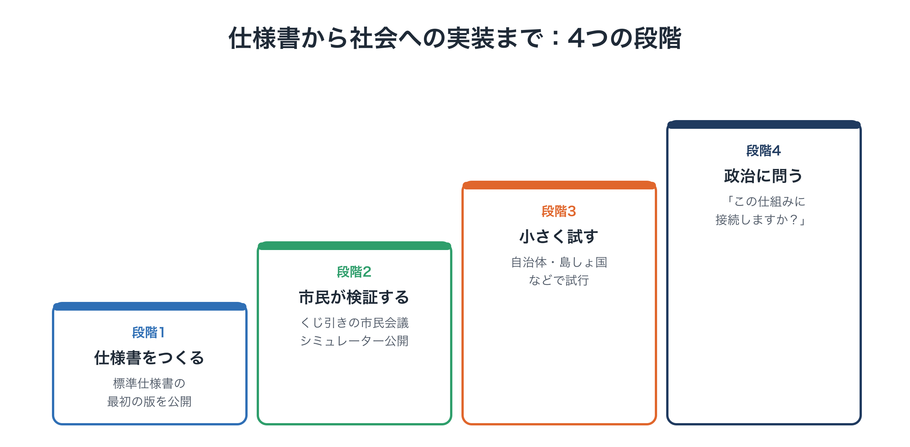

# 最初の一歩：仕様書と、それを担う若者たち

**連載「地球のOSを書き換える」第8回（最終回）**

前回は、これまでの気候運動がなぜ勝てなかったのかを振り返り、運動の向け先を、政治家への「お願い」から、**動く仕組みを先につくって示す「実装」**へと切り替えることを提案しました。

最初につくるべきものは、次の3つでした。

1. **標準仕様書**：Planetary OS の設計図
2. **還元シミュレーター**：自分の家計の手取りが分かるツール
3. **実行する主体**：仕様書とシミュレーターを掲げて、社会に広める担い手

最終回の今回は、3つ目の「実行する主体」を中心に、**一つの構想が、どうすれば世界を巻き込む運動に変わっていくのか**を考えます。

---

## 1. 器だけをつくっても、運動は動かない

新しい運動を始めようとするとき、よくあるのは、まず組織や集まりという「器」をつくり、それから「さあ、何をしようか」と話し合い始めるやり方です。

けれども、このやり方は、ほとんどの場合うまくいきません。

- 「地球の未来のために、何ができるか」という答えのない問いから議論を始めると、理念や考え方の違いばかりが目立ち、話がまとまらない
- 具体的な成果が生まれないまま時間が過ぎ、最初の熱が冷めていく
- 外からは「また新しい話し合いの集まりができただけ」と見られてしまう

逆に、**最初から明確な課題と、それに取り組むための道具が用意されていれば**、集まった人は初日から具体的な作業に取りかかれます。

<figure markdown="span">
  
  <figcaption>器だけと中身とセット</figcaption>
</figure>

この連載で描いてきた Planetary OS は、その「中身」にあたります。そして、それを担う「器」として考えているのが、次に紹介する若者たちの集まりです。

**器と中身を、最初からセットで示すこと。** それが、立ち上げの勢いをつくる鍵です。

---

## 2. 担い手：若者が主導する「地球市民会議」

Planetary OS を社会に広める中心的な担い手として、私は**若者が主導する国際的な集まり**を構想しています。名前は「**Youth-Led Global Citizens' Congress for Future Generations（将来世代のための、若者主導の地球市民会議）**」、略して Youth GCC です。

（参考：Proposal: Global Citizens Congress [↗](https://ttmori.substack.com/p/proposal-global-citizens-congress) ）

### なぜ若者なのか

- **最も大きな利害を持つ当事者だから**：気候危機の影響を最も長く受けるのは、今の若者と、これから生まれてくる世代です。第4回で書いたとおり、将来世代は今の政治の中で「声のない利害関係者」になっています。若者が前に立つことは、その声を社会に届けることでもあります。
- **既存の利害にとらわれにくいから**：特定の業界や組織への義理が少なく、新しい仕組みを素直に検討できます。
- **広げる力があるから**：デジタルの道具を使いこなし、国境を越えてつながる力を持っています。還元シミュレーターのようなツールを広めるうえで、これ以上の担い手はいません。

### どんな集まりか（構想の一例）

- **若者評議会**：世界の各地域を代表する、15〜35歳程度の若者が、議題を決め、組織を運営します。
- **世界市民会議**：すべての世代から、くじ引きで選ばれた市民が、具体的な政策の選択肢を熟議します。若者と将来世代の視点は、意識して厚くします。
- **助言者**：科学者、専門家、経験のある元政治家、宗教指導者、企業の経営者などが、助言の役割で支えます。
- **拠点と地域の支部**：拠点を置く場合は協力団体とともに選び、世界各地の支部がオンラインでつながります。
- **資金**：特定の大口の出資者に影響力が偏らないよう、一人あたりの上限を設けたクラウドファンディングや、上の世代から将来世代への「世代の責任としての寄付」などを組み合わせます。

### 最初の課題は、一つに絞る

Youth GCC が扱いうるテーマは、気候だけではありません。AIの安全性、成長に頼らない経済のあり方、地球市民としての教育など、将来世代に関わる課題は数多くあります。

けれども、立ち上げの最初の段階では、**すべてのエネルギーを Planetary OS の一点に集中させます**。一本の槍のように課題を絞り込むことで、成果を出し、勢いをつくります。テーマを広げるのは、その後です。

---

## 3. 一人の役割と、若者たちの役割

ここで、私自身の役割についても書いておきます。

私の役割は、運動を自分で動かすことではありません。**運動が迷わずに走り出せるよう、最初の設計図を描いて手渡すこと**です。

<figure markdown="span">
  
  <figcaption>叩き台を手渡す</figcaption>
</figure>

前に立って発信し、人を集め、社会に問いかけるのは、Youth GCC の若者たちです。私の役割は、叩き台を公開し、寄せられた指摘を受けて改訂を続けることです。中身を確かめ、育てていくのは、若者たちと、協力してくれる専門家たちです。

正直に書いておくと、この設計図は、私一人の知識や経験だけで描いたものではありません。調べもの、構成、文章、シミュレーターのコードに、AIを大きく活用しています。それでも、何を書き、何を採用するかは、すべて私が判断し、責任を持ちます。一人の市民がAIの助けを借りて叩き台をつくり、それを多くの人が検証して育てる。それ自体が、この連載で描いてきた「AIは支えるが、決めない」という考え方の、小さな実践だと考えています。

### 叩き台は、書き換えられるためにある

大切なことを一つ付け加えます。私が手渡す設計図は、**完成品ではなく叩き台**です。

第1回で、「世界は計算しきれないと認める謙虚さ」について書きました。それは、この構想自体にも当てはまります。一人で描いた設計図には、必ず見落としや誤りがあります。若者たち、専門家、市民の検証を通じて、書き換えられ、より良くなっていくことを前提にしています。

ビットコインの仕組みは、一本の論文がインターネット上に公開されたことから始まりました。その後、世界中の人々がそれを検証し、改良し、自ら参加することで、大きな広がりが生まれました。

Planetary OS も同じように、**最初の設計図を公開し、それを多くの人が自分たちのものとして育てていく**ことを目指します。

---

## 4. 最初の一歩：3つのステップ

では、具体的に何から始めるのか。最初の一歩は、次の3つのステップです。

### ステップ1：持ち運べる「起動キット」をつくる

若者たちが読んですぐに「これなら動ける」と感じられるパッケージを用意します。

- **運営の手引き**：会議の開き方、意思決定のルール、作業部会の構成
- **Planetary OS の概要と宣言文**：難しい理論を、誰にでも分かる言葉と図にまとめたもの。この連載も、その一部になります
- **還元シミュレーターの試作版**：実際に動いて、数字が出るもの

### ステップ2：最初の仲間を集める

いきなり大きな団体をつくるのではなく、まず**少人数の、意欲と発信力のある若者たち**に集まってもらいます。この構想を一緒に読み込み、議論し、批判し、書き換える中で、彼ら自身が自分の言葉で Planetary OS を語れるようになることを目指します。

そして、彼らに**共同設立者**として前に立ってもらいます。

### ステップ3：世界に呼びかける

Youth GCC の立ち上げと同時に、彼らの名前で世界に呼びかけます。世界中の若者、気候の問題に取り組む団体、科学者、エンジニアに、**Planetary OS の標準を一緒につくろう**と呼びかけるのです。

---

## 5. 仕様書から社会への実装まで：4つの段階

その先の道筋は、大きく4つの段階で考えています。

<figure markdown="span">
  
  <figcaption>4つの段階</figcaption>
</figure>

### 段階1：仕様書をつくる

第2回で紹介した Planetary Protocol Assembly（PPA）の母体となる、開かれた共同体を立ち上げます。気候科学者、経済学者、法律家、エンジニアが加わり、**Planetary OS 標準仕様書の最初の版**をまとめて公開します。

### 段階2：市民が検証する

仕様書が一部の専門家の独りよがりにならないよう、**くじ引きで選ばれた市民の会議**で検証します。

- 専門家が、地球の物理的な現実と、仕組みの動き方を説明する
- 市民が、暮らしへの影響、公平さ、思わぬ副作用を検討し、改善を提案する

あわせて、還元シミュレーターを一般に公開します。「この仕組みが動けば、10年後の排出量、エネルギーの価格、自分の家計への還元はどうなるか」を、誰でも確かめられるようにします。

### 段階3：小さく試す

国全体の法律を待たずに、意欲のある自治体や小さな島国、地域のコミュニティなどで、**小さな規模で仕組みを試します**。たとえば、地域の中での小さな還元の仕組みや、企業や地域の負荷の少なさを点数にする仕組みです。

「本当に還元が届く」という体験と、試した結果のデータが、次の段階への何よりの説得材料になります。そして、その体験は、人から人へとバトンを渡すように広がっていきます。

### 段階4：政治に問う

動く仕組みと、市民の検証の記録と、地域で試した結果。この3つがそろった段階で、初めて国の政治と国際社会に、前回書いた問いを突きつけます。

**「この仕組みに、あなたの国や自治体を接続しますか、しませんか？」**

ここから、第6回で描いた、参加国のクラブづくりへとつながっていきます。

---

## 6. 最初の1年のイメージ

段階1から段階2にかけての、最初の1年ほどのイメージも描いておきます（あくまで一例です）。

1. **最初の数か月：静かな対話**
   気候の問題に取り組む団体や専門家と一対一で対話を重ね、「お願い型の運動の限界」と「実装への転換」について、共通の認識を探ります。
2. **半年ごろまで：作業部会の立ち上げ**
   経済・還元、科学・上限、法務の作業部会をつくり、仕様書の試作版をまとめます。
3. **半年を過ぎたころ：立ち上げの場**
   世界に向けて、仕様書とシミュレーターを公開する場を開きます。
4. **1年目の後半：各地での展開**
   各地で「我が家の還元」を確かめるキャンペーンを広げ、小さく試す自治体との協力を探ります。

### 立ち上げの場は「抗議」ではなく「発表」

立ち上げの場は、これまでの抗議集会のような悲壮な雰囲気ではなく、**新しい製品を発表する場のような、知的な興奮と希望に満ちたもの**にしたいと考えています。

その中心になるのは、還元シミュレーターの実演です。たとえば、ケニアの農家、パリの会社員、日本の地方都市の家族の暮らしをその場で入力し、「この仕組みが動けば、それぞれの家計に毎月いくら還ってくるのか」を大きな画面に映し出します。会場やオンラインの参加者が、自分のスマートフォンで自分の家計の数字を確かめ、それを共有していく。そんな場面を思い描いています。

あわせて、次のような道具も用意します。

- **共有の仕組み**：シミュレーターの結果を、ひと押しでSNSに共有できるようにする
- **地元の政治家への質問の道具**：「あなたは、この仕組みへの接続に賛成ですか、反対ですか」という公開の質問を、地元の議員や候補者に簡単に送れるようにする
- **エンジニアへの呼びかけ**：「気候危機という社会のバグを、オープンソースで修正しよう」と、技術者のコミュニティに参加を呼びかける

---

## 7. この連載を読んだあなたにできること

ここまで読んでくださった方に、お願いではなく、**誘い**を書いておきます。

- **読んで、批判してください**：この設計図の弱点、見落とし、誤りを指摘してください。叩き台は、批判によって強くなります。
- **専門の知恵を貸してください**：気候科学、経済、金融、法律、ソフトウェア開発。どの分野の知恵も、仕様書を育てるために必要です。
- **若い方は、仲間になってください**：Youth GCC の最初の仲間を探しています。
- **身近な人に伝えてください**：「我慢ではなく、減らすほど得をする社会」という考え方を、家族や友人と話してみてください。
- **地域から始めてください**：自治体の議員や職員の方は、小さく試す場をつくることを検討してみてください。

（共同提案者・参加者の募集ページ：[→](../join.md)）

---

## 8. その先へ：経済のOSの、さらに深い部分へ

最後に、この連載の先にある構想についても触れておきます。

この連載では、気候危機に対応するための仕組みを中心に描いてきました。けれども、第3回で書いたように、その根本には「**拡大し続けなければならない経済**」という問題があります。上限と還元の仕組みは、その問題に立ち向かうための最初の一手にすぎません。

より長い時間をかけて、経済のOSのさらに深い部分を書き換えていく構想も、別に提案しています。

- **経済を「設計できるもの」として捉え直す**：経済は自然の法則ではなく、人間が設計したルールの集まりです。成長を駆り立てる力の強さを、民主的に調整し直すことを提案しています。
  （参考：Proposal for Introducing a Designed Model Economy [↗](https://ttmori.substack.com/p/proposal-for-introducing-a-designed) ）
- **縮小を評価する国際的な仕組み**：排出や資源の使用を減らしたことを、国際的に評価し、価値として認める仕組みです。
  （参考：Proposal for the Establishment of a Global Shrinkage Evaluation System [↗](https://ttmori.substack.com/p/proposal-for-the-establishment-of) ）
- **人の豊かさと地球の豊かさ、二つの価値で測る経済**：今のお金という一つの物差しだけでなく、地球への貢献を測るもう一つの物差しを持つ経済の構想です。
  （参考：Dual Value Economy Concept Book [↗](https://ttmori.substack.com/p/dual-value-economy-concept-book) ）

これらは、Planetary OS が動き始めた後の「次の段階」として、改めて別の機会に紹介したいと考えています。

---

## おわりに：絶望する理由はなかった

この連載で描いてきたことを、最後にもう一度振り返ります。

- **第1回**：世界が変わらなかったのは、人類の能力の限界ではなく、エネルギーの向け先がずれ、移行先の設計図がなかったから
- **第2回**：その設計図として、地球の限界の内側で社会を回し続ける新しいOS「Planetary OS」の全体像
- **第3回**：一方向に下がり続ける上限（SAS）と、それを可能にする2つの条件。過去の排出の分配と市民への直接還元、そして縮小に報いる共通のインセンティブ
- **第4回**：将来世代の声を、意思決定の仕組みに組み込む
- **第5回**：「我慢」ではなく「得」で動く、減らすほど得をする還元の設計
- **第6回**：世界政府なしで、参加すると得をし、参加しないと損をするクラブとして広げていく
- **第7回**：運動の向け先を、「お願い」から「実装」へ
- **第8回**：設計図と、それを担う若者たちによる最初の一歩

第1回の最後に、こう書きました。

> もし問題が「人類の能力の限界」なら、絶望するしかありません。けれども問題が「配線の間違い」なら、話は違います。配線は、つなぎ直すことができるからです。

必要な資金も、知恵も、情熱も、すでにこの世界にあります。足りなかったのは、それらをつなぐ設計図と、それを担う人々でした。

設計図の最初の版は、ここにあります。完璧ではありません。だからこそ、多くの人の手で検証され、書き換えられ、育てられていく必要があります。

**自然に任せてきた文明から、意識して舵を取る文明へ。**

その舵を握るのは、特別な誰かではありません。この設計図を手に取った、一人ひとりです。

最後まで読んでくださって、ありがとうございました。

---

この文書は、次の場所でも公開しています： [note（日本語）](https://note.com/ttmori/n/n04fd16dd82df)
