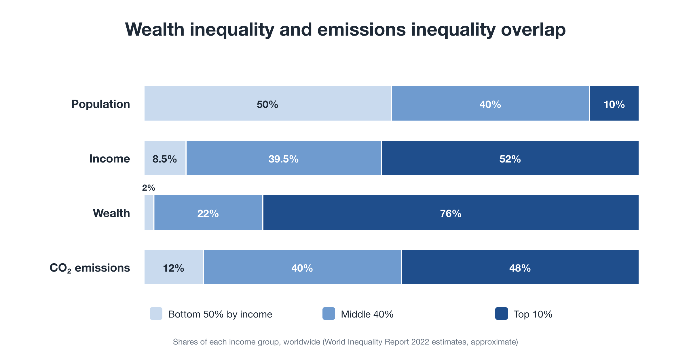
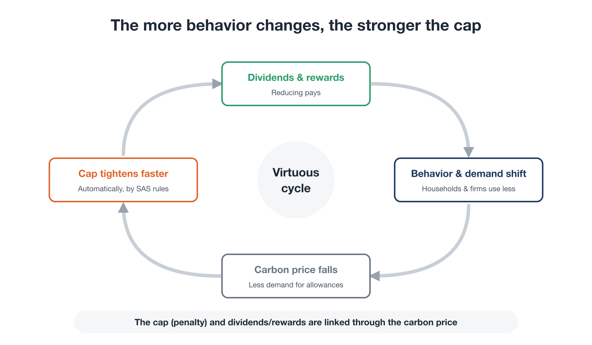
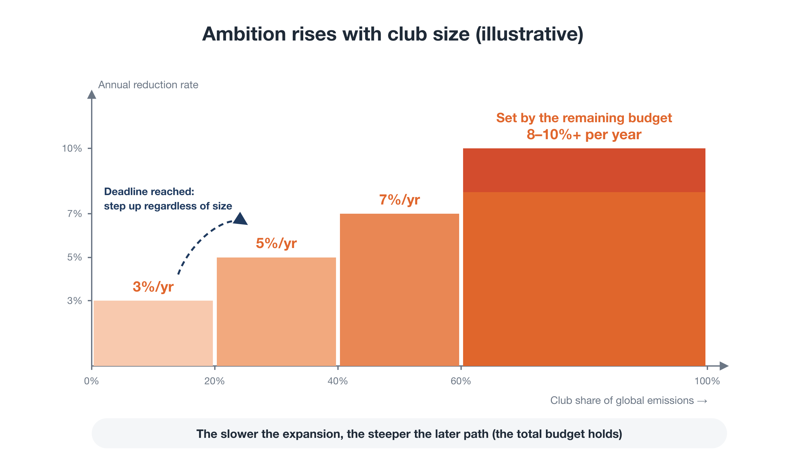
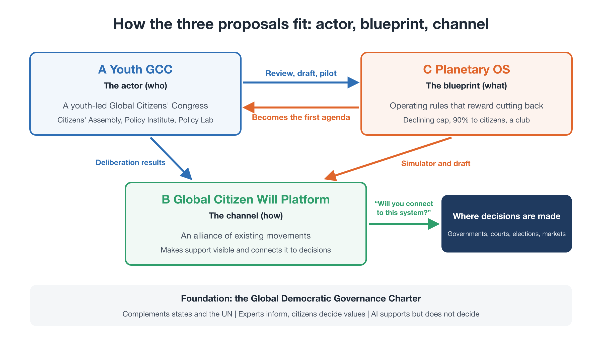
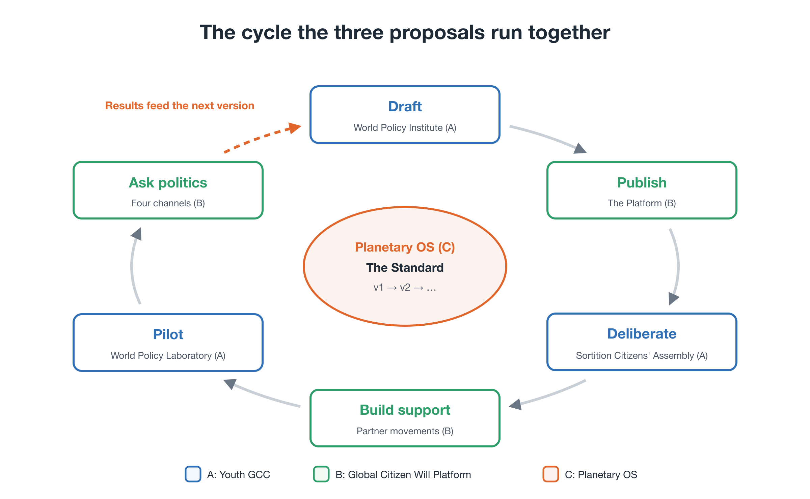

# The Whole Idea, in One Read
### *Steering Within Limits* for readers new to the proposal

**Guide for general readers** — First edition (October 2026)

!!! info "About this page"
    For readers new to the proposal: the whole idea, with the reasoning behind it, in one read (about 15 minutes). For the key points only, see the one-page overview [→](overview.md) (about 3 minutes). If you are considering taking part, funding, or research, see also the package proposal [→](package.md).

---

## The argument in brief

- The climate crisis has not been solved by effort, goodwill, or technology, because **the rules of the economy and of politics make reducing a losing move** for individuals, firms, and countries alike.
- The answer is neither more sacrifice nor waiting for a global agreement. It is to **rewrite the operating rules so that reducing pays**, and to put those rules where they are hard to undo.
- **Planetary OS** is a concrete design for such rules. **Youth GCC** is the actor that carries it, and the **Global Citizen Will Platform** is the channel that connects citizens' support to real decisions.

This guide explains the whole package in one continuous argument. It assumes no background in economics or climate science. All names, ratios, and figures are **illustrative**: they show a direction, and the real values are meant to be set through expert review and public deliberation.

---

## 1. Why so much effort has changed so little

For decades, enormous effort has gone into the climate crisis: research, funding, activism, international conferences, corporate pledges. And the curves have not bent. In the last fifty years, the world's population has doubled, and annual fossil CO₂ emissions have more than doubled. About 70% of all fossil CO₂ ever emitted was released in those fifty years, most of it after the world had already been warned.

The cause is not that people do not care. It is that **the situation has the structure of a collective-action problem.**

A classic example is a shared fishing ground. Each fisher gains by catching a little more, and loses little from the damage, which is spread across everyone. So each makes a reasonable choice, and together they empty the sea. Economists call this the *tragedy of the commons*. When each actor also fears that holding back will only let others take more, it becomes a *prisoner's dilemma*.

Climate policy runs into this at every level:

- **A firm** that invests in cutting emissions while its competitors do not raises its costs and loses market share.
- **A country** that prices carbon on its own risks seeing industry and jobs move abroad, and its emissions simply reappear elsewhere ("carbon leakage").
- **A government** that raises the price of fossil energy puts the cost on today's households at once, while the benefits are spread over decades and across the world.

The last point explains a pattern seen again and again. Australia introduced a carbon price in 2012 and repealed it in 2014. In France, protests in 2018 led the government to suspend a planned increase in fuel taxes. Canada ended its consumer carbon charge in 2025, even though most households were receiving rebates. Even the EU Emissions Trading System, the most developed carbon market in the world, spent years with too many allowances to impose a strict cap.

There are two barriers here:

1. **The burden falls only on the present.** Pricing today's emissions puts the cost on today's households and workers, while those who built wealth on past emissions contribute almost nothing. Support erodes, and the policy is weakened.
2. **Reducing alone means losing.** As long as the rules stay the same, unilateral reduction has only downsides.

So the effort has not been wasted for lack of will. **It has been poured into a game it is structurally unable to win.**

## 2. The problem is the operating system, not the people

It helps to separate *behavior* from the *rules that shape behavior*. A computer runs applications, but underneath them is an operating system that decides what any application can do. If the operating system is flawed, better applications cannot fix it.

Our civilization also runs on an operating system, and two of its core rules are:

1. **The economy is built to expand.** Firms, investors, and governments are rewarded for growth, and most institutions, from pensions to public budgets, assume it.
2. **Politics is organized by nation-state.** Governments answer to their own voters, on electoral time scales.

These rules produced extraordinary progress. But they were never designed for a world with hard physical limits, for problems that cross every border, or for the interests of people who cannot vote: the young and those not yet born.

The tools we have built on top of this system share the same limits. Treaties that need near-unanimous consent, and policies that can be reversed at the next election, were designed for one-off agreements. The climate crisis requires **continuous, system-wide management within physical limits**. Applying the old tools to it is a category error.

There is also a point that is often missed. **Humanity as a whole already has enough** wealth and productive capacity. What is missing is circulation. Wealth and emissions are concentrated in the same hands: the top 10% of the world by income hold about 76% of global wealth and produce about 48% of global emissions. That means a well-designed system can **move money from high emitters to low emitters** while cutting emissions, rather than asking everyone to pay equally.

<figure markdown="span">
  
  <figcaption>Wealth and emissions are concentrated in the same hands</figcaption>
</figure>

So the real question is not "how do we get everyone to sacrifice?" It is **"how do we rewrite the rules so that the low-carbon choice is also the rewarding one?"** Economic rules are not laws of nature. They are human agreements, and they can be rewritten.

## 3. The new rules: Planetary OS

**Planetary OS** is the package's design for those rules. It has four modules, each aimed at the barriers above. Its target is to keep warming **well below 2°C**; holding it to 1.5°C without overshoot is now very likely out of reach.

<figure markdown="span">
  
  <figcaption>The four modules of Planetary OS and the two money flows</figcaption>
</figure>

### Module 1: a one-way cap at the source (SAS)

Instead of regulating millions of emitters one by one, Planetary OS caps fossil fuels **upstream**, where they enter the economy: at the mine, the well, and the port of import. Producers and importers must hold an allowance for every unit, and allowances are **sold at auction**. The price then flows through the whole economy, to every product in proportion to its fossil content.

The total number of allowances falls every year at a pace **derived from the remaining carbon budget**: around 8% a year globally on average in the illustration, and faster for high-income countries.

The decisive feature is that **the cap moves in one direction only**. It can tighten faster than planned, for example when clean technology arrives sooner, but it can never be loosened. This removes the option of "postponing it to next year" that has undermined so many past policies.

(SAS stands for Scientific Automatic Stabilizers.)

### Module 2: return the revenue to citizens (the Citizen Dividend)

The auctions raise large sums. Planetary OS does not use them as general tax revenue. **In the illustration, 90% goes directly back to citizens as a Citizen Dividend:**

- **60% is paid equally** to every person.
- **40% is a sufficiency-linked dividend**, which pays more to people who use less energy and fewer materials.
- **The remaining 10%** funds a **Just Transition** for workers and regions that depend on fossil fuels.

Why does this make most people better off? Because fossil consumption rises steeply with income. A high-income household that flies often and owns several cars pays far more in higher prices than it receives; a typical household that uses less receives more than it pays. As a rough calculation, about 70% of people come out ahead under the standard assumptions, and from about 60% to the low 70s depending on the assumptions. The standard design does not rely on that estimate: under a **majority-benefit rule**, households just short of break-even receive a top-up from the PTE so that **at least 70%** come out ahead. These are model estimates, not promises: indirect effects through wages and the wider economy can only be estimated, and the guarantee is limited by what the PTE can spend. You can explore the effect on different households with the Citizen Dividend Simulator [→](tools/simulator.md).

The incentive also changes direction. Today, using less is a private cost. Under these rules, **using less leaves you with more money**: commuting by bike, working from home on some days, choosing lower-impact food and goods, or simply not buying what you do not need. In many cases the lowest-impact choice is to do less, and for the first time it is rewarded rather than merely praised.

### Module 3: a share for those who gained most from the past (BEI and the PTE)

The stock of CO₂ in the atmosphere was built up over generations, and the gains from it were not evenly shared. Planetary OS asks those who benefited most to take on part of that historical liability, through a **thin, broad levy on very large concentrations of wealth and corporate profits**. (In the proposal this is called **BEI**, Benefit Equity Internalization. One illustrative estimate puts its global potential on the order of USD 1 trillion a year (0.8–1.3 trillion).)

The proceeds go into a long-term fund, the **Planetary Transition Endowment (PTE)**. It invests in alternatives, provides first-loss guarantees that lower the cost of capital for clean energy in developing countries, funds ecosystem restoration, and in the launch phase adds a top-up to the Citizen Dividend. This addresses the first barrier directly: **the cost no longer falls only on today's ordinary households.**

### Module 4: a double key against backsliding

Rules that protect the future are easy to weaken later. So changing the rules requires **two keys at once**:

1. a **scientific justification**, and
2. approval by a large majority, for example three-quarters, of a **citizens' assembly selected by lot**.

Neither experts nor politicians can loosen the cap on their own. Emissions and payment data are cross-checked by a distributed network of independent institutions, so the numbers cannot quietly be bent.

### How the modules reinforce each other

Under the old design, public opinion pushed caps down because they were felt as a cost. Under Planetary OS, the dividend comes from the cap, so **public opinion has a reason to defend it**.

There is also a self-reinforcing loop. As the dividend rewards lower consumption, demand for fossil fuels falls. Lower demand pushes down the auction price, and the rules then allow the cap to tighten faster. **The more behavior changes, the faster emissions fall.**

<figure markdown="span">
  
  <figcaption>The more behavior changes, the faster the cap can tighten</figcaption>
</figure>

| Until now | Under Planetary OS |
|---|---|
| Only the present paid | Past beneficiaries contribute through BEI |
| Reducing was a loss | The less you use, the more you receive |
| Public opinion pushed caps down | Public opinion defends the cap |
| Caps were reversed after elections | The cap moves one way, protected by the double key |

## 4. Scaling without a world government: a club worth joining

A global agreement among nearly 200 countries is not a realistic starting point. Planetary OS therefore starts with a **club** of willing countries and cities, building on the economist William Nordhaus's idea of a "climate club."

- **Joining pays.** Members gain energy security, guaranteed investment, access to each other's markets, Citizen Dividends for their residents, and a first-mover position in new industries.
- **Staying out costs.** A **carbon border adjustment** applies the same carbon cost to imports from outside the club. This removes the advantage of free-riding and the risk of carbon leakage.
- **Ambition rises with membership.** "We will if you will." In the illustration, the club-wide reduction rate rises with the members' share of global emissions:
    - under 20%: 3% a year
    - 20–40%: 5% a year
    - 40–60%: 7% a year
    - 60% or more: a rate derived from the remaining carbon budget

    A time-based trigger moves the club to the next step on a fixed date regardless of size, so members cannot keep the club small to avoid tighter targets.

- **The rules are fixed at launch.** Thresholds, rates, and the terms for early and late entrants are published in advance, so there is a clear reason to join early.

<figure markdown="span">
  
  <figcaption>Club size and the reduction rate</figcaption>
</figure>

Each country connects through a single **linkage clause** in its existing tax, payment, and customs systems. The club agrees on outcomes, such as returning most of the revenue to households; how to return it is each country's choice. **No country gives up sovereignty**, and no world government is required.

The natural first movers are fossil-fuel importers, the countries most exposed to climate impacts, insurers and long-term investors, and ambitious cities and regions.

## 5. Who carries it: Youth GCC (Proposal A)

A blueprint does not implement itself. And at present, no actor speaks for the future across borders: governments answer to today's voters within their borders, international bodies depend on their member states, and the people with the largest stake, the young and the unborn, have almost no voice.

Proposal A is the **Youth GCC** (Youth-Led Global Citizens' Congress for Future Generations). It is not a government and does not replace the United Nations. It builds **a second political circuit** alongside inter-state politics: one that identifies global problems, develops policy options from the standpoint of world citizens, deliberates on them in public, and presents the results to existing decision-makers.

Its structure is illustrative, but the logic is deliberate:

- A **Youth Council** (roughly ages 15–35, from every region) sets the agenda and runs the organization.
- A **World Citizens' Assembly** of people **selected by lot from all generations**, stratified to reflect the world's population. Selection by lot (sortition) is the same principle as a jury. Citizens' assemblies of this kind have already been tested, for example in Ireland, which used them on constitutional questions, and in France's Citizens' Convention for Climate.
- A **World Policy Institute**, where experts set out **several workable options** for each issue, never a single "right answer," with their costs, risks, and trade-offs.
- A **World Policy Laboratory**, which **tests options through simulation and small pilots before they are scaled up**, and publishes failures as well as successes.
- **Independent audit** of procedures, finances, and conflicts of interest.

The division of roles matters: **experts clarify facts and options; citizens judge values and priorities.** AI helps with translation, summarizing, and mapping arguments, but never makes the decisions.

The Youth GCC has no power to compel. Instead it asks governments and international bodies to **respond publicly** to its recommendations, and to publish their reasons when they reject them. Its legitimacy is not declared but earned, through open participation, transparent procedures, and a track record.

Its first agenda is climate: an international citizens' assembly compares Planetary OS with alternative designs. The governance of advanced AI is the next candidate.

(The institutional design behind this, a second circuit of politics for world citizens, is set out in the *Global Democratic Governance Charter* [→](charter/charter.md).)

## 6. How civic will reaches decisions: the Global Citizen Will Platform (Proposal B)

Millions of people already march, sign, and organize. But their efforts are fragmented, and most remain inside national agendas, with no shared infrastructure to turn them into visible support for specific policy choices.

Proposal B is the **Global Citizen Will Platform**, shared and open infrastructure that federates existing movements. It does not compete with them: groups keep their names, autonomy, and campaigns, and join as **Co-Initiators** through a common standard for proposals and support.

- An open-source deliberation engine (for example, based on Decidim) to collect and compare proposals.
- A shared dashboard that shows verified support alongside planetary indicators such as the remaining carbon budget.
- Tools such as the Citizen Dividend Simulator, so people can see what a policy means for them.
- Privacy by design: minimal personal data, published methods, and checks against double counting.

That visible support reaches decisions through four lawful channels:

1. **Multilateral:** working with willing governments, such as climate-vulnerable states, in international forums.
2. **Legal:** providing verified data and deliberation records that can inform climate litigation, including claims about harm to future generations.
3. **Electoral:** turning proposals into concrete questions voters can put to candidates and parties.
4. **Markets:** helping consumers and investors align their choices with the Standard.

And it puts a single question to politics. Not "please act," but:

> **"Will you connect to this system?"**

## 7. Why a package, not three separate proposals

Each proposal on its own has a familiar failure mode:

- **A blueprint without carriers** stays on paper.
- **Carriers without a blueprint** lose direction and end in general demands.
- **Both, without a channel to decisions,** remain small and easy to ignore.

Together they form a complete loop:

| | Proposal | Role |
|---|---|---|
| **What** | C — Planetary OS | The operating rules |
| **Who** | A — Youth GCC | The actor and its institutions |
| **How** | B — Global Citizen Will Platform | The channel from civic will to decisions |

<figure markdown="span">
  
  <figcaption>How the three proposals fit: actor, blueprint, channel</figcaption>
</figure>

In practice, the cycle runs like this: the Institute drafts a first edition of the rules (the *Planetary OS Standard*); the platform publishes it with the simulator; the citizens' assembly deliberates on it; partner movements gather support; the Laboratory runs pilots; the four channels ask politics "Will you connect?"; and the results feed into the next edition.

<figure markdown="span">
  
  <figcaption>The cycle the three proposals run together</figcaption>
</figure>

## 8. Common objections

**Isn't this just a carbon tax with extra steps?**
No. A carbon tax sets a price and hopes the quantity follows; Planetary OS sets the quantity by science, makes it one-way, returns most of the revenue to citizens, adds a contribution from past beneficiaries, and protects the rules with a double key. Those additions are aimed precisely at the reasons past carbon prices were repealed.

**Why not work through the UN?**
The package works *with* the UN, not against it. But a process that needs near-unanimous consent cannot be the only path. A club can start now, and an independent citizens' body can develop options that states have not yet put on the table.

**Is this a world government?**
No. States remain as they are. The Youth GCC proposes and asks for public answers; it cannot give orders. Planetary OS spreads through a club that countries choose to join.

**Is it anti-growth, or a call to live with less?**
It does not ban growth or prescribe lifestyles. It enforces only the outer physical limit, the total amount of fossil carbon, and leaves freedom within it. What it changes is the reward: using less is no longer a loss. Later layers of the package take up deeper questions, such as returning productivity gains as shorter working hours rather than more output.

**Will individuals be monitored?**
No. The strict limit applies upstream, to fossil fuels entering the economy, not to individual behavior. The package's principles exclude individual surveillance.

**Who decided the numbers?**
No one, yet. Every figure here is illustrative. The design is published as a working draft so that it can be criticized, tested, and rewritten.

(More objections and answers: Planetary OS FAQ [→](proposals/c-faq.md).)

## 9. Where it starts, and how to take part

The first stage is deliberately modest and concrete (roughly eighteen months in the illustration):

1. A first edition of the *Planetary OS Standard*, drafted by working groups in climate science, economics, law, and engineering.
2. A public Citizen Dividend Simulator.
3. The launch of the Youth GCC with partner organizations, and a first citizens' assembly to review the Standard.

Pilots with willing municipalities and small island states follow, and then the question is put to politics.

Ways to take part now:

- **Try the simulator** [→](tools/simulator.md) and test the design against your own assumptions.
- **Criticize it.** The design improves only if people look for its weak points.
- **Join.** We are looking for young co-founders, partner movements, researchers, civic technologists, and municipalities willing to host pilots [→](join.md).

## Closing: a graduation, not a sacrifice

This is not a call to become poorer, or to overthrow anyone. It is a **graduation**: moving on from a system that served its purpose, toward one that offers more time, more security, and a livable planet.

A civilization that grew without steering now has to learn to **steer within limits**. The data, the digital infrastructure, and the experience with citizens' assemblies already exist. What is needed now is a design that has been tested, and people willing to carry it.

---

**Read more**

- One-page overview [→](overview.md)
- Essay: *Why Now?* [→](why-now.md)
- Package proposal: *Steering Within Limits* [→](package.md)
- Proposal C: Planetary OS (summary) [→](proposals/c-summary.md)
- Series: *Rewriting the Planet's OS* [→](series/part-0.md)

**Contact:** Tatsuya Mori · [Substack](https://ttmori.substack.com) · [note](https://note.com/ttmori) · [X](https://x.com/ttmori)
