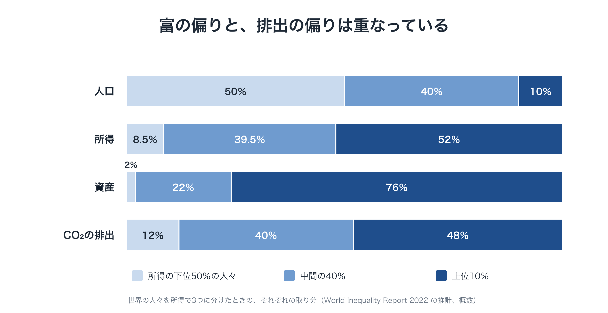
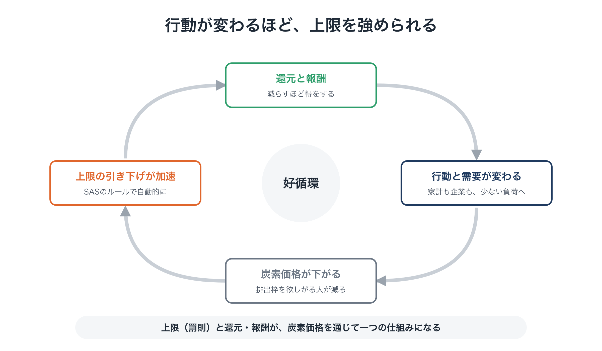
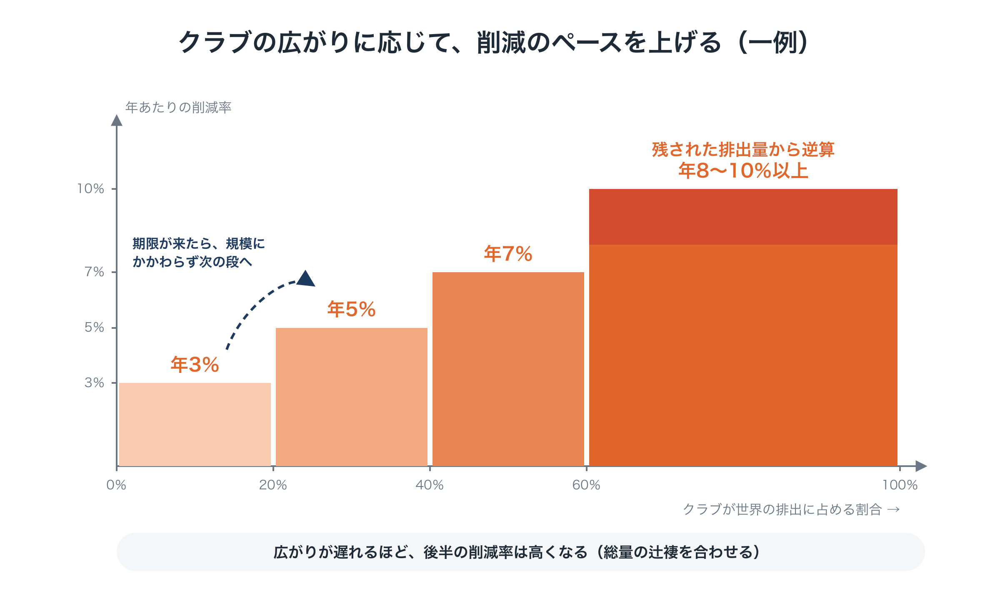
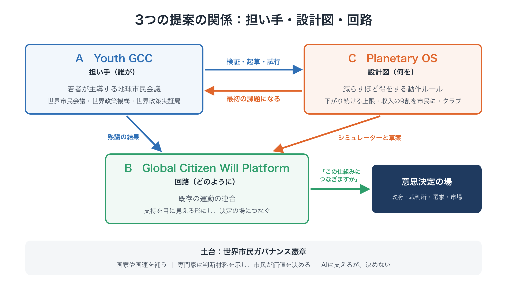
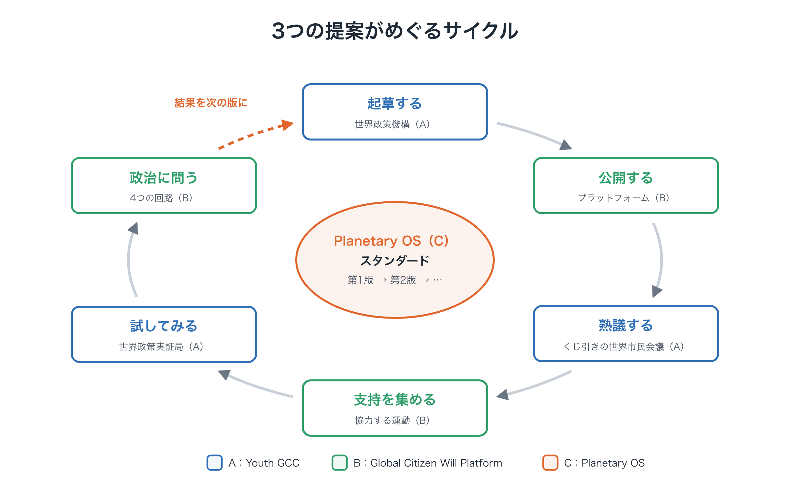

# ひと続きで読む「限界の内側で、舵を取る」
### はじめて読む人のための、提案の全体像

**一般の読者のための解説**　第1版（2026年10月）

!!! info "このページについて"
    はじめて読む方に向けて、提案の全体を、理由とともにひと続きで説明します（約45分）。要点だけを知りたい方は1ページ概要[→](overview.md)（約7分）を、参加・資金提供・研究を検討している方はパッケージ提案書[→](package.md)もご覧ください。

---

## 要点

- 気候危機が、努力や善意や技術で解決してこなかったのは、**経済と政治のルールが、個人にも企業にも国にも「減らすと損をする」構造になっている**からです。
- 答えは、さらなる我慢でも、世界的な合意を待つことでもありません。**減らすほど得をするように動作ルールを書き換え**、そのルールを簡単には覆せない場所に置くことです。
- そのルールの具体的な設計が **Planetary OS** です。それを担う主体が **Youth GCC**、市民の支持を実際の決定につなぐ回路が **Global Citizen Will Platform** です。

この解説では、パッケージ全体を一続きの議論として説明します。経済学や気候科学の予備知識は前提にしていません。名前・割合・数値は、すべて**一例**です。方向性を示すもので、本当の値は、専門家の検証と市民の熟議で決めていきます。

---

## 1. なぜ、これほどの努力で、ほとんど変わらなかったのか

何十年ものあいだ、気候危機には大きな努力が注がれてきました。研究、資金、市民運動、国際会議、企業の目標。それでも、流れは変わっていません。この50年で、世界の人口は約2倍に、化石燃料からの年間のCO₂排出量は2倍以上になりました。これまでに出された化石燃料のCO₂の約7割は、この50年間に出されたものです。その大半は、世界がすでに警告を受けたあとのことです。

原因は、人々が無関心だったことではありません。**この問題が「集合行為の問題」という構造を持っている**ことにあります。

よく知られた例に、みんなで使う漁場があります。漁師は、少し多く獲れば自分の得になり、資源が減る損はみんなに薄く広がります。だから一人ひとりは筋の通った判断をしているのに、全体としては海が空っぽになります。経済学では、これを「共有地の悲劇」と呼びます。さらに、「自分だけ控えても、その分をほかの人が獲るだけだ」と考える状況になると、「囚人のジレンマ」になります。

気候政策は、あらゆる段階でこの構造にぶつかります。

- **企業**：競合が何もしないなか、自社だけが排出削減に投資すれば、コストが上がり、市場を失います。
- **国**：一国だけで炭素に価格をつければ、産業や雇用が国外に移り、排出はほかの国で出るだけになりかねません（「カーボン・リーケージ」）。
- **政府**：化石燃料の価格を上げると、そのコストはすぐに今の家庭にかかります。一方、その効果は、何十年もかけて、世界中に薄く広がります。

この最後の点が、何度もくり返されてきた流れを説明しています。オーストラリアは2012年に炭素価格を導入し、2014年に廃止しました。フランスでは、2018年の抗議運動を受けて、政府が燃料税の引き上げを見送りました。カナダは、多くの家庭が還付を受けていたにもかかわらず、2025年に消費者向けの炭素課金を廃止しました。世界で最も発達した炭素市場であるEU排出量取引制度でさえ、排出枠が余って厳しい上限をかけられない時期が長く続きました。

ここには、2つの壁があります。

1. **負担が「今」にだけかかる。** 今の排出に価格をつけると、そのコストは今の家庭や働く人にかかります。過去の排出で富を築いた人は、ほとんど負担しません。支持が失われ、政策は弱められます。
2. **自分だけ減らすと、損をする。** ルールが同じままなら、一方的に減らすことには、不利な点しかありません。

つまり、努力が報われなかったのは、意志が足りなかったからではありません。**構造的に勝てないゲームに、努力が注ぎ込まれてきた**のです。

## 2. 問題は人ではなく、「OS」にある

ここでは、人の「行動」と、その行動を形づくる「ルール」を分けて考えると、わかりやすくなります。コンピューターではアプリが動いていますが、その下には、アプリに何ができるかを決めるオペレーティング・システム（OS）があります。OSに欠陥があれば、どれほど良いアプリを入れても、問題は解決しません。

私たちの文明も、ある種のOSの上で動いています。その中心にあるルールは、次の2つです。

1. **経済は、拡大するように作られている。** 企業も投資家も政府も、成長することで報われます。年金から国の予算まで、多くの制度が成長を前提にしています。
2. **政治は、国民国家を単位にしている。** 政府は、自国の有権者に、選挙の周期で応えます。

これらのルールは、めざましい進歩をもたらしました。けれども、物理的な限界がはっきりある世界、問題があらゆる国境を越える世界、そして投票できない人たち（若者や、まだ生まれていない人たち）の利益のためには、設計されていませんでした。

このOSの上につくってきた道具も、同じ限界を抱えています。ほぼ全会一致を必要とする条約や、次の選挙で覆されうる政策は、一回限りの合意のために作られたものです。気候危機に必要なのは、**物理的な限界の内側で、社会全体を継続的に管理すること**です。古い道具をそこに当てはめるのは、そもそも種類の違う問題に、合わない道具を使うようなものです。

もう一つ、見落とされがちな点があります。**人類全体では、富も生産する力も、すでに足りています。** 欠けているのは、それがめぐるしくみです。富と排出は、同じところに集中しています。所得の上位10％の人々が、世界の富の約76％を持ち、排出の約48％を出しています。ということは、うまく設計すれば、全員に同じように負担を求めるのではなく、**排出を減らしながら、排出の多い人から少ない人へとお金を動かす**ことができます。

<figure markdown="span">
  
  <figcaption>富と排出の偏りは重なっている</figcaption>
</figure>

ですから、本当の問いは「どうやってみんなに我慢させるか」ではありません。**「低炭素の選択が、得をする選択にもなるように、どうルールを書き換えるか」**です。経済のルールは、自然の法則ではありません。人間どうしの約束ごとであり、書き換えることができます。

## 3. 新しいルール：Planetary OS

**Planetary OS** は、そうしたルールについての、パッケージの設計です。4つのモジュールがあり、それぞれが上の2つの壁に向けられています。目標は、温暖化を **2℃を十分に下回る** 水準に抑えることです。1.5℃を超えずに抑えることは、今では非常に難しくなっています。

<figure markdown="span">
  
  <figcaption>Planetary OS の4つのモジュールと、2つのお金の流れ</figcaption>
</figure>

### モジュール1：入口での、一方向の上限（SAS）

何百万もの排出源を一つひとつ規制するのではなく、化石燃料が経済に入ってくる**上流**、つまり鉱山、油田、輸入港で、量に上限をかけます。生産者と輸入業者は、1単位ごとに排出枠を持つ必要があり、排出枠は**競売（オークション）で販売**します。その価格は、経済全体に、それぞれの製品に含まれる化石燃料の量に応じて伝わっていきます。

排出枠の総量は、**残りのカーボン・バジェット（炭素予算）から導いたペース**で、毎年減っていきます。一例では、世界平均で年に約8％、高所得国ではもっと速く減らします。

決定的なのは、**上限が一方向にしか動かない**ことです。たとえばクリーンな技術が予想より早く広がれば、計画より速く絞ることはできます。けれども、ゆるめることは決してできません。これにより、これまで多くの政策を骨抜きにしてきた「来年に先送りする」という選択肢がなくなります。

（SAS は Scientific Automatic Stabilizers、「科学的な自動安定装置」の略です。）

### モジュール2：収入を市民に返す（市民への還元）

競売では、大きな収入が生まれます。Planetary OS では、それを一般の税収として使いません。**一例では、その90％を「市民への還元（Citizen Dividend）」として、市民に直接返します。**

- **60％は、全員に同じ額**を配ります。
- **40％は「縮小に連動する還元」**です。エネルギーやモノの使用が少ない人に、多めに配ります。
- **残りの10％**は、化石燃料に頼ってきた働く人や地域のための「**公正な移行**」に使います。

なぜ、これで多くの人が得をするのでしょうか。化石燃料の消費は、所得とともに急に増えるからです。よく飛行機に乗り、車を何台も持つ高所得の家庭は、値上がりで払う額が、受け取る額をはるかに上回ります。使う量が少ない平均的な家庭は、払う額より受け取る額のほうが多くなります。計算上の目安では、標準的な前提で約7割、前提によって6割前後から7割台前半の人の手取りがプラスになります。標準の設計は、この見込みに頼りません。**多数派保証ルール**により、損益の境目にいる世帯にPTEから上乗せして、**少なくとも7割**の人がプラスになるようにします。これは計算上の想定で、約束ではありません。賃金や経済全体を通じた間接の影響は推計するしかなく、保証もPTEが出せる範囲に限られます。さまざまな家庭への影響は、還元シミュレーター[→](tools/simulator.md)で確かめられます。

インセンティブの向きも変わります。今は、使う量を減らすことは、自分にとっての損です。このルールの下では、**使う量が少ないほど、手元にお金が残ります。** 自転車で通勤する、週に何日か在宅で働く、環境への負担が小さい食べ物やモノを選ぶ、そして、必要のないものを買わない。多くの場合、環境への負担がいちばん小さいのは「しないこと」です。それが、ほめられるだけでなく、はじめて報われるようになります。

### モジュール3：過去に最も得をした人の負担（BEI と PTE）

大気中のCO₂は、何世代もかけて積み上がってきました。そこから得られた利益は、平等に分けられてはいません。Planetary OS は、最も得をした人たちに、その歴史的な負債の一部を引き受けてもらいます。**非常に大きな資産と企業の利益に、薄く、広く課す**しくみです（提案では **BEI**（恩恵の内部化）と呼んでいます。一例の試算では、世界全体で年に約1兆ドル規模（0.8〜1.3兆ドル）の可能性があります）。

集めたお金は、長く続く基金 **PTE**（Planetary Transition Endowment）に入ります。基金は、代わりの技術に投資し、途上国でのクリーンエネルギーの資金調達コストを下げる「最初の損失」の保証を行い、生態系の回復に資金を出し、立ち上げの段階では市民への還元に上乗せをします。これは、1つ目の壁に直接こたえるものです。**負担が、今のふつうの家庭にだけかかることはなくなります。**

### モジュール4：後戻りを防ぐ「二重の鍵」

未来を守るルールは、あとから弱められやすいものです。そこで、ルールを変えるには、**2つの鍵を同時に**必要とします。

1. **科学的な根拠**があること
2. **くじ引きで選んだ市民会議**の大多数（一例として4分の3）が承認すること

専門家だけでも、政治家だけでも、上限をゆるめることはできません。排出と支払いのデータは、分散した独立の機関どうしで照らし合わせるので、数字をこっそり曲げることもできません。

### モジュールどうしが、たがいを強め合う

これまでの設計では、上限はコストとして感じられたので、世論が上限を押し下げてきました。Planetary OS では、配当が上限から生まれるので、**世論には上限を守る理由があります。**

自分で自分を強める循環もあります。配当が消費を減らすことに報いると、化石燃料の需要が下がります。需要が下がると競売の価格が下がり、ルールにしたがって上限をより速く絞れるようになります。**行動が変わるほど、排出は速く減っていきます。**

<figure markdown="span">
  
  <figcaption>行動が変わるほど、上限を強められる</figcaption>
</figure>

| これまで | Planetary OS では |
|---|---|
| 今だけが負担していた | 過去の受益者も BEI を通じて負担する |
| 減らすと損をした | 使う量が少ないほど、多く受け取る |
| 世論が上限を押し下げた | 世論が上限を守る |
| 選挙のあとで上限が覆された | 上限は一方向にしか動かず、二重の鍵で守られる |

## 4. 世界政府なしで広がる：入る価値のあるクラブ

200か国近くが一度に合意することを、出発点にするのは現実的ではありません。そこで Planetary OS は、経済学者ウィリアム・ノードハウスの「気候クラブ」の考えをもとに、意欲のある国と都市による**クラブ**から始めます。

- **入ると得をする。** メンバーは、エネルギーの安定、保証された投資、おたがいの市場への参加、住民への還元、そして新しい産業での先行者の立場を得ます。
- **入らないと損をする。** **国境炭素調整**により、クラブの外からの輸入品にも、同じ炭素のコストをかけます。ただ乗りの利点と、カーボン・リーケージのおそれがなくなります。
- **参加が増えるほど、目標が高くなる。** 「あなたがやるなら、私もやる」。一例では、クラブ全体の削減率を、メンバーの排出が世界の排出に占める割合に応じて、次のように上げていきます。
    - 20％未満：年3％
    - 20〜40％：年5％
    - 40〜60％：年7％
    - 60％以上：残りの炭素予算から逆算した率

    目標が厳しくなるのを避けるためにクラブを小さいままにしておくことがないよう、期限が来たら規模にかかわらず次の段へ進む、時間による引き金も設けます。

- **ルールは、立ち上げのときに決めておく。** 段階の境目、削減率、早く入る国と遅く入る国の条件を、前もって公開します。だから、早く入る理由がはっきりします。

<figure markdown="span">
  
  <figcaption>クラブの規模と削減率</figcaption>
</figure>

それぞれの国は、自国の税・決済・通関のしくみに、**連動条項**を一つ加えることでつながります。クラブで決めるのは、収入の大部分を家計に還すといった「結果」で、還し方は各国が選べます。**主権を手放す国はなく**、世界政府も必要ありません。

最初に動きやすいのは、化石燃料を輸入している国、気候変動の影響を最も受けやすい国、保険会社や長期の投資家、そして意欲のある都市や地域です。

## 5. 誰が担うのか：Youth GCC（提案A）

設計図は、ひとりでに実行されるわけではありません。そして今、国境を越えて未来のために語る主体は、存在しません。政府は国境の内側で今の有権者に応え、国際機関は加盟国の同意に頼り、最も大きな利害を持つ若者や、まだ生まれていない人たちには、ほとんど声がありません。

提案Aは、**Youth GCC**（将来世代のための、若者主導の地球市民会議）です。政府ではなく、国連に取って代わるものでもありません。国家どうしの政治のとなりに、**もう一つの政治の回路**をつくります。地球規模の問題を見つけ、世界市民の立場から政策の選択肢をつくり、公開の場で熟議し、その結果を今の意思決定者に示す回路です。

組織の形は一例ですが、その考え方には理由があります。

- **若者評議会**（おおむね15〜35歳、世界の各地域から）が議題を決め、組織を運営します。
- **世界市民会議**は、**すべての世代からくじ引きで選んだ人たち**で構成し、世界の人口の構成を映すようにします。くじ引きによる選出は、裁判員制度と同じ考え方です。こうした市民会議はすでに試されてきました。たとえばアイルランドでは憲法にかかわる問題に、フランスでは「気候市民会議」に使われています。
- **世界政策機構**では、専門家が、課題ごとに**実行可能な選択肢をいくつも**示します。「正解」を一つだけ示すことはせず、それぞれの費用、リスク、トレードオフを説明します。
- **世界政策実証局**は、選択肢を**シミュレーションと小さな試行で試してから**広げます。成功だけでなく、失敗も公開します。
- 手続き、財務、利益相反を、**独立した監査**で確かめます。

役割の分け方が大切です。**専門家は事実と選択肢を明らかにし、市民は価値と優先順位を判断します。** AIは翻訳、要約、論点の整理を手伝いますが、決めることはしません。

Youth GCC には、強制する力はありません。その代わりに、政府や国際機関に、提言に**公の場で応えてもらい**、退けるならその理由を公開してもらいます。正統性は、名乗って得るものではありません。開かれた参加、透明な手続き、積み重ねた実績によって得ていくものです。

最初の課題は気候です。国際的な市民会議で、Planetary OS をほかの設計と比べます。その次の候補は、高度なAIの統治です。

（その土台にある制度の設計、つまり世界市民のための「もう一つの政治の回路」は、「世界市民ガバナンス憲章」[→](charter/charter.md)にまとめています。）

## 6. 市民の意思を、どう決定につなぐのか：Global Citizen Will Platform（提案B）

すでに何百万もの人が、デモに参加し、署名し、活動しています。けれども、その力はばらばらで、多くは国の中の議論にとどまっています。具体的な政策への支持として目に見える形にする、共通の基盤がありません。

提案Bは、**Global Citizen Will Platform** です。今ある運動を連合させる、みんなで使える開かれた基盤です。今ある団体と競うことはしません。団体は名前も、自主性も、活動もそのままに、提案と支持の共通の規格を通じて、**共同発起人**として加わります。

- オープンソースの熟議のしくみ（たとえば Decidim をもとにしたもの）で、提案を集めて比べます。
- 共通のダッシュボードで、確かめられた支持を、残りの炭素予算など地球の状態を示す指標と並べて示します。
- 還元シミュレーターのような道具で、政策が自分にとって何を意味するのかを確かめられます。
- プライバシーを最初から設計に組み込みます。個人データは必要最小限にし、方法を公開し、二重に数えないよう確かめます。

目に見える形になった支持は、4つの合法的な回路を通じて、決定に届きます。

1. **多国間**：気候変動の影響を受けやすい国など、意欲のある政府と協力し、国際的な場に提案を届けます。
2. **法**：確かめられたデータと熟議の記録を提供し、将来世代への害をめぐる主張を含む、気候訴訟に役立てます。
3. **選挙**：提案を、有権者が候補者や政党に問える具体的な質問にします。
4. **市場**：消費者や投資家が、スタンダードに沿った選択をしやすくします。

そして、政治にひとつの問いを投げかけます。「何とかしてください」ではありません。

> **「このしくみに、つながりますか？」**

## 7. なぜ、3つの別々の提案ではなく、パッケージなのか

それぞれの提案には、単独ではよく知られた失敗のしかたがあります。

- **担い手のいない設計図**は、紙の上にとどまります。
- **設計図のない担い手**は、方向を見失い、一般的な要求で終わります。
- **その両方があっても、決定への回路がなければ**、小さいままで、無視されやすくなります。

3つがそろうと、輪が閉じます。

| | 提案 | 役割 |
|---|---|---|
| **何を** | C：Planetary OS | 動作ルール |
| **誰が** | A：Youth GCC | 担い手と、その制度 |
| **どのように** | B：Global Citizen Will Platform | 市民の意思から決定への回路 |

<figure markdown="span">
  
  <figcaption>3つの提案の関係：担い手・設計図・回路</figcaption>
</figure>

実際には、次のようなサイクルで動きます。世界政策機構がルールの第1版（**Planetary OS スタンダード**）を起草します。プラットフォームが、それをシミュレーターとともに公開します。世界市民会議が熟議します。協力する運動が支持を集めます。世界政策実証局が試行を行います。4つの回路で、政治に「つながりますか？」と問います。その結果を、次の版に生かします。

<figure markdown="span">
  
  <figcaption>3つの提案がめぐるサイクル</figcaption>
</figure>

## 8. よくある反論

**結局、手の込んだ炭素税ではないのですか？**
違います。炭素税は価格を決めて、量がついてくることを期待します。Planetary OS は、量を科学で決め、それを一方向にし、収入の大部分を市民に返し、過去の受益者の負担を加え、二重の鍵でルールを守ります。こうした追加の部分は、これまでの炭素価格が廃止されてきた理由そのものに向けたものです。

**なぜ国連を通じて進めないのですか？**
パッケージは、国連と対立するのではなく、国連と*一緒に*進めます。けれども、ほぼ全会一致を必要とする手続きだけを道にすることはできません。クラブなら今すぐ始められます。また、独立した市民の機関なら、国家がまだ検討していない選択肢をつくることができます。

**世界政府をつくるのですか？**
いいえ。国家は今のままです。Youth GCC は提案し、公の場での答えを求めますが、命令はできません。Planetary OS は、国が自分で選んで入るクラブを通じて広がります。

**成長を否定する、あるいは「少なく暮らせ」という呼びかけですか？**
成長を禁じることも、暮らし方を決めつけることもしません。厳しく守るのは、外側の物理的な限界、つまり化石燃料の炭素の総量だけで、その内側は自由です。変わるのは報われ方です。使う量を減らすことが、もう損ではなくなります。より深い問い、たとえば生産性の向上を、生産量の増加ではなく労働時間の短縮として返すことは、パッケージの次の層で扱います。

**個人が監視されるのですか？**
いいえ。厳しい上限がかかるのは、経済に入ってくる化石燃料、つまり上流であって、個人の行動ではありません。パッケージの原則として、個人の監視はしません。

**数値は誰が決めたのですか？**
まだ、誰も決めていません。ここに出てくる数値は、すべて一例です。批判され、試され、書き直されるように、作業のための草案として公開しています。

（ほかの反論と答えは、Planetary OS のよくある質問[→](proposals/c-faq.md)にあります。）

## 9. どこから始まり、どう参加できるのか

最初の段階は、あえて控えめで、具体的にしています（一例では、およそ18か月）。

1. 気候科学、経済学、法学、工学の作業部会による、**Planetary OS スタンダード**の第1版
2. 誰でも使える**還元シミュレーター**
3. 協力団体とともに **Youth GCC** を立ち上げ、最初の市民会議でスタンダードを見直す

そのあと、意欲のある自治体や小さな島国での試行に進み、政治に問いを投げかけます。

今からできること：

- **シミュレーターを試す**[→](tools/simulator.md)：自分の前提で、設計を確かめてみてください。
- **批判する**：設計は、誰かが弱点を探してくれることで、はじめて良くなります。
- **参加する**：若い共同発起人、協力する運動、研究者、シビックテックの開発者、試行を引き受けてくれる自治体を探しています[→](join.md)。

## おわりに：我慢ではなく、卒業

これは、貧しくなろうという呼びかけでも、誰かを倒そうという呼びかけでもありません。**卒業**です。役目を果たしたしくみから、時間にゆとりがあり、安心でき、住み続けられる地球のある暮らしへと進むことです。

舵を取らずに成長してきた文明は、今、**限界の内側で舵を取る**ことを学ばなければなりません。データも、デジタルの基盤も、市民会議の経験も、すでにあります。今必要なのは、試された設計と、それを担う人たちです。

---

**あわせて読みたい**

- 1ページ概要[→](overview.md)
- 「なぜ今か」[→](why-now.md)
- パッケージ提案書「限界の内側で、舵を取る」[→](package.md)
- 提案C：Planetary OS（要約）[→](proposals/c-summary.md)
- 連載「地球のOSを書き換える」[→](series/part-0.md)

**連絡先**：森　達哉 · [Substack](https://ttmori.substack.com) · [note](https://note.com/ttmori) · [X](https://x.com/ttmori) · [お問い合わせフォーム](https://docs.google.com/forms/d/e/1FAIpQLSexBpD4BcRWIV--FuhMC9BxbP4I9fXl6pi9nxQPmX2bjivjqw/viewform)

---

この文書は、次の場所でも公開しています： [note（日本語）](https://note.com/ttmori/n/n3fb7e83e75a6)
