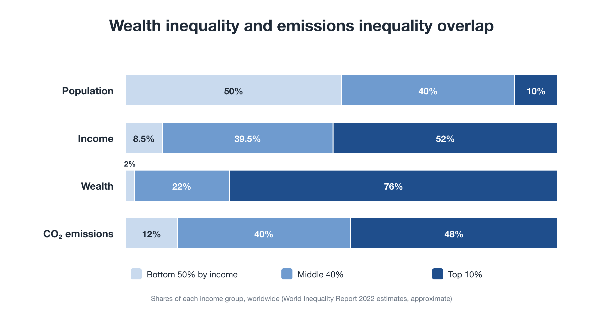
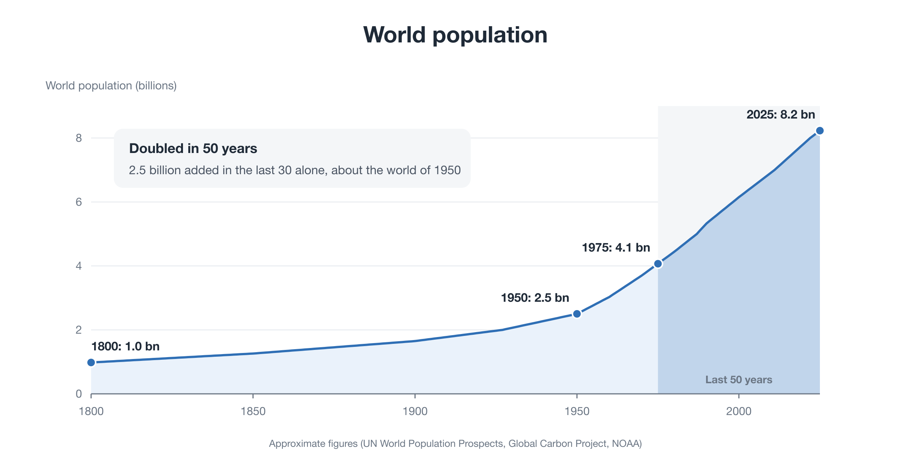
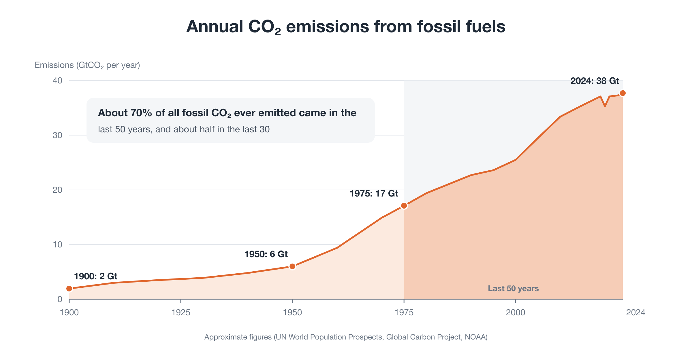
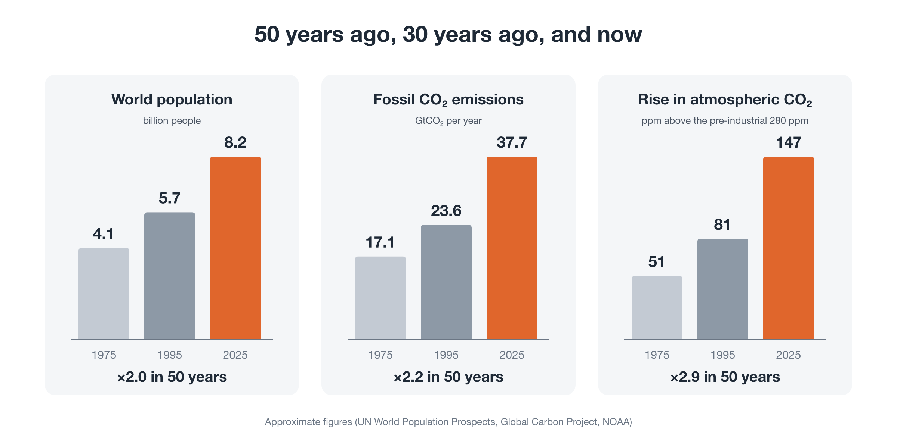

# Why Now? Civilization Has Reached the Point Where It Must Learn to Steer

!!! info "About this page"
    An essay on why this proposal is needed now (about 10 minutes). The proposal itself is explained in Start here [→](start.md).

We know more than ever about the state of the planet. Our technology has never been more powerful. In the last few years, AI has learned to write, translate, and analyze in seconds.

And yet many of us feel busier, more anxious, and more pressed than before. And the planet keeps crossing limits that cannot be uncrossed.

This essay argues that these are not separate problems. They are symptoms of a single cause, and that cause tells us something important about the moment we are living in.

---

## Three strange facts

Look closely at our time, and three things don't add up.

**First, technology saves time, yet we have less of it.** When one firm introduces a tool that does an hour's work in a minute, its rivals adopt the same tool. The gain becomes the new baseline. Customers expect faster answers and more polish; content multiplies, and everyone competes harder for the same limited human attention. The time saved does not become free time. It disappears into a faster race.

**Second, economies grow, yet daily life gets harder.** The surplus flows into asset prices: shares, property, and land. Meanwhile, the things we need to live, such as a home, education, and health care, keep getting more expensive. The statistics show growth, while many households feel squeezed.

**Third, we know more than ever, yet the curves don't bend.** Scientists have warned about the climate for decades. Millions have marched. Enormous sums have been spent. Emissions remain high, and carbon pricing has been rolled back again and again.

---

## Everyone on tiptoe

Imagine a theater audience. One person stands on tiptoe to see better. The person behind does the same, and then the next. Soon the whole audience is on tiptoe. Everyone is tired, and no one sees any better.

No one in that theater is foolish or wicked. Each person made a sensible choice. The problem is the situation: **when everyone acts rationally, the whole ends up worse off**. And no one can fix it by sitting down alone. They would simply see nothing.

This is the shape of our predicament. Humanity does not lack food, goods, technology, or knowledge. What we have is a set of rules under which individually sensible behavior adds up to collective failure: a runaway, not a shortage.

<figure markdown="span">
  
  <figcaption>Wealth inequality and emissions inequality overlap</figcaption>
</figure>

The imbalance has a clear shape. Divide the world's people into three groups by income. The top 10% hold about three-quarters of the world's wealth and produce about half of its emissions. The bottom 50% hold about 2% of the wealth and produce about 12% of the emissions, yet they suffer most from climate damage. The pattern of wealth and the pattern of emissions are nearly the same. Like a board game that ends once one player holds all the money, an economy stops working when wealth stops circulating.

---

## The economy is a set of rules, not a law of nature

It is tempting to treat this as fate: "that's just how markets work." But accounting standards, money, taxes, and the length of the working week are not laws of physics. They are **human agreements**, written at particular moments for particular purposes. They can be rewritten.

The rules we live under were written for a world of few people and seemingly endless room. In that world, costs pushed onto the atmosphere or the future could be ignored, and growth could be the main goal.

How far are we from that world? The scale and the speed of the change are hard to feel in daily life, so it helps to look.

<figure markdown="span">
  
  <figcaption>World population, 1800–2025</figcaption>
</figure>

For most of human history, the world's population grew slowly. It took until about 1800 to reach one billion. It reached 2.5 billion in 1950, about 4.1 billion in 1975, and about 8.2 billion today. **It has doubled in the last fifty years.** In the last thirty years alone, about 2.5 billion people were added: roughly the entire population of the world in 1950.

<figure markdown="span">
  
  <figcaption>Annual CO₂ emissions from fossil fuels, 1900–2024</figcaption>
</figure>

Emissions tell the same story, even more sharply. **About 70% of all the fossil CO₂ emitted since the Industrial Revolution was emitted in the last fifty years, and about half in the last thirty.** Most of it came after the world had been warned. *The Limits to Growth* and the first UN conference on the environment, in Stockholm, both came in 1972, just before the fifty-year period began. The Earth Summit in Rio came in 1992, just before the thirty-year period.

<figure markdown="span">
  
  <figcaption>50 years ago, 30 years ago, and now</figcaption>
</figure>

Compare 1975 with today. The population is about twice as large, annual fossil CO₂ emissions about 2.2 times larger, and the rise in atmospheric CO₂ above pre-industrial levels about 2.9 times larger. And the pace has not slowed. The population still grows by about as many people each year as it did in the late 1970s, while emissions and atmospheric CO₂ have risen faster per year in the last thirty years than in the twenty before. Many people alive today have seen, within their own lifetimes, most of humanity's entire fossil-fuel impact on the climate.

The world our economic rules were written for is gone. The old operating system is still running, but on hardware it was never designed for.

---

## The wrong tools for the job

We have tried to manage this with the tools we had: international treaties that need nearly everyone's consent, and national policies that can be reversed at the next election.

Those tools worked for some past dangers. During the Cold War, for example, the task was essentially to agree **not to do** one thing: not to press the button. A one-off agreement, held in place, was enough.

The planetary crisis is a different kind of problem. It is not about one button. It requires keeping energy, food, finance, and cities within physical limits, **year after year, everywhere at once**. That is continuous management of a whole system. Trying to do it with occasional negotiations and reversible policies is not just slow; it is the wrong category of tool.

---

## Two failed answers, and a third path

The twentieth century offered two big answers to the question of how to run an economy, and both failed in the same way.

- **Central planning** assumed that human reason could calculate and command the whole economy.
- **Market fundamentalism** assumed that no one should ever steer it at all.

Both shared the same overconfidence: that a single model could capture the world. Retreating into small, self-governing communities does not solve the problem either. It cannot coordinate a world of eight billion people.

There is a third path. It begins by admitting that the world is too complex to calculate, and draws a different conclusion from that:

- **Define the planet's limits strictly**, as guardrails that are not up for bargaining.
- **Leave life and business free** within them.
- **Correct course continually**, using real-time data and rules agreed in advance.
- **Set the goals democratically**, including the voice of future generations.

We can call this the move from a **naturally arising civilization**, one that grew without anyone steering, to a **consciously steered civilization**: one that keeps itself within limits by design, with humility about what it cannot predict.

---

## Why now is also the moment of opportunity

If the need is so great, why has it not happened before? Partly because it was not possible before. That has changed.

- **The tools exist.** Satellites and sensors can measure the planet almost in real time. Digital payment systems can return money directly to every citizen. AI can translate and summarize across dozens of languages, so people from different countries can deliberate together. Citizens' assemblies chosen by lot have been tested in many countries and have proven able to handle hard questions.
- **The old story is losing its hold.** Fewer people, especially the young, believe that more growth will make their lives better. That leaves room for a different story.
- **Crises will come.** Climate shocks are likely to force many countries to act. When they do, the speed and quality of the response will depend on whether **a working alternative is already designed and tested**, even at small scale. History moves fastest when a crisis meets a prepared plan.

---

## A graduation, not a defeat

None of this means becoming poorer or living with less joy. It means stopping a race that no one is winning, and changing what prosperity means: more time, more security, and a planet that stays livable.

Nor is it a campaign against anyone. Firms and wealth holders also have a stake in a soft landing, because a collapsing system would take their assets and markets with it.

We think of it as a **graduation**: thanking the system that brought us this far, and moving on to the next stage of human development.

---

## What would it take?

If this is the moment, three things are still missing: **an actor** that speaks for the future across borders, **a channel** that connects scattered civic will to real decisions, and **a concrete blueprint** for the system we should move to.

We have drafted one proposal for each gap, designed to work as a package, and set them out in *Steering Within Limits* [→](package.md). They are working drafts, published to be criticized and rewritten.

The question we want to put to politics is not "please do something." It is: **"Here is a working design. Will you connect to it?"**

---

**Read more**

- Package Proposal: *Steering Within Limits* [→](package.md)
- Series: *Rewriting the Planet's OS* (8 parts) [→](series/part-0.md)
- Citizen Dividend Simulator [→](tools/simulator.md)

---

This document is also published on: [note (Japanese)](https://note.com/ttmori/n/n093d06d64e79)
