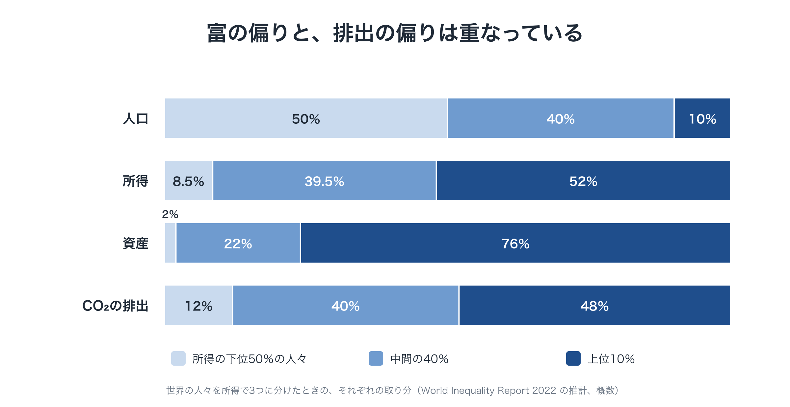
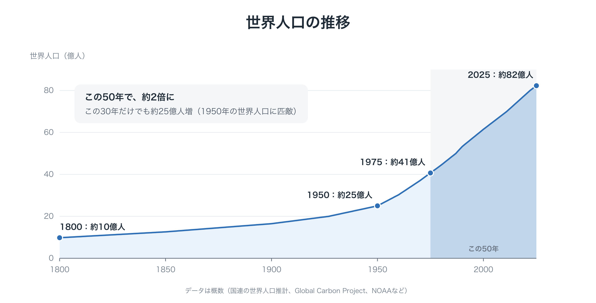
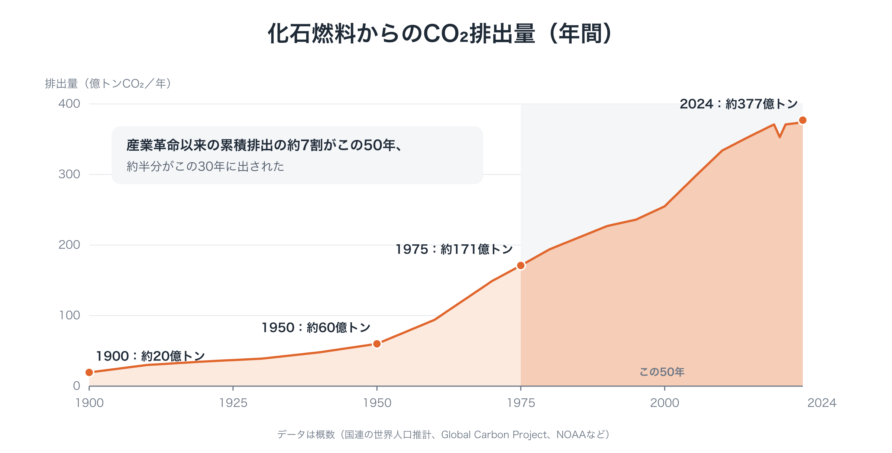
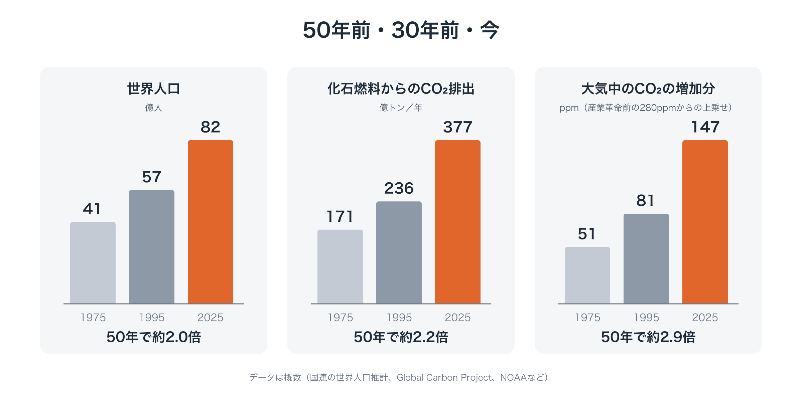

# なぜ今なのか：文明は「舵を取る」段階に入った

!!! info "このページについて"
    この提案が、なぜ今必要なのかを、問題意識から説明する記事です（約20分）。提案の中身は、「はじめての方へ」[→](start.md)で説明しています。

私たちは、地球の状態についてかつてないほど多くを知っています。技術も、かつてないほど強力です。ここ数年で、AIは数秒で文章を書き、翻訳し、分析できるようになりました。

それなのに、多くの人が、以前より忙しく、不安で、追われていると感じています。そして地球は、元に戻せない限界を越え続けています。

この記事では、これらが別々の問題ではないことを考えます。どれも一つの原因から生じた症状です。そしてその原因は、私たちが生きている今という時について、大切なことを教えてくれます。

---

## 3つの、つじつまの合わないこと

今の時代をよく見ると、つじつまの合わないことが3つあります。

**第一に、技術は時間を生み出すのに、私たちの時間は減っている。** ある企業が、1時間かかる仕事を1分で済ませる道具を導入すると、競合する企業も同じ道具を入れます。その成果は、新しい「当たり前」になります。客はより速い対応と、より丁寧な仕上がりを期待するようになります。情報や作品はあふれ、誰もが限られた人の注意を奪い合います。浮いたはずの時間は、自由な時間にはならず、より速い競争の中に消えていきます。

**第二に、経済は成長しているのに、暮らしは苦しくなっている。** 余剰は、株や不動産、土地といった資産の価格に流れ込みます。その一方で、住まい、教育、医療といった生きていくのに必要なものは、高くなり続けます。統計は成長を示していても、多くの家計は苦しさを感じています。

**第三に、かつてないほど知っているのに、曲線は曲がらない。** 科学者は何十年も前から気候について警告してきました。何百万人もの人が声を上げ、莫大な資金が投じられてきました。それでも排出は高いままで、炭素の価格づけは何度も撤回されてきました。

---

## 全員が、爪先立ち

劇場の観客を思い浮かべてください。一人が、よく見ようと爪先立ちをします。その後ろの人も同じようにし、さらにその後ろの人も続きます。やがて観客全員が爪先立ちになります。全員が疲れ、誰も見やすくはなっていません。

この劇場に、愚かな人や悪い人は一人もいません。一人ひとりは、もっともな選択をしただけです。問題は状況のほうにあります。**全員が合理的に行動すると、全体として悪くなる**のです。そして、誰か一人が座っても、解決しません。その人には何も見えなくなるだけです。

これが、私たちの置かれた状況の形です。人類には、食料も、モノも、技術も、知識も足りています。あるのは、一人ひとりのもっともな行動が積み重なって共倒れになる、という一組のルールです。不足ではなく、暴走なのです。

<figure markdown="span">
  
  <figcaption>富の偏りと、排出の偏りは重なっている</figcaption>
</figure>

その偏りには、はっきりした形があります。世界の人々を所得で3つに分けてみます。上位10％の人々は、世界の資産の約4分の3を持ち、排出の約半分を出しています。下位50％の人々は、資産の約2％しか持たず、排出も約12％ですが、気候の被害を最も強く受けています。富の偏りと排出の偏りは、ほぼ同じ形をしています。一人がすべてのお金を手にしたところで終わるボードゲームのように、経済も、富がめぐらなくなれば回らなくなります。

---

## 経済は、自然の法則ではなく、ルールの集まり

これを「市場とはそういうものだ」と、運命のように受け止めたくなるかもしれません。けれども、会計の基準、お金、税、週の労働時間は、物理の法則ではありません。特定の時代に、特定の目的のために書かれた、**人間どうしの合意**です。書き換えることができます。

私たちが従っているルールは、人が少なく、余地がいくらでもあるように見えた世界のために書かれたものです。その世界では、大気や未来に押しつけたコストは無視でき、成長を主な目標にすることができました。

私たちは、その世界からどれだけ離れてしまったのでしょうか。変化の大きさと速さは、日々の暮らしの中では実感しにくいものです。そこで、目で見てみます。

<figure markdown="span">
  
  <figcaption>世界人口の推移（1800〜2025年）</figcaption>
</figure>

人類の歴史の大半で、世界の人口はゆっくりとしか増えませんでした。10億人に達したのは、1800年ごろのことです。1950年には約25億人、1975年には約41億人、そして今は約82億人です。**この50年で、ほぼ2倍になりました。** この30年間だけでも約25億人が増えています。1950年の世界の人口と、ほぼ同じ規模です。

<figure markdown="span">
  
  <figcaption>化石燃料からのCO₂排出量の推移（1900〜2024年）</figcaption>
</figure>

排出量は、同じことを、さらにはっきりと示しています。**産業革命以来、化石燃料から出されたCO₂の約7割はこの50年間に、約半分はこの30年間に出されたものです。** その大半は、世界が警告を受けたあとのことです。『成長の限界』の出版と、環境をテーマにした初めての国連会議（ストックホルム）は、どちらも1972年、この50年が始まる直前でした。リオの地球サミット（1992年）は、この30年が始まる直前に開かれていました。

<figure markdown="span">
  
  <figcaption>50年前・30年前・今</figcaption>
</figure>

1975年と今を比べてみます。人口は約2倍、化石燃料からの年間のCO₂排出量は約2.2倍、大気中のCO₂の産業革命前からの増加分は約2.9倍になりました。しかも、変化の速さは衰えていません。人口は今も、1970年代後半とほぼ同じ人数が毎年増えています。排出量と大気中のCO₂は、1年あたりで見ると、前半の20年より後半の30年の方が速く増えています。今生きている多くの人は、自分の一生のうちに、人類が化石燃料で気候に与えてきた影響の大半を目の当たりにしてきたことになります。

経済のルールが前提としていた世界は、もうありません。古いOSは今も動いていますが、もともと想定していなかった機械の上で動いているのです。

---

## 仕事に合わない道具

私たちは、手元の道具でこれに対処しようとしてきました。ほぼ全員の同意を必要とする国際条約と、次の選挙で覆されうる国の政策です。

こうした道具は、過去のある種の危険には役に立ちました。たとえば冷戦期の課題は、突き詰めれば、一つのことを**しない**と合意することでした。ボタンを押さないことです。一度きりの合意を守り続ければ、それで足りました。

地球の危機は、種類の違う問題です。一つのボタンの話ではありません。エネルギー、食料、金融、都市を、**毎年、あらゆる場所で同時に**、物理的な限界の内側に保ち続けることが求められています。それは、システム全体の継続的な管理です。それをときどきの交渉と覆されうる政策で行おうとするのは、遅いだけでなく、道具の種類そのものが間違っています。

---

## 2つの失敗した答えと、3つ目の道

20世紀は、経済をどう動かすかという問いに、2つの大きな答えを出しました。そして、どちらも同じ形で失敗しました。

- **中央計画**は、人間の理性で経済全体を計算し、指令できると考えた。
- **市場原理主義**は、そもそも誰も経済の舵を取ってはならないと考えた。

両者は、一つのモデルで世界をとらえられるという、同じ過信を共有していました。小さな自治の共同体へ退くことも、答えにはなりません。80億人の世界を調整することができないからです。

3つ目の道があります。それは、世界は計算しきれないほど複雑だと認めるところから始まり、そこから別の結論を引き出します。

- **地球の限界を、厳格に定める**。交渉の余地のないガードレールとして。
- **その内側の暮らしと事業は、自由にする。**
- **実時間のデータと、あらかじめ合意したルールで、絶えず軌道を修正する。**
- **目標は、将来世代の声も含めて、民主的に決める。**

これを、**自然発生の文明**、つまり誰も舵を取らずに育ってきた文明から、**意識して舵を取る文明**への移行と呼ぶことができます。予測できないことへの謙虚さを持ちながら、設計によって自らを限界の内側に保つ文明です。

---

## 今は、好機でもある

それほど必要なら、なぜこれまで実現しなかったのでしょうか。一つには、これまでは可能ではなかったからです。それが変わりました。

- **道具がそろった。** 衛星やセンサーで、地球の状態をほぼ実時間で測れます。デジタルの決済の仕組みで、すべての市民に直接お金を還せます。AIは何十もの言語を翻訳し、要約できるので、国の違う人々が一緒に熟議できます。くじ引きで選ぶ市民会議は多くの国で試され、難しい問いを扱えることが示されてきました。
- **古い物語が、力を失いつつある。** もっと成長すれば暮らしが良くなると信じる人は、特に若い世代で減っています。そこに、別の物語の入る余地が生まれています。
- **危機は来る。** 気候の衝撃が、多くの国に行動を迫ることになるでしょう。そのとき、対応の速さと質は、**動く代わりの仕組みが、小さな規模でも、すでに設計され試されているかどうか**で決まります。歴史が最も速く動くのは、危機が、準備された計画と出会ったときです。

---

## 敗北ではなく、卒業

これは、貧しくなることでも、喜びを減らして暮らすことでもありません。誰も勝っていない競争をやめ、豊かさの意味を変えることです。より多くの時間、より大きな安心、そして住み続けられる地球です。

誰かに対する運動でもありません。企業や資産を持つ人々にとっても、穏やかな着地には利害があります。システムが崩れれば、その資産や市場も一緒に失われるからです。

私たちは、これを**卒業**だと考えています。ここまで私たちを運んできた仕組みに感謝し、人類の次の段階へ進むことです。

---

## 何が必要なのか

今がその時だとすれば、まだ3つのものが欠けています。国境を越えて未来のために語る**担い手**、散らばった市民の意思を現実の意思決定につなぐ**回路**、そして移行先の具体的な**設計図**です。

私たちは、それぞれの空白を埋める提案を一つずつ、パッケージとして働くように描き、パッケージ提案書「限界の内側で、舵を取る」[→](package.md)にまとめました。どれも草案であり、批判され、書き直されるために公開しています。

私たちが政治に投げかけたい問いは、「何とかしてください」ではありません。**「動く設計図がここにあります。この仕組みにつなぎますか」**という問いです。

---

**あわせて読みたい**

- パッケージ提案書「限界の内側で、舵を取る」[→](package.md)
- 連載「地球のOSを書き換える」（全8回）[→](series/part-0.md)
- 還元シミュレーター[→](tools/simulator.md)

---

この文書は、次の場所でも公開しています： [note（日本語）](https://note.com/ttmori/n/n093d06d64e79)
